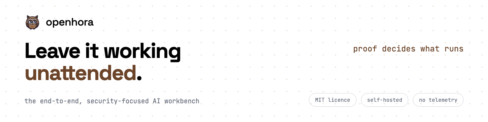

<h1 align="center">
  <picture>
    <source media="(prefers-color-scheme: dark)" srcset=".github/brand/readme-banner-dark.png">
    
  </picture>
</h1>

**The end-to-end, security-focused AI workbench you can leave working unattended, because proof decides what runs.**

MIT licence · self-hosted · no telemetry

Harness-agnostic skills, agents and workflows that let an AI build a digital solution end to end: business, product, brand, design, engineering, delivery, marketing, and AI inside the product. A skill reads and writes artifacts in the target project's `docs/` folder, so later phases, other skills and other people find what earlier ones produced.

The skills, their areas and how each one stands under the reliability model are listed in [docs/inventory.md](docs/inventory.md); the areas and how they chain are in [docs/area-map.md](docs/area-map.md). The rules every file follows are in [AGENTS.md](AGENTS.md).

## Principles

The fourteen principles of [AGENTS.md](AGENTS.md), in one line each (when two pull apart, AGENTS.md gives the order that decides):

1. **Harness-agnostic core.** Skills, agents, shared files, contracts, templates and providers name no AI tool, its folders or its tool names.
2. **Open-closed adapters.** Everything specific to one AI tool lives in `adapters/<harness>/`; adding a harness never edits the core.
3. **Write for the weakest model you will run.** One default path, a template for every output, criteria for every judgment, scripts for anything deterministic, and every fact traced to a source.
4. **Artifacts over invocation.** A capability never invokes another skill; it reads and writes artifacts. Only flows invoke skills, and `core-orchestrator` routes a request without doing the routed skill's work.
5. **Never assume; ask.** A decision that belongs to the user and is not recorded is asked, with a recommended answer.
6. **English only.** Every file in this repository is written in English.
7. **Parallel by default.** Independent work (eval runs, checks, research, agents with separate scopes) runs at the same time; work runs in sequence only when one step needs another's result, a shared resource cannot be used concurrently, or a rate limit forces it.
8. **Shared core, projects outside.** The repository holds only the workbench: nothing that identifies a project that uses it, and none of its work data. Examples and fixtures use fictional names and `.example` hosts.
9. **Proof decides.** A skill's standing, the model it runs on and what it may do unattended are decided by recorded evidence, never ticked by hand; evidence holds for the pair of model and adapter it was measured on.
10. **A claim says what it rests on.** A published result names its model, adapter, measurement version, date and number of runs, is published whether it passed or not, and states a band, never a bare number the evidence cannot carry.
11. **Hard limits live in code.** What must never happen (a side effect without the approval of its exact content, a credential inside a run) is prevented by code or by structure, never by a prompt or a test.
12. **A change pays for what it can reach.** A change invalidates only the layer it touches and only the cases, skills, models and adapters it can affect.
13. **A saving must exceed its loss of safety.** A cheaper test or a lighter rule is accepted only when what it saves is clearly more than the safety it gives up, and both are stated.
14. **Adopt before building.** What exists, is solid and is open is adopted behind an adapter or a provider; the workbench builds what links the pieces: the proof, and what the proof decides.

## Layout

```
skills/<name>/      one folder per skill, flat; the prefix is the area (biz, product, brand, design, eng, ops, mkt, ai, core, asst, flow)
agents/             four harness-neutral agents for delegated work: implementer, researcher, reviewer, social-manager
shared/references/  security.md, the one cross-cutting reference, and platforms/: one reference and one data file per social platform
shared/scripts/     the one source of every script more than one skill carries; scripts/sync_copies.py writes the copies
contracts/          what skills read and write in a target project: project-layout.md, state.md, environment.md, runtime.md, secrets.md, vote-data.md
providers/          native implementations of requirement classes, resolved by providers/resolve.py: reader:email, publisher:<platform>,
                    messenger:<platform>, scheduler:job, store:runtime, integration:vcs, integration:issue-tracker, integration:documents;
                    the interface is providers/CONTRACT.md
templates/          capability.SKILL.md, flow.SKILL.md and agent.md, used by scripts/new-skill.sh
packs/              installation subsets: default (every area but the optional ones), all, assistant, business, brand, design, planning, code, marketing, content
adapters/           one folder per AI tool: claude-code and agents-dir install the skills; api runs the agent runtime with one model call and no tools;
                    openclaw is documentation only (the runtime's MCP mode from an OpenClaw gateway), not an adapter
evals/              the eval harness: eval_run.py (the runner), executor.py and container/ (every run executes in a container),
                    eval_status.py (status, hashes, the inventory table), eval-gate.json (models, grader, gate, measurement version), tests/
scripts/            repository tooling: validate.py, security_scan.py, sync_copies.py, owner_table.py, architecture_tables.py, new-skill.sh,
                    install-hooks.sh, select_skills.py, stage_skills.py, test_dirs.py, doctor.py, evidence.py, redact.py, build_demo.py and
                    demo_fixtures.py (the interface's demo mode), and the agent runtime (runtime.py, runtime_vote.py, vote_job.py)
runtime/            the task runtime: a request becomes tasks, each task runs one skill in the eval container, a person decides
                    through pending decisions; lab.py is the one file that imports the eval runner, ops.py the operations, cli.py the shell
interface/          the local interface the runtime's service serves: an isometric 3D scene (City, Building, floor) with plain panels as the
                    equivalent of every scene action, vendored libraries only, no build step, and a demo mode with fictional data and no service
                    (interface/README.md)
site/               the public website: static pages, its own styles and fonts, its tests and tools (site/README.md); its Interface page embeds
                    the demo, which is built into site/demo/ at deploy time by scripts/build_demo.py and is not committed
netlify.toml        how Netlify publishes site/ (the build command and the response headers, the content security policy among them)
flows/              one data file per flow: the tasks and their written dependencies, read by the task runtime
.github/            CI workflows, the code owners file, the dependency-update configuration and brand/ (the banner and social images, the mark)
.githooks/          the versioned pre-commit hook
docs/               area map, decisions, inventory, backlog, and architecture notes (plans, reviews, findings, the platform pages)
```

## Install

Each adapter documents its own install in its `README.md`. Without `--pack`, the `default` pack installs every area except the optional ones (`packs/README.md`).

- **Claude Code**: `bash adapters/claude-code/install.sh [--pack <name>]` builds a plugin and links it where Claude Code loads it.
- **Codex, Cursor, Cline, OpenCode, OpenClaw and any tool that reads `~/.agents/skills/`**: `bash adapters/agents-dir/install.sh [--pack <name>] [--project <dir>]`.

Both installers put `shared/references/` beside the skills and take `--uninstall`. The `api` adapter installs nothing: it is the tool-free way for the agent runtime (`contracts/runtime.md`) to call a model.

Which requirement classes the environment satisfies: `python3 scripts/doctor.py`.

## Checks

```bash
python3 scripts/validate.py                 # conventions: names, frontmatter, the artifact contract, eval cases, harness names in the core
python3 scripts/security_scan.py --strict   # secrets, hidden text, unsafe script patterns, undeclared side effects
bash scripts/install-hooks.sh               # once per clone: enables .githooks/ (--check, --uninstall)
```

The pre-commit hook runs `validate.py`, then `security_scan.py --strict`, then the tests of every folder the commit touches: `providers/<class>/`, `scripts/`, `evals/`, `shared/`, an adapter, or a skill's `scripts/` (its `scripts/tests/`). The tests need [uv](https://docs.astral.sh/uv/). CI runs the same checks in its `validate` and `tests` jobs, beside a `python39` job and a `container` job for the eval container.

A new skill starts from `bash scripts/new-skill.sh --name <prefix-name> --kind capability|flow --area <area>`; `AGENTS.md`, "Adding a skill", has the rest.

## How a skill is judged

Every skill is tested in the lab: its eval cases (`skills/<name>/evals/evals.json`) run in a container, with the skill and without it, and a grader judges each assertion. Under the reliability model ([docs/architecture/reliability-model-2026-10-02.md](docs/architecture/reliability-model-2026-10-02.md)), a skill is ranked by the evidence of the tests it has passed rather than by a single pass: a full test (`python3 evals/eval_run.py --skill <name>`) runs every case and evaluates the gate on each model of `lab_models` in `evals/eval-gate.json` (the mean with the skill at the threshold or above, and not below the baseline without the skill by more than the tolerance); a partial test (`--cases <ids>`) carries a small change; each run leaves an evidence line, and the skill's band (`reliable`, `watch` or `needs a test`) is computed from that evidence, never ticked. `python3 evals/eval_status.py status` prints each skill's band with its cause and the command that clears it. Check a skill's cases without calling a model with `python3 evals/eval_run.py --skill <name> --check-cases`.

## Status

What is built and how each skill stands: [docs/inventory.md](docs/inventory.md). What remains: [docs/backlog.md](docs/backlog.md) and the plan in `docs/architecture/final-plan-2026-10-02.md` (removed on 2026-10-14; `git show d3e60770:docs/architecture/final-plan-2026-10-02.md`).
