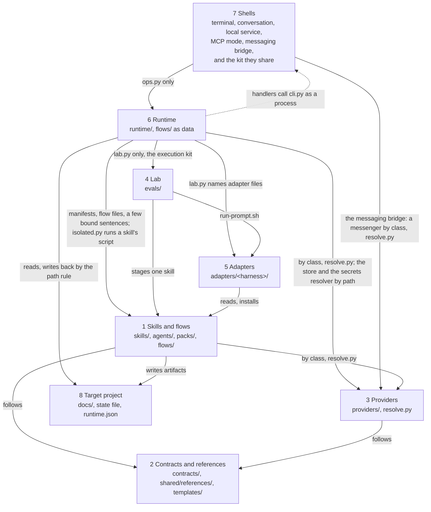
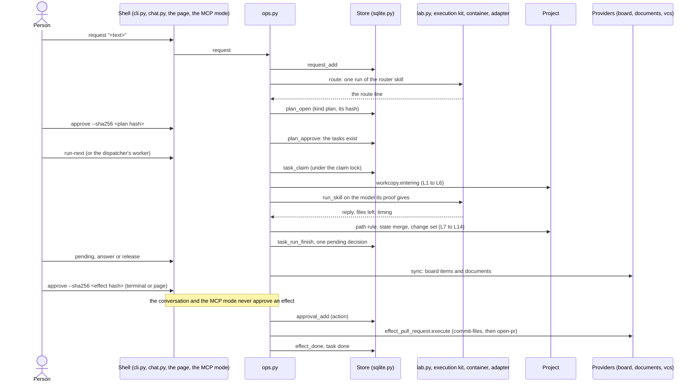

# The platform map

A living map of the whole repository: what each layer is, what it owns, what it may read, and where the rules that bind it are kept. It is written for three readers: the maintainer following the system's growth and looking for what to improve, a newcomer learning the platform, and a reviewer checking a change against the rules. It points to the contracts, the READMEs and the findings instead of repeating them; when a page and the file it points to disagree, the file wins and the page is corrected.

This folder is undated on purpose. Each page ends with its own "Changes" section.

## What the system is

openhora is a workbench of skills that let a model build a digital solution end to end, and every skill is proven in a lab: run in a container, graded, and ranked by the evidence it has passed on each model (`evals/`). On top of the skills sits a task runtime: a person writes a request, a planning agent routes it, code turns the route into a plan of tasks, and area agents work through that backlog, several tasks at a time (each floor has its slots and the project a limit; two tasks that write the same file never run together), each task a run of one proven skill in the same container it was proven in. The model only reads and writes files in a copy; every external effect (a commit, a pull request, a post) is executed by code, under an approval recorded by its hash. The proof decides what runs unattended: a model you name runs, and its run is released without review only where the skill is proven on that pair of model and adapter (or where you gave your consent for that agent); with `auto` the runtime picks the cheapest proven model. A person reaches the runtime from the terminal, a conversation, a local page, an MCP client or a messaging app they already use (Telegram, Discord, WhatsApp). The same skills install into several AI tools through adapters, so a person can also use them by hand, without the runtime.

## Start here

1. **Install a pack of skills into your tool.** A pack is the unit of installation ([packs/README.md](../../../packs/README.md)); `default` is every area except the optional ones. Pick the adapter of your tool from `adapters/` (each folder's `README.md` says what it installs and where):

   ```sh
   bash adapters/agents-dir/install.sh                     # pack "default", into the user-level skills folder
   bash adapters/agents-dir/install.sh --project .         # the same, into ./.agents/skills of one project
   bash adapters/claude-code/install.sh --pack default     # a plugin built from the core for one pack
   python3 scripts/select_skills.py --pack business        # which skills a pack selects, without installing
   ```

   With a pack installed you can run any skill by hand in your tool. The rest of this section is the runtime, which runs skills without you at the keyboard.

2. **Prepare a project for the runtime.** A project starts with the workbench state file, which the project-init skill writes (`skills/core-project-init/scripts/init_project.py --root <project> --apply --autonomy milestones`, or run the skill in your tool), and a configuration, `<project>/docs/workbench/runtime.json`, with four absolute paths ([runtime/README.md](../../../runtime/README.md), "Trying it"):

   ```json
   {"workbench": "<this checkout>", "data_dir": "<a folder outside every repository>", "store_db": "<data folder>/tasks.sqlite", "sources_dir": "<a dedicated folder, apart from the data folder>"}
   ```

   Every operation but `accept-config`, `config` and `service-check` refuses a configuration whose hash is not the one you accepted last (`config` reports the hash and never refuses). The refusal names the hash and the command that gets past it; read the file, then accept it:

   ```sh
   python3 runtime/cli.py accept-config --project <dir> --sha256 <hash>
   ```

3. **Run one request end to end**, from the workbench checkout the configuration names:

   ```sh
   python3 runtime/cli.py request  --project <dir> --flow market-positioning --text "<what you want>"
   uv run --with keyring==25.7.0 python3 runtime/cli.py run-next --project <dir>   # a model call: docker and the credential
   python3 runtime/cli.py pending  --project <dir>                                 # what waits for you
   python3 runtime/cli.py answer   --project <dir> --id <n> --text "<your answer>" # a question, or a review sent back
   python3 runtime/cli.py release  --project <dir> --id <n>                        # a delivery: done, still a draft
   python3 runtime/cli.py sync     --project <dir>                                 # only with a task board or documents platform
   python3 runtime/cli.py status   --project <dir>
   ```

   Without `--flow`, the request waits for its route: `route --project <dir> --request <id>` runs the router skill (a model call), and `approve --id <n> --sha256 <the plan's hash>` creates the tasks. `proof --project <dir>` shows, without a model call, which model each skill would run on and why. `run-next` again runs the next ready task; a run that asks waits for your `answer`, and the task runs again with it.

4. **Where the result lands.** The documents a skill writes come back into the project, under `docs/<area>/`, and the state file `docs/workbench/state.md` gets the skill's draft rows, decisions and open questions. Each run's copy, prompt and output are kept in `<data_dir>/task-runs/<run id>/`; the records (requests, tasks, runs, pending decisions, approvals) are in the store at `store_db`. A use of each skill is recorded in the project's `.workbench-local/evidence/`, and your verdict on a run is one command: `verdict --project <dir> --run <id> --word worked|corrected|failed`.

5. **Where to read next.** The runtime's page, [runtime.md](runtime.md); then [contracts/runtime.md](../../../contracts/runtime.md) for the contract and [AGENTS.md](../../../AGENTS.md) for the rules every file follows. The terminal conversation with the planning agent is `python3 runtime/chat.py --project <dir>` (`/help` lists its commands). Two more shells reach the same operations ([shells.md](shells.md)):

   ```sh
   uv run --with keyring==25.7.0 python3 runtime/service.py --project <dir> [--project <dir>]... [--port 8765] [--no-dispatch]
   python3 runtime/mcp.py --project <dir> [--project <dir>]...
   ```

   The local service prints one JSON line with its address and the path of its token file, and serves the pages of `interface/`: open the address in a browser and paste the token once per session. Unless it is started with `--no-dispatch`, it also dispatches the ready tasks of each project (`--dispatch-every`, 30 seconds by default), as far as the modes and the daily caps of the area agents allow; with `--no-dispatch`, `status` says `dispatch off` for every ready task of that service. The MCP mode is a process an MCP client starts, JSON-RPC on standard input and output, with no token and no port, and it has no tool that approves anything. For a project whose configuration is not accepted yet, both list the project with `accepted: false` and answer 412 to each route or tool until `accept-config` is typed in the terminal.

6. **A person's phone.** To run projects from Telegram, Discord or WhatsApp, read [messaging.md](messaging.md): the bridge, the channel policy, the messenger providers, the public address the official WhatsApp paths need, the security model and a runbook. It follows one feature across the layers (the shells, the runtime, the providers and the project) and has the same eight sections as a layer page, but it is not a layer: each layer page carries its own part of it. Start the bridge with the page, `uv run --with keyring==25.7.0 python3 runtime/service.py --project <dir> --messaging <platform>`, or alone, `uv run --with keyring==25.7.0 python3 runtime/messaging.py --project <dir> --platform <platform>`; the project's `docs/workbench/runtime.json` names who may write (`messaging`) and what the phone may do (`channels`).

7. **A project's sources.** To give a project a file or a Notion page to read, read [sources.md](sources.md): the sources folder and its numbered guardrails (L21 to L27), the immutable versions, the catalog the planner reads, the document converter that runs in a container with no network, and the copies a task receives. It is a feature page like messaging, not a layer. `sources_dir` is a key every project's `runtime.json` must hold; register and import with `python3 runtime/cli.py source-add` and `source-import`, and see what the planner will read with `sources`.

8. **A task's outputs.** To make a CSV file, a workbook, a Word document or a PDF from a task's result, to write a project document back to the platform that holds it (after you approve the hash of the exact content), or to see what text in a source a person cannot see, read [outputs.md](outputs.md): the export step kinds and the renderer's container, the formula guard (L32), the step engine's effect gate (L30), the write-back and the check that the target was not edited since it was read (L31), and the hidden-text flag with what it does not find.

9. **A project's own script.** To run the project's code as a step, read [scripts.md](scripts.md): the step kind `project-script`, approved by the hash of its exact content, the sandbox it runs in with no credential and a read-only root, the internal network and the per-step egress proxy that enforce its declared destinations, the dependencies built from a hashed lock with no mount, and limits L34 to L38. It is a feature page like sources, not a layer. `python3 runtime/step_project_script.py prepare --project <dir> --script <path> --source <id>` prints the arguments of a plan; `python3 providers/script/container.py build --confirmed` builds the image once.

10. **A machine that runs for weeks.** To run the runtime on a server with nobody logged in, read [unattended.md](unattended.md): the SSH tunnel to reach the page (never `--lan` across networks), the credentials directory for secrets with no desktop session, the OAuth consent on a machine with a browser, the retention of run folders and source versions, the sweep of orphan containers, the lease of a synced sources folder, and `python3 scripts/doctor.py --unattended`.

11. **What is not yet a replaceable piece.** If you want to know which layers cannot yet be swapped on their own, read the review of 2026-10-06 (removed on 2026-10-14; `git show d3e60770:docs/architecture/platform/review-2026-10-06.md`): the findings, ranked, each with its state in a table at the top.

## Keeping the pages current

A table that changes with the code is generated, never edited by hand: it sits between `<!-- generated: <table> -->` and `<!-- /generated -->`, and `python3 scripts/architecture_tables.py --help` names each table and its one source. After a change to one of those sources, run `python3 scripts/architecture_tables.py --write`; `--check` names the stale blocks, and `scripts/validate.py` reports each one as a warning (`[architecture-tables]`). The prose around a block stays hand-written.

## The pages

Every page of this folder, once. The eight layer pages share a template; the four feature pages cross layers.

| Page | What it covers |
|---|---|
| [skills-and-flows.md](skills-and-flows.md) | Layer 1: the skills, agents, packs, the flow files under `flows/` and the runtime manifest of a skill |
| [contracts-and-references.md](contracts-and-references.md) | Layer 2: the contracts under `contracts/`, the references under `shared/references/` and the templates |
| [providers.md](providers.md) | Layer 3: the providers by requirement class, `providers/resolve.py`, the store and the secrets resolver |
| [lab.md](lab.md) | Layer 4: the eval runner, the container, the measurement, evidence, the lab models and the execution kit the runtime reads |
| [adapters.md](adapters.md) | Layer 5: what is specific to one AI tool, the installers and the eval entry `run-prompt.sh` |
| [runtime.md](runtime.md) | Layer 6: the task runtime, its artifacts, abstractions, business rules, the table of operations and its known limits |
| [shells.md](shells.md) | Layer 7: the terminal, the conversation, the local service, the MCP mode and the shell kit |
| [project.md](project.md) | Layer 8: the target project, its documents, state file, configuration and work data |
| [messaging.md](messaging.md) | A feature across layers: the messaging bridge, the channel policy, the five messenger providers and a runbook |
| [sources.md](sources.md) | A feature across layers: the sources folder (limits L21 to L27), versions, the catalog, the converter, Notion pages and Drive files |
| [outputs.md](outputs.md) | A feature across layers: the export step kinds and the renderer's container, the formula guard (L32), the step engine's effect gate (L30), the write-back to a platform document (L31) and the hidden-text flag |
| [unattended.md](unattended.md) | A feature across layers: remote access, the credentials directory, retention, orphan containers, the lease and the doctor's `--unattended` |

## The layers



An arrow is "may read or call". The service, the MCP mode and the messaging bridge also import the shell kit, inside layer 7. The one shell with an arrow to the providers is the messaging bridge, whose modules (`runtime/messaging_*.py`) start a messenger provider by class through `providers/resolve.py` and read `scripts/redact.py`; it is a row of the layer map like every other arrow. Nothing in layers 1 to 3 points to adapters, the lab or the runtime, and the one arrow into a shell is the dotted one: a handler (`runtime/handlers/*.py`) calls `runtime/cli.py` as a process (`execute-under-policy` for an effect, `contained-run` for the social agent's run). `scripts/tests/test_layer_map.py` scans code only (an import, or a string or path that names a `.py` or `.sh` file): every arrow that is code is a row of its `ALLOWED`, and an arrow the code violates is a row of its `TOLERATED`, named after the finding that removes it (`ops.py` reading the side-effect line of `scripts/validate.py`, finding 11; `mkt-engage`'s fallback to another skill's copy of a script, finding 17; the social handlers' calls of skill scripts, finding 9). The test fails on a tolerated row the scan no longer finds, so the list only shrinks. The arrows that are data (the layers reading contracts and references, the manifests and flow files, the project's files) are by convention: the test does not see them. `runtime/` also reaches scripts of `scripts/`, which is tooling and not a layer (`select_skills.py`, `evidence.py`, `redact.py`); `runtime/lab.py` alone also loads `image_lock.py`, which holds the one reading of the published eval image's lock file.

| # | Layer | What it is | Page |
|---|---|---|---|
| 1 | Skills and flows | The capabilities and flow skills under `skills/`, the delegation agents under `agents/`, the packs under `packs/`, and the flow files `flows/<name>.json` that code reads; a skill the runtime runs also has a runtime manifest beside its eval cases | [skills-and-flows.md](skills-and-flows.md) |
| 2 | Contracts and references | The artifact, state, environment, runtime and secrets contracts under `contracts/` (the runtime's holds the contained run, the local service and the MCP mode), the cross-cutting and platform references under `shared/references/`, the templates | [contracts-and-references.md](contracts-and-references.md) |
| 3 | Providers | One script per implementation of a requirement class, reached through `providers/resolve.py` (`resolve.call` for a verb); the store is the runtime's own persistence and the secrets resolver one door to credentials | [providers.md](providers.md) |
| 4 | The lab | The eval runner, the container, the measurement, the status script and the evidence (`evals/`, `skills/<name>/evals/`), and the execution kit the runtime reads (`evals/execution.py`, with `evals/run_attempts.py`) | [lab.md](lab.md) |
| 5 | Adapters | Everything specific to one AI tool: installers, the eval entry `run-prompt.sh`, overrides (`adapters/<harness>/`), and the runner of the first runtime | [adapters.md](adapters.md) |
| 6 | The runtime | The task runtime under `runtime/`: requests, tasks, runs and contained runs in the container, pending decisions, approvals, mirrors, the dispatcher, the handlers, the table of operations, the roles file and the isolated runner | [runtime.md](runtime.md) |
| 7 | The shells | Thin fronts over the operations layer: the terminal (`runtime/cli.py`), the conversation (`runtime/chat.py`), the local service (`runtime/service.py`, with the pages of `interface/`), the MCP mode (`runtime/mcp.py`) and the messaging bridge (`runtime/messaging.py`, which the service can start as a child with `--messaging`); the service, the MCP mode and the bridge share the shell kit (`runtime/shell_kit.py`) | [shells.md](shells.md), and [messaging.md](messaging.md) for the bridge across the layers |
| 8 | The target project | The project a person works on: its documents, its state file, its configuration, its work data; never a file of this repository | [project.md](project.md) |

**The direction rules.**

- The core (`skills/`, `agents/`, `shared/`, `contracts/`, `templates/`, `providers/`, `packs/`) never reads an adapter and names no AI tool; adapters read the core ([AGENTS.md](../../../AGENTS.md), principles 1 and 2; enforced by `scripts/validate.py`).
- The runtime reads adapters only through the lab: `runtime/lab.py` is the one module of `runtime/` that imports anything under `evals/`, and the lab starts the adapter (`lab.py` names the adapters' `adapter.json` and `run-prompt.sh`). It loads the lab's execution kit (`evals/execution.py`, with `evals/run_attempts.py`), which is outside the measurement fingerprint (decision D1, review finding 2). This is why `runtime/` sits outside the core directories, as `evals/` does.
- A skill's script is run by the runtime only through `runtime/isolated.py`, as a subprocess with a scrubbed environment; no module of `runtime/` loads a file of `skills/` in its own process. The social handlers' host subprocesses are the tolerated rows of finding 9.
- A capability never invokes another skill. The one exception is the router, `core-orchestrator`, which names the skill and hands the request over and does none of its work ([AGENTS.md](../../../AGENTS.md), principle 4).
- What measures lives in the lab's measurement files (the grading template, `evals/measure.py`, `evals/measurement.json`, the executor and the container, `scripts/stage_skills.py`, the eval adapters' `run-prompt.sh` and `eval.json`), bound by the fingerprint in `evals/eval-gate.json`. The runtime imports the lab's functions and never edits a measurement file.

## A request, end to end

The path of one request from a text to its documents and a pull request, each step with the layer and the module or command that does it. The runtime's page states each rule in full.

1. **Request** (shell, then runtime). `cli.py request` (or a line typed in `chat.py`, a request sent from the local page or a tool of the MCP mode) calls `ops.request`, which records the request in the store (`request_add`). With `--flow`, the plan is the flow file's tasks at once; without it, the request waits for its route.
2. **Route** (runtime, through the lab). `ops.route` runs the router skill once, as it is, asked only for the route; `runtime/router.py` reads the one route line `Route: <name> (...)` or the question lines, and nothing else. A reply that asks becomes a `question`; anything else reaches the person whole.
3. **Plan approved** (runtime). `runtime/plan.py` builds the tasks from the flow file or a one-skill route, checks each skill against the packs of the enabled area agents (a skill outside them is refused with the pack to add, `plan.scope_refusal`), and opens a `plan` pending decision with the plan's hash. No task exists until `approve --sha256 <hash>`; the router creates none (limit L19).
4. **Task claimed** (runtime, store). `run-next`, the dispatcher's worker or the local service's own dispatch loop (every 30 seconds unless it is started with `--no-dispatch`) decides which ready tasks may start (`runtime/parallel.py`: a free slot of the task's agent and of the project, no code task of the request running, no file in use) and starts each as a process of its own (`run-task`), which claims its task under the claim lock (`task_claim`).
5. **The copy that enters the run** (runtime). `runtime/workcopy.py` decides what enters a fresh copy (limits L1 to L6): the versioned files, the documents and the state file, the declared machine files and the task's file drop; only the declared artifacts for a task with the web; never the store, the configuration, a tool's settings or a credential.
6. **The run** (lab, adapter, container). `runtime/proof.py` chooses the model from the skill's proof; `lab.run_skill` stages the one skill and runs it in the eval container through the lab's execution kit (`evals/execution.py`) and the adapter's `run-prompt.sh`, with the attempts made by the kit's `evals/run_attempts.py`. The credential stays in a key proxy outside the run.
7. **What comes back** (runtime). Every file the run left gets one class from the path rule (`runtime/path_rule.py`); documents and machine files come back unless they changed at the origin, the state file comes back only through `runtime/state_merge.py`, and versioned files of a code task come back as one change set (`runtime/changeset.py`), never as loose files.
8. **The ending** (runtime). `runtime/endings.py` classifies the run from a closed list (`done`, `question`, `draft_with_questions`, `gate`, `blocked`, `unclassified`) and never guesses.
9. **The pending decision** (runtime, store). The task waits on exactly one: a `question` (it wrote nothing and asks), a `review` (a delivery, with the whole reply), or an `effect` (a skill stopped at its confirmation gate with a payload code recovered). `blocked` opens nothing.
10. **The person's answer or release** (shell). `answer` sends the task back with the person's words, written into the state file by code; `release` lets the delivery stand, still a draft. An area agent's autonomy mode may release a plain `done` delivery by itself, and never what the autonomy row of the cross-cutting table below lists (`runtime/autonomy.py`, `runtime/dispatcher.py`).
11. **The mirror** (runtime, providers). `sync` mirrors the tasks with the project's task board (`runtime/board.py`) and the documents with its documents platform (`runtime/documents.py`); an edit the person made there is taken back only when the skill's checker passes, and the next run is told that the content is the person's.
12. **The effect** (runtime, providers). For the pull-request skill, `approve --sha256 <the effect's hash>` records the approval (`approvals` table) and checks that nothing moved; it is typed in the terminal or sent from the local page, never from the conversation or the MCP mode (the channel rule, `EFFECT_CHANNELS`). Code then makes the one commit and opens the pull request through the code provider (class `integration:vcs`): `runtime/effect_pull_request.py` executes, and `runtime/effects.py` is the registry of effect kinds (`KINDS`, `module_for`) that calls the provider (`provider_call`).
13. **Progress recorded** (runtime). Every run is a row of `task_runs`, every decision a resolved pending decision, every effect an executed approval; `progress` and `status` read them, and no model writes them (`runtime/progress.py`).



## Cross-cutting rules

| Rule | Where it is enforced |
|---|---|
| Two promises: cheap with proof (a run is released without review only where the skill is proven on its model, or by the person's consent) and safe by construction (the model reads and writes a copy; code executes every effect) | `runtime/proof.py` and `runtime/effects.py`; the limits of [contracts/runtime.md](../../../contracts/runtime.md) |
| An artifact has exactly one owner, the skill whose `outputs` lists it; others list it in `updates` | `scripts/validate.py` (the artifact contract); [contracts/project-layout.md](../../../contracts/project-layout.md) |
| The model only reads and writes its copy; code executes effects, with the exact content approved or inside an approved policy (L15); the social agent's auto reply goes through the operation (CONS-2a), on a class of targets the operation resolves from the publisher's ledger; the paths that confirm an exact content the person approved by its hash stay with the social handlers until CONS-2b | `runtime/ops.py` (`execute_under_policy`, which calls `autonomy.covers`), `runtime/effects.py`, `runtime/effect_reply.py`; `runtime/tests/test_execute_under_policy.py`, `test_effects.py`, `test_standing_approval.py`, `test_effect_reply.py`; the exemption is `EXACT_CONTENT_PORTS` in `runtime/tests/test_runtime_rules.py` |
| An effect is approved with its hash from the terminal or the local page, or from a messaging app the project grants that effect's word (a policy: the default is the terminal and the page; the channel rule, decisions D8 and M-40); the conversation and the MCP mode never approve it | `runtime/ops.py` (`EFFECT_CHANNELS`), `operations.GRANTS`, the `channels` column of `runtime/operations.py`; `runtime/tests/test_task_ops.py`, `test_an_effect_is_approved_from_the_terminal_and_the_page_and_from_no_other_channel` |
| The proof decides the autonomy: a run is released without review only on a pair whose band is `reliable`, the measurement files are the recorded ones and the image is the evidence's; `auto` picks the cheapest such pair; the person's consent per agent is the other way (D34, D38) | `runtime/proof.py`; `runtime/tests/test_proof_routing.py`, `runtime/tests/test_model_choice.py` |
| The measurement has a fingerprint; a change to a fingerprinted file is committed as a measurement change of one of three kinds | `scripts/validate.py` (fingerprint); `evals/eval_status.py measurement`; [reliability model](../reliability-model-2026-10-02.md), section 8 |
| A configuration is accepted only by the hash the person typed in the terminal; the one change code accepts is a narrowing of an area agent's mode (`set-mode`, also from the page), made under `config.lock` so that a stale copy of the file can never bring a widening | `runtime/ops.py` (`accept_config`, `set_mode`), `runtime/autonomy.py` (`narrows`); `runtime/tests/test_mode_narrowing.py`; `runtime/tests/test_service.py`, `test_accepting_a_configuration_is_not_a_route` |
| The local service answers only on the loopback address, to a Host and an Origin of its own, with a token on every `/api/` path, and one route calls one operation | `runtime/service.py` (its docstring numbers the rules of a request), [contracts/runtime.md](../../../contracts/runtime.md), "The local service"; `runtime/tests/test_service.py` |
| A contained run (one skill, once, in the eval container, for a caller that is not a task) sees only the artifacts its skill declares, receives no credential but the model's own, makes one attempt and never reaches the open network, and returns only the reply (R1 to R4) | `ops.contained_run`; [contracts/runtime.md](../../../contracts/runtime.md), "The contained run"; `runtime/tests/test_contained_run.py` |
| Skill code runs only through `runtime/isolated.py`, in a subprocess with a scrubbed environment, and no module of `runtime/` loads a file of `skills/` in its own process; the social handlers are the tolerated exception (finding 9) | `runtime/isolated.py`; `runtime/tests/test_isolated.py`; `scripts/tests/test_layer_map.py` (`TOLERATED`) |
| The dependency map between the layers is a test: an arrow the code has that the diagram does not is a failing test, and a tolerated arrow names the finding that removes it | `scripts/tests/test_layer_map.py`; the status table of `docs/architecture/platform/review-2026-10-06.md` (removed on 2026-10-14; `git show d3e60770:docs/architecture/platform/review-2026-10-06.md`), finding 14 |
| Credentials are passed by name only, through one resolver; never in a file, a flag, a prompt or a run | `providers/secrets/resolver.py`; [contracts/secrets.md](../../../contracts/secrets.md); the security scan; limit L6 |
| A channel other than the terminal and the conversation does only what the operation's row lists and the project's channel policy covers; the messaging channel is closed to reading, talking and answering until the project opens more, and the check runs in code on every path | `runtime/operations.py` (`GROUPS`, `DEFAULT_POLICY`, `permitted`, `refusal`); [messaging.md](messaging.md), "Business rules" |
| A tap or a typed command on a messaging app is bound to the card the person saw: a plan by its hash, an acceptance by the card's content | `runtime/messaging_bridge.py` (`approve`), `runtime/ops_waits.py` (`only_on_plans`); [messaging.md](messaging.md) |
| Principle 8: the repository holds no file of a project that uses it and names none of its people, accounts or hosts | [AGENTS.md](../../../AGENTS.md); the validator's `private-term` check where a maintainer keeps the local list |
| A standing policy's bounds are enforced by the operations layer, a configuration refuses an unknown key, a skill enters the runtime by its manifest and `runtime/roles.json`, an effect kind is a module, and a provider verb is called by `resolve.call` (the effect path starts its verbs through `resolve.invoke`, in `effects.provider_call`); the first runtime and the social handler keep loaders of their own | `runtime/ops.py`, `runtime/project_config.py`, `runtime/roles.json`, `runtime/effects.py`, `providers/resolve.py`; the status table of `docs/architecture/platform/review-2026-10-06.md` (removed on 2026-10-14; `git show d3e60770:docs/architecture/platform/review-2026-10-06.md`) |
| Autonomy modes: five per area agent, from three facts, with two daily caps (runs per day for subscription and free credentials, dollars per day for metered ones); a mode never releases a question, an unclassified reply, a draft with open questions, a `done` with no change, a blocked change set, an unproven skill or a mandatory milestone, and never executes an effect outside an approved policy | `runtime/autonomy.py`; `runtime/tests/test_autonomy.py` |
| Tasks that write the same file never run together; a floor runs at most `max_parallel` tasks, a project `max_running` | `runtime/parallel.py` (`admit`), called under the claim lock (`ops_core.py`, `_claim_lock`); `runtime/tests/test_parallel_runs.py` |
| What enters a run (L1 to L6) and what comes back (L7, L8, L12, L14), each by one module | `runtime/workcopy.py`, `runtime/path_rule.py`; `runtime/tests/test_run_limits.py` |
| The state file's merge: a run adds its own draft rows, its own decisions and new open questions; only code writes what is the person's | `runtime/state_merge.py`; `runtime/tests/test_state_merge.py` |
| Document types are `editable` (a person's edit is taken back when the checker passes) or `read_only` (an edit is kept aside, never imported, and the page is never written over while it differs) | the runtime manifest of each skill; `runtime/documents.py`; `runtime/tests/test_documents_mirror.py` |

## Glossary

The names fixed for this work. Use each exactly.

| Term | What it is |
|---|---|
| Task runtime | The code under `runtime/`; the older `scripts/runtime.py`, with `scripts/runtime_vote.py` and `scripts/vote_job.py`, is "the first runtime", which stays until stage 7 ends; its social agent already runs as handlers of the task runtime, as a contained run |
| Request | What the person asked for, in the person's words; in the store, a task with no parent and no skill |
| Task | One unit of work: one skill, run on the project until it is done; nine states |
| Task run | One run of a task's skill in the container (table `task_runs`); a run made again inside it is an attempt |
| Task board | Where tasks are shown and edited by a person, on the machine or a platform (class `integration:issue-tracker`) |
| Pending decision | What a task waits for the person to decide, of six kinds: `plan`, `question`, `review`, `effect`, `acceptance`, `your_document` |
| File drop | The folder through which the person hands a file to one task, `<project>/.workbench-local/drop/<task id>/` |
| Area agent | A scope: a pack of skills, a queue, two daily caps (runs per day for subscription and free credentials, dollars per day for metered ones) and an autonomy mode; no persona text and no file under `agents/` |
| Planning agent | The area agent named `planning`, whose pack holds the router skill; it returns a route and creates no task |
| Flow file | `flows/<name>.json`: the tasks of a flow and their written dependencies, read by code; not a `flow-` skill |
| Runtime manifest | `skills/<name>/evals/runtime-manifest.json`: what the runtime knows of a skill that its frontmatter does not declare |
| Project configuration | `<project>/docs/workbench/runtime.json`, accepted by its hash |
| Lab | The eval harness under `evals/`: the runner, the executor, the container |
| Lab facade | `runtime/lab.py`, the one file of `runtime/` that imports the lab's execution kit (`evals/execution.py`) |
| Operations layer | `runtime/ops.py` (with `ops_say.py`, `ops_reads.py`, `ops_waits.py`, `ops_config.py`, `ops_runs.py` and `ops_core.py`): every operation a shell can perform, once |
| Table of operations | `runtime/operations.py`: one row per operation (its verb, function, arguments, channels, whether it calls a model, whether it is a job); the terminal's parser is built from it, and the service's routes, the MCP tools and the conversation's commands exist only for the rows that list their channel |
| Channel | The surface that called an operation: `terminal`, `chat`, `page`, `mcp` or `messaging`; each row of the table of operations lists the channels that may call it |
| Channel rule | An effect is approved with its hash from the terminal or the page (`EFFECT_CHANNELS`), or from a messaging app the project grants that effect's word (`GRANTS`); the conversation and the MCP mode never approve one |
| Job | An operation whose row says it calls a model or a platform: the local service and the MCP mode start it in a thread and answer at once with a job to ask for again |
| Shell | A thin front over the operations layer: the terminal command, the conversation, the local service, the MCP mode and the messaging bridge |
| Shell kit | `runtime/shell_kit.py`: what the local service, the MCP mode and the messaging bridge share (project ids, the words of the status codes, the argument kinds, the job registry); it is not a shell and imports nothing of the runtime |
| Run copy | The fresh folder a run sees: what entered from the project, plus the staged skill |
| Run folder | Where a run's copy and output are kept afterwards, `<data_dir>/task-runs/<run id>/` |
| Path rule | The one function that gives each path a run left one class: `state`, `machine`, `document`, `versioned`, `ignored`, `other` |
| Ending | How a run that did not fail ended: `done`, `question`, `draft_with_questions`, `gate`, `blocked`, `unclassified` |
| Release | The person, or an agent's mode, lets a delivery stand so the next task may start; the delivery stays a draft |
| Approve | Only the person approves; an approval is a row of the store's `approvals` table, and "approved" in the state file is written only by code |
| Milestone | A delivery the person reviews even in the `milestones` mode; a mandatory milestone is held in every mode |
| Effect | An action outside the project (today a commit and a pull request), shown at a skill's confirmation gate and executed by code once approved by its hash |
| Effect kind | What differs between two effects, written as one module of `runtime/` and a row of `effects.KINDS`, keyed by the side-effect words; today the pull request (`create`, `runtime/effect_pull_request.py`), the commit of files (`push`, `runtime/effect_commit.py`) and the reply to a comment (`publish`, `runtime/effect_reply.py`) |
| Standing approval | The approval of a policy file by its hash, with bounds and an expiry of at most 365 days (a row of the `approvals` table with scope `standing`); `autonomy.covers` checks every bound before an effect runs under it |
| Contained run | One run of one skill in the eval container for a caller that is not a task (the social agent's run): `ops.contained_run`, one attempt, never on the open network, only the reply comes back |
| Effect hash | The sha256 of `<run folder>/effect.json`, which binds the repository, the base, the head, the title, the body and every file of the change set |
| Change set | What a code task did to versioned files, taken by git in the run's container and kept in its run folder until code commits it |
| Drop | Short for the file drop |
| Mirror | The runtime's copy of its tasks on a task board, and of its documents on a documents platform; only code talks to the platform |
| Record statuses | A mirrored document is `mirrored`, `read_only` or `rejected`; a saved platform comment is `open`, `used` or `dismissed`; an approval is `pending-execution`, `executed`, `active`, `expired` or `revoked` |
| Autonomy modes | `stopped`, `supervised`, `milestones` (the default), `autonomous`, `autonomous-with-policy` |
| Lab models | The models of `lab_models` in `evals/eval-gate.json`, named nowhere else; there are no tiers and no reference model, and a skill has a band for each pair of model and adapter |
| Auto | The choice of the cheapest model that is `reliable` for the skill, by price and measured usage (`runtime/proof.py`, `route`) |
| Spend split | The day's metered spend as `autonomy.spend_split` gives it: `usd_recorded` (the recorded costs) and `usd_reserved` (`max_cost_usd_per_run` for each metered run without a recorded cost); their sum is what the dollars cap compares, and `runs_counted` (subscription and free runs) what the runs cap compares |
| Proof | What the status script computes for a skill on a model and adapter; the runtime keeps a copy in `<data_dir>/proof.json` and routes by it |
| Proof file | That copy: a cache in the data folder, never a source, never committed |
| Band | A skill's standing on a model, computed by rules from lab evidence: `needs a test`, `watch` or `reliable` ([reliability model](../reliability-model-2026-10-02.md), section 5) |
| Dispatcher | The function that decides the next run and the releases a mode makes, started by the scheduler's two jobs and by the local service's own dispatch loop |
| Held task | A ready task the last dispatcher round did not start; its reason is one word of `REASONS` in `runtime/dispatcher.py`, kept in the cursor `dispatch:held` |
| Step task, step kind | A step task is a task of a request that runs no skill and calls no model: code runs it, as the step engine of `runtime/steps.py`, in a process of its own (`run-step`), and its owner is the runtime's pseudo-agent `runtime` (migration 12 of the store). A step kind is a kind of step task in the engine's registry (`ingest`, `export-csv`, `export-xlsx`, `export-docx`, `export-pdf` and `write-back`: `runtime/step_ingest.py`, `step_export.py`, `step_write_back.py`); it is not an effect kind (a key of `effects.KINDS`) and not a pending-decision kind |
| Sources folder | `sources_dir` of `runtime.json`: the dedicated, private folder where a project's sources live, mandatory and with no default; the older plans called it a data folder, which is `data_dir`'s other name and not this folder ([sources.md](sources.md); limits L21 to L27 of [contracts/runtime.md](../../../contracts/runtime.md)) |
| Source | A file, a Notion page or a Google Drive file a person gave a project to read: an id, a type (`file`, `notion` or `drive`) and an origin; never deleted ([sources.md](sources.md), "Abstractions") |
| Version | An immutable import of a source (`original.<ext>`, `converted.md` or `converted.csv`, `manifest.json`); a refresh is the next number, and a task records the version it received ([sources.md](sources.md)) |
| Catalog | What the planner reads of a project's sources: for each, the name, type, size, date, sheets and columns with a few values, first headings and warnings, built by code from the converted text only (limit L27; `sources.list_catalog`) |
| Converter | The provider of the class `converter:document` (`providers/converter/`): a container with no network that turns a source's bytes into text with adopted tools ([sources.md](sources.md); [providers.md](providers.md)) |
| Export kind | A step kind that makes a file with the renderer: `export-csv`, `export-xlsx`, `export-docx`, `export-pdf` (`runtime/step_export.py`); the file is written to `docs/outputs/` ([outputs.md](outputs.md)) |
| Gate (step engine) | The last step of a kind, with no executor: it opens an `effect` decision with the hash of the exact content and the task waits; the effect it opens is made only by the operation `approve` (`runtime/steps.py`, `Gate`; limit L30; [outputs.md](outputs.md)) |
| Write-back | A step task of kind `write-back` that replaces a document of the platform that holds the project's documents (a Notion page) with a project file, whole; the effect kind `write` carries it ([outputs.md](outputs.md); limit L31) |
| Hidden text | Text in an HTML page or a PDF that a person cannot see (white on white, a one-pixel font, `display: none`); the converter counts it and names the kinds, never the text, and the version's manifest and the catalog say so ([outputs.md](outputs.md)) |
| Runtime owner, brake | The owner of step tasks is the pseudo-agent `runtime` (not an entry of `area_agents`); its brake is `set-mode --agent runtime --mode stopped|autonomous`, kept in the store's cursor `steps:mode` ([runtime.md](runtime.md), "Step task and the step engine") |
| Flow | What the platform runs in several tasks: tasks (skills or steps), their written dependencies and parameters. It has two forms: a flow file (`flows/<name>.json`) that code reads and a person can read, and a flow skill (`flow-*`) that a model reads (`runtime/flow_files.py`) ([contracts/runtime.md](../../../contracts/runtime.md), "Flows") |
| Project flow | A flow of the project's own, `docs/workbench/flows/<name>.json` of the project; a run never writes that folder, and a name of a workbench flow is never read there |
| Parameter | What a flow's request fills in: a name, a type (`text` or `file`) and for a text a default; any string of a task may hold `{name}`, and the plan's hash covers the values |
| Date variable | `{today}` (the ISO date) and `{week}` (`YYYY-Www`) in a flow's strings, filled when the plan is built from the machine's clock and time zone (`runtime/flow_files.py`, `bind`) |
| Flow check | `runtime/flow_check.py`: a skill task that requires the web must not receive sources; for a skill that reads a research brief it offers the split code makes; run by `flow-check` and before `flow-save` |
| Consent (agent) | The person's agreement, stored with an area agent as `consent` (`{"model", "mode"}`), that the runs of a model fixed on an autonomous agent are released by the agent's mode even where the skill is not proven on that model; given in the terminal with `--consent` or on the page by `give-consent`, after `autonomy.CONSENT_WARNING`; a routine has a consent of its own (see Routine) ([contracts/runtime.md](../../../contracts/runtime.md), "The choice of the model") |
| Local evidence | Lab evidence written by a test the person ran on a model of their own choice, in `<XDG data home>/openhora/evidence/`, outside the checkout; the runtime reads it to rank and release for that person ([lab.md](lab.md); `evals/README.md`, "Whose evidence goes where") |
| Community evidence | Lab evidence produced by the official workflow in a contributor's fork and attested by GitHub, verified offline in CI; it ranks models and never releases unattended work by itself ([docs/community-evidence.md](../../community-evidence.md)) |
| Lease | The claim on the sources folder, `.openhora-lease`: two hosts do not write within one lease window, and a live lease of another host refuses the write and names that host (limit L28; `runtime/lease.py`; [unattended.md](unattended.md)) |
| Routine | A flow started by a schedule: created as a draft, fired only after the person approves the sha256 of its exact content, never deleted, only cancelled; its tasks are released without review only for a proven pair or by the routine's own consent, given for a fixed model and part of the hash (the agent's own consent, D38, is never read for a routine's task) ([contracts/runtime.md](../../../contracts/runtime.md), "Routines"; `runtime/routines.py`, `runtime/ops_routines.py`; tables `routines` and `routine_fires` of migration 14) |
| Standing instructions | The project's own file of instructions, `docs/workbench/instructions.md`: plain Markdown the person writes, at most 4,000 characters, read into the prompt of every model run of the project (a task, the planning agent, a handler's agent run), under a sentence that says it never replaces a stop rule, a confirmation gate or an approval; only the person writes it (limit L40); a routine's approval covers its sha256. Not `AGENTS.md`, which holds the project's technical rules ([contracts/runtime.md](../../../contracts/runtime.md), "Standing instructions") |
| Stop and ask (routine) | When a routine's content, its flow's flow check, its plan or its `auto` candidates no longer match what was approved, the routine becomes `stopped` and one request with one question is created; approving the routine again makes it active ([contracts/runtime.md](../../../contracts/runtime.md), "Routines") |
| Routine groups | The routine verbs sit in groups of the channel policy: `routine-brakes` (pause and cancel; on in the default policy of messaging), `routine-edit` (create and change; a grant of `channels.messaging`) and `routine-approve` (approve and resume; the terminal and the page); limit L33 keeps a routine with a networked step or a standing-policy effect to being created and changed only from the terminal or the page (pause and cancel still reach messaging) |
| Fire, slot, catch-up rule | A slot is a scheduled time named by its local date and time; a fire is one row of `routine_fires` for a slot, unique for (routine, slot), that creates the routine's request; after an outage the newest missed slot runs once if it is younger than the routine's catch-up window (its `window_seconds`, else its period) and the older ones are skipped and noted |
| Handler | A module under `runtime/handlers/` that the dispatcher ticks, with verbs of its own: the weekly published-posts job and the three files of the social agent (`social.py`, `social_vote.py`, `social_vote_job.py`, the last started by the scheduler and never by hand) |
| Roles file | `runtime/roles.json`: the skills the runtime is wired to, the code areas and the packs in use, as data read by `runtime/roles.py` |
| Isolated runner | `runtime/isolated.py`: runs a skill's script as a subprocess with a scrubbed environment, so that no module of the runtime loads a skill's file |
| Execution kit | `evals/execution.py`: the part of the lab the runtime reads, named by its `__all__`; it and `evals/run_attempts.py` are outside the measurement fingerprint |
| Narrowing | A move of an area agent's mode down the order of `MODES`; `set-mode` makes it and code accepts the changed configuration at once (`code:narrowing`); a move up is never accepted by code |
| Config lock | `<data_dir>/config.lock`: the lock that `accept-config` and `set-mode` take, so that a change finds the file and the accepted hash as it began |
| Change signal | `version`: a number the store keeps in its file's header (`change_counter`), raised by one with every write transaction that changed a row; a page compares two numbers to know it must reload |
| Bridge | The messaging bridge: `runtime/messaging.py` and its `runtime/messaging_*.py`, a shell that takes the operations to a messaging app as the channel `messaging`; one process per platform and user; `Bridge` is its class (`runtime/messaging_bridge.py`) |
| Messenger | A provider of the class `messenger:<platform>` (`providers/messenger/`): it moves messages between a messaging app and the bridge and decides nothing; five ship (Telegram, Discord, WhatsApp unofficial, WhatsApp Cloud API, WhatsApp through Twilio) |
| Card | One open pending decision as a platform-neutral message (`runtime/messaging_cards.py`): a header, a body, the actions the policy permits, a footer, and optionally a link and a document |
| Neutral message | What the bridge hands a messenger: `{"text", "actions": [{"id", "label"}], "link", "document"}`; the provider renders it for its platform |
| Ledger | The bridge's record of the cards it sent (`<state folder>/messaging-<platform>.json`): the project, the decision, the content hash, the chat, the message id and the action ids; no project text; it binds a tap to the card the person saw and keeps a restart from sending a card twice |
| Capabilities | What a messenger declares of its platform: `max_text`, `buttons`, `max_buttons`, `max_button_label`, `lists`, `max_list_rows`, `url_buttons`, `reply_context`, `documents` and, optional, `listen` and `actions_need_reply`; the bridge fits a card to them and folds what does not fit into typed commands |
| Listen mode | A messenger provider that stays connected: one long-lived process, started once with `resolve.start`, speaking JSON lines (`ListenSession` in `runtime/messaging_provider.py`); the other mode is one process per verb |
| Paused | An error-event kind of a listen provider: its platform session is gone and only the person can mend it; the bridge waits five minutes and asks again instead of stopping |
| Deferred | An answer kind of a send: the platform cannot take the card now (the 24-hour window of the official WhatsApp API); not an error, the bridge keeps the card and offers it again |
| Channel policy | The groups of operations a project turns on for the page, the MCP mode and the messaging channel (`channels` in `runtime.json`; `operations.GROUPS`), narrowing the table's ceiling and never widening it; `messaging` is closed to `read`, `talk` and `answer` by default |
| Permissions | The page's list of what it may do on a project (`permissions` of `GET /projects`, in pairs such as `approve:plan` and `set-mode:down`); `interface/js/permissions.js` hides the controls the list does not allow |
| Window | The 24 hours after a person's last message to the official WhatsApp API, outside which a business may send only a fixed template; the providers gate a card at 23 h 30 min |
| Service check | `service-check` (the operation `service_check`): what the local service finds at its start for each project (the secret store, the credential, docker, the eval image, whether it dispatches); it starts nothing |

## Known limits and improvements

| Limit | Where it is recorded |
|---|---|
| The proof covers one skill in one run with an input in the form of its cases; resuming with answers and running on another model's document were not measured, and only field evidence checks them | [contracts/runtime.md](../../../contracts/runtime.md), "What the proof covers" |
| The line that tells a run a document is the person's edit is built and tested, and not yet observed in a live run | stage 3 findings (removed on 2026-10-14; `git show d3e60770:docs/architecture/stage-3-findings-2026-10-06.md`), findings 8 and 15 |
| An answer that settles an open question does not close it in the state file | stage 3 findings (removed on 2026-10-14; `git show d3e60770:docs/architecture/stage-3-findings-2026-10-06.md`), finding 10 |
| A request written as bullets is read as several deliveries, one router run each, before the person sees the count | stage 3 findings (removed on 2026-10-14; `git show d3e60770:docs/architecture/stage-3-findings-2026-10-06.md`), finding 12 |
| The social platform layer is built for one platform of one shape | [AGENTS.md](../../../AGENTS.md), design rule 3 |
| The adapters' report of what a run did with a skill is built (`skills_loaded`, `skills_used`) but not yet shown on a recorded follow-up run; no rule reads it | skeleton findings (removed on 2026-10-14; `git show d3e60770:docs/architecture/skeleton-findings-2026-10-05.md`), finding 6; [backlog](../../backlog.md), R12 |
| A board's own status property is not written; the runtime's states live in a property of its own | [backlog](../../backlog.md), R13 |
| The workarounds listed under T23 wait for the next change of the lab default list or of the grader (the dependency install step, the two `AGENTS.md` lines, the approvals copied into the state file, the manifest outside the frontmatter, a skill run up to its gate, among others) | [backlog](../../backlog.md), T23 |
| The review of 2026-10-06 ranks its findings against the goal of replaceable layers; its status table says which are fixed, which partly (skill code runs in an isolated host process, not yet in a container) and which wait for the next change of their layer | `docs/architecture/platform/review-2026-10-06.md` (removed on 2026-10-14; `git show d3e60770:docs/architecture/platform/review-2026-10-06.md`) |
| `runtime/ops.py` holds every operation and has grown since the review measured it, and `runtime/dispatcher.py` is both the decision and the scheduler's entry; the split waits for the next change of that layer | `docs/architecture/platform/review-2026-10-06.md` (removed on 2026-10-14; `git show d3e60770:docs/architecture/platform/review-2026-10-06.md`), finding 10, whose status row gives the size now; [runtime.md](runtime.md) |
| The social handlers keep three differences from the other handler until their step of stage 7 hands them to the operations layer: their own gate and records, their skill scripts run as host subprocesses (finding 9), and their own loaders (the third has no listed removal) | [runtime.md](runtime.md), "Known limits and improvements"; `docs/architecture/platform/review-2026-10-06.md` (removed on 2026-10-14; `git show d3e60770:docs/architecture/platform/review-2026-10-06.md`), findings 9 and 15 |
| The eval container's model routes are keyed by provider route, and the eval contract has no shared conformance suite; both wait for the next change of the lab or an adapter | `docs/architecture/platform/review-2026-10-06.md` (removed on 2026-10-14; `git show d3e60770:docs/architecture/platform/review-2026-10-06.md`), findings 12 and 13; [lab.md](lab.md); [adapters.md](adapters.md) |
| `integration:documents` is in neither list of classes (the table of `contracts/environment.md` and `LISTED` in `providers/resolve.py`), though the runtime uses it; it resolves by its folder | [contracts-and-references.md](contracts-and-references.md); [providers.md](providers.md) |
| The messaging channels' open items: the live tests of the Meta Cloud API and of the unofficial WhatsApp client, the second Twilio signature vector, no state for a paused bridge on the page, no restart of a crashed bridge, a ledger that is never pruned | [messaging.md](messaging.md), "Known limits and improvements" |
| A local service started without dispatching makes its own `status` hold every ready task as `dispatch off`, though the scheduler's jobs may be dispatching: the service does not know of them | `runtime/service.py`, the docstring of `--no-dispatch`; [shells.md](shells.md) |

## Changes

- 2026-10-06: first version, with the runtime's page; the pages of the other seven layers follow.
- 2026-10-06: the layer list links the page of every layer; the shells' and the target project's pages added.
- 2026-10-06: the volatile tables of the layer pages are generated ("Keeping the pages current").
- 2026-10-06: the architecture review and its status table (review-2026-10-06.md (removed on 2026-10-14; `git show d3e60770:docs/architecture/platform/review-2026-10-06.md`)).
- 2026-10-07: the close-out of the architecture fixes: the review's status table is final, and the cross-cutting rows and the known limits name what the fixes changed.
- 2026-10-07: the local service (`runtime/service.py`, `interface/`) is a shell of layer 7, with its own arrow to `runtime/ops.py` in the layer map.
- 2026-10-08: the layer map gives `runtime/service.py` and `runtime/mcp.py` an arrow to `runtime/shell_kit.py`, the kit they share (it imports nothing of the runtime); the other shells keep the one arrow to `runtime/ops.py`.
- 2026-10-09: brought to the code of the central branch after the eight layer pages: the start commands for the local service and the MCP mode, the configuration check, the layer diagram and its prose (the handlers' call of `cli.py`, the adapter files `lab.py` names, the store, the secrets resolver and the isolated runner), the layer rows, the request path (the execution kit, the effect kinds, the channel rule, the service's dispatch loop), new cross-cutting rows, the glossary's new terms and the known limits (closed rows deleted, open limits added).
- 2026-10-09: the workbench is called openhora (it was `ai-workbench`): the first sentence of the page, and the three names other machines hold (the secret store's service, the install marker, the plugin's name and link), each with a compatibility stage removed with the next change of the lab default list or of the grader (T23); the dated records keep the old name.
- 2026-10-13: the messaging channels have a page of their own (messaging.md): the bridge, the channel policy, the messenger interface and the five platforms, the security model, a runbook and the open items.
- 2026-10-14: the map follows the messaging channels (MSG-14): the messaging page has the eight sections of a layer page, the layer table and the diagram name the bridge as a fifth shell (with its arrow to the providers), the cross-cutting rules gain the channel policy and the card binding, the glossary gains twelve terms (bridge, messenger, card, neutral message, ledger, capabilities, listen mode, paused, deferred, channel policy, permissions, window) and the channel terms name `messaging`, and a known-limits row points to the messaging page.
- 2026-10-15: the platform map follows the delegation platform's first packages: an index of every page of the folder, the glossary gains the terms of the sources, workflows, consent, local and community evidence and the lease, and the numbering of "Start here" is mended.
- 2026-10-15: the outputs page (outputs.md) is in the index and the glossary gains the export kinds, the step engine's gate, the write-back and hidden text (package P8).
- 2026-10-16: the entity is called "flow" everywhere (FLOW-WORD): the glossary rows, the pages and the interface say flow; the channel-policy group is `flow-write` (not `flows`, the read operation) and the routine content is version 2 (see [messaging.md](messaging.md) and [contracts/runtime.md](../../../contracts/runtime.md)).
