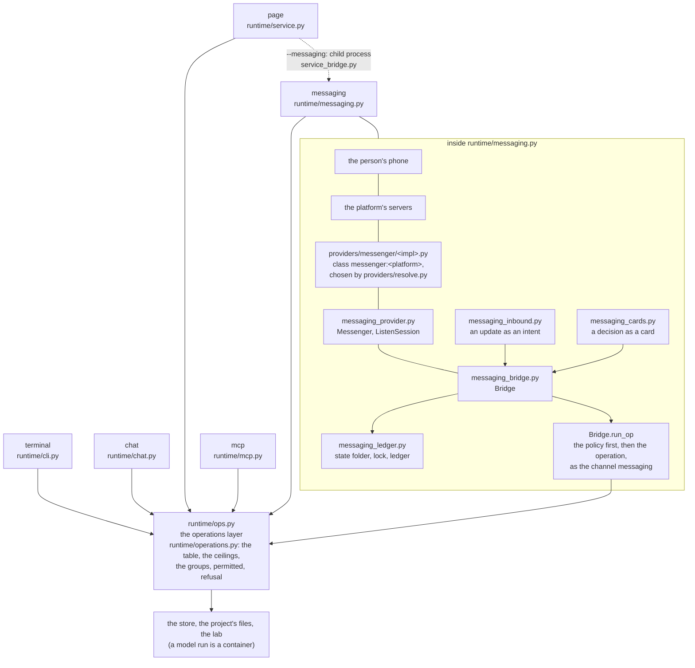
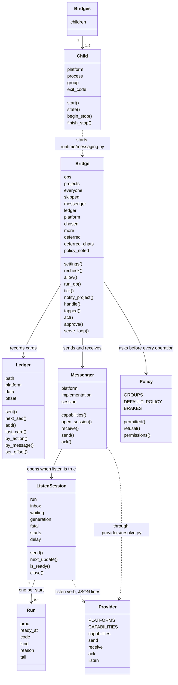
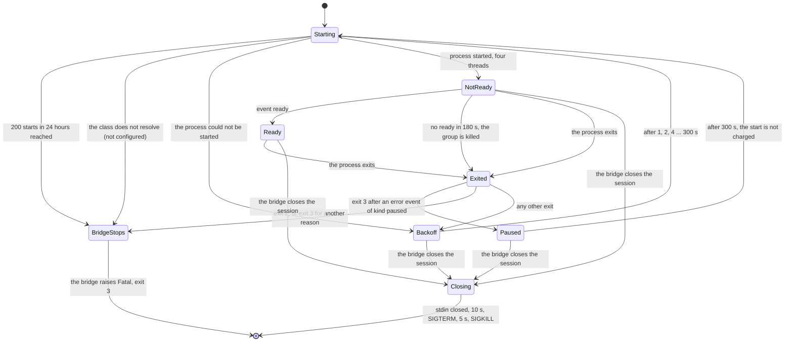
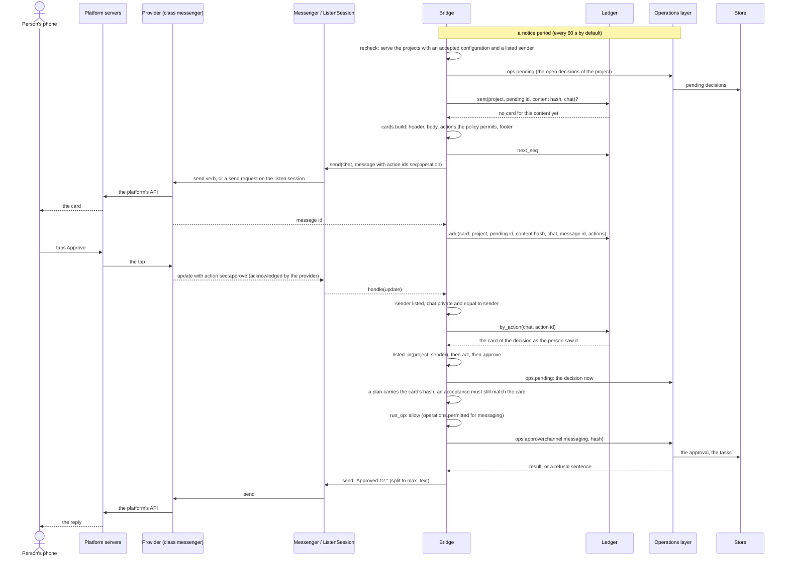

# The messaging channels

Part of [the platform map](README.md). This is not a layer page: it follows one feature, a person running projects from a messaging app they already use, across the layers that carry it. It has the same eight sections, in the same order, as a layer page, and each fact sits in the section where a reader of a layer page would look for it. It states what the code does, with file and line references, and points to the contracts for the rules; when this page and the file it points to disagree, the file wins and the page is corrected. Written on 2026-10-13 from the code of the integration branch after packages MSG-1 to MSG-11, brought to the code after MSG-13 and put in the shape of the platform map on 2026-10-14 (MSG-14).

The feature spans these layers, and each of their pages describes its own part:

| Layer | What messaging puts there | Page |
|---|---|---|
| 7 The shells | the fifth shell `runtime/messaging.py`, the child of the local service `runtime/service_bridge.py`, the option `--messaging` of `runtime/service.py`, the `messaging` and `permissions` fields of `GET /projects`, and the page's side of the policy, `interface/js/permissions.js` | [shells.md](shells.md) |
| 6 The runtime | the channel `messaging` of the table of operations, the channel policy (`runtime/operations.py`), the checks in `ops_say.py`, `ops_waits.py`, `ops_config.py` and `ops.py`, and the keys `messaging` and `channels` of the configuration (`runtime/project_config.py`) | [runtime.md](runtime.md) |
| 3 The providers | the class `messenger:<platform>` and its six implementations under `providers/messenger/`, the listen mode (`providers/resolve.py`, `start`), the messenger rows of the secrets registry | [providers.md](providers.md) |
| 8 The target project | the keys `messaging` and `channels` of `docs/workbench/runtime.json` | [project.md](project.md) |
| 2 Contracts and references | "The messaging bridge", "The channel policy" and "The listen mode" of [contracts/runtime.md](../../../contracts/runtime.md), [providers/CONTRACT.md](../../../providers/CONTRACT.md), [providers/messenger/README.md](../../../providers/messenger/README.md), [contracts/secrets.md](../../../contracts/secrets.md) | [contracts-and-references.md](contracts-and-references.md) |

## Purpose

A person who runs a project through openhora needs two things away from the keyboard: to hear that a decision waits, and to answer it. The page of [the local service](shells.md) does both, but it is a web page to learn and keep open. The messaging channels take the same operations to apps the person already has: Telegram, Discord and three kinds of WhatsApp. The person is told, in a chat with a bot or a number, that a plan, a question, a review or an acceptance waits; reads its text; taps a button or types a short command; and can write a free line to the planning agent as in the terminal conversation.

What reaches the phone:

- **Notices.** One card for each open pending decision, once per content, to every listed sender (`runtime/messaging_cards.py`, `runtime/messaging_bridge.py`).
- **Replies** to what the person writes: the answer of an operation, or the planning agent's reply to a free line.
- **An answer from the project's sources**, when the person asks `/ask <question>` and the sender's profile lists the group `ask` (off by default; package AQ-1). The reply carries the quotes the answer rests on and the sources read, and it is sent only to the chat that asked. On a messaging app the question, the answer and its quotes pass the platform's servers, which are not end-to-end encrypted for Telegram and Discord: the group says so in `operations.GROUP_TEXT`, and the person's `accept-config --widen` is the consent.
- **The mailbox (package W3).** A listed sender with the group `mail-organize` asks to archive, move, mark, trash or draft by naming messages of a mail snapshot (`inbox#3`), which needs the group `ask-mail` too; the bridge answers "Card #n waits for your approval." and sends the card. The grant `approve-effect-mailbox` lets a messaging app approve a mailbox card, and a card is approved only if it is whole: the lines that show another person's subject and sender, and the addresses, subject and text of a draft (`phrases.CARD_PRIVATE`), are drawn only for a sender who holds `ask-mail`, so for any other sender the card says what it left out and offers no approval (`ops_grants.effect_refusal` refuses it too). A draft is saved, never sent.
- **Files.** A file a listed sender sends is held, checked and shown on a card; it becomes a source of the project only when a person adds it (the card's button, `/add <n>`, the page or the terminal) or the sender's profile has the grant `add-sources-direct`. A channel whose policy lacks the group `add-sources` takes no file: nothing is downloaded (`runtime/messaging_attach.py`; rules F1 to F6; [sources.md](sources.md) rule 16).
- **A write in words.** A plain line that asks for a write to the person's own accounts ("marca dentista quinta às 10h", "salva esse pdf no drive") is read by code, asked back when a slot is missing, and opens the card of its exact content (`runtime/messaging_inbound.py`, `Bridge.write`, `ops.natural_write`; rule 57; limit L61). It never executes a write: the approval of the card does, as for a typed command. No model reads it, it takes no route lock and no place in the router's queue, and it is not stored in the conversation.
- **Reminders.** `/remind <time> <text>` stores one line of the sender's own words and the bridge sends it back once, at that time, to that sender's own chat (`runtime/messaging_remind.py`; rules R1 to R7; limit L51). It is a notice and never an effect. The group `reminders` is in no default policy: a project turns it on in a profile and confirms it with `accept-config --widen`; the MCP mode has no row for it. NR-1: the same reminders in the person's own words, read by code with no model ("me lembra amanha as 13h da aula de violao", "remind me tomorrow at 1 pm to call the florist", "/remind aula de violao as 13hrs amanha"); the reply shows the day, the weekday, the date, the hour, the zone and `/forget <n>`; anything unclear or not fully understood is asked back and never guessed (an hour with no marker, "next friday", x/y that may be a fraction, a scheduling verb with no calendar word), and a full reading with something uncertain (a week or a month word near the time, a typo, a past date) is shown and confirmed with a "yes"; the question is a draft kept in memory for the chat (ten minutes, swept on the tick, one per chat, lost on a restart, answered by a reply only to its own message). A reminder in free text is never made at once: the reading is shown ("Entendi: ... Confirma?") with a one-tap Yes button where the platform has buttons, and made only on the yes; only the strict `/remind` forms make one directly. A reply to a card answers that card; a short reply that does not fit a question is asked once more, and a "yes" after the question expired is told so. A remind verb counts anywhere in the line, and the word reminder wins over a scheduling verb; a week named with no day asks which day of it; a forget acts at once only on an explicit number, shows and confirms a number after another word, several numbers or an hour, otherwise names the reminder by its words (whole words), says what it cancelled, and the bare "undo" brings the most recent one back as a new one within ten minutes; a line that repeats (the repeating word is part of the time phrase) is said to be a routine's. The words are language tables (`runtime/natural_lang_*.py`, listed in `runtime/natural_languages.json`, read as data and checked once at start), all tried on every line.
- **The decisions the project's policy allows the phone to take**: by default only reading, talking to the planning agent and answering a question (`operations.DEFAULT_POLICY`); approving a plan or an acceptance, releasing a delivery, rejecting, cancelling and retrying are turned on one group at a time by the project's configuration (the channel policy, under Abstractions), and an effect is a **grant** (below), one word at a time.

By default an effect (a commit, a pull request, a post, a message sent in the project's name) does not reach the phone as an approval: it is approved in the terminal or on the local page, with its hash typed or clicked there (`operations.EFFECT_CHANNELS = ("terminal", "page")`, decision D8), and its card says to approve it on the platform's page, with the link when `page_url` is set, and has no button and no command (decision of 2026-10-19, limit L62). A channel restriction is a policy: the default is that rule, and a project may grant a messaging app one effect word at a time (`approve-effect-create`, `-write`, `-send`, `-publish`; `operations.GRANTS`, decision M-40). The card then has the button, **only** when the card carried the whole text it approves, and only with the effect's own hash. What the grant changes is where an approval can be given, never whether the exact content is approved: an e-mail with an attachment, a post with an image, a table (its card is a preview of the rows) and a pull request (its card shows paths and hashes and not the code) are never approvable from a card, the group granted or not, because the hash covers what the card cannot carry. The grant `approve-effect-create` is kept for the package that makes a card show the change; until then it approves nothing.

What the channels are not: not a second runtime and not a place with a model of its own. No model sits between the app and the operations layer; free text goes to `say`, which is the same planning agent the terminal and the page reach. And the bridge is not an assistant platform: a gateway that is itself an MCP client can use the MCP mode instead, and the note for that is `adapters/openclaw/README.md`; it is outside the core and runs a model between the chat and the tools, which the bridge does not.

Scope of this page: the bridge and its modules, the channel policy for all three channels that take one, the messenger interface, the six platforms built today, the public address the official WhatsApp paths need, the security model, a runbook and the open items. The decisions that shaped it, each with its reason, are the table at the end of "Business rules".

## Artifacts it owns

Where: **repo** is this repository; **state** is the per-user state folder (`--state-dir`, else `$OPENHORA_STATE_DIR`, else `$XDG_STATE_HOME/openhora` when that variable is set and absolute, else `~/.local/state/openhora`; `runtime/messaging_ledger.py:47`), which is never in a repository and outside every project's data folder; **project** is the target project; **store** is the OS secret store (service `openhora`); **service** is an answer of the local service.

| Path | Where | Format | Written by | Read by | Lifecycle | Versioned | Generated |
|---|---|---|---|---|---|---|---|
| `runtime/messaging.py` | repo | Python 3.9, standard library only; the bridge's shell: its docstring is the `--help` text | maintainers | the person, the local service (`service_bridge.py` starts it) | changed by pull request | yes | no |
| `runtime/messaging_bridge.py`, `messaging_cards.py`, `messaging_inbound.py`, `messaging_ledger.py`, `messaging_provider.py` | repo | Python 3.9, standard library only; the logic, the card, the intent, the ledger and the provider access ("The bridge's modules" under Abstractions) | maintainers | `runtime/messaging.py`, and `messaging_*.py` among themselves | changed by pull request | yes | no |
| `runtime/service_bridge.py` | repo | Python 3.9, standard library only; the bridge as a child of the local service | maintainers | `runtime/service.py` | changed by pull request | yes | no |
| `runtime/tests/test_messaging*.py`, `runtime/tests/test_service_messaging.py` | repo | pytest, offline; each sets `OPENHORA_STATE_DIR` to a temporary folder | maintainers | CI, the commit hook | grows with each package | yes | no |
| `interface/js/permissions.js` | repo | an ES module: no network, no DOM; `OPS`, `EXEMPT`, `ASKED`, `can`, `withheld`, `lineText`, `reader`, `fingerprint` | maintainers | the controls of the page (`floor/cards.js`, `cards/plan.js`, `cards/plan-waits.js`, `floor/task-actions.js`, `floor/agent-tab.js`, `views/lobby-composer.js`, `views/lobby.js`, `views/lobby-request.js`) | changed by pull request; a test ties `OPS` and `EXEMPT` to the write functions of `interface/js/api.js` | yes | no |
| `providers/messenger/telegram.py`, `discord.py`, `email-imap.py`, `whatsapp.py`, `whatsapp-cloud.py`, `whatsapp-twilio.py` | repo | one script per implementation of `messenger:<platform>`, PEP 723 header with exact pins; each declares `PLATFORMS` | maintainers | `providers/resolve.py` (by class), the bridge (through it) | changed by pull request, with offline tests | yes | no |
| `providers/messenger/whatsapp_meta.py` | repo | the code the two official WhatsApp providers share (server, window rules, state store, identity map, renderer); its underscore keeps the resolver from listing it | maintainers | `whatsapp-cloud.py`, `whatsapp-twilio.py` (loaded by path) | changed by pull request | yes | no |
| `providers/messenger/discord.py.lock` | repo | the lockfile of `uv lock --script` for Discord's `websockets` dependency, with hashes | maintainers | `providers/resolve.py` (`uv run --locked`) | rewritten when the pin changes; a test fails when it is missing or names another version | yes | yes |
| `providers/messenger/whatsapp/` | repo | the Go program: `main.go`, `listen.go`, `inbound.go`, `send.go`, `render.go`, `session.go`, `commands.go`, `protocol.go`, `logger.go`, `fd*.go`, their `*_test.go`, `go.mod`, `go.sum` | maintainers | `whatsapp.py build`, which builds it on the person's machine; CI runs `go mod verify`, `go vet` and `go test` | `go.sum` holds the hash of every module; the repository carries source only, never a built binary | yes | no |
| `providers/messenger/tests/` | repo | pytest, offline: a fake HTTP client and server on port 0, the shared kits `whatsapp_cloud_kit.py` and `whatsapp_twilio_kit.py`, the render corpus `whatsapp_render_corpus.json` shared with the Go renderer; `conftest.py` applies the loopback guard | maintainers | CI, the commit hook | grows with each verb | yes | no |
| `providers/messenger/README.md` | repo | setup of each platform, the neutral message, the listen protocol, who can read the traffic of each tunnel, live measurements | maintainers | people | updated with each provider | yes | no |
| `<state>/` | state | a folder, mode 0700; checked at every start | `messaging_ledger.prepare_state_dir` (the bridge), and each provider for its own subfolder | the bridge, the providers | kept; nothing prunes the folder itself | no | yes |
| `<state>/messaging-<platform>.lock` | state | an empty file, mode 0600, opened `O_NOFOLLOW`, held with `flock(LOCK_EX \| LOCK_NB)` | `messaging_ledger.take_lock` (the bridge only: a provider is a separate process and must not) | `whoami` of a WhatsApp provider (to refuse while a bridge holds it) | the lock lives as long as the process; a crash leaves none stale; the file stays | no | yes |
| `<state>/messaging-<platform>.json` | state | the ledger: JSON `{"version": 1, "offset", "seq", "cards": [...]}`, mode 0600, no project text; the card entry is under Abstractions | `runtime/messaging_ledger.py` (the bridge), through a temporary file (`O_EXCL`, random name, fsync), published with `os.link` the first time and `os.replace` after | the bridge | grows by one entry per card sent and is never pruned; migrated once from `<data_dir of the first project>/messaging-<platform>.json` when the new file does not exist; the old file is left | no | yes |
| `messenger-message-*.json` in the system's temporary folder | machine | the neutral message handed to a per-call `send` (Telegram only), mode 0600 | `Messenger.send` (`messaging_provider.py:121-137`) | the provider's `send` | removed in a `finally`, right after the call | no | yes |
| `<state>/whatsapp/` | state | a folder, mode 0700: `bin/whatsapp-bridge` (the program), `build.json` (mode 0600: the sha256 of the binary, of `go.sum` and of go.mod, go.sum and every non-test `.go` file), `session.db` (mode 0600, with the `-wal`, `-shm` and `-journal` files beside it: the keys of a linked device, so whoever holds it can read and send as that number) | `whatsapp.py build`, `pair` and `listen` (the program) | `whatsapp.py` (`listen` refuses to start when the program or its sources differ from `build.json`), the Go program | `build` writes it again; `pair` creates the session; a logged-out device is mended by deleting `session.db` and running `pair`; exclude the folder from backups | no | yes |
| `<state>/whatsapp-cloud/` | state | a folder, mode 0700, files 0600: `settings.json` (`phone_number_id`, `port`, `webhook_path`, `template`, `template_language`, optional `public_base`: no secret), `seen.json` (message ids), `window.json` (per chat: `last_inbound`, `template_sent_at`), `identities.json` (business-scoped id to phone digits; phone numbers) | `whatsapp-cloud.py setup` (`settings.json`), the provider's `listen` (the rest), through `whatsapp_meta.Store` | the same | `seen.json` ids are kept 8 days (`SEEN_KEEP`, at most 50000), `window.json` rows 30 days (`WINDOW_KEEP`, at most 1000), `identities.json` rows 30 days (`IDENTITY_KEEP`, at most 2000); pruned when the store opens and once a day while running (`PRUNE_EVERY`); exclude the folder from backups | no | yes |
| `<state>/whatsapp-twilio/` | state | the same folder shape: `settings.json` (`account_sid`, `sender`, `port`, `webhook_path`, `public_url`, `template_sid`, `template_button_id`, `buttons`: no secret), `seen.json`, `window.json`, `identities.json`, and `sent.json` (the MessageSids this process sent, with the chat and the time, so that an error 63016 reported later still matches) | `whatsapp-twilio.py setup` (`settings.json`), the provider's `listen` (the rest) | the same | as the Cloud folder; `sent.json` rows are kept 2 days (`SENT_KEEP`, at most 2000) | no | yes |
| `docs/workbench/runtime.json`, the keys `messaging` and `channels` | project | JSON, no secret: `messaging` is `{"senders": {"<platform>": ["<id>" \| {"id": "<id>", "policy": "<profile>"}, ...]}, "notices": "text" \| "count", "page_url": <http(s) URL> \| null}`; `channels` is `{"page": ..., "mcp": ..., "messaging": ...}`, each a list of group names or the name of a profile; `policies` (POL-2) is `{"<profile>": [group, ...] \| {"groups": [...], "notices": "all" \| "actionable"}}` | the person | `runtime/project_config.py` (`_policies`, `_messaging`, `_channels`), the bridge through `ops.config` at each call | a change takes effect only after `accept-config` is typed in the terminal | the project decides | no |
| The secret records of every messenger | store | one entry per store username of the table below (service `openhora`, read by the providers through `providers/secrets/resolver.py`); WhatsApp unofficial has none: its secret is the session file | `keyring set openhora <store username>` by a person, at a hidden prompt | the providers | replaced on a new value; the bridge never reads one | no | no |
| `messaging` of `GET /api/v1/projects` | service | `null` without `--messaging`; an object `{"platform", "state": "running" \| "stopped", "exit_code": <n> \| null}` for one platform; a list of those objects for several | `runtime/service.py` (`messaging_state`), from `service_bridge.Child.state` and `Bridges.state` | the page, a client | recomputed at each request | no | yes |
| `permissions` of each project in `GET /api/v1/projects` | service | `{"channel": "page", "allowed": [...]}`, or `null` when the configuration is not accepted | `runtime/service.py` (`_permissions`), from `operations.permissions` | `interface/js/permissions.js` | recomputed at each request | no | yes |

The messenger rows of the secrets registry (`REGISTRY` of `providers/secrets/resolver.py`, equal cell by cell to the table of [contracts/secrets.md](../../../contracts/secrets.md)): store usernames only, never a value.

<!-- generated: messenger-secrets -->
| Secret | Store username | Read by | Purpose |
|---|---|---|---|
| `MESSENGER_TELEGRAM_BOT_TOKEN` | `messenger-telegram` | `providers/messenger/telegram.py` | receive the person's messages and send the notices of the messaging bridge, as a Telegram bot |
| `MESSENGER_DISCORD_BOT_TOKEN` | `messenger-discord` | `providers/messenger/discord.py` | receive the person's messages and button taps and send the notices of the messaging bridge, as a Discord bot |
| `MESSENGER_WHATSAPP_CLOUD_TOKEN` | `messenger-whatsapp-cloud` | `providers/messenger/whatsapp-cloud.py` | send the notices of the messaging bridge through the official WhatsApp Cloud API, and check at start that the token works |
| `MESSENGER_WHATSAPP_CLOUD_APP_SECRET` | `messenger-whatsapp-cloud-app-secret` | `providers/messenger/whatsapp-cloud.py` | check the signature of every webhook call Meta makes to the bridge's local server |
| `MESSENGER_WHATSAPP_CLOUD_VERIFY_TOKEN` | `messenger-whatsapp-cloud-verify-token` | `providers/messenger/whatsapp-cloud.py` | answer Meta's webhook handshake (the verify token typed in the app's webhook settings) |
| `MESSENGER_WHATSAPP_TWILIO_API_KEY_SID` | `messenger-whatsapp-twilio-api-key-sid` | `providers/messenger/whatsapp-twilio.py` | name the Restricted API key that sends the notices of the messaging bridge through Twilio's WhatsApp sender |
| `MESSENGER_WHATSAPP_TWILIO_API_KEY_SECRET` | `messenger-whatsapp-twilio-api-key-secret` | `providers/messenger/whatsapp-twilio.py` | authenticate the sends of the messaging bridge through Twilio's Messages API, as the Restricted API key |
| `MESSENGER_WHATSAPP_TWILIO_AUTH_TOKEN` | `messenger-whatsapp-twilio-auth-token` | `providers/messenger/whatsapp-twilio.py` | check X-Twilio-Signature on every webhook call Twilio makes to the bridge's local server |
| `MESSENGER_EMAIL_PASSWORD` | `messenger-email` | `providers/messenger/email-imap.py` | receive the person's messages (IMAP, read only) and send the cards of the messaging bridge (SMTP) through the dedicated mailbox of the e-mail channel |
<!-- /generated -->

## Abstractions

### Where the bridge sits

The operations layer (`runtime/ops.py` and the table `runtime/operations.py`) is reached by five shells. Each parses what it was given, calls one operation and returns what came back; none decides a rule a second shell would have to decide again.



With `--messaging`, the local service also starts `runtime/messaging.py` as a child process (`service_bridge.py`); the two are separate processes that share the operations layer, not a call path.

The five channels are the values of the `channels` column of the table (`runtime/operations.py`): `terminal`, `chat`, `page`, `mcp` and `messaging`. The ceiling of `messaging` is the rows `status`, `task`, `progress`, `pending`, `answer`, `release`, `approve`, `reject`, `retry`, `cancel`, `say`, `agents`, `skills`, `costs`, `artifacts` and `artifact`, and no other (not `request`, `route`, `set-mode`, `accept-config`, `go-ahead`, `config`, `dispatch`, the standing approvals, nor anything terminal-only). `messaging` is not in `ops_say.QUEUING_CHANNELS` (`runtime/ops_say.py:62`: only the page queues a line while a run holds the project): a line that arrives meanwhile is answered with the sentence in `messaging_bridge.RUN_BUSY` (`runtime/messaging_bridge.py:66`). Of the rows that take a channel (`channel_arg`), `approve` and `say` are told `messaging` by the bridge (`Bridge.run_op`, `messaging_bridge.py:182-183`).

### The class diagram



### The channel `messaging` and the channel policy

The `channels` column of the table (`runtime/operations.py`) is the **ceiling** of a channel. A project's `docs/workbench/runtime.json` may narrow it with named groups, `"channels": {"page": [...], "mcp": [...], "messaging": [...]}` (a channel's value is a list of groups or the name of a **profile**, below), and widens it only by a **grant** (`operations.GRANTS`, below); like every key of the file, a change takes effect only after `accept-config` is typed in the terminal, and a file that gives a channel or a sender any group the accepted file did not effectively give it is accepted only with the hash of the widening list. `runtime/project_config.py` (`_channels`, `_check_assigned` and `operations.group_refusal`, the one function that says whether a channel takes a group) refuses an unknown group (the sentence lists the known ones; the group `instructions` was renamed `instructions-write` with no alias, because `instructions` is the read operation of the group `read`), a group none of whose operations the channel's ceiling lists and that is not a grant of that channel, `approve-effects` anywhere but the page, an effect group or `approve-networked-plans` on the MCP mode, `approve-networked-plans` anywhere but messaging or without `approve-plans`, a `page` or `mcp` list without `read`, and `read-limited` anywhere but messaging, an entry for `chat` or `terminal` (neither is ever narrowed: the conversation's input is local access, equal to the terminal; a profile name there is refused the same way). A group is valid on a channel when one of its operations is in that channel's ceiling; it then covers the ceiling's share. Every row the page, the MCP mode or messaging may call is in exactly one group (a test walks the table).

The groups are a closed list in `operations.GROUPS` (`runtime/operations.py:259`), a pure literal, and the block below is generated from it:

<!-- generated: channel-groups -->
Channels with a policy (`POLICY_CHANNELS`): `page`, `mcp`, `messaging`. Never narrowed (`NEVER_NARROWED`): `terminal`. A policy for `page`, `mcp` must list `read` (`MUST_READ`). A channel with no entry in the project's `channels` takes its `DEFAULT_POLICY`: `messaging`: `read`, `talk`, `answer`, `routine-brakes`; any other channel keeps its whole ceiling. Valid on the page only (`PAGE_ONLY_GROUPS`): `approve-effects`. Valid on a messaging app only (`MESSAGING_ONLY_GROUPS`): `read-limited`, `ask-mail`. An effect is approved with no grant from (`EFFECT_CHANNELS`): `terminal`, `page`. Brakes (`BRAKES`), permitted on the page whatever its policy says: `cancel`, `stop-task`, `set-mode`, `routine-pause`, `routine-cancel`.

| Group | Operations | Decision kind | Valid on | In the default policy of | What it gives |
|---|---|---|---|---|---|
| `read` | `status`, `progress`, `pending`, `task`, `agents`, `costs`, `skills`, `artifacts`, `artifact`, `flows`, `flow-check`, `routines`, `instructions`, `conversation`, `connections`, `version`, `config`, `commands`, `artifact-raw`, `items` | - | `page`, `mcp`, `messaging` | `messaging` | reads everything the channel shows: the state of the work, what waits, the spend, the agents' caps and the connections |
| `read-limited` | `status`, `pending`, `skills`, `artifacts`, `artifact`, `flows`, `flow-check`, `routines`, `instructions`, `conversation`, `version`, `commands`, `artifact-raw` | - | `messaging` | - | reads what the work is and what waits for the person, never the spend (costs, agents, a run's cost in task and progress), the connections or the config operation |
| `talk` | `say` | - | `page`, `mcp`, `messaging` | `messaging` | writes a line to the planning agent (a new request, or the answer to its question) |
| `answer` | `answer` | - | `page`, `mcp`, `messaging` | `messaging` | answers a question a task asked |
| `release` | `release` | - | `page`, `mcp`, `messaging` | - | releases a delivery (it stays a draft) |
| `request` | `request`, `route` | - | `page`, `mcp` | - | makes a request and has it routed |
| `approve-plans` | `approve` | `plan` | `page`, `mcp`, `messaging` | - | approves a plan, with its hash: the tasks start to run |
| `approve-acceptances` | `approve` | `acceptance` | `page`, `mcp`, `messaging` | - | accepts what a request delivered or proposed: more work follows |
| `approve-effects` | `approve` | `effect` | `page` | - | approves any effect with its hash (the page alone) |
| `approve-effect-create` | `approve` | `effect:create` | `page`, `messaging` | - | approves a pull request, with its hash |
| `approve-effect-write` | `approve` | `effect:write` | `page`, `messaging` | - | approves the write of a page of the documents platform, with its hash |
| `approve-effect-send-own` | `approve` | `effect:send-own` | `page`, `messaging` | - | approves an e-mail sent from one of the person's own accounts, with its hash |
| `approve-effect-send` | `approve` | `effect:send` | `page`, `messaging` | - | approves an e-mail sent from the project's outbox, with its hash |
| `approve-effect-publish` | `approve` | `effect:publish` | `page`, `messaging` | - | approves a post to a social platform, with its hash |
| `approve-networked-plans` | `approve` | `plan:networked` | `messaging` | - | approves a plan that holds a script which reaches the network, with the plan's hash |
| `ask` | `ask` | - | `page`, `messaging` | - | asks a question answered by a model from the full text of the project's sources; the answer and its quotes are sent to this channel (on a messaging app they pass the platform's servers) |
| `ask-mail` | `ask` | `mail` | `messaging` | - | asks about the mail and calendar sources from a messaging app and has them read for questions that name no source: their text goes to a model and the answer passes the platform (adds to `ask`, never grants it) |
| `go-ahead` | `go-ahead` | - | `page` | - | goes ahead on a task that waits for another request |
| `reject-cancel` | `reject`, `cancel` | - | `page`, `mcp`, `messaging` | - | rejects a decision and cancels a request |
| `brakes` | `cancel`, `stop-task` | - | `page`, `messaging` | - | cancels a request and stops a running task |
| `retry` | `retry` | - | `page`, `mcp`, `messaging` | - | makes a failed or blocked task ready again |
| `set-mode` | `set-mode`, `set-model` | - | `page` | - | moves an agent's autonomy mode up or down |
| `consent` | `give-consent` | - | `page` | - | gives the consent an autonomous agent needs (the page alone) |
| `dispatch` | `dispatch` | - | `page` | - | starts the dispatcher's round |
| `documents` | `sync`, `hand-over` | - | `page` | - | syncs the documents platform and hands a file over to a task |
| `flow-write` | `flow-save`, `stage-file` | - | `page` | - | saves a flow of the project and hands a file over for a plan |
| `routine-brakes` | `routine-pause`, `routine-cancel` | - | `page`, `messaging` | `messaging` | pauses and cancels a routine |
| `routine-edit` | `routine-create`, `routine-change` | - | `page`, `messaging` | - | makes and changes a routine (it stays a draft until it is approved) |
| `routine-approve` | `routine-approve`, `routine-resume` | - | `page` | - | approves a routine by its hash and resumes it |
| `instructions-write` | `instructions-set`, `instructions-add` | - | `page` | - | writes the person's standing instructions |
| `verdict` | `verdict` | - | `page` | - | records a verdict on a skill's use |
| `sources` | `source-add`, `source-import`, `source-refresh`, `source-describe`, `sources` | - | `page`, `mcp`, `messaging` | - | adds, imports, refreshes and describes the project's sources |
| `add-sources` | `attachments`, `attachment-hold`, `attachment-add`, `attachment-discard` | - | `page`, `messaging` | - | takes the files a listed sender sends through a messaging app (held, then added or discarded on a card or on the page), and lists and decides the held files |
| `add-sources-direct` | `attachment-hold` | `direct` | `messaging` | - | a file a listed sender sends becomes a new source of the project without a confirmation; a file for an existing source still waits for a card (it holds the hold alone, and adds nothing else) |
| `reminders` | `remind`, `reminders`, `reminder-forget`, `reminder-restore` | - | `page`, `messaging` | - | makes, lists and forgets reminders: one-shot lines of the sender's own words that the bridge sends back to their own chat at the time they chose |
| `calendar-write` | `event-create`, `event-change`, `event-cancel` | - | `page`, `messaging` | - | prepares changes to your own calendars (create, change, remove an event); each one waits for approval of its card |
| `approve-effect-calendar` | `approve` | `effect:calendar` | `page`, `messaging` | - | approves an event on the person's own calendars (create, change or remove), with its hash |
| `files-write` | `file-create`, `file-replace`, `file-save` | - | `page`, `messaging` | - | prepares new files and new revisions in your own Drive and OneDrive, and the saving of a file you sent; each one waits for approval of its card |
| `approve-effect-files` | `approve` | `effect:files` | `page`, `messaging` | - | approves a new file or a new revision in your own Drive or OneDrive, with its hash |
| `mail-send` | `mail-send`, `mail-reply` | - | `page`, `messaging` | - | prepares e-mails from your own accounts (a new e-mail, a reply to a message of a mail snapshot); each one waits for approval of its card |
| `mail-organize` | `mail-draft`, `mail-archive`, `mail-move`, `mail-mark`, `mail-trash` | - | `page`, `messaging` | - | prepares changes to your mailbox (a draft, archive, a move to a folder, read state, the trash); each one waits for approval of its card, and nothing is sent or deleted for good |
| `approve-effect-mailbox` | `approve` | `effect:mailbox` | `page`, `messaging` | - | approves a change to the person's own mailbox (a draft, archive, a move to a folder, read state, the trash), with its hash |

A grant (`GRANTS`) widens a channel and counts only when the project's own entry for the channel lists it, never through the default policy; accepting a file that gives a channel or a sender any group the accepted file did not effectively give them, a grant or not, asks for the hash of the widening list (`accept-config --widen`).

| Channel | Grant | What it gives away |
|---|---|---|
| `messaging` | `approve-effect-create` | a messaging app may approve a pull request, with its hash; today its card shows the files and their hashes and not the code, so no pull request is approved from a card yet and this grant approves nothing until a card shows the change |
| `messaging` | `approve-effect-write` | a messaging app may approve the write of a page of your documents platform (never a table: its card is a preview), from a card that carries the whole text, with its hash |
| `messaging` | `approve-effect-send` | a messaging app may approve an e-mail sent from your outbox (never one with an attachment), from a card that carries the whole text, with its hash |
| `messaging` | `approve-effect-send-own` | a messaging app may approve an e-mail sent from one of your own accounts (never one with an attachment), from a card that carries the whole text, with its hash; the grant of the outbox's e-mail does not cover it |
| `messaging` | `approve-effect-publish` | a messaging app may approve a post to a social platform (never one with an image), from a card that carries the whole text, with its hash |
| `messaging` | `approve-networked-plans` | a messaging app may approve a plan that holds a script which reaches the network, with the plan's hash |
| `messaging` | `add-sources-direct` | a file a listed sender sends becomes a new source of the project without a confirmation (a file for a source that already exists still waits for a card) |
| `messaging` | `approve-effect-calendar` | a messaging app may approve an event on your own calendars (create, change or remove), from a card that carries the whole event, with its hash |
| `messaging` | `approve-effect-files` | a messaging app may approve a new file or a new revision in your own Drive or OneDrive, from a card that carries the whole text, with its hash; a file you sent from the phone is saved on a card that names it, its size and its hash, and only the sender who sent it approves it |
| `messaging` | `approve-effect-mailbox` | a messaging app may approve a change to your own mailbox (a draft, archive, a move to a folder, read state, the trash), from a card that lists every message or shows the draft whole, with its hash; the card shows the subjects, senders, addresses and text only to a sender who may read your mail (ask-mail), so for any other sender it approves nothing |
| `mcp` | `approve-plans` | a connected AI client may approve a plan, with its hash: a model then authorises runs on its own request chain |
| `mcp` | `approve-acceptances` | a connected AI client may accept what a request delivered or proposed: a model then authorises more work |
| `mcp` | `reject-cancel` | a connected AI client may reject a decision and cancel a request |
| `mcp` | `retry` | a connected AI client may make a failed or blocked task ready again |
<!-- /generated -->

**Grants.** `operations.GRANTS` is the one list of the widenings a configuration can ask for, a pure literal like `GROUPS`; "grant" means these groups and no other. The groups inside a channel's ceiling (`approve-plans`, `release`, `reject-cancel`, `retry`, `brakes`, `routine-edit`, ...) are narrowing's other half: a project turns them on by listing them, and since POL-2 that is a widening too (below): `accept-config` takes the hash of the list for them as for a grant, because a channel restriction is a policy whose default is the restrictive rule, and a `runtime.json` edited by someone else must not add a power in an acceptance made without reading. A grant has one sentence in `GRANT_TEXT` (the last table above) and every other group one in `GROUP_TEXT`. A grant is a group a channel reaches **only when the project's own entry for that channel lists it**: never through `DEFAULT_POLICY`, never through "no entry keeps the ceiling" (`operations.effective_groups` is the one seam every check reads, `operations.granted` the one test of a grant). For a messaging app: `approve-effect-<word>` for the five words an approval path opens (a pull request, a write to the documents platform, an e-mail, a post, a change to the person's own calendar; a test forces a group for each word that can reach `approve`, and each kind's `APPROVAL_GROUP` names it) and `approve-networked-plans` (a plan that holds a step reaching the network, limit L36, on top of `approve-plans`). For the MCP mode (a model client): `approve-plans` with the plan's hash, `approve-acceptances`, `reject-cancel` and `retry`, each off by default, with the sentence saying a model then authorises runs; **never** an effect, a networked plan or consent (`operations.NEVER_GRANTED` and a test; the configuration refuses them). The umbrella `approve-effects` stays the page's alone, so a kind added later (a new word) is never approvable from a phone until its own group is granted.

**Accepting a widening.** A widening is any group that a place has in the file being accepted and did not effectively have in the file accepted before. A place is a channel or one listed sender (`<platform>:<sender id>`); the groups it effectively has come from its entry (a sender's profile, else the channel's list or profile, else what the channel holds with no entry: for messaging `operations.DEFAULT_POLICY`, for the page and the MCP mode their whole ceiling). So these are widenings: a grant (`approve-effect-write`), a group inside a channel's ceiling (`release`, `approve-plans`, `reject-cancel`, `brakes`, `retry`, `routine-edit`, ...), a group added to a profile that is assigned somewhere, a sender moved to a profile whose groups are not a subset of the groups that sender had, a new sender (an id the accepted file did not list), compared with nothing whether or not it names a profile (the restrictive default is that a person has no power until the owner widens it, knowing it), and a channel's entry removed when the channel then holds more (the page's whole ceiling). A group that another one holds (`read` holds `read-limited`, the umbrella `approve-effects` each effect word, `operations.IMPLIED`) is one line, not two. `config` shows `grants` (every grant the file lists, with what it gives away; a sender's also carry the `sender`), `widening` (`[{"place", "channel", "group", "means"}], one line for each widening, `means` being `GRANT_TEXT` for a grant and `GROUP_TEXT` for any other group) and `widening_sha256`, the sha256 of the widening list written one `<place>:<group>` line each with a newline after it (messaging, then the MCP mode, then the page, then the senders by key, each in the order of `GROUPS`). `accept-config --sha256 <the file's hash> --widen <that hash>` accepts a file that widens; without it, or with another, nothing is accepted and the sentence lists the lines and the command. A person types the hash of the list, never a phone number. What the earlier file effectively had is recorded when a configuration is accepted, in the store's cursor `config:effective` (`runtime/policy_widening.py`: the groups of each place as a bit mask over `GROUPS`, a sender only by a short hash of its key, which is no secret (a phone number is easy to guess: the store is outside the repository, and that is its protection), at most 100 senders in all so that the record fits a cursor of 4 KiB); `set-mode --accept` and the page's consent accept only the file that was already accepted, so they widen nothing. The hash is a deliberate step and not a proof of reading: it can be computed by whoever can run `accept-config`, so it protects against a file accepted without the list ever being shown, which is what the command does when the flag is missing (it stops and prints the lines and the command that accepts them), and against nothing else. The `config` answer also warns, without refusing, that a messaging effect grant (a channel's or a profile's) does nothing while `messaging.notices` is `count`, and that a profile is assigned to no one.

**A project that was accepted before this record existed** has only POL-1's cursor `config:grants` (the grants), or nothing, and cannot say what its accepted file gave. Its baseline is "unknown": only those grants were confirmed, so `config` lists every group of every channel, whether or not the file has an entry for it (an absent entry is its default or its ceiling, so the page and the MCP mode show their whole ceiling), and every listed sender with the groups they have. An edit made after the old acceptance, such as removing an entry, is therefore listed like the rest and cannot widen anything unseen. The person runs `accept-config --sha256 <the file's hash> --widen <the hash `config` shows>` once, and the same command, run on the file already in force, records it. The file stays in force meanwhile (the person accepted it). **Only `accept-config` writes the record** (and a change of an agent's mode keeps one up to date when it exists): a narrowing that code accepts, or `set-mode --accept`, does not end the unknown state, because nothing was confirmed by it. A project that has never accepted a file has the defaults.

**Policies per person (POL-2).** A policy is a named set of groups, a **profile**; a channel has a default and, on a messaging app, each listed sender may have their own.

```json
"policies": {
  "owner": ["read", "talk", "answer", "release", "approve-plans", "approve-acceptances", "reject-cancel", "retry", "routine-brakes", "approve-effect-write"],
  "staff": {"groups": ["read-limited", "talk", "answer"], "notices": "actionable"}
},
"channels": {"page": ["read", "approve-plans"], "messaging": "staff"},
"messaging": {"senders": {"whatsapp-cloud": [{"id": "55119000000001", "policy": "owner"}, "55119000000002"]}, "notices": "text", "page_url": null}
```

A sender's entry is a plain id (the sender gets the channel's groups) or `{"id", "policy"}`; the sender's profile **replaces** the channel's default for that sender (it does not add), so an employee can be narrower than the default. Resolution is one pure function, `operations.effective_groups(channel, cfg, sender)`: the sender's profile, else the channel's entry, else `DEFAULT_POLICY`, else the whole ceiling; `sender` is `operations.sender_key(platform, id)` and is read for messaging only; the loaded policy mapping carries each profiled sender's groups under `operations.SENDERS_KEY`. A grant counts only from an explicit entry or an explicit profile, never from a default. A file with no `policies`, flat lists and plain sender ids resolves exactly as before (a test compares the resolved groups for every channel and every sender). `project_config` refuses, each with its sentence: an unknown profile; a profile that lists an unknown group, or both `read` and `read-limited`; a profile assigned to a channel that does not take one of its groups (the sentence names the profile and the channel); a sender id listed twice on one platform; an id that is not a text without a space of at most 64 characters; an entry object with keys other than `id` and `policy`; a profile named `default` (the label of a sender with no profile) or not written as lowercase words joined by hyphens; more than 100 senders in all; a `policy` for `chat` or `terminal`. It warns (in `config`, never a refusal): a profile nobody uses, and a profile with an effect grant while `notices` is `count`.

*What stays code.* An act from a messaging app is checked against the profile of the sender who acted, read from the accepted configuration **when the sender acts**, never when the card was sent: a sender removed or narrowed loses the act at once (the bridge asks `permitted(..., sender)` at each tap and line, and the operations layer asks again for the same sender: `ops.approve`, `reject`, `release`, `retry`, `answer`, `cancel`, `stop-task`, a command typed into `say`). A card is acted on only in the chat it was sent to, by that chat's sender: cards are per private chat with `chat` equal to `sender` (rules 6 and 7), and the bridge also checks that the ledger card's `chat` is the acting sender's, so a profile cannot share another sender's card. This binds a tap and every decision typed by id: `/approve <id>`, `/reject <id>`, `/release <id>` and `/answer <id> <text>` need the card that was sent to the sender's own chat ("Act on the card sent to you (send /pending)."), whatever their profile lists. The commands that end or restart work (`cancel`, `stop-task`, `retry`, typed into a line) are by id and need the group: a brake must not wait for a card. A call from a messaging app always names its sender: the bridge refuses to ask the policy without one, an operation that cannot be told who acts is not called from a messaging app (a typed `/routine-create` is refused), and the operations layer refuses `channel=messaging` with no sender, so a sender with a narrower profile than the channel is never answered with the channel's wider set. Nothing a sender sends names a profile: the profile is read from the configuration by the sender's id, which the provider authenticated; no operation has a profile or policy argument, and a sender key that carries a profile name is only a key nobody is listed under. A profile changes only by `accept-config` in the terminal. The brakes are as they were: always on the page; on messaging only what the sender's profile lists. POL-1's rules hold per sender: the whole card, the hash, no approval from a typed line. A decision several senders received is resolved by the first act; the others get "pending decision N is resolved, not open". **There is one conversation for a project**: a line from any listed sender with `talk` goes to the same planning agent, so a staff member's line can answer the router's open question for a request the owner made, while the plan it produces still waits for a profile that approves it. A line that asks about the state ("status?") is answered only to a profile that reads. `/pending` lists a profile with `notices: actionable` only the decisions it can act on or answer.

*What a profile sees.* `read-limited` is `read` without the spend: no `costs`, no `agents` (caps and spend), no `connections`, no `config` operation, and, because they carry a run's cost, no `task` and no `progress`; it is valid on messaging only, and a profile lists `read` or `read-limited`. A line such as "status?" is answered only to a profile that reads. `status` names the configuration's file and hash and never its path; `config`, the terminal's and the page's, keeps the full path. A command or a path that an operation writes into a reply or a card (the command of an effect that no card approves, a held task's `next`, a route command) is spelled from the home folder as `~` by the bridge's one outgoing filter (`messaging_bridge.scrub`, applied at `Bridge.deliver` to the text and the file of every reply, card and document, so that no path skips it): a phone is not sent the username or the folder layout, and a pasted command still runs, since an unquoted `~/x` is expanded by the shell and a quoted path becomes `~/'my folder'`. A test captures the messages for a refusal, an OpsError, an effect card, an effect reply, a networked plan, a held status, a draft routine's command and an unclassified route. What the filter does not know is a path outside the home folder (a project kept in `/srv`), which it leaves as it is. A profile's `notices` is `all` (a card for every open decision, the default) or `actionable` (a card only for a decision the profile can act on or answer: the card built for that sender has an approve, reject or release button, or a reply to answer; `messaging_cards.build` returns `actionable`). A sender whose profile permits no read of what waits is sent no card. A sender reaches only the projects whose `runtime.json` lists them.

*The record.* A resolution and an approval record who acted: `terminal`, `page`, `mcp` or `chat`, or `messaging:<platform>:<profile>:<sender id>` (the id last, the only part that may hold a colon), in the `actor` column of `pending_decisions` and `approvals` (migration 17; the approvals trigger refuses to change it). The store is outside git; the project's versioned files get the platform and the profile name and never the id: the state file's generated approval row says "approved on telegram, profile owner", a cancel's label says "user from messaging, profile owner", and what a shell reads (`pending <id>`, `task`, `progress`) shows `acted_by` ("owner on telegram") in place of the raw actor. A retry has no row to carry an actor (the task row has no such column), so the layer checks the sender's profile and records nothing; a cancel or a stop records the profile in its label and not the sender. The id stays on old rows after an entry is removed (retention: the store keeps its records); give a profile with effect grants only to an account on a phone with a lock and an app lock, and remove a person's entry the day they leave.

*How far to trust an id.* It proves whoever controls that account at that moment, and no more: a shared or unlocked phone, a stolen session file, a SIM swap or a recycled number all inherit the profile. Code cannot see any of these. The table of what each platform's id is, and what sets it, is in [providers/messenger/README.md](../../../providers/messenger/README.md). The page and the MCP mode have no person identity (the terminal is whoever uses the machine, the page whoever holds the token, the MCP mode the client process): per-person policies there need sign-in, which belongs to the hosting project; the core only prepares the same profile model, so `channels.page: "owner"` works today and a signed-in page user would map to a profile name with no new schema.

**The effect card.** The bridge reads the decision whole (`ops.pending <id>` adds `effect_word` and `effect_on_cards`, from the effect document read by the decision's own hash: `ops_grants.effect_facts`). The card (`messaging_cards.build`) draws "Approve this exact content" when all of these hold: the accepted policy grants the word, `notices` is `text`, `effect_on_cards` is true (each kind says it: `effect_send.on_cards` is false with an attachment, `effect_publish.on_cards` false with an image, `effect_write.on_cards` false for a table, `effect_pull_request.on_cards` always false), and the card is **whole**: the body uncut, or the whole text as a file that the provider **confirmed as delivered**. A file is sent first, as a message of its own, and the card with the buttons only after the provider said the file arrived (`messaging_provider.Sent.document_failed`: Telegram, WhatsApp Cloud and the unofficial WhatsApp client report it; Discord sends text and file in one request, so a failed file fails the whole send; WhatsApp through Twilio, with 1600 characters and no documents, approves only short effects); a file that failed, or a provider that cannot say, makes a card with no button that says to approve on the page. A plan that holds a step reaching the network is approved off the terminal and the page only from a whole card too, and a hash typed with `/approve <id> <hash>` must be the card's for a plan as for an effect. A cut card draws no button and says "Too long to approve here: approve it on the page or in the terminal." beside the command. The ledger records `whole`, `approvable`, `blocked` and `effect_word` for each card (no project text). `whole` is true only for a text that arrived: no file travelled in the card's own message, or the provider confirmed the one that did (a card sent while it was not approvable carries its file inline, and a plain id that says nothing is not a confirmation); an entry written before the field has no `whole` and approves nothing. A card whose file did not arrive is recorded `blocked: "document"` and is not sent again by a tick until its content changes (a file that failed once would fail on every tick); the person's own `/pending` tries it again, once for each request, with the file first and the same confirmation rules, and the card says so. A typed line approves an effect or a networked plan only if its card offered the approval (`approvable`); a plain plan or an acceptance keeps the rule it had, and the policy is read when the person acts. A hash typed with `/approve <id> <hash>` must be the card's, for an effect, a plan and an acceptance. A tap or `/approve <id>` is bound to the card (`messaging_bridge.approve_effect`): no card, "Send /pending first"; a card that was not whole, a decision that does not fit on a card or a granted word withdrawn since, the command and the page; a typed `/approve <id> <hash>` must carry the card's hash; a card whose hash is not the decision's own `payload_sha256` is "This decision changed since you saw it." with a new card (a stale card is refused); otherwise `approve` runs in a job thread with the card's hash and `channel=messaging`. The policy is read from the accepted configuration when the person acts, not when the card was sent: a grant taken back, or a configuration not accepted, approves nothing. A line typed into `say` never approves an effect.

`messaging` is **closed** by default: with no entry in `channels` it takes `DEFAULT_POLICY`, and that default holds no grant. The other channels:

| Channel | With no entry in `channels` | Narrowed by |
|---|---|---|
| `terminal` | the whole ceiling, always | never |
| `chat` | the whole ceiling, always | never (an error to name it) |
| `page` | the whole ceiling | `channels.page`, which must list `read` |
| `mcp` | the whole ceiling | `channels.mcp`, which must list `read` |
| `messaging` | **closed**: `read`, `talk`, `answer`, `routine-brakes` (`operations.DEFAULT_POLICY`) | `channels.messaging`: approving, releasing, rejecting, cancelling, stopping a task (the group `brakes`, R18) and retrying are turned on one group at a time; an effect word and a networked plan are grants |

**One helper, and every place it runs.** `operations.permitted(op, channel, policy, kind=None)` (`runtime/operations.py:335`) is pure; `operations.refusal(op, channel, policy, kind=None, go_ahead=False)` (`:350`) returns the sentence "/<operation> is not enabled for this channel; the project's configuration (channels.<channel>) turns it on" (`not_enabled`, `:345`), or `None`; the caller raises `OpsError` with code 1. It runs in code, never in a prompt:

| Where | What it checks |
|---|---|
| `runtime/service.py` `_policy_refusal` (`:660`) | every route of the page, after the query is read and before the bytes of an upload are written and before a job starts: a refused route is `409` `refused`, takes no model slot, writes nothing. A read returns first; a configuration that is not accepted is left to the operation (`412`) |
| `runtime/mcp.py` `_refuse_by_policy` (`:287`) | each `tools/call`, per project, before a job starts. `tools/list` still shows the ceiling's tools |
| `runtime/ops_say.py` `_say_command` (`:508`) | a command typed into `say`, under the channel that carries the line (`page`, `mcp` or `messaging`, never `chat`) |
| `runtime/ops_waits.py` `only_on_plans` (`:281`, called from `ops.approve`) | approval of a plan (a networked one needs `approve-networked-plans` off the terminal and the page), an acceptance, an effect asked by its word (`effect:<word>`) for the terminal and the page, and a non-empty `go_ahead` (which needs the group `go-ahead` too) |
| `runtime/ops_grants.py` `effect_refusal` (called from `ops.approve`) | an effect on any other channel: refused unless the accepted policy grants that channel the effect's word and the whole effect fits on a card; fails closed for no channel, the conversation and the MCP mode |
| `runtime/ops_config.py` `set_mode` (`:114`) | the direction of a mode change from the page (below) |
| `runtime/ops_say.py` `_drain_refusal` (`:364`) | a queued entry, again when the page's queue is drained (below) |
| `runtime/messaging_bridge.py` `Bridge.allow` / `run_op` (`:167`, `:178`) | every operation the bridge calls, and the card it draws |

The policy is read from the project's accepted configuration at each call (`Bridge.settings` asks `ops.config` every time, `messaging_bridge.py:97-105`), so a change the person accepted takes effect without a restart, and a configuration that is not accepted refuses everything.

**The brakes.** `operations.BRAKES = ("cancel", "stop-task", "set-mode", "routine-pause", "routine-cancel")`: on the page, `cancel`, `stop-task` and a move **down** of an agent's mode are permitted whatever the policy says (`permitted`, `:340`), `--lan` included, so a person who has lost trust can always stop work from the page; a page policy may omit them without error. A move **up** is refused unless the policy lists `set-mode`; the direction is known only after the mode is read, so `ops_config.set_mode` checks it before its lock and any write (`:143-147`). The brakes do not leak to the MCP mode, which has neither. On `messaging` `cancel` and `stop-task` are the group `brakes`, which is turned on by listing it (not a grant of `GRANTS`): the channel's default policy stays closed (`routine-brakes` is in it, `brakes` is not), so a request to cancel or to stop a task from a messaging app needs `channels.messaging` to list `brakes` (or `reject-cancel`, for `cancel` alone), accepted in the terminal like every key; `cancel` is also in `reject-cancel`, the one operation in two groups, so that a policy written before stays valid.

**The queue's stored group.** Only the page queues a line or a route while a run holds the project. Each queue entry stores the group that created it (`talk` for a line and for a request a line made, `request` for a route the page asked for, `QUEUE_GROUPS`, `ops_say.py:63`); `route_queued` re-checks that group under `page`, with the policy as it is at drain time, before it answers the line or routes the request. A refused entry gets a stored reply with the sentence and leaves the queue; an entry queued before the group was stored is checked as `talk` (a line) or `request` (a route), under `page` (`_drain_refusal`, `:364-370`).

**The permissions pairs.** The service's own `GET /projects` adds, per project, `"permissions": {"channel": "page", "allowed": [...]}`, or `null` when the configuration is not accepted (`service._permissions`, `:685`, built from `operations.permissions`, `:363`, in the handler at `:821` and not in `shell_kit`). `allowed` is in the table's order and holds the plain name of every operation the page may call, except `approve` and `set-mode`, which are pairs: `approve:plan`, `approve:acceptance`, `approve:effect`, `approve:effect:<word>` for each effect word the policy covers, `approve:go-ahead` and `set-mode:down`, `set-mode:up`; `cancel` and `set-mode:down` are always there. When the project grants something, the entry also carries `"grants"` (`[{"channel", "group", "text"}]`) and the project switcher draws one line from it, "Your configuration widens: ..." (`permissions.js` `grantsText`; no control: the widening is changed in the terminal). The answer of `commands` leaves out the commands the page's policy refuses (`service._shown_commands`: `/new` follows `talk`, `/help` stays).

`interface/js/permissions.js` is the page's side: no network, no DOM; `can(project, op, kind)` (`:57`) looks a name up in that list. A project entry without the key, with `null`, or with a shape that is not a list allows everything, so the page never hides a control because of a shape it does not know. The controls draw only what the list allows and say on one line what is turned off; `cancel` and `setMode` are exempt from the check as brakes (`EXEMPT`, `:32`). A test ties the write functions of `interface/js/api.js` to the module's `OPS` (`:17`) and `EXEMPT` maps so a new one cannot be added without a decision. The page decides nothing: a write the page still sends against the policy is refused by the service with `409`, and the service's check is the authority. The policy governs a person's requests, not the dispatch loop the service runs on its own timer.

### The bridge

`Bridge` (`runtime/messaging_bridge.py:82`) subclasses `shell_kit.Jobs`. Its properties:

| Property | What it holds |
|---|---|
| `ops`, `log` | the operations module and the log function (from `Jobs`); the log carries no sender id, no text and no result |
| `projects` | the projects that are ready to serve now (a part of `everyone`) |
| `everyone` | every project the bridge was given |
| `skipped` | project id to the reason it is skipped now (absent: served) |
| `messenger`, `ledger`, `platform` | the `Messenger` of the platform, its `Ledger`, the platform's name |
| `chosen` | sender to the project id that sender chose with `/project` |
| `more` | `(project id, chat)` to the number last announced as waiting ("And n more waiting"), set once the line went out |
| `policy_noted` | the projects whose "notices are off" line was already logged |
| `deferred`, `deferred_chats` | `(project id, pending id, chat)` to the time it was last logged as deferred; the chats with a card kept for later |
| `unread_waiting`, `unread_told` | chat to how many skipped messages it has not been told of (memory only); chat to the `time.monotonic()` of the last line about skipped messages |
| `clock` | the time source for `sent_at` |
| `waiting`, `ticket`, `queue_lock`, `drain_lock`, `monotonic`, `session_ready` | the lines kept for a busy project (BQ-1), oldest first, in memory only: `{n, project, chat, text, since, after, starting}` (`starting`: chosen by `drain`, in the list until its run begins); the number of the last one; the lock of the list; the lock that makes one drain at a time; the clock of the queue (a test moves it); a listen provider's `is_ready` (no line starts while it is false) |

Its relations: it asks the **ledger** whether a card was sent and records each one; it sends and receives through the **messenger**; it asks the **policy** (`operations.permitted`) before every operation, through `run_op`; it calls the **operations layer** only through `run_op` (the one call path) and `ops.pending`/`ops.config`; it takes the project's model slot through `shell_kit.Jobs.start_job` for `say` and `release`.

**Its loop.** `serve_loop` (`:489`) runs until `stop` is set. For a provider with a listen session it is `listen_loop` (`:464`), otherwise a poll loop: `tick` every notice period, then `poll_once` (a `receive` of at most `POLL_SECONDS` = 25 s, the ledger's offset sent and the next one stored). **`tick`** (`:257`) is `recheck` first, then, for each served project, `notify_project` and the "And n more waiting" line, and last **`notify_unread`**: it reads `hearers()` first (the chats `hears_count` returns in the served projects under the settings read now, once for a chat in two projects), then takes the count of messages the provider gave up (`Messenger.take_unread`) and adds it for each of them; a chat that no longer hears (removed, narrowed to `notices: actionable`, no longer permitted to read) loses what it was owed. It sends each chat with a count `UNREAD_ONE` or `UNREAD_MANY` through `reply` when it was never told or `UNREAD_EVERY` = 3600 s have passed; a deferred reply keeps the count and is tried at the next tick, a failed one (logged by `reply`) keeps it too and is tried again an hour later, never at every tick. **`notify_project`** (`:228`) sends the cards a project's open decisions lack, at most `CARDS_PER_TICK` = 10, and returns how many are left over. A provider that listens is looked at again at once when it becomes ready, and notices wait until it is (`listen_loop`). Both loops call `drain_safely` at each iteration, and the end of each job does too (`job_ended`). A line that waits out a `RunBusy` pause is looked at again about 1 s later on a listen provider, and within `QUEUE_POLL` = 2 s on a polling one (a held slot has a job whose end drains, so the poll of up to 25 s stays long for it).

**Skip and re-check.** A project whose configuration is not accepted, or whose accepted configuration lists no sender for the platform, is skipped, not a reason to stop. `Bridge.recheck` (`:107`) runs at the start of every notice period; it logs one line when a project's state changes (`skipping <name>: its configuration is not accepted (run accept-config in the terminal)`, `... runtime.json messaging.senders.<platform> lists no sender`, `... its configuration cannot be read`, `<name> is ready: now served`) and serves a project from its accepted file the moment it is ready. With every project skipped the bridge keeps running. Until a project is ready no update is served for it: a message from its sender in that window is dropped like one from an unlisted sender (the first row of "Common errors").

**Inbound** (`handle`, `:275`). An update from a sender who is not in `messaging.senders.<platform>` of at least one served project, or from a chat that is not private, or whose `chat` differs from `sender`, is dropped with no reply and one log line (`dropped an update from an unlisted sender`, no id, no text). A tapped button is looked up in the ledger by action id and chat (an unknown one gets "This button is no longer valid. Send /pending."), acknowledged where the platform needs it, and run with the recorded pending id. A typed command is read by `messaging_inbound.parse`; a reply to a question's card is `answer`; any other text is `say`, in a thread, one model call per project at a time, and its reply goes back as a neutral message split to the platform's limit (`cards.split`). A line that meets a busy project waits (the rules Q1 to Q7 below); a command and a tap get "Still working on the last message." as before. A person listed in several projects chooses with `/project <name>`; the default is the first (`project_of`, `:147`).

**The modules**, each with one job (the layer map in `scripts/tests/test_layer_map.py` lets `messaging.py` import `ops.py`, `shell_kit.py` and these, `messaging_*.py` reach each other, `shell_kit.py`, `providers/resolve.py` and `scripts/redact.py`, and `service.py` import `service_bridge.py`, which names only `messaging.py`):

| Module | Job |
|---|---|
| `messaging.py` | The shell: parses the command line, makes and locks the state folder, installs the signal handlers, prints the start line, and runs `serve` |
| `messaging_bridge.py` | The logic. `Bridge.run_op` is the one call path: `operations.permitted` for the channel and the project's policy, then the operation, as the channel `messaging`. Notices (`tick`, `notify_project`), the intents (`handle`, `tapped`, `act`, `approve`), `say` and `release` in threads (`shell_kit.Jobs`, one model job per project), the waiting lines (`queueable`, `keep`, `drain`, `close_queue`), the poll loop and the listen loop |
| `messaging_attach.py` | The files a listed sender sends (ATT-1): from the update to the policy check, the checks on what the platform declared, the fetch, the hold, the card or the direct add; and from the card's answer, tap or `/add <n>`, `/discard <n>`, to the add or the discard. Built with the bridge, which dispatches to it in three places |
| `messaging_remind.py` | Reminders (RM-1): `/remind`, `/reminders` and `/forget` through the one call path, and `deliver`, which at the end of each tick sends what `ops.reminders_due` claimed to the chat that made it and marks it `sent` (or open again). Built with the bridge. NR-1 adds `made` (the reply that shows the moment as a person reads it), `natural` (a line in the person's own words), and the draft of a question asked back (`ask`, `answer`) |
| `messaging_cards.py` | A pending decision as a neutral card, fitted to the capabilities; pure. Also `content_sha256` and `split` |
| `messaging_inbound.py` | An update as an intent (`approve`, `reject`, `release`, `answer`, `add`, `discard`, `attachment`, `remind`, `reminders`, `forget`, `natural`, `pending`, `project`, `help`, `reply`, `action`, `text`, `usage`, `ignore`); pure |
| `messaging_ledger.py` | The state folder (made and checked), the lock, the ledger file; no network |
| `messaging_provider.py` | `Messenger` (the four verbs through `providers/resolve.py`) and `ListenSession` (the long-lived `listen` verb) |
| `service_bridge.py` | The bridge as a child of the local service (below); standard library only |

### The card of an account write, line by line

An effect of a write to the person's own accounts (package FND; [contracts/runtime.md](../../../contracts/runtime.md), "A write to the person's own accounts") stores, beside its English body, `payload["card"]`: its lines as `[key, {field: text}]`, every key of the phrase table's family `CARD_`. The card is said in the project's language, line by line (`messaging_cards.effect_card_text`), only when the lines are well formed (`phrases.card_valid`: every key in the English table, every field a text, exactly the fields the sentence has) **and** their English text is exactly the stored body; anything else falls back to the stored body as it always was. The fields are the person's or a service's words and are never translated; the hash on the card is the effect's own `payload_sha256` in both languages, so a card in Portuguese approves the same bytes. A field with a control, format (a right-to-left override, a zero-width character), separator, surrogate or private-use character is no card (`phrases.card_valid`; only the fields of `CARD_MULTILINE` may hold line ends and tabs), and `account_start.start` refuses such a card instead of showing it. The title of such a card is a phrase key of the family `TITLE_` chosen by code (`account_start.start`), never the person's words, and is said in the project's language by `phrases.heading`. The closed fields a kind could say per language (a status, a kind of file, a date) are not translated yet. Tests: `test_cards_lines.py`.

### The ledger and a card entry

Per user, never in a repository. The folder is the state folder (`messaging_ledger.state_dir`, `:47`). `prepare_state_dir` (`:59`) makes it mode 0700 and **checks** it with `lstat`: a real directory (not a link), owned by the user, no group or other bits; anything else is `StateError` and exit 2 naming the path. `take_lock` (`:78`) opens `<state>/messaging-<platform>.lock` with `O_CREAT | O_NOFOLLOW` at mode 0600, checks it is a regular file of the user, and takes `flock(LOCK_EX | LOCK_NB)` for the life of the process; a held lock is `LockHeld` and exit 4 ("another messaging bridge already serves <platform> on this machine (its lock: <path>); stop it first"). The system releases the lock when the process ends, so a crash leaves none stale. Only `messaging.py` takes it: a provider is a separate process and must not.

The ledger is `<state>/messaging-<platform>.json` (mode 0600), written through a temporary file (`O_EXCL`, random name, fsync) and published with `os.link` the first time and `os.replace` after (`_write`, `:149`). It holds no text of a project. Its keys: `version` (1), `offset` (the platform's next update offset, Telegram only; a listen provider never touches it), `seq` (the number action ids are made from, raised by `next_seq` and persisted by the next `add`) and `cards`. A **card entry** (`Bridge.send_card`, `messaging_bridge.py:209-211`) holds:

| Key | What it is |
|---|---|
| `platform` | the platform (added by `Ledger.add`; an entry without it is read as this platform's) |
| `project` | the project's id |
| `pending_id`, `kind` | the pending decision and its kind |
| `attachment_id` | for a card of a file a sender sent (kind `attachment`): the attachment's number; `pending_id` is then null, so no lookup by a decision's number meets it. Its `content_sha256` is `attachments.card_sha256` (the file's hash, its target source, its label) |
| `content_sha256` | what the card is bound to: a plan's hash, an effect's payload hash, else the sha256 of the decision's text (`messaging_cards.content_sha256`) |
| `chat` | the chat it was sent to |
| `message_id` | the platform's message id |
| `actions` | the action ids made for it, `{"<seq>:<operation>": "<operation>"}` |
| `sent_at` | the time it was sent |

A card is found by platform, project id and chat (`sent`, `:189`), so two sets of projects on one machine never suppress each other's cards, and a restart sends no card twice. A button is found by `by_action` (chat and action id, newest first), a reply by `by_message`, the newest card of a decision in a chat by `last_card`. An **action id** is `<seq>:<operation>` (`approve`, `release`, `reject`), made by the bridge, never by a provider; a card with several buttons gets several ids with one `seq`. A one-time migration copies, from `<data_dir of the first project>/messaging-<platform>.json` (where the first versions kept it), the cards of the projects this bridge serves, with the old `seq` and `offset`, so an action id on a card already sent still acts on that card; the old file is left and one line says it can be deleted (`_migrate`, `:114`). A ledger that cannot be read or is not of this version is `LedgerError` (exit 1).

### The card and the neutral message

The neutral message the bridge sends is `{"text", "actions": [{"id", "label"}], "link": {"label", "url"} | null, "document": {"name", "text"} | null}` (and, only for a platform that declares `actions_need_reply`, `"footer": [str]`, the lines the text ends with), where the text is Markdown as the agents write it and the action ids are `<seq>:<operation>` made by the bridge. `messaging_cards.build` (`:89`) makes it from a pending decision and returns `{"message", "content_sha256", "kind", "pending_id"}` (each action of `message` is first `{"op", "label"}`, and the bridge turns it into `{"id", "label"}`):

- a header `<project name> · <kind> #<id>`, then the body, then a footer;
- **actions**: one for each resolution word of the decision whose operation the policy permits (approved and accepted are `approve`, rejected `reject`, released `release`), in the order approve, release, reject; an effect is never offered an approval; a question is answered by replying to its card, when the policy permits `answer` and the platform keeps reply context;
- **folding**: buttons are drawn only when the platform declares them, and only as many as `max_buttons`; the rest become typed lines in the footer, "Send /approve 12", which always work. What the **policy** refuses is neither drawn nor offered as a line: the card says "Act on it on the platform's page.";
- **link**: a page link (when `messaging.page_url` is set and the card is an effect, has a refused action, or is in `count` mode) becomes a link button where the platform has `url_buttons`, else the URL in the footer;
- **text**: with `notices: "text"` the decision's text, cut to `max_text` with "(continues on the page)" or, where the platform takes documents, a short body plus the whole text as a document (`<kind>-<id>.txt`); with `"count"`, "A <kind> waits for you." and no project text;
- the card of an effect ends with "Approve it on the platform's page." (and the link, above) and carries **no command**: a phone has no terminal (LIVE-2, limit L62; `code_span` and the `effect_command` argument of `build` are gone); when it has the button its line is "Approving applies exactly the text above." with **no hash printed**: the button still binds to the hash the ledger recorded, and a card that changed is refused;
- **a phone never reads a command or a path** (LIVE-2): see "A phone never reads a command or a path" below;
- **the header** names the kind as a plain word (`request #3`, `pedido #3`; `KIND_EFFECT`), and the dates are said in the project's language (`phrases.localize_dates`, at the send point only);
- at most 10 cards per project per tick, then the line "And <n> more waiting. Send /pending to list them."

**A phone never reads a command or a path** (LIVE-2; the maintainer, 2026-10-19: on an online platform the person has no terminal). Two layers. (1) The sentences: what the phone can do it does; what is kept off it by design (the acceptance of a configuration, accounts, secrets, permissions and policies, adding sources, routines, the standing instructions, a reminder the router chose to bring back, an effect whose card is not whole) is answered with ONE plain sentence in the project's language and the page link (`PHONE_*` keys, `ops_natural.PHONE_FAMILY`; "Settings, accounts and permissions are changed on the platform's page: <link>"), never the command, a path or a hash. A refusal of a write carries no step name: `messaging_failure` says what failed and what to check ("I could not open the folder "Documents" in your OneDrive. Check that it exists..."), and `messaging_outcome` says what an approved effect did ("Event created: ..."). (2) The net: `messaging_guard.guard_message` in `Bridge.deliver` cuts a command line of this platform or a path from the text, the footer and the file, adds one sentence, records an event for tests, and logs only the kinds. The net is applied to the operations layer's error text only; a card and a reply that quotes the person's data are never cut (what is quoted is theirs, and the person approves exactly what they read), and a typed command's result leaves out its command and path fields by name. Rejected: stripping silently with no sentence (the person would not know something was left out), and checking in the providers (each would need its own copy of the rule).

**A question the router left open** (LIVE-2): answered by a plain line on a phone only within two hours (`ops_say.ROUTER_QUESTION_TTL`); older, the line is new and the old request is cancelled by code. A request code recognises (a write, a reminder, a cancel) is never taken as the answer, and a line taken as the answer is told so ("I took that as the answer to question #2.").

### An update and an intent

An **update** is one element of what a provider receives (a `receive` answer, or a listen `update` event): `{"update_id"?, "sender", "chat", "private", "text", "action", "action_ref", "reply_to", "attachments"?, "forwarded"?}` (`attachments`: at most 10 of `{"ref", "name", "size", "type"}`, checked by `messaging_provider.valid_attachments` on both paths; an invalid element drops the update; `text` is then the caption, or null). For a listen provider the bridge validates it (`messaging_provider.valid_update`, `:164`): it must be a JSON object with `private` true, a non-empty string `sender` and `chat`, and `text`, `action` and `reply_to` each a string or null; `action_ref` is forced to null (the provider has already acknowledged); `forwarded` is always there as a boolean (`messaging_provider.forwarded_of`: absent or `false` is false, any other value is true). Anything else is dropped and logged by class. An **intent** is what `messaging_inbound.parse` (`:37`) makes of it, one dict with a `kind`:

| Kind | From | Fields |
|---|---|---|
| `action` | a tapped button | `action` (the id) |
| `approve`, `release` | `/approve <id>`, `/release <id>` | `id` |
| `reject` | `/reject <id> [note]` | `id`, `note` or null |
| `answer` | `/answer <id> <text>` | `id`, `text` |
| `attachment` | an update with files | `attachments`, `text` (the caption or null) |
| `add`, `discard` | `/add <n>`, `/discard <n>` | `id` (the attachment's number) |
| `remind` | `/remind <time> <text>` | `when` (the time as typed), `text` |
| `reminders`, `forget` | `/reminders`; `/forget <n>` | `forget`: `id` |
| `pending`, `help` | `/pending`; `/help`, `/start` | none |
| `project` | `/project [name]` | `name` (empty: say which) |
| `reply` | a reply to a message, not a command | `reply_to`, `text` |
| `text` | anything else, a command the bridge does not handle itself (such as `/status`) included | `text` (a line for the planning agent) |
| `usage` | a command it handles with arguments it cannot read | `text` ("Usage: ...") |
| `forwarded` | an update with `forwarded` that carries no file | none (no text is carried) |
| `ignore` | an empty update | none |

### Forwards (FWD)

A forwarded message is never a request, a command, an answer or an approval, whatever its words say: someone else wrote it, and the person only passed it on. Every provider sets `"forwarded": true` on an update from the platform's own mark (per provider below), `messaging_provider.valid_update` keeps the key (absent or `false` is false, any other value fails closed to true), and `messaging_inbound.parse` makes `{"kind": "forwarded"}` of a forwarded line **before** the `/` test and every matcher (the reminders, the writes, the reply gesture), so even a forwarded `/approve 12` is nothing. The bridge answers that intent with one sentence in the project's language (`FWD_NOT_A_REQUEST`: "I don't act on forwarded messages. To ask for something, write it in your own words.") and returns **before** it reads a draft, a reminder, a question about a write or any store: a forward neither answers nor drops an open question, and the person's own next line still does. A forwarded **file** is still an `attachment` intent with `"text": None`: its card opens as any file's (a standing grant that adds files without a card never applies to it), and its caption never names a source or preselects a save. A tap (`action`) is never a forward. A sender that is not listed gets no sentence (the drop comes first).

| Provider | Mark | Notes |
|---|---|---|
| Telegram | `forward_origin`, `forward_from`, `forward_from_chat`, `forward_sender_name`, `forward_date`, `is_automatic_forward` | `quote` and `external_reply` alone never set it: they mark a reply that quotes a message, which is the person's own text |
| Discord | `message_reference.type` 1, `message_snapshots`, the `HAS_SNAPSHOT` flag | the words are in the snapshot, which is never read |
| WhatsApp, unofficial client | `ContextInfo.IsForwarded`, `ForwardingScore` > 0 | read from the vendored library's protobuf accessors |
| WhatsApp Cloud API | `context.forwarded`, `context.frequently_forwarded` | |
| WhatsApp through Twilio | `Forwarded`, `FrequentlyForwarded` | **Twilio's webhook has the fields** (twilio.com/docs/messaging/guides/webhook-request, read 2026-10-20), so it is not forward-blind and declares no `forward_blind` |
| E-mail | the Subject prefix alone (`Fwd`, `Fw`, `Enc`, `Rv`, `Tr`, `Wg`, `I`, `Vs`, after any `Re:`), a forward marker line of the body in en, pt, es, fr, de or it, or a `message/rfc822` part | a forward by subject is not read further; the body markers and the attached message are found in the budgeted child that makes the text |

**The residue.** An e-mail forwarded by a client that writes no prefix and no marker (the text pasted into a new message) cannot be told from the person's own words and can open a card; the card of the exact content, approved by the person, is the only guard there. A second edge: the subject of a card the bridge sends to the person is "Re: " plus its first line, which starts with the project's name, so a project named like a forward prefix (`Fwd`, `Tr`, `I`) would make the person's e-mail reply to its cards read as a forward; not handled. A Telegram message copied without the sender's name (a copy, not a forward) carries no forward field either. The same holds for any platform whose mark is missing from a message. A platform with no field at all is declared `forward_blind` and decided in IX-5 (approval by word off on that provider).

### Capabilities

`capabilities --platform <p>` prints a JSON object. `Messenger.capabilities` (`messaging_provider.py:89`) reads it once and checks every key's type (`CAPABILITY_KEYS`, `:35`): `max_text` (int), `buttons` (bool), `max_buttons` (int), `max_button_label` (int), `lists` (bool), `max_list_rows` (int), `url_buttons` (bool), `reply_context` (bool), `documents` (bool). The optional keys are `listen` and `actions_need_reply` (bool each; absent is stored as false; the second makes the bridge act on a typed approve, reject, release or answer only in reply to the card, rule 50). A missing or mistyped key is `MessengerError("failed")`. The values of the shipped providers, read from their text by the generator (no provider is run):

<!-- generated: messenger-capabilities -->
`yes` and `no` are booleans; a key a provider leaves out is `no` (`listen`, `actions_need_reply`, `attachments` and `max_attachment_bytes` are optional); `configured` is a value the provider computes from its saved settings, not a constant.

| Platform | Provider | `max_text` | `buttons` | `max_buttons` | `max_button_label` | `lists` | `max_list_rows` | `url_buttons` | `reply_context` | `documents` | `listen` | `actions_need_reply` | `attachments` | `max_attachment_bytes` |
|---|---|---|---|---|---|---|---|---|---|---|---|---|---|---|
| `discord` | `discord.py` | 1900 | yes | 5 | 80 | no | 0 | yes | yes | yes | yes | no | yes | 26214400 |
| `email` | `email-imap.py` | 8000 | no | 0 | 0 | no | 0 | no | yes | no | yes | yes | no | no |
| `telegram` | `telegram.py` | 4096 | yes | 6 | 40 | no | 0 | yes | yes | yes | no | no | yes | 20971520 |
| `whatsapp` | `whatsapp.py` | 4096 | no | 0 | 0 | no | 0 | no | yes | yes | yes | no | yes | 104857600 |
| `whatsapp-cloud` | `whatsapp-cloud.py` | 4096 | yes | 3 | 20 | no | 0 | no | yes | yes | yes | no | yes | 104857600 |
| `whatsapp-twilio` | `whatsapp-twilio.py` | 1600 | configured | 3 if configured, else 0 | 20 if configured, else 0 | no | 0 | no | yes | no | yes | no | yes | 16777216 |
<!-- /generated -->

### The messenger class and its two modes

A messenger is a provider of the class `messenger:<platform>`, in `providers/messenger/<impl>.py`. The class is one the runtime uses, not one a skill may require, so on purpose it is not in the class table of `contracts/environment.md` (which skills copy); it is documented in [providers/CONTRACT.md](../../../providers/CONTRACT.md). The part after the colon is handed to the script as `--platform`; each script declares the platforms it serves on one top-level line, `PLATFORMS = ("<platform>",)`, which `providers/resolve.py` reads as text. The variables `MESSENGER_<PLATFORM>_PROVIDER`, then `MESSENGER_PROVIDER`, choose among several; one candidate is chosen on its own. The bridge names no implementation.

`resolve.py` has two ways to run a provider: `call(cls, verb, args, ...)` (`:383`), one JSON object per process, and `start(cls, verb, args, ...)` (`:395`), which returns the running `Popen` of a long-lived verb (binary stdin, stdout and stderr pipes, its own session, no file descriptor of the caller). `interpreter_for(path)` (`:322`) picks the interpreter: the caller's own for a header with `# dependencies = []`, otherwise `uv run`, and `uv run --locked` when `<script>.lock` sits next to the script. The exit codes of a verb map to `ProviderCallError.kind` (`:370-373`): 2 `usage`, 3 `not-configured`, anything else `failed`, and a timeout `timeout`; `Messenger._call` (`messaging_provider.py:82`) turns it into a `MessengerError` with the same kind.

**Mode one: the per-call verbs** (Telegram). One process per call. `receive --platform <p> --offset <n> --timeout <s>` returns `{"updates": [{"update_id", "sender", "chat", "private", "text", "action", "action_ref", "reply_to"}], "next_offset"}` (long polling where the platform has it); `send --platform <p> --chat <id> --message-file <f>` reads the neutral message from a file of mode 0600 that the bridge removes afterwards and prints `{"message_id"}`; `ack --platform <p> --action-ref <ref>` acknowledges a tapped button. `send` has no `--confirmed` and no idempotency key (which CONTRACT.md asks of other verbs that send): the bridge is the only caller, sends only to a chat of the project's accepted `messaging.senders` list, and keeps the ledger. A provider refuses a message beyond its capabilities (exit 2); the bridge never sends one.

**Mode two: the listen session.** A platform that must stay connected (a gateway that delivers taps only on its open connection, a client with one live session, a webhook server) declares `"listen": true` and implements `listen --platform <p>`. The bridge starts it once, through `resolve.start`, and keeps it (`ListenSession`, `runtime/messaging_provider.py:202`).

- **Protocol.** JSON lines on binary standard input and output, UTF-8 written as ASCII (`ensure_ascii=True`, `line_of`, `:159`), one flush per line, at most 1 MiB per line (`MAX_LINE`, `:39`). The bridge writes `{"id", "op": "send", "chat", "message"}`; the provider writes `{"event": "ready"}`, `{"event": "update", "update": {...}}` (the shape of one element of `receive`), `{"event": "error", "kind", "reason"}` and the answers `{"id", "ok": true, "message_id"}` or `{"id", "ok": false, "kind", "reason"}`. Nothing else is ever written to stdout. There is no `ack`: the provider acknowledges its own taps at once and emits `action_ref: null` (the bridge forces it to null); no offset applies.
- **Validation** (`take`, `:515`). The reader drops, and logs by class, a line over the limit, one that is not JSON or not an object, an unknown event, an answer to an unknown id, and an update that is not private or lacks a non-empty string `sender` or `chat`. Updates feed a bounded queue (`UPDATE_QUEUE` = 1000; the newest are dropped when full, with one line).
- **Lifecycle** (`supervise`, `:350`). One supervisor starts the process, waits for `ready` (`READY_SECONDS` = 180; missing it counts as a crash and kills the group), and decides after an exit: **2 or 3 stops the bridge** (exit 3, with the reason of the last error event, else the redacted stderr tail, else `exit <n>`); anything else restarts it after a backoff of 1, 2, 4 ... up to 300 s (`BACKOFF`; the first wait again only after `RESET_AFTER` = 10 minutes ready), at most `MAX_STARTS` = 200 starts per rolling 24 hours for each bridge process, after which the bridge stops with a sentence (a platform may reset a credential that connects too often). Notices wait until `ready` and are looked at again at once when it comes back (`generation`). A watcher on `proc.wait()` detects an exit, kills the leader's group and fails every waiting request (`exit_loop`, `:452`). Stderr is drained, the last `STDERR_TAIL` = 300 characters kept and shown only after `scripts/redact.py`, and only when no error event gave a reason.
- **Stop** (`close`, `:288`). The bridge closes the session after its jobs have ended: stdin closed, then `STDIN_WAIT` = 10 s, SIGTERM to the provider's group, `TERM_WAIT` = 5 s, SIGKILL, by group id only. A provider must exit **within 5 s of the end of its standard input**: it runs in a session of its own, so killing the bridge never reaches it, and the end of its stdin is what stops it.
- **Rules for a provider.** Duplicate fd 1 for the protocol and point fd 1 at stderr; never `setsid`; interactive pairing is a separate verb run in a terminal, never inside `listen`.

`Run` (`:179`) is one start of the provider process: `proc`, `out` (the writer thread's queue), `ready_at`, `code`, `reason` (of the last error event, at most 300 characters), `kind` (a word of `ERROR_KINDS`, else `other`), `tail`, `threads`, `stale`; it is `ready` once `ready_at` is set and the process has not exited. `ListenSession` holds one `Run` at a time, the update `inbox`, the `waiting` requests (request id to an event and an answer), the `generation` (how many `ready` events), `fatal` (the sentence that stops the bridge), the `starts` of the rolling window and the current backoff `delay`; its threads are a supervisor, and for each start a writer, a reader, a stderr drain and a watcher on the exit.



### Answer kinds and error kinds

| Kind | Where it is said | Meaning | What the bridge does |
|---|---|---|---|
| `usage` | an exit 2 of a verb; an error event or an answer | the call or the message does not fit (a message beyond the capabilities, a flag) | the verb fails with `MessengerError("usage")`; as a listen exit it stops the bridge |
| `not-configured` | an exit 3 of a verb; an error event; an answer | the person has something to do (a missing secret, a refused token, a webhook set on the bot) | `Fatal` and exit 3; as a listen exit it stops the bridge |
| `failed` | any other exit; an answer; the resolver for a provider that printed no JSON object | the call did not work | logged by class; a card not sent is tried again at the next notice period |
| `timeout` | the resolver, when a verb runs over its time | the same, for a per-call verb | as `failed` |
| `skipped` | an **error-event** kind only (`ERROR_KINDS`): `{"event": "error", "kind": "skipped", "reason"}` | the provider gave up a message the person may have sent and nothing was done with it (the e-mail provider: refused by the server for an hour, or pushed out of the list of 200 to try again). It is not the state of the connection and not a failure to retry | `ListenSession.take` adds one to `unread` (under `inbox_cv`), logs "the messenger provider gave up a message it could not read (skipped)" and does not set `Run.kind` or `Run.reason`; the reason is never stored, logged or forwarded. At the end of each tick `Bridge.notify_unread` tells the senders the "N more waiting" line goes to, who still hear the count at that moment (rule 52). A burst of events is one log line until the bridge takes the count. `failed` is not a skip: Discord and the WhatsApp providers write it on every retry |
| `paused` | an **error-event** kind only (`ERROR_KINDS`, `messaging_provider.py:48`) | the platform session is gone and only the person can mend it (a logged-out WhatsApp device). The provider writes the event and exits 3 | this is the one exit 3 that does not stop the bridge: it logs the redacted reason, waits `PAUSED_WAIT` = 5 minutes (a close interrupts the wait), and starts the provider again; that start is not charged to the 200-starts ceiling and the backoff is left alone; the line is written again every `PAUSED_REPEAT` = 24 hours while it stays paused and again after the provider has been connected in between. Cards wait as for any provider that is not ready |
| `deferred` | an **answer** kind only (`ANSWER_KINDS`, `:49`): `{"id", "ok": false, "kind": "deferred", "reason"}` | a platform that lets a business write first only inside a window (the official WhatsApp API: 24 hours after the person's last message) cannot take the card now. It is not an error and never a reason to stop or restart | the bridge records nothing in the ledger for that card, so it is offered again at the next notice period and at once when the person next writes from that chat (`Bridge.deferred_chats`), and it logs one line for a card and a chat at most every `DEFERRED_LOG_EVERY` = 24 hours (`defer`, `messaging_bridge.py:216`) |
| `gone` | an **answer** kind only (`ANSWER_KINDS`): the answer to a fetch of a reference the platform no longer serves (a one-shot provider: exit 1 with the word `gone` first on stderr) | the bridge says "That file can no longer be fetched from <platform>. Send it again." and holds nothing |

**At-least-once delivery.** A send in flight when the provider dies fails, and its card is sent again after the next `ready`. The first copy, if it was delivered, has buttons the ledger has no record of, which answer the stale-button sentence. What the platform delivers to a linked device while the provider is paused or restarting is delivered when it reconnects, each approval still bound to the card the person saw. Duplicates are therefore possible; a wrong approval is not, because the binding is the hash or the card's content, not the delivery.

### The service's children

With `--messaging`, `service_bridge.Child` (`runtime/service_bridge.py:83`) holds the bridge process of one platform: `platform`, `argv` (built by `command`, `:62`), `environment` (a copy of the snapshot), `process`, `group` (the process group id its own session made), `exit_code`, `stopping`, `stop_wait` (150 s) and a watcher thread. `state()` is `{"platform", "state": "running" | "stopped", "exit_code": <n> | null}`. `Bridges` (`:170`) holds one `Child` per platform, in the order given. The service's `bridge` attribute is the `Child` for one platform and the `Bridges` for several (`service.py:1022-1029`). What a child is started with, and how it stops, is under "Business rules" (rules 41 to 44).

### The WhatsApp window and the template marks

The two official WhatsApp providers share one rule (`whatsapp_meta.py`): a business may write free text only within 24 hours of the person's last message (`WINDOW_SECONDS`), and the provider sends a card only while that last message is younger than 23 h 30 min (`WINDOW_GATE`). The provider records per chat, in `window.json`, `last_inbound` (the time of the last message: Meta's own timestamp for the Cloud API, the time of receipt for Twilio, which sends none) and `template_sent_at` (the time the fixed template was last sent). Outside the window a send is not made: with an approved template (optional), the provider sends it once per closed window and again at most every 7 days (`TEMPLATE_REPEAT`); without one it sends nothing and logs one line per chat per 24 hours (`NO_TEMPLATE_LOG`); either way the send answers `deferred`. The template is fixed text with no project text ("N decisions wait; reply to see them") and one "See decisions" quick reply, mapped to `/pending`. A late error closes the window of that chat and sends the template, still once: 131047 on the Cloud API (reported later as a `failed` status for a message the process sent), 63016 on Twilio (from the send or a per-message status callback for a SID in `sent.json`). The marks of the window and the template are exactly these two fields; a clock skew over `CLOCK_SKEW` = 300 s is read as now.

### The platforms

| | Telegram | Discord | WhatsApp, unofficial | WhatsApp Cloud API | WhatsApp through Twilio | E-mail |
|---|---|---|---|---|---|---|
| Platform name | `telegram` | `discord` | `whatsapp` | `whatsapp-cloud` | `whatsapp-twilio` | `email` |
| Provider | `telegram.py` | `discord.py` (+ `discord.py.lock`) | `whatsapp.py` + Go program `whatsapp/` | `whatsapp-cloud.py` | `whatsapp-twilio.py` | `email-imap.py` |
| Mode | one process per verb | listen | listen | listen | listen | listen |
| How it receives | `getUpdates` long polling | Gateway (WebSocket), direct messages | linked-device session of a Go client | webhook (local server, public HTTPS) | webhook (local server, public HTTPS) | IMAP polling of a dedicated mailbox, read only (`EXAMINE`, `BODY.PEEK`); only a message the server's own Authentication-Results admits |
| How it sends | Bot API `sendMessage` | REST `POST` on the DM channel | the Go client | Graph API | Messages API | SMTP, one `text/plain` message with a random Message-ID |
| Buttons | inline keyboard, up to 6, label 40, URL button | up to 5, label 80, link button | none (typed commands) | up to 3 reply buttons per message | typed commands until three quick-reply template ids are recorded, then up to 3 | none: typed lines ("Reply to this e-mail with: /approve 12"), acted on only in reply to the card |
| Documents | `sendDocument` | `.txt` in the same message | text/plain or text/markdown after the text | media upload after the text | no (text cut at 1600) | no: the whole text is in the body; a card that does not fit is cut and not approvable |
| `max_text` | 4096 | 1900 | 4096 | 4096 | 1600 | 8000 |
| Sender id | numeric user id | user id | phone digits | phone digits (and, if used, a business-scoped id) | phone digits (and, if used, a business-scoped id) | the From address, lower case |
| Secrets (store usernames) | `messenger-telegram` | `messenger-discord` | none: the session file | `messenger-whatsapp-cloud`, `-app-secret`, `-verify-token` | `messenger-whatsapp-twilio-api-key-sid`, `-api-key-secret`, `-auth-token` | `messenger-email` |
| Public HTTPS address | no | no | no | yes | yes | no |
| Live test | run by the maintainer: cards and the conversation received (the Markdown rendering not explicitly confirmed) | run by the maintainer: a card received in a direct message (buttons not confirmed); findings below | **not tested live** (an attempt showed the number must be separate) | **not tested live** | **passed** (text and typed commands); buttons not tested | **not tested live** |

**Rendering per platform.** The text is Markdown. Each provider renders the subset its platform can show, with everything escaped first so text from a project can never become markup, or sends it plain.

| Platform | Rendering |
|---|---|
| Telegram | `render_html` into Telegram's HTML parse mode: fenced blocks, table lines and quote runs found on the raw text, everything else escaped with `html.escape` before any mark; headings bold, bullets a dot, `**x**` bold, `~~x~~` strike, `` `x` `` code, fences and tables `<pre>`, quotes `<blockquote>`; no single-mark italics; a link shown as `text (url)`, never an anchor; previews off on every message; on a 400 "can't parse entities" one plain resend with the same keyboard |
| Discord | Discord renders Markdown itself; `render_discord` keeps the text and makes it safe outside code spans and fenced blocks: masked links to `text (url)`, mention openers escaped, `||` escaped, table runs fenced; `allowed_mentions` is empty and embeds are off |
| WhatsApp (unofficial) | In the Go program (`render.go`): `**x**` to `*x*`, `~~x~~` to `~x~`, headings to `*text*`, links to `text (url)`, tables fenced, code byte for byte; cut at 4096 with "(continues on the page)" |
| WhatsApp Cloud API, Twilio | The shared renderer of `whatsapp_meta.py` with the platform's limit, held to the Go renderer on a shared corpus (`providers/messenger/tests/whatsapp_render_corpus.json`) |

#### Telegram

`telegram.py` serves `telegram` over HTTPS with the standard library. It is the one provider that uses the per-call verbs: `getUpdates` long polling (the provider caps the wait at 50 s; the bridge asks 25 s; never a webhook), `sendMessage` with an inline keyboard (the action ids are the buttons' `callback_data`, at most 64 bytes), a URL button for the link, `sendDocument`, `answerCallbackQuery` for `ack`. The sender and chat are the numeric ids, and `private` is true when the chat type is `private`. A `409` of `getUpdates` is told in two: one whose description says another `getUpdates` request terminated this one gives "another program is reading this bot's updates (a second bridge, or another tool with the same token)"; any other gives the sentence that tells the person to remove the webhook; both exit 3, since a provider has no exit 4. The token is the secret `MESSENGER_TELEGRAM_BOT_TOKEN` (store username `messenger-telegram`); Telegram carries it in the request path, so every error is built from the class of the exception, the status and the service's own description, with anything shaped like a token removed. Rendering is above. **Files (ATT-2):** a document, photo, voice note, video, video note, audio or sticker is an update with `attachments` (ref = the `file_id`, which must match `[A-Za-z0-9_-]{1,200}`; the caption is the `text`, read only beside a file) and `capabilities` declares `attachments` and `max_attachment_bytes` 20 MiB. `fetch-attachment` asks `getFile`, checks the answered size and file path (a closed pattern) and downloads `https://api.telegram.org/file/bot<token>/<path>` with the opener that follows no redirect, counting bytes while they stream; a file that is too big is exit 2, one Telegram no longer knows exit 1 with `gone` alone as the last stderr line; the file is `<out>/content`, `O_EXCL|O_NOFOLLOW`, mode 0600, and a failed one is removed. A chat with a bot is not end-to-end encrypted.

#### Discord

`discord.py` serves `discord`, with buttons, through the Gateway, only in the listen mode (`receive`, `send` and `ack` exit 2). It uses the standard library for HTTP and `websockets` 16.1.1, pinned in the script's header, imported only where the Gateway opens, and **hash-locked** in `discord.py.lock`, which `resolve.py` honours by starting the script with `uv run --locked` (a stale lock is refused, not re-resolved). No port is opened. The Gateway is a pure state machine over a fake clock in the tests: Hello, Identify with the intent `DIRECT_MESSAGES` only, heartbeats with jitter, Resume after a drop, op 7 and a missing acknowledgement closing with 4000, one Identify per 5 s, `session_start_limit.remaining` read before each Identify (below 50 is an error and exit 3), close codes 4004 and 4014 exiting 3 and 4010 to 4013 exiting 2. **Direct messages only**: a message in a server channel, from a bot or a webhook is ignored; `chat` and `sender` are both the person's user id, never the DM channel id, and the provider opens the DM channel itself when it sends. A tap (an interaction of type 3 in a DM) is acknowledged at once with callback type 6 before the update is written. A bot can message a person only when they share a server with it (or the application is installed to the person) and the person allows direct messages from that server; Discord otherwise answers 403 (error 50007), the send fails with a sentence, and the bridge keeps running. The token is `MESSENGER_DISCORD_BOT_TOKEN` (`messenger-discord`), masked in every error path together with any Discord token shape. **Files (ATT-2):** a direct message with `attachments[]` is an update with `attachments` (ref = `<channel id>:<message id>:<attachment id>`, ASCII digits only; no address in an update) and `capabilities` declares `attachments` and `max_attachment_bytes` 25 MiB. The listen op `fetch` reads the message again with the bot token (to `discord.com/api` only) for a fresh signed address, accepts only https on `cdn.discordapp.com` or `media.discordapp.net`, and downloads it through a second opener that follows no redirect and sends **no `Authorization` header**; it runs on a thread of its own, beside the sends; a message, an attachment or a file that is gone is kind `gone`. Discord messages are not end-to-end encrypted.

#### WhatsApp, unofficial client

`whatsapp.py` serves `whatsapp` through [whatsmeow](https://github.com/tulir/whatsmeow) (MPL-2.0), an unofficial WhatsApp Web client, in a small Go program in `providers/messenger/whatsapp/` that is **built from source on the machine that runs the bridge** and never downloaded. It works only in the listen mode and has **no buttons**: every action is a typed line.

- **Build and pin.** `whatsapp.py build` builds the program into `<state folder>/whatsapp/bin/` with `GOENV=off`, `GOFLAGS=-mod=readonly`, `GOWORK=off`, `CGO_ENABLED=0` and the settings that would weaken the checks cleared (`GO_ENV_REMOVED`, `GO_ENV_SET`, `whatsapp.py:73-74`), runs `go mod verify`, and records `build.json` (mode 0600) with the hashes of the binary, `go.sum` and the sources. `listen` refuses to start when the program or its sources differ from the record, and says to run `build` again. The pure-Go SQLite driver means no C compiler. `go.sum` holds the hash of every module; CI runs `go mod verify`, `go vet` and `go test`.
- **Pairing, `status`, `whoami`.** `pair --phone <digits>` prints a pairing code (no QR code) and the steps; it refuses an already paired session. `status` prints whether the session is paired and never connects. `whoami` prints the phone digits of each one-to-one sender that writes within a window (default 120 s), on a terminal only, never sends, and refuses while a bridge holds `messaging-whatsapp.lock`.
- **A separate number.** The bridge is a linked device of the number it pairs. The person writes to it from their personal WhatsApp as to any contact. Pairing the person's own number would make the bridge a linked device of the personal account, which cannot talk to itself: use a separate number you can afford to lose.
- **Identity.** An update is made only for a text message in a one-to-one chat from another person, not from the linked device itself, not a group, broadcast list, status or newsletter, not an edit, reaction or protocol message, not a medium. `sender` and `chat` are both the phone digits (a hidden LID address is resolved to the number, else the message is dropped with a line that carries no id). Senders in `runtime.json` are digits only, with the country code and no `+` (for example `5511900000000`); `whoami` prints the exact ones.
- **Session and `paused`.** `session.db` (0600, in `whatsapp/`, mode 0700) holds the keys of a linked device: whoever holds the file can read and send as that number. A logged-out device makes the provider write a `paused` event naming `pair` and exit 3; the bridge waits and asks again. A second program using the same session is not a pause: the provider says so and the bridge stops. A refused client version stops it the same way, with a sentence to update and build again.
- **Licences and risk.** The program links whatsmeow (MPL-2.0) and, through it, `go.mau.fi/libsignal` (GPL-3.0). The repository carries source only; do not hand a built binary to anyone without meeting the GPL-3.0. WhatsApp's terms bar automation and unofficial clients, so the number may be restricted or banned; the protocol is not published and may change under the client.
- **Privacy.** Messages are end-to-end encrypted between WhatsApp's clients; this program is one of them and decrypts them on the machine that runs the bridge. WhatsApp sees who writes to whom and when.
- **Tested.** Offline (Go and Python). **Not tested live**: an attempt showed that the number must be separate.

#### WhatsApp Cloud API (Meta direct)

`whatsapp-cloud.py` serves `whatsapp-cloud`, the official WhatsApp Business Cloud API, with buttons, only in the listen mode, with the standard library only. It shares its server, window rules, state store, identity map and renderer with the Twilio provider through `whatsapp_meta.py` (loaded by path; its underscore keeps the resolver from listing it).

- **Receives** through a small HTTP server on `127.0.0.1:<port>` only (default 8787): `GET` and `POST` on a random 32-hex path (any other path 404, other method 405), `Content-Length` required, 3 MiB cap, a total deadline of 10 s per request, at most 8 requests at once, no request in any log. The handshake needs `hub.mode=subscribe` and the verify token, compared as bytes in constant time. A `POST` is accepted only with `X-Hub-Signature-256: sha256=<HMAC-SHA256 of the raw body keyed with the app secret>` over the raw bytes (a re-serialised body fails); a valid call is processed (the update line is written and flushed, `seen.json` persisted) **before** the 200. A message id is remembered 8 days, so Meta's retries and duplicates are dropped, also after a restart. Until the listener is ready (the token checked) a `POST` is answered 503 and nothing is marked seen, so Meta's retry is handled later (`whatsapp-cloud.py:417`).
- **Sends** with `POST` on the Graph API (`graph.facebook.com/v25.0/<phone_number_id>/messages`, `Authorization: Bearer`), no link preview. A card whose rendered text is at most 1024 characters is one interactive message with up to 3 reply buttons (title cut to 20 characters, made distinct); a longer one is a text message followed by a message with the fixed line "Choose an action for the card above." and the buttons. The answered id is the text message's. A document is uploaded and sent after the text.
- **The window.** See "The WhatsApp window and the template marks" above.
- **Identity.** `sender` and `chat` are the phone digits in `from`; for a person who uses a WhatsApp username Meta may send only a business-scoped id, in which case the digits remembered for that id (30 days, `identities.json`) are used, else the id. List the digits and, if needed, the id in `messaging.senders.whatsapp-cloud`.
- **Secrets**: the system user's token, the app secret (signature only) and the verify token (handshake only). **State**: `<state folder>/whatsapp-cloud/` (0700; files 0600) holds `settings.json`, `seen.json`, `window.json`, `identities.json` with phone numbers: exclude it from backups.
- **Errors.** 190, 0 and HTTP 401: an error event `not-configured` and exit 3; rate limits are `failed` with a wait; nothing ever carries a response body.
- **Files a sender sends** (ATT-3). A `document`, `image`, `audio`, `video` or `sticker` with a valid media id becomes an update with one attachment (`ref` the media id, the document's cleaned file name, no size, the media type of a document or `photo`, `audio`, `voice`, `video`, `sticker`, the caption as `text`); the signature, dedupe and window rules are those of a text. The provider declares `attachments` and `max_attachment_bytes` 100 MiB. The listen op `fetch` runs on its own thread: Graph is asked for the short-lived media address (`GET /<media id>`), which is requested only on exactly `lookaside.fbsbx.com` over https, with the token the media host requires, no redirect followed, the bytes counted while they stream and capped, the `sha256` Graph declares checked, and the file written as `<out>/content` (`O_EXCL|O_NOFOLLOW`, 0600). A medium Meta no longer has is `gone`; no error carries the token, an address or a body. Details and the live checks: the provider's README.
- **Tested.** Offline (a local HTTP client against the server on port 0, the Graph API and the media host replaced by fakes, a shared render corpus). **Not tested live**: the Meta side needs a number off the WhatsApp app and a developer account the maintainer did not yet have.

#### WhatsApp through Twilio

`whatsapp-twilio.py` serves `whatsapp-twilio`: WhatsApp reached through a Twilio WhatsApp sender, only in the listen mode, standard library only, sharing `whatsapp_meta.py` with the Cloud provider.

- **Receives** on the same kind of server, `POST` only, a body cap of 256 KiB. `X-Twilio-Signature` is `base64(HMAC-SHA1(Auth Token, URL + the form parameters))` computed as Twilio's own validator does: the body is read as a UTF-8 form with blank values kept, names sorted, each name's values sorted with a repeated value counted once, over UTF-8 bytes; the URL is the stored `public_url` plus the query exactly as received, accepted with and without `:443`; the comparison is on bytes in constant time. A missing or wrong signature is a 403 and nothing is processed. The answer to a valid call is an empty TwiML `<Response/>`. Only calls whose `AccountSid` and `To` are the configured account and sender are read; a `MessageSid` is remembered 8 days. Until the listener is ready a `POST` is answered 503 and nothing is marked seen (`whatsapp-twilio.py:539`).
- **A tap.** When `ButtonPayload` is present the provider emits only the action, never `Body`: the template's `see-decisions` becomes `/pending`; `<seq>:<operation>` becomes the action of a card button; any other payload is ignored.
- **Sends** a form `POST` to `Messages.json` with HTTP Basic using a **restricted API key**; the Auth Token never sends. `max_text` is 1600 and `documents` false: the bridge cuts a card to 1600 and splits replies itself. Twilio has no reply-to parameter.
- **Buttons are off until configured.** `capabilities` reports `buttons: true` only after `setup` records the ids of three quick-reply Content templates the person created (one, two and three buttons); then a short card is one Content message and a longer one is text followed by a message with the fixed buttons line. If Twilio refuses the variables (error 21656) the provider logs it once and falls back to the text plus the fixed-body buttons message. This path has not been tested live.
- **The window** is the same rule as the Cloud provider's, with the time of receipt as the clock (Twilio sends no timestamp). Error 63016, from the send or a per-message status callback for a SID this process sent (`sent.json`, 2 days), closes the window and sends the template once. The person must leave the status callback URL of the sender empty: the provider passes it on every message and both together would deliver each report twice.
- **Files a sender sends** (ATT-3). A message with `NumMedia` from 1 to 10 becomes an update with one attachment for each `MediaUrlN` that is exactly Twilio's media address for the configured account (`ref` `<MM...>:<ME...>`, no name, no size, the content type or `photo`, `audio`, `video`, the `Body` as the caption); a message with a medium that cannot be read is dropped whole, and media-only messages are no longer ignored. The provider declares `attachments` and `max_attachment_bytes` 16 MiB. The listen op `fetch` runs on its own thread: it rebuilds the address from the ids, requests it with the Restricted API key at `api.twilio.com` only, follows one redirect and only to Twilio's media host without the key, caps the bytes while they stream, and writes `<out>/content`. A deleted medium is `gone`; a refused key on the media path fails that fetch without stopping the provider; no error carries the key, its SID, an address or a body. The key must be allowed to read media (`contracts/secrets.md`). Details and the live checks: the provider's README.
- **Costs.** Twilio charges per message, inbound or outbound, plus Meta's fees for a template outside the window and a small fee for a failed message; figures are in the provider's README, from Twilio's pricing page at the time of writing.
- **Messages lost while asleep.** Twilio retries a webhook once, and only on a connection failure. A message the person sends while the machine is asleep or offline is lost for good, unlike Meta's retries of up to 7 days. There is no catch-up; the person writes again.
- **Tested.** Offline, including Twilio's published signature vector. **Passed the maintainer's live test**: the webhook signature, `whoami`, cards with typed commands and the conversation. Not tested live: card buttons, the second published signature vector (its parameters are not in the sources), the template path after 24 hours.

#### E-mail

`email-imap.py` serves `email`, a **dedicated mailbox** of the assistant, only in the listen mode, with the standard library only (`imaplib`, `smtplib`, `email`; `providers/_email.py` for the TLS rules and the message, `providers/_email_text.py` for the text of a message). The person writes from the listed addresses, the bridge from the mailbox. Setup, the checks and what to verify on first use are in the provider's README.

- **Who is admitted (rule 47).** An address is trivial to forge, so the list of senders never admits a message alone. An update is made only when the topmost `Authentication-Results` header of the configured authserv-id holds exactly one DMARC result, `dmarc=pass` with a `header.from` equal to the From domain (a DKIM-only path was dropped; a comment with a double quote makes the header unreadable), the From is one plain address, the mailbox is the only recipient, the message is not automatic, it is under 1 MiB and the sender is under 30 messages an hour. Anything else is dropped with one log line by class and no reply. What this proves is that the receiving server saw the sender's domain vouch for the message, not which mailbox sent it.
- **What an update holds (rule 48).** The sender's own words: the text part, else the HTML text without hidden text and quoted blocks, cut at the first quoted line, signature delimiter or attribution or forward marker, a first-line command alone, at most 8,000 characters. `reply_to` is the `In-Reply-To` only when it names a Message-ID this provider sent to that chat.
- **The card (rule 49).** One plain-text message; `documents` is false and `max_text` 8000, so the whole text of a decision is in the body, or the card is cut and, for a decision whose approval needs its whole text, not approvable (a plain plan or an acceptance follows its old rule); the lines that say how to act are moved under the first line. **Delivery is confirmed by the reply.** SMTP acceptance is not delivery, and e-mail has no per-message delivery receipt that can be trusted, so the ledger's `whole` is true for a card sent in one message but the approval is taken only from a reply that names the card's random Message-ID (rule 50): a card that never reached the mailbox cannot be replied to, so it cannot be approved. This is the decision M-41.
- **Approving (rule 50).** The optional capability `actions_need_reply` makes `Bridge.handle` act on a typed `approve`, `reject` or `release` only through `Bridge.replied_card`: the update's `reply_to` must be the ledger's card of that decision in that chat, and the action is bound to that card (the one replied to, not the newest), so a stale card is `CHANGED`. A line that is not such a reply gets "Reply to the card of this decision to act on it." `/pending`, `/project`, `/help`, a plain line for `say` and an answer to a question card need no reply.
- **The mailbox is never changed (rule 51).** `EXAMINE`, `UID SEARCH`, `UID FETCH` with `BODY.PEEK` and `RFC822.SIZE`, `NOOP`, `LOGOUT` only; the cursor `{uidvalidity, last_uid}` is in the provider's state folder and a new UIDVALIDITY starts from "now on".
- **Secrets**: `MESSENGER_EMAIL_PASSWORD` (store username `messenger-email`). **State**: `<state folder>/messenger-email/` (0700; files 0600): `settings.json`, `cursor.json`, `sent.json` (Message-IDs only), `listen.lock`.
- **Errors.** A refused login, no authserv-id and another reader of the mailbox are exit 3 (an error event `not-configured`); any other loss of the IMAP connection is an error event `failed` and exit 1, started again by the bridge with its backoff; a refused recipient is a `failed` send and the card is tried again.
- **Tested.** Offline, with a fake IMAP inbox and the fake SMTP server of the sender's tests on loopback (`providers/messenger/tests/test_messenger_email.py`, `email_kit.py`), and the bridge half in `runtime/tests/test_channel_email_reply.py`. **Not tested live.**

### The end to end flow

From a decision to a card, and from a tap back to an operation:



## Dependencies

**What it reads.**

| What | How | Why |
|---|---|---|
| The operations layer | `runtime/ops.py` through the module the bridge is handed: `ops.config`, `ops.pending`, `ops.stop_runs`, `ops.OpsError`, and by name through `Bridge.run_op` the operations whose row lists `messaging` (`status`, `task`, `progress`, `pending`, `answer`, `release`, `approve`, `reject`, `retry`, `cancel`, `say`, `agents`, `skills`, `costs`, `artifacts`, `artifact`); `ops.operations` (`permitted`, `not_enabled`, `by_name`, `command_line`) | one call path; the bridge holds no rule about the work |
| The shell kit | `runtime/shell_kit.py`: `Jobs` (one model job per project, `Busy`, `Stopping`, the hook `job_ended`), `projects_of`, `default_log`, `now` | the job registry and the project list the service and the MCP mode share |
| The provider resolver | `providers/resolve.py`, loaded by path (`messaging_provider.resolver`): `call`, `start`, `ProviderCallError`, `interpreter_for` | the class `messenger:<platform>` chooses the implementation; the bridge names none |
| The credential redactor | `scripts/redact.py`, loaded by path (`messaging_provider.redact_module`) | the reason of a stopped listen provider and the paused line are shown masked |
| The secrets resolver | `providers/secrets/resolver.py` and the secret store (`keyring`), read **by each provider**, never by the bridge or the service | a credential is read where it is used |
| The store | indirectly: the pending decisions and the approvals are the operations layer's; the bridge opens no database | one persistence |
| The project | `docs/workbench/runtime.json` through `ops.config`: `messaging`, `channels`, the accepted hash | senders, notices, page URL and the policy |
| The state folder | `runtime/messaging_ledger.py`: the ledger and the lock | what was sent, one bridge per platform |
| The local service | `runtime/service.py` imports `service_bridge.py`, which starts `messaging.py` as a process | one start brings up the page and the bridge |

The bridge never imports the service, the MCP mode, the lab or a provider script: the layer map allows `runtime/messaging.py` to reach `ops.py`, `shell_kit.py` and `messaging_*.py`, the modules `messaging_*.py` to reach each other, the kit, `providers/resolve.py` and `scripts/redact.py`, and `service_bridge.py` to name only `messaging.py` (`scripts/tests/test_layer_map.py:223-234, 386-393`). A provider reads nothing under `runtime/`.

**Who depends on it.**

- **The local service** (`runtime/service.py`): the `--messaging` option, the child, the `messaging` field of `GET /projects` and the stop order; and the policy it applies to the page (`_policy_refusal`, `_permissions`).
- **The page** (`interface/js/permissions.js` and the controls): the `permissions` list.
- **The operations layer**: `ops_say.py`, `ops_waits.py`, `ops_config.py` and `ops.approve` check the policy for every channel, including `messaging`; `project_config.py` validates the keys.
- **The MCP mode** (`runtime/mcp.py`): the same policy.
- **The contracts**: [contracts/runtime.md](../../../contracts/runtime.md), [providers/CONTRACT.md](../../../providers/CONTRACT.md), [contracts/secrets.md](../../../contracts/secrets.md).
- **Outside the core**: `adapters/openclaw/README.md` documents the MCP route for a gateway that is an MCP client; nothing in the bridge reads it.
- **Nothing reads the `messaging` field** of `GET /projects` today (the page, the demo fixtures and the demo builder do not: MSG-13 checked them).

## Business rules

Each rule with the file and line that enforce it. Tests are in `runtime/tests/test_messaging*.py`, `runtime/tests/test_service_messaging.py` and `providers/messenger/tests/` unless a path is given. The decisions that produced the rules follow the table.

Principle 11 of [AGENTS.md](../../../AGENTS.md): what must never happen is prevented by code or structure, not by a prompt or a test.

**Approvals and effects (the hard limits that live in code).**

| # | Rule | Enforced at |
|---|---|---|
| 1 | By default an effect is not approved from a messaging app, and from a line never, whatever the policy. The default card ends with a line that says to approve on the platform's page (with the link), and no command (LIVE-2). A project may grant a messaging app one word (`approve-effect-<word>`): the card then has the button, only if it carried the whole text and the effect fits on a card, and the approval is the decision's own hash; the MCP mode, the conversation and a typed line are never granted | `runtime/operations.py` (`EFFECT_CHANNELS`, `GRANTS`, `policy_allows`), `runtime/ops.py` `approve`, `runtime/ops_grants.py` `effect_refusal`, `runtime/ops_waits.py` `only_on_plans`, `runtime/ops_say.py` `_say_command`, `runtime/messaging_cards.py` `build`, `runtime/messaging_bridge.py` `approve_effect` |
| 2 | A plan is approved only with its hash: the card is bound to `payload.plan_sha256`; the tap or `/approve <id>` sends the hash the ledger recorded; `ops.approve` refuses a plan whose tasks no longer have the hash it states or that differs from the one given; from `messaging` a plan cannot be approved without a hash; the plan's text, which the card carries whole, has a language line (`Language: pt-BR`, or `Language: en (requested)` when the router proposed one the person sees), and the language is a field of each task, so the hash the tap carries covers it | `runtime/messaging_cards.py:52-57`, `runtime/messaging_bridge.py:406-408`, `runtime/ops_waits.py:295-297`, `runtime/ops.py:2067-2073` |
| 3 | An acceptance is approved only if its card still matches: an acceptance has no hash, so the bridge compares the sha256 of the decision's text now with the hash recorded for the card; when they differ it approves nothing, replies "This decision changed since you saw it." and sends the new card | `runtime/messaging_bridge.py:402-405`, `runtime/messaging_cards.py:60` |
| 4 | A typed `/approve 12` acts on the newest card of decision 12 in that chat; on a platform that declares `actions_need_reply` (e-mail) it acts only in reply to the card of decision 12, and on that card (rule 50); with none, "Act on the card sent to you (send /pending)." For an effect it may carry the card's hash (`/approve 12 <hash>`), which must be the card's. The bridge reads these commands itself and never passes `/approve` to `say`; one that does reach `say` from `messaging` is answered "use the card's button, or /approve <id> as the whole line" | `runtime/messaging_bridge.py:363,399-401`, `runtime/messaging_inbound.py:24,47-56`, `runtime/ops_say.py:530-531` |
| 5 | A tap of an old card: the ledger finds the card by action id and chat; if the sender is not listed for that card's project, nothing happens; a card it cannot find is "no longer valid" | `runtime/messaging_bridge.py:313-327`, `runtime/messaging_ledger.py:217-223` |

**Who may write.**

| # | Rule | Enforced at |
|---|---|---|
| 6 | Only listed senders, only private chats: an update from an unlisted sender, from a chat that is not private, or whose `chat` differs from `sender`, is dropped with no reply and no id logged; a listen provider's update must have `private` true and non-empty string `sender` and `chat` | `runtime/messaging_bridge.py:61,275-280`, `runtime/messaging_provider.py:164-176` |
| 7 | A card of one project is acted on only by that project's listed senders, and only in the chat it was sent to, by that chat's sender: the ledger card's `chat` must be the acting sender's | `runtime/messaging_bridge.py` `listed_in`, `tapped`, `act` |
| 8 | A project whose configuration is not accepted is skipped and everything for it is refused ("This project's configuration is not accepted yet. Accept it on the platform's page: <link>.") | `runtime/messaging_bridge.py:107-126,170-172` |
| 9 | Free text goes to `say`, in a thread, one model call per project at a time; no model sits between the app and the operations layer | `runtime/messaging_bridge.py:310-311,423-441` |
| 10 | One update never ends the bridge: the class of the failure is logged, never the content | `runtime/messaging_bridge.py:445-451` |

**The channel policy.**

| # | Rule | Enforced at |
|---|---|---|
| 11 | `messaging` is closed by default (`read`, `talk`, `answer`, `routine-brakes`); a project turns more on, one group at a time, or gives a sender a profile of their own, and any group a place did not effectively have (a grant of `operations.GRANTS` or a group inside the ceiling) is added only with the hash of the widening list; the keys are checked | `runtime/operations.py` (`DEFAULT_POLICY`, `GRANTS`, `effective_groups`), `runtime/project_config.py` `_policies`, `_channels`, `_messaging`, `runtime/ops_config.py` `accept_config`, `runtime/policy_widening.py` |
| 12 | The policy is checked in code, in seven places, and is read from the accepted configuration at each call | `runtime/operations.py:311-360`; the table under Abstractions |
| 13 | The bridge reads `pending` itself, outside the policy's `read` group, to build cards and to bind an approval; `read` (or `read-limited`) of the SENDER's profile decides what a person may ask for, and a profile without it is sent no card (one log line when no sender is); a profile with `notices: actionable` is sent a card only for a decision it can act on or answer | `runtime/messaging_bridge.py` `notify_project`, `wants` |
| 14 | A card draws no button the policy refuses to its SENDER and offers no typed line for it; an effect card draws the approve button only for a word the sender's profile grants, on a whole card | `runtime/messaging_cards.py` `build` |
| 15 | The page can always stop work: `cancel` and a move down of an agent's mode are permitted whatever the page's policy says, `--lan` included | `runtime/operations.py:287,340-341`, `runtime/ops_config.py:143-147` |
| 16 | A queued line or route is checked again, under the page, with the group it was created by | `runtime/ops_say.py:63,364-370` |
| 17 | The MCP mode keeps its ceiling unless narrowed, and checks each call | `runtime/mcp.py:287-300` |
| 18 | A refused route of the page is `409` `refused`, takes no model slot and writes nothing | `runtime/service.py:660-682` |

**Bridge limits.**

| # | Rule | Enforced at |
|---|---|---|
| 19 | One bridge per platform and user: the lock; a second one exits 4 | `runtime/messaging_ledger.py:78-100`, `runtime/messaging.py:194-201` |
| 20 | At most 10 cards per project per tick, then one line "And <n> more waiting" | `runtime/messaging_bridge.py:56,249-253,266-271`, `runtime/messaging_cards.py:38` |
| 21 | A reply is split to the platform's `max_text`; a card is cut or becomes a document | `runtime/messaging_bridge.py:153-165`, `runtime/messaging_cards.py:138-147,152-163` |
| 22 | `--notice-every` is a whole number of seconds, 5 or more; a platform is a lowercase word of letters, digits and hyphens | `runtime/messaging.py:73-75,107-115` |

**Files, locks and the state folder.**

| # | Rule | Enforced at |
|---|---|---|
| 23 | The state folder is mode 0700 and checked with `lstat`: a real directory, owned by the user, no group or other bits; else exit 2 naming the path | `runtime/messaging_ledger.py:59-75` |
| 24 | The lock is opened `O_NOFOLLOW` at mode 0600, must be a regular file of the user, and is held for the life of the process | `runtime/messaging_ledger.py:78-100` |
| 25 | The ledger is written through a temporary file of mode 0600 (`O_EXCL`, random name, fsync), published with `os.link` the first time (which refuses a path someone placed) and `os.replace` after; it holds no text of a project | `runtime/messaging_ledger.py:5-11,149-173` |
| 26 | The message file handed to a per-call `send` is mode 0600 and removed afterwards | `runtime/messaging_provider.py:121-137` |
| 27 | Every file a provider writes is 0600 in a folder of 0700 (umask 077) | `providers/messenger/whatsapp.py:426`, `providers/messenger/whatsapp_meta.py:189,214,1262`, `providers/messenger/whatsapp/session.go:37` |

**The providers' processes.**

| # | Rule | Enforced at |
|---|---|---|
| 28 | The bridge names no implementation: the class and the platform choose it; the bridge never passes or reads a credential | `runtime/messaging_provider.py:5-10,82-87` |
| 29 | A dependency that holds a credential is hash-locked: `discord.py.lock` is honoured by `uv run --locked`; the Go program by `go.sum` and `go mod verify` | `providers/resolve.py:322-334`, `providers/messenger/whatsapp.py:35-38` |
| 30 | Listen protocol limits: a line is at most 1 MiB, the update queue 1000, ready within 180 s, backoff 1 s to 300 s, at most 200 starts in 24 hours, stderr tail 300 characters, only known event and answer kinds | `runtime/messaging_provider.py:35-51,341-348,433-450,497-512,539-566` |
| 31 | `paused` waits 5 minutes and starts again without being charged; `deferred` keeps the card | `runtime/messaging_provider.py:394-405`, `runtime/messaging_bridge.py:201-203,216-224` |
| 32 | The provider is stopped by group id only: stdin closed, 10 s, SIGTERM, 5 s, SIGKILL; a provider exits within 5 s of the end of its stdin | `runtime/messaging_provider.py:288-305,309-313` |

**Webhooks (the two official WhatsApp providers).**

| # | Rule | Enforced at |
|---|---|---|
| 33 | Meta: HMAC-SHA256 of the raw body, constant-time compare, 401 otherwise; the verify token for the handshake. Twilio: HMAC-SHA1 over the stored URL and the sorted parameters, 403 otherwise | `providers/messenger/whatsapp-cloud.py:381-386,398-399,412`, `providers/messenger/whatsapp-twilio.py:500-524,542` |
| 34 | The webhook server binds `127.0.0.1` only; body cap 3 MiB (256 KiB for Twilio), a 10 s deadline per request, 8 requests at once (the next gets 503), `Content-Length` required (411), the path a random 32-hex string matched in constant time (404 otherwise, 405 for a method) | `providers/messenger/whatsapp_meta.py:49-51,646-672,692-713`, `providers/messenger/whatsapp-twilio.py:116,649` |
| 35 | A message id is remembered 8 days, so retries and duplicates are dropped, also after a restart; a valid call is processed before the 200 | `providers/messenger/whatsapp_meta.py:58,263` |
| 36 | A card is sent only within the 24-hour window (gate 23 h 30 min) | `providers/messenger/whatsapp_meta.py:54-55,356-369` |

**Secrets and redaction.**

| # | Rule | Enforced at |
|---|---|---|
| 37 | A provider builds errors from the class of an exception, the status and the service's description, never a body or a token; `scripts/redact.py` masks credential formats in the reason of a stopped listen provider and in the paused line; `whatsapp_meta.redact` masks secrets, long tokens and runs of eight digits; Discord masks the exact token and token shapes; Telegram removes anything shaped like a token | `runtime/messaging_provider.py:403,420`, `providers/messenger/whatsapp_meta.py:95-107`, `providers/messenger/discord.py:174`, `providers/messenger/telegram.py:141` |
| 38 | No credential in a run: the bridge never reads or passes a credential (`Messenger._call` passes none); a model run is the container's, which holds no credential | `runtime/messaging_provider.py:82-87` |
| 39 | The service's child gets the environment snapshot taken before any thread or run, so a floor-model key written into the service's own environment never reaches it | `runtime/service.py:1228,1241`, `runtime/service_bridge.py:86-101` (`Child.__init__`, `start`) |
| 40 | The bridge's log carries no sender id, no text and no result; the start line names the platform and the projects' ids and names, never a sender or a token | `runtime/messaging.py:147`, `runtime/messaging_bridge.py:61,279` |

**The service's child.**

| # | Rule | Enforced at |
|---|---|---|
| 41 | The child has its own session (so a signal to the service's group does not reach it and one signal to its group reaches the bridge and everything it started), a standard input that is a pipe the service holds open and never writes to (the bridge, started with `--stop-on-stdin-eof`, stops when it closes, however the service dies), standard output at `/dev/null`, standard error the service's, the service's own interpreter | `runtime/service_bridge.py:62-70,97-113`, `runtime/messaging.py:166-179,211-212` |
| 42 | When the child exits, at any time, the service writes one line with the code and its meaning and goes on serving the page; nothing restarts the bridge | `runtime/service_bridge.py:54-59,73-80,115-120` |
| 43 | On the service's stop, `begin_stop` runs first (close the child's stdin, SIGTERM to its group), then the service ends its own runs, then `finish_stop` waits up to `BRIDGE_STOP_WAIT` = 150 s (above the bridge's own 120 s wait for its jobs) and sends SIGKILL to the group if the child is still alive. Several children share one bound | `runtime/service_bridge.py:53,129-167,170-198` |
| 44 | At most 6 platforms, no name twice, each a lowercase word; `--notice-every` needs `--messaging` | `runtime/service.py:209-210,1188-1219` |

**Tests never reach the real secret store or state folder.**

| # | Rule | Enforced at |
|---|---|---|
| 45 | Every provider suite applies the loopback guard: no network but loopback, the null keyring backend, a fresh `OPENHORA_STATE_DIR` for each test | `providers/loopback_only.py`, `providers/messenger/tests/conftest.py:1-20` |
| 46 | `OPENHORA_STATE_DIR` is set in every runtime test that reaches the bridge, the ledger or the service's child | `runtime/tests/test_messaging.py`, `test_messaging_policy.py`, `test_messaging_state.py`, `test_messaging_shell.py`, `test_messaging_listen.py`, `test_service_messaging.py` |

**The e-mail channel.**

| # | Rule | Enforced at |
|---|---|---|
| 47 | An e-mail update is served only when the receiving server's own authentication result passes for its From domain (the topmost Authentication-Results header of the configured authserv-id; exactly one `dmarc=pass` with its `header.from`; never DKIM alone, never SPF; none, no admission), the message has one plain From address, is private and not automatic, is under 1 MiB, and its sender is under 30 messages an hour; a dropped message gets one log line by class and no reply | `providers/messenger/email-imap.py` `topmost_results`, `authenticated`, `inspect_message`, `Listener.throttled` |
| 48 | Only the sender's own words reach the bridge: the text part, else the HTML text without hidden text, scripts and quoted blocks; history cut at a `>` line, a signature delimiter, an attribution or a forward marker; a first-line command alone; 8,000 characters; invisible characters and controls removed | `providers/messenger/email-imap.py` `message_text`, `strip_quoted`, `command_only`, `QuoteFreeText`; `providers/_email_text.py` |
| 49 | A card is one plain-text message to one listed address, with no attachment (`documents` false), a random Message-ID that is remembered, and a Subject made safe (no control character, no encoded word); no header is built from a caller's text and no recipient but the chat | `providers/messenger/email-imap.py` `send_card`, `check_message`, `subject_of`; `providers/_email.py` `build_message`, `normalize_address` |
| 50 | On a platform that declares `actions_need_reply`, a typed approve, reject, release or answer acts only in reply to the ledger's card of that decision in that chat, bound to that card; that reply is also the confirmation that the card was delivered | `runtime/messaging_bridge.py` `Bridge.handle`, `replied_card`; `runtime/messaging_provider.py` `OPTIONAL_KEYS` |
| 51 | The mailbox is never changed: only `EXAMINE`, `UID SEARCH`, `UID FETCH` (`BODY.PEEK`, `RFC822.SIZE`), `NOOP` and `LOGOUT` are sent; no password before TLS | `providers/messenger/email-imap.py` `Mailbox`, `ALLOWED_IMAP`; `providers/_email.py` `security_for`, `imap_connect`, `smtp_connect` |

**A line that meets a busy project (BQ-1).**

| # | Rule | Enforced at |
|---|---|---|
| Q1 | Only a text line that would run `say` waits: a plain line, `/new`, `/ask` (with or without `@bot`). A tap, a card's job and every command (`/progress`, `/cancel`, `/approve`...) are never kept: a brake kept behind the run it should stop is of no use. They get the sentence they always got | `runtime/messaging_bridge.py` `queueable`, `Bridge.say`, `Bridge.line` |
| Q2 | At most 1 line per chat and 5 per project wait; a line beyond that, or one that comes while the bridge is stopping, gets the sentence it always got ("Still working on the last message." for a held slot, "The planning agent is answering another request. Send it again in a moment." for `RunBusy`, also when the lines in the way only wait out a `RunBusy` pause). A kept line is answered "Got it: I will answer this after the current one." | `Bridge.keep`, `QUEUE_PER_CHAT`, `QUEUE_PER_PROJECT`, `QUEUED` |
| Q3 | The oldest line of a project whose slot is free is started at each iteration of the loops and at the end of each job, through `run_op`, so the sender's policy is read again when it runs (L46): a sender removed from the configuration meanwhile, or a project whose configuration is no longer accepted, is dropped (one log line, no reply), a sender narrowed gets the policy's sentence, and a sender whose profile does not let them talk is refused when the line comes and nothing is kept. A new line goes behind the lines already waiting for its project, also one being started (it stays in the list, marked, until its run begins); a listen provider whose session is not ready starts none (expiry still applies) | `Bridge.drain`, `Bridge.job_ended`, `Bridge.line`, `Bridge.keep_or_refuse`, `Bridge.allow` |
| Q4 | A line that meets `RunBusy` (the router answers another request, for instance of the local service) is kept the same way and tried again after `QUEUE_RETRY` = 1 s, keeping its place and its time; the sender is told once | `Bridge.line`, `Bridge.keep` (`retry`) |
| Q5 | A line waiting `QUEUE_WAIT` = 1800 s is dropped with "Not answered: the project stayed busy for 30 minutes. Send it again." and never runs | `Bridge.drain` |
| Q6 | On a clean stop each chat with a waiting line is told "Not answered: the bridge stopped. Send it again." before the runs end, the messages going out together with a total deadline of `QUEUE_STOP_WAIT` = 10 s so that a provider that hangs cannot hold back the end of the runs; a line that is ready when the stop began is not started (a job that ends then tells its chat the same). A crash loses the lines and tells nobody | `Bridge.serve_loop` (its `finally` sets `stopping` and calls `close_queue`, before `messaging.serve` ends the runs and closes the provider), `Bridge.drain`, `Bridge.keep` |
| Q7 | The text of a waiting line is in the bridge's memory only: it is never logged (a count and a class only), never written to the ledger or to a file, and never sent back. The store's queue is not used (`ops_say.QUEUING_CHANNELS` stays the page): it is drained only by the local service and its entry does not know the chat to answer | `Bridge.keep` (no log), `runtime/tests/test_messaging_queue.py` `test_the_text_of_a_queued_line_is_in_memory_only_never_logged_never_in_the_ledger_never_sent_back` |

**Files a listed sender sends (ATT-1).**

| # | Rule | Enforced at |
|---|---|---|
| F1 | A sender lists, adds and discards only the files THEY sent: `/pending` names only the files that have a card in the sender's own chat, the operation answers "No file n waits for you." for anyone else's, and a file is decided only by the answer to its card (`/add <n>`, `/discard <n>`, a tap), never by a typed `/attachment-add`. A channel takes a file only when THIS sender's profile permits `attachment-hold` (the group `add-sources`, or the grant `add-sources-direct`); the default policy of messaging takes none, and then nothing is fetched: the reply is "Files are not taken from this app for this project. Add it on the page or in the terminal (source-import).", with one log line and no id | `messaging_attach.Attachments.arrived`; `operations.permitted`; `ops_attachments.attachment_hold` (`ops_actor.guard`) |
| F2 | What the platform declared is checked before a byte: at most 5 files of a message, no voice note, video, audio file, sticker or image other than PNG, JPEG, WebP, GIF or HEIC (a photo and those images are save-only holds, ATT-3: never converted, never a source, saved to the person's Drive or OneDrive through the W4a card), no declared size over the cap (the least of 25 MiB and the provider's `max_attachment_bytes`), the day's 20 files and 100 MiB for the project, 10 files held, a file already held answered with its id; `attachment-hold` checks the day and the ceiling again after the bytes arrived | `attachments.precheck`, `declared_problem`; `ops_attachments._hold` |
| F3 | Every fetch counts against the day, also one that ended with no file (gone, failed, over the cap, refused by the checks below): the bridge reports it to the hold (`failed`, `fetched_bytes`), so 25 oversized attempts stop at the limit. The provider is asked for a file by the reference it handed over and nothing else (`Messenger.fetch(ref, out, max_bytes)`), into an incoming folder the bridge made, one fetch at a time per project (the upload lock the page's uploads share), at most the day's bytes left; the provider's answer is not taken on its word: one regular file named `content` with no other name, of the size and with the sha256 it said and no larger than allowed, else the fetch is refused and the folder removed. A reference is `gone` only when the verb exits 1 and the last non-empty line of its stderr is exactly `gone`. Limit L47 | `Messenger.fetch`, `ListenSession.fetch`; `messaging_attach.fetch_one`, `left_as_told` |
| F4 | The type is read from the bytes; a declared specific type that the bytes contradict is refused; the held file is in the data folder only and becomes a version only when a person adds it (a tap on the card, `/add <n>`, the page, the terminal) or the profile has `add-sources-direct`; the sender's id is in the store alone. Limit L48 | `ops_attachments`; [sources.md](sources.md) rule 16 |
| F5 | A card of a file is bound to the file's hash, its target source and its label (`attachments.card_sha256`); a tap or `/add` compares it with the file as it is now (the CHANGED sentence), is acted on only in the chat it was sent to, and asks the policy for the sender who acts, at that moment | `messaging_attach.decide`; `Bridge.tapped` |
| F6 | A caption is never a line to the planner and is never echoed: only an exact `@<source id>` on a message of one file names a source; any other text is answered "The text sent with a file is not read; send it as its own message."; the name of the file is cleaned and cut | `attachments.caption_target`, `clean_name` |

**Reminders (RM-1).**

| # | Rule | Enforced at |
|---|---|---|
| R1 | A reminder is a notice and never an effect: it is sent only to the private chat of a listed sender, the one who set it (or whom the terminal named, who holds the group), with that sender's own words, or no words in `notices: count`; it does nothing in the world and takes no hash | `ops_reminders.remind` (the chat comes from the authenticated sender, or from a listed `--to`), `Reminders.deliver` (the row's own chat), limit L51 |
| R2 | The group `reminders` is in no default policy, and it is never valid on the MCP mode (no row lists it); turning it on in a profile is a widening that `accept-config` takes only with the hash of the list | `operations.GROUPS`, `DEFAULT_POLICY`, `group_refusal`, `policy_widening` |
| R3 | When the reminder fires the accepted configuration and the sender's profile are read again: a sender removed from the list, or whose profile no longer holds the group, gets nothing and the reminder ends `dropped`; a profile narrowed and widened again before the time is sent the reminder | `ops_reminders.reminders_due` |
| R4 | The time is read against the machine's clock and zone: `HH:MM` (today, or tomorrow when past), `YYYY-MM-DD HH:MM`, `in <n>m\|h\|d`, a 24-hour clock of two digits; anything the strict grammar does not claim is read in the person's own words (NR-1), and a time that can be read two ways (an hour with no marker, two time phrases) is asked back, not guessed; a wall time a clock change skips is refused; at least one minute and at most 366 days ahead; the text is one line of at most 300 characters, with its format characters (bidirectional overrides, zero-width, byte order mark) dropped, and is refused if it looks like a credential; the day cap starts at the real start of the local day, and an instant a relative time names is read in the local time of that day | `runtime/reminders.py` (`resolve`, `clean_text`), `workcopy.credential_findings` |
| R5 | At most 100 reminders wait in a project, 30 for one chat (so one sender cannot block the others) and 30 are made for one chat in a day (the local day); a sender sees and forgets only the reminders made for them, and another's is answered as one that does not exist | `reminder_add` (counted in the transaction that writes), `ops_reminders._own` |
| R6 | A due reminder is claimed (`sending`) by the one call that sends it, then marked `sent`; a send that failed or was deferred is open again and tried after a pause of 1, 2, 4, 8 ... minutes (at most 64), not at every tick; a claim older than 10 minutes belongs to a bridge that stopped (or whose mark failed after the send) and is open again, so a line may go twice and never zero times; at most 10 go out in one tick of one project | `reminder_claim`, `reminders_reclaim`, `Reminders.deliver` |
| R7 | One that is more than 6 hours past its time when a bridge looks ends `missed` and is never sent; one that is late by less goes out, marked \"(due at HH:MM)\" when it is more than 5 minutes late; `/reminders` names the ones that did not go out for 7 days; the words are never logged and a phone is never told a path | `reminders.verdict`, `reminders.line`, `Attachments.phone`, `Reminders` |

**Messages the provider gave up.**

| # | Rule | Enforced at |
|---|---|---|
| 52 | A message the provider gave up reaches the senders the "N more waiting" line goes to as one sentence of the bridge's own (`UNREAD_ONE`, `UNREAD_MANY`), at most once an hour to a chat, and only to a sender the policy still lets hear the count when the line goes out; never the provider's reason, a uid, a Message-ID, an address or a subject; it passes `deliver`, so the home-folder filter applies. Only a `skipped` event counts: `failed` (a Discord or WhatsApp retry) never does, and an exception on one e-mail message writes no event | `runtime/messaging_provider.py` `ListenSession.take`, `take_unread`, `Messenger.take_unread`; `runtime/messaging_bridge.py` `Bridge.notify_unread`; `providers/messenger/email-imap.py` `retry_pending`, `run_mailbox` |

**The language of the bridge's sentences.**

| # | Rule | Enforced at |
|---|---|---|
| 54 | Every sentence the bridge says (a reply, the frames of a card, `/help`, a usage line, the notice of a message set aside, the sentences of a waiting line, the fixed sentences of the files and the reminders, the answer from sources) is the phrase table's (`runtime/phrases.py`) in the project's language: the key `language` that `config` carries, read once for each update, tick or drain (`Bridge.cfg`, `Bridge.t`, `Bridge.read_once`; an unaccepted file too), and `en` for a project with no key and for a tag with no table. A store status word shown inside a sentence (`phrases.status`) and a heading or a body code wrote whole (`phrases.heading`: "The router asks"...; `phrases.body`: the question of an unrecognised route) are said in the language at the reading layer only, never in the store, the operations layer, the logs, the terminal, the MCP mode or the API, and the card's hash is of the stored heading. A decision's own text, the project's name, the commands in a sentence (`/approve 12`, `/pending`), ids and the text of an `OpsError` are not translated; a sentence about a file or a reminder that an operation raised is said in the language when it is exactly one the table knows (`phrases.localize`, used by `Attachments.phone`). Tests pin the English sentences with exact strings and show the Portuguese ones on the stand-in messenger | `runtime/messaging_bridge.py` (`cfg`, `t`), `runtime/messaging_cards.py` (`build`'s `cfg`), `runtime/messaging_attach.py`, `runtime/messaging_remind.py`; `runtime/tests/test_phrases.py`, `test_phrases_status.py`, `test_runtime_language.py`, `test_runtime_language_files.py`, `test_runtime_language_ask.py`, `test_runtime_language_status.py` |
| 55 | A line in the person's own words reaches an operation by tier 1 (a closed list of whole-line forms, no model) or by the router's `Route: none (operation)` outcome, and is executed by one dispatcher that asks `operations.refusal` with the carrying channel and the sender, as the typed command does, and calls the operation with them. The bridge asks the group of the operation a form names (a read or a notice its own group, a decision `pending`), not `talk`, for a tier-1 line, and `talk` for every other plain line. A sender without `talk` never reaches the router and never answers its open question: the layer asks `talk` again, and a line no form takes is refused with the typed sentence. A decision named in words is never decided: the reply says it is made from its card and the bridge sends the card again to the chat that named it (`resend`, under the rules of any card). A write, a gated act and an effect on the person's accounts (the operations of W1 to W4a) are never run from a line: the reply is the exact command or the place (a line that is a write form of NR-5 OPENS the card of its exact content instead: rule 57). A time the router normalised is confirmed in a human date before a reminder exists, by the reminders' own rules (NR-1: the reading is shown, only a yes to the whole reading makes it, for the moment shown, and a pick never confirms), in the one draft store `runtime/drafts.py` that the bridge's own questions also use (memory, ten minutes, one per channel and sender, never stored or logged); a notice the router chose is always confirmed; a reminder's words, and any natural read whose row the MCP mode does not list, are not stored in the conversation (limits L50, L51). A sender whose own profile lists `ask-mail` (never a channel-wide list, and a profile with it is named by one sender: the configuration refuses both) may ask about the project's mail and calendar sources, and those join the automatic selection of their questions; the group is a gain over the accepted file (`--widen`) and adds to `ask` without granting it | `runtime/natural.py`; `runtime/drafts.py`; `runtime/ops_natural.py`; `runtime/ops_say.py` `_turn`, `_say_route`; `runtime/messaging_bridge.py` `Bridge.needs`, `Bridge.resend`; `runtime/operations.py` `GROUPS["ask-mail"]`, `holds`; tests `runtime/tests/test_ops_natural.py`, `test_say_operation.py`, `test_messaging_natural.py`, `test_ask_mail.py`, `test_natural_table.py` |
| 56 | The router's question reaches a phone as the question alone (LIVE-1). A reply of the router that asks is the template of `core-orchestrator`, and the page, the terminal and the stored decision keep it whole; on a messaging app both the reply to a line (`ops_say._say_route`, channel `messaging`) and the notice card (`messaging_cards.build`, for a decision `router_asks`: the kind `question`, the title "The router asks", the ending `question`) show only `phrases.asked_view`: the project's framing (`ROUTER_ASKS_FRAME`, both columns) and the lines `Q<n>: ... Recommended: ...` (`phrases.question_lines`; a question on the `Next:` line loses that label, and a question keeps the non-blank lines that follow it, its `Recommended:` line first, up to the next question, the next field of the template (Route, Why, Context, Requirements, Sources, Autonomy, Assumptions, Next) or a blank line, and a `Recommended:` line always belongs to the last question; the section of instructions found in external content (its heading, in any spelling with a `#` or a list marker, and the non-blank lines directly under it) is skipped and nothing else is, so the closing questions the template puts after it are shown and a `Q<n>:` line directly under the heading is never shown as the router's question; when that section holds anything but a `none` word (`none`, `(none)`, `None found.`, `n/a`) one line, `ROUTER_QUOTED_NOTE`, says the request quoted instructions from external content; the reply and the card use the one test `phrases.is_router_question`), never the route, why, context, requirements, sources, autonomy, assumptions or the section of instructions found in external content. A reply with no question line is shown as it was, and the card's hash stays the stored text's. A sender whose chat got the question as the reply is not sent the notice of the same decision: when the reply went out (`Bridge.reply` returned true), `Bridge.note_asked` writes a ledger card of kind `question` for the project, the decision, its content hash and that chat (no message id, no action), which `notify_project` reads as sent; another listed sender is sent the card, and a reply that did not go out leaves the notice to be sent. A plan or an unrecognised route keeps its card. The window between the decision's creation and the ledger line is the length of one reply and is not closed by a lock (a tick that falls inside it still sends the notice) | `runtime/phrases.py` `question_lines`, `asked_view`; `runtime/ops_say.py` `_say_route`; `runtime/messaging_cards.py` `router_asks`, `build`; `runtime/messaging_bridge.py` `Bridge.line`, `Bridge.note_asked`; tests `runtime/tests/test_router_question_phone.py` |
| 57 | A line that asks for a write to the person's own accounts (package NR-5a: an event, a file; the mail is rule 58) is recognised by the bridge BEFORE `say` (`messaging_inbound.parse`: the intent `natural` with `op` `write`), handled by code in a job of its own (`Bridge.write`, `write_now`) with no model, no route lock, no model slot and no place in the router's queue, and is not stored in the conversation. The bridge asks the group of the operation (never `talk`), and `ops.natural_write` asks `operations.refusal` again and calls the operation's own function with the sender, so the sender's profile decides and `account_start.start` checks `accounts`, the gate and its group; the card goes to the asking chat at once (`resend`; when it cannot be sent to this chat the reply says so). What is missing is asked in the chat and the open question is a draft of owner `write` in the one store: the next line of the chat answers it (`Bridge.write_answers`) or drops it, a new write question replaces a reminder's question and the other way round, and the reply says so. The kind question and the loose verb's question, answered "event" (the kind word alone or in a short phrase: `natural.answer_kind`), open the event with the reading they showed (`Reminders.finish`, `said`); a reply that is not an answer is asked once more; the caption of a message of one file that is a closed save form opens the save card once the file is held (`Attachments.hold`). Tests: `test_messaging_natural_writes.py` | `runtime/messaging_inbound.py`, `runtime/messaging_bridge.py` (`write`, `write_now`, `write_open`, `write_answers`), `runtime/messaging_remind.py`, `runtime/messaging_attach.py`, `runtime/ops_natural_writes.py` (`natural_write`) |
| 58 | A mail write asked in words (package NR-5b: an e-mail sent, a reply, a draft, and 1 to 20 messages archived, moved, marked or trashed) follows rule 57 and adds what a mailbox needs. The body and the subject are the person's own words, verbatim; an address is only as written in the line (a name asks for its address; no mailbox, snapshot or address book is searched for one) and a reply takes no recipient at all (limit L60: the operation takes it from the index of the message answered). A message is named by digits, by a `<source>#<n>` or by the whole words of its sender and subject; naming one, listing candidates or choosing a mailbox needs `item_refs.may_read` (a messaging sender needs the group `ask-mail`), so a sender without it gets the sentence of `item_refs` and learns nothing of the mailbox, not even the ids of its sources; the questions that list a sender's candidates are stored as the neutral word like every question of the path. A text answer (a subject, a body, an address) that is a question, a request or an over-long line is never an answer. Tests: `test_natural_writes_mail.py`, `test_natural_writes_mail_dialogues.py` | `runtime/natural_writes_mail.py`, `runtime/ops_natural_mail.py` |

**A card decided by a word, and a command answered as a sentence (S2; the maintainer's words of 2026-10-20: "Aprovo" typed did nothing; "/cancel 8" answered JSON).**

| # | Rule | Enforced at |
|---|---|---|
| 60 | A plain line that is, whole, only an approve or reject form ("Aprovo", "sim", "pode marcar", "nao", "aprovo o 2"; the closed lists of `runtime/card_words.py`, no open tail) decides a decision card as that card's own button would: `Bridge.word_line` finds the card, `Bridge.word_act` checks it again against the ledger and the decision as it is now, and `Bridge.act` does the rest (the policy for the sender, the card's hash, the same operation). It happens only when ALL of L64 hold: a private line of a listed sender in the chat the card was sent to, not a forwarded message; the card is the last message the platform sent to the chat (`Bridge.last_sent`: every message counts, a delivered reminder or a reply included, a restart forgets it); it is the only card a word could decide (sent whole, offering the act) or else the numbered list is sent (kind and title, no id) and a position within 600 seconds decides, while "approve all" is never done (`WORD_ONE_AT_A_TIME`) and "todos nao" rejects each card of the list through its own card; the decision is open and its hash is the card's (`CHANGED`, a new card, nothing runs). A word sent as a reply to a decision card decides THAT card, last or not. On a platform whose acts are replies (rule 50) only a reply decides. A card on a platform with no buttons ends with `REPLY_WORDS_LINE` when it is whole (a card that is not keeps the typed lines) ("Reply yes to approve or no to decline.") in place of "Send /approve 12"; the ledger records the acts a card offered (`offers`). The sentence the bridge says about the cards in answer to the word ("approve all" refused) and a doubt or a rolled-day line said with a write's card in the same turn leave the card the last message (`keep_cards`). A line that is not for the cards goes on as it always did. Amends rule 1 ("from a line never") for plans, acceptances and the granted effect words, under L64 | `runtime/card_words.py`; `runtime/messaging_bridge.py` `word_line`, `word_reply`, `word_on_list`, `word_act`, `deliver`; `runtime/messaging_cards.py` `build`. Tests: `test_card_words.py`, `test_messaging_card_words.py` |
| 61 | A table command typed on a phone (`/cancel 8`, `/stop-task`, `/retry`, `/status`, `/attachments`) is answered with a sentence in the project's language ("Pedido 8 cancelado." / "Request 8 cancelled."), never the JSON of the operation's result and never an internal id other than the number the person typed: `Bridge.command_sentence` reads the reply of `say` and, when it is the JSON of a table command, says it with the `CMD_` phrases (a result it has no sentence for is "Done."). The operations layer still returns the result whole to the terminal, the page and the conversation | `runtime/messaging_bridge.py` `command_sentence`, `line`; `runtime/phrases.py` `CMD_*`. Tests: `test_phone_command_sentences.py` |

**An answer from the sources.**

| # | Rule | Enforced at |
|---|---|---|
| 53 | A question typed as `/ask <question>` is answered only for a sender whose profile lists the group `ask`, which is in no default and is a widening accepted with `--widen`; the policy is read when the sender acts and again inside the operation. The answer is the reply to the update's own chat (a private chat whose id is the listed sender's), never to a recipient the operation takes (it takes none), and no effect, approval or action is made (limit L50). The operation reads the sources code selected, as a task would (limit L49); a version the person changed by hand is refused off the terminal. The bridge asks the group `ask` (not `talk`) for a typed `/ask`. The reply is stored in the conversation with its run's id, and `conversation` shows it only to the sender who asked: any other reader gets a placeholder. The policy is read again before the answer is sent: a sender removed meanwhile gets nothing. A line met by a busy router is answered `RUN_BUSY`, as any line is | `runtime/operations.py` `GROUPS`, `OPERATIONS` (row `ask`); `runtime/ops_ask.py` `ask`, `_check_policy`; `runtime/ops_say.py` `_turn_routes`; `runtime/messaging_bridge.py` `Bridge.say`; tests `runtime/tests/test_messaging_ask.py`, `runtime/tests/test_ask.py` |

**Asked in words (D10, the coverage rule).** Everything a sender's policy lets them do can be asked in words as well as by a command, so no operation is reachable only by a command. A test keeps the rule (`runtime/tests/test_interpreter_coverage.py`): every operation that a group of `operations.GROUPS` grants is in the `ops` of the interpreter's served catalog (`runtime/interpreter_catalog.json`), or is a decision or a widening act, which the catalog lists in `refused` and code never executes, or is internal machinery or one of `say`, `request` and `route`, which the catalog does not serve; and every operation in `ops` has at least 3 items in the dev corpus and at least 2 in the test split of `evals/interpreter/`. An operation added to a policy group without a catalog row, or to the catalog without corpus items, fails the test. What a channel's policy can never hold (widening permissions or spending) stays off the channel: the reply is one plain sentence that it is done on the page or in the terminal.

### The decisions and why

Decisions are numbered M-n in the supervisor's record of the messaging work; the table gives each as the workbench's own decision. "The maintainer" is the person who owns the repository. Dates are those of the decision (2026-10-11 to 2026-10-14); a row that groups several says which.

| Decision | What | Why |
|---|---|---|
| M-1 (10-11) | An openhora bridge of its own: no model between the app and the operations layer; free text goes to `say`. Telegram first, over the Bot API with long polling and no open port. Each platform is a provider, so another one adds a file. | A model between a chat and the tools can be argued into acting by text it reads; code cannot. A generic bridge with one provider per platform keeps the cost of the next platform at one file. |
| M-2 (10-11) | The messaging channel may approve a plan, with the plan's hash carried by the button. | The tap names exactly the content the person saw; `ops.approve` refuses a plan whose hash moved. |
| M-3 (10-11, changed 2026-10-16) | Effects stay under D8 by default: approved in the terminal or on the page; the notice carries the command. A project may grant a messaging app one effect word at a time (M-40). Standing approvals reduce how often an approval is needed. | An effect leaves the machine and cannot be undone; the person must see its content and hash. The default is the surface that is local to them; the grant moves where an approval is given, never whether the exact content is approved. |
| M-4 (10-11) | Notices carry the decision's text by default; a project may choose `count` (a line and a link, no project text). | The platform's servers see what is sent; the person chooses how much. |
| M-5 (10-11) | The route through a gateway that is an MCP client (the MCP mode) is documented outside the core (`adapters/openclaw/README.md`), for people who already run one. Running skills inside such a gateway would be a later project with its own battery. | It serves people who already have a gateway. It puts a model between the chat and the tools, which the bridge does not, and anything specific to one tool lives in `adapters/` (principle 2). |
| M-6 (10-11) | An acceptance may also be approved from the messaging channel; the bridge binds it to the content of the card the person saw. Reject, retry and cancel are allowed there too (when the policy turns them on). | An acceptance has no hash. A person who wants more safety uses the page, the fully safe channel. |
| M-7 (10-11) | Cards are platform-neutral (header, body, actions, link, document). Each provider declares capabilities; the bridge folds what does not fit into typed commands (`/approve 12`), which always work. One decision per message. | One bridge for every platform; a platform without buttons loses nothing but convenience. |
| M-8, M-12, M-13, M-14 (10-11 to 10-12) | A channel policy: the table's `channels` column is the ceiling; `runtime.json` `channels.<channel>` narrows it with named groups. Messaging is closed by default (`read`, `talk`, `answer`). The policy covers the page and the MCP mode too; the conversation (`chat`) and the terminal are never narrowed; the MCP mode keeps its ceiling unless narrowed; `cancel` and a move down of an agent's mode are never withheld from the page, `--lan` included. Two independent reviews of the plan and a third of the written specs shaped these (a group's validity, the queue's stored group, the ledger's migration keeping `seq`, the state folder checked, provider exit codes staying 0 to 3, test hooks as keyword parameters only). | One rule for every surface instead of one per shell. The person who has lost trust must always be able to stop work from the page. The chat's input is local access, equal to the terminal, so it is not narrowed. |
| M-9, M-13 (10-11, 10-12) | `service.py --messaging <platform>` starts the bridge as a child process of the service with the same projects; one start brings up the page and the bridge. | One command for a person who wants both; the child's stop is tied to the service's. |
| M-10 to M-19 (10-11 to 10-12) | Order of delivery: the policy for the page and the MCP mode and `--messaging` waited for the parallel runtime work that owned the same files (the table, `ops_say`, `service`, `mcp`), then were split: the bridge's state folder, lock and child process first (MSG-3a), the policy on the server rebased onto that work (MSG-3b), and the page hiding what the policy refuses in a package of its own after the interface work (MSG-3c). | Several packages owned the same files; the order avoided conflicts without changing any rule. |
| M-20, M-21 (10-12) | Telegram renders the Markdown of a message safely (HTML parse mode, everything escaped first); an effect command was a tap-to-copy code span until LIVE-2 took every command off a phone; link previews are off for every message the Telegram provider sends. | Agents write Markdown; raw marks are hard to read. A command that is one tap to copy is harder to mistype than one typed from a screenshot. |
| M-22 (10-12) | Discord with buttons, through its Gateway, with `websockets` adopted rather than built. WhatsApp after it, through an unofficial web client first, as another gateway does. A long-lived `listen` mode for a messenger provider comes first, generic. | The Gateway delivers button taps only on its open connection. The maintainer decided on the unofficial WhatsApp client knowing that WhatsApp's consumer terms bar automation and the number may be restricted; the risk is written in the provider's README. |
| M-23, M-26 (10-12, 10-13) | An expired or logged-out WhatsApp session makes the bridge wait and ask again every few minutes, not stop. The `paused` line repeats every 24 hours. A `whoami` subcommand prints the sender digits, on a terminal only. The README documents excluding the session from backups. Messages sent while paused are processed on reconnect. | The same behaviour as a project that is not ready: only the person can mend it, and the bridge recovers by itself. |
| M-24 (10-12) | Discord's `websockets` dependency is hash-locked (`discord.py.lock`), honoured by the way `resolve.py` starts the provider (`uv run --locked`). | The dependency holds a credential on a long-lived connection; a version pin is not an integrity check. |
| M-25, M-27 (10-13) | WhatsApp unofficial through whatsmeow, a Go program built from source on the person's machine and pinned by `go.sum`, driven by a Python provider; a separate number of the person's own; typed commands only. The GPL-3.0 licence of a library it links is accepted on two conditions: openhora never distributes the built binary, and the note stays in the provider's README. | Research found the alternatives downloading a native library without a hash check, or with a published vulnerability and a lookalike package that stole sessions. A separate number keeps a restriction away from the personal account. |
| M-28, M-29, M-35 (10-13) | The official WhatsApp Cloud API as a second platform, `whatsapp-cloud`. Outside the 24-hour window the provider sends one fixed template with no project text ("N decisions wait; reply to see them") with a "See decisions" quick reply mapped to `/pending`, at most once per closed window and once every 7 days; the template is optional (without it a card waits until the person writes). The Meta-direct provider's state folder is documented as excluded from backups; it remembers message ids 8 days and identity pairs 30 days. | The official path has no restriction risk for the number. A fixed text is the only thing that can be sent where free-form text cannot. |
| M-30 to M-34 (10-13) | A third WhatsApp provider, `whatsapp-twilio`, for a number that is a Twilio WhatsApp sender. A restricted API key sends; the Auth Token only checks `X-Twilio-Signature`. No documents (text cut at 1600); no card buttons until the person records three quick-reply template ids; no catch-up of messages lost while the machine slept. Shared code with `whatsapp-cloud` lives in `providers/messenger/whatsapp_meta.py`. Leaving Twilio later is Meta's migration between WhatsApp Business Accounts, never deleting the sender. | The maintainer's test number is a Twilio sender. Twilio documents the Auth Token as the signing key and a restricted key for sending, so each secret does one job. |
| M-36 (10-13) | The official WhatsApp providers take any public HTTPS address (`--public-url`); Tailscale is an optional helper, not a requirement. A README table says who can read the traffic for each option. A missing `keyring` library is reported as such, not as "secret missing". | Forcing one tunnel vendor on every user is not the workbench's choice; the person decides who sits in the path. |
| M-37 (10-13) | This page and the entry in [decisions.md](../../decisions.md). | The integration is the workbench's own knowledge and must outlive the conversation that built it. |
| M-38 (10-13) | One service may start several bridges (`--messaging a,b`); cards go to every app; a decision resolved in one app is refused in the others. Built (MSG-13): at most 6 platforms, one child each, stopped together within one 150 s bound. | A person may use more than one app; the decision's state, not the app, says whether it is still open. |
| M-39 (10-14) | This page is written in the platform map's eight-section shape, with its objects, properties, relations and diagrams, and the tables that change with the code are generated (`channel-groups`, `messenger-capabilities`, `messenger-secrets`); the layer pages carry their part of messaging. | A newcomer reads the objects once, in the place every other feature is read; a table that changes with the code is a generated block, not a sentence that goes stale. |
| M-40 (10-16) | A channel restriction is a policy: the default is today's restrictive rule, and the person may widen it in the project's configuration, one grant (`operations.GRANTS`) at a time, per effect word on a messaging app; the umbrella `approve-effects` stays the page's. Stays code: approval bound to the effect's hash, a card that carried the whole text (a cut card, a `count` notice, an attachment or an image never approves), no typed line approves an effect, `accept-config` and its widening hash only in the terminal, the sender allowlist, the brakes, the terminal never narrowed. The MCP mode may be granted plans, acceptances, reject-cancel and retry (off by default) and never an effect, a networked plan or consent. | The decision changes where an approval can be given, never whether the exact content is approved (principle 11). A widening is asked for with the hash of the list it widens, so an `accept-config` typed without the flag shows what the file adds before it accepts anything (the hash proves no reading: it can be computed, and `--widen` covers `GRANTS` alone). |
| M-41 (10-17) | E-mail is a messenger platform (`email`) over a dedicated mailbox, with the standard library only. A sender is admitted only by the receiving server's own `Authentication-Results` (the topmost Authentication-Results header of the configured authserv-id: exactly one `dmarc=pass` aligned to the From domain), failing closed when the server writes none; a typed approve, reject, release or answer acts only in reply to the card (`actions_need_reply`). **Delivery is not SMTP acceptance:** the channel declares no attachments (`documents` false), the whole text travels in the body, and the approval is taken only from a reply that names the card's random Message-ID, which proves the card reached the mailbox; a card that does not fit is cut and never approvable there. | An address is trivial to forge, and e-mail gives no trustworthy delivery receipt. A file attached to a card cannot be confirmed delivered, so the document-first rule of M-40 could never hold for it; the body can, because the reply is the proof. The receiving server is the only party that saw the connection. |
| M-42 (10-17) | A policy is a named set of groups (a profile): a channel has a default profile and, on a messaging app, each listed sender may have their own, which replaces the default for that sender. The check is made for the sender who acted, when they act, and records them (the store only). Any group a place did not effectively have is a widening, asked with the hash of the list (a group inside the ceiling too); a project accepted before is asked once. Stays code: the card in its own chat, no profile named by a sender, profiles changed only in the terminal, the brakes, POL-1's rules per sender. The page and the MCP mode get no person identity here. | A different permission set for the owner's phone and an employee's is the point of the feature; it must not let an edited file add power in an acceptance made without reading, nor let a sender act on another's card or name their own profile. A phone number is an account of a person: it is kept where the record of work is kept, outside the project's repository. |
| M-43 (10-17) | A file a listed sender sends is held, checked and shown on a card, and becomes a source only when a person adds it or the sender's profile holds the grant `add-sources-direct`; a channel without the group `add-sources` takes no file and fetches nothing; the limits are constants in code; the provider fetches by the reference it handed over, into a folder the bridge made, and the bridge does not take its word for the result (ATT-1; `docs/decisions.md`). |
| M-44 (10-17) | A question is answered from the content of the project's sources on any channel that may ask (`/ask`): one contained run of an answer skill, no plan to approve, the sources chosen by code, the quotes checked by code, the sources and versions read and the proof of the model stated. The group `ask` is in no default; a messaging sender gets it only from a profile accepted with `--widen`; never the MCP mode. | A question has no effect and writes nothing to the project, so a plan per question would protect nothing; the one approval is the widening of the group, once. The text of the person's documents then passes the platform's servers, so the choice is the person's, per sender. |
| M-45 (10-18) | A text line that meets a busy project waits in the bridge's memory (one per chat, 5 per project, 30 minutes, told on a clean stop) instead of being refused; the sender's policy is read again when it runs; a command and a tap never wait; the store's queue is not used (BQ-1; `docs/decisions.md`). |
| M-46 (10-18) | A reminder is a stored one-shot notice that the bridge sends to the chat that made it, with the person's own words and no model; it is not a one-shot routine (a routine runs a flow, which costs a model run, and cannot be set from the phone) and not an effect (nothing is done in the world). The group `reminders` is in no default policy and never on the MCP mode; the creator's own chat only; `/forget` (not `/cancel`, which cancels requests); a reminder more than 6 hours late is `missed`, one fired for a sender removed or narrowed is `dropped`. | A routine has no one-shot form and is approved only in the terminal or on the page; it would spend a model run to send one line; a notice reuses the path a card already takes, and the policy and the sender check at send time (the lesson of F2-A) keep it from reaching anyone the project does not list. |

## Entry points

### The bridge

`uv run --with keyring==25.7.0 python3 runtime/messaging.py --project <dir> [--project <dir>]... --platform <platform> [--notice-every 60] [--state-dir <dir>] [--stop-on-stdin-eof]` (`runtime/messaging.py:11-13`, `:86-116`); `python3 runtime/messaging.py --help` prints the docstring.

| Flag | Meaning | Default |
|---|---|---|
| `--project <dir>` | a project folder; repeat for several; its configuration must be accepted and name who may write to the bot | at least one |
| `--platform <platform>` | the messaging platform, such as `telegram`; the provider is chosen by the class `messenger:<platform>`; its credential is read by the provider from the secret store | required |
| `--notice-every <s>` | seconds between two looks at what waits for the person, and between two re-checks of the projects that are skipped | 60 (5 or more) |
| `--state-dir <dir>` | the per-user state folder | `$OPENHORA_STATE_DIR`, else `$XDG_STATE_HOME/openhora`, else `~/.local/state/openhora` |
| `--stop-on-stdin-eof` | stop, as SIGTERM does, when standard input ends; off by default because a bridge started by hand under `nohup`, `&`, launchd or systemd has its input at `/dev/null` | off |

It runs until SIGINT or SIGTERM, then stops polling, ends the runs it started (`ops.stop_runs`) and, last, closes the provider's session. It prints one JSON line at the start (the platform and the projects' ids and names, never a sender or a token) and logs to standard error with no sender id, no text and no result. Exit codes: 0 stopped; 1 a messenger or ledger failure that is not "not configured"; 2 usage (also a state folder that is not safe, and a `--platform` that is not a lowercase word of letters, digits and hyphens); 3 a folder that is not a configured project, or the messenger provider is not configured (also the provider's two Telegram 409 answers, and the end of a listen provider that said it could not go on); 4 another bridge already serves the platform for this user.

### The local service with the bridge

`uv run --with keyring==25.7.0 python3 runtime/service.py --project <dir> --messaging <platform>[,<platform>]... [--notice-every <s>]` (`runtime/service.py:24,60-85`). Off by default. Several platforms are a comma list or the option repeated: at most 6, no name twice, each a lowercase word of letters, digits and hyphens; a violation is exit 2 and nothing starts. After the sockets are bound and the JSON line is printed, which then ends with `"messaging": "<platform>"` (a list of platforms for several), `service_bridge.Child` starts `[sys.executable, runtime/messaging.py, --project <each project>..., --platform <platform>, --stop-on-stdin-eof]` (and `--notice-every <s>` when given); several platforms start one child each. When a child exits the service writes one line with the code and its meaning (`service_bridge.MEANINGS`; a negative code names the signal) and goes on serving the page; the other children keep running. `GET /api/v1/projects` answers `{"projects": [...], "messaging": <null | one object | a list of objects>}`, each object `{"platform", "state": "running" | "stopped", "exit_code": <n> | null}`; the field belongs to the service, beside the projects and not inside each (`shell_kit.projects_list`, which the MCP mode shares, is unchanged), and each project in `projects` also carries `permissions`. The service cannot know which model jobs a killed bridge was running (its output is not read), so the line says "unknown": the containers such a bridge started stay until removed by hand or by a later `stop-runs --all`; a `stop-runs` of another process does not reach them. The service and the bridge each hold their own model slot per project, in memory; only the project's file locks keep two router runs apart. An upgrade or restart of the service restarts the bridge, and a bridge started by hand cannot run beside the service's child for the same platform (the second exits 4). With several apps, each gets its own card and a decision resolved in one is refused in the others; the bridges share the project's file locks, so two apps written at once may answer "busy" in one; two official WhatsApp providers need different ports in `setup`.

### The providers' verbs

Every provider takes `--platform` on each verb. Exit codes of a verb: 0 done, 1 a service error, 2 usage, 3 not configured (the person has something to do). A provider with a hyphen in its file name serves a platform of the same name.

| Provider | Verbs and flags |
|---|---|
| `telegram.py` | `--check` (verify the token with `getMe`: 0 ready, 3 not configured); `capabilities`; `receive --offset <n> --timeout <s>`; `send --chat <id> --message-file <f>`; `ack --action-ref <ref>`; `fetch-attachment --ref <file id> --out <dir> --max-bytes <n>` |
| `discord.py` | `--check` (verify the token with `GET /users/@me`); `capabilities`; `listen` (it also answers the op `fetch` of a file); `receive`, `send` and `ack` exit 2 |
| `whatsapp.py` | `capabilities`; `build`; `status`; `pair --phone <digits>`; `whoami [--seconds 120]`; `listen`; the three per-call verbs exit 2 |
| `whatsapp-cloud.py` | `capabilities`; `listen`; `setup [--phone-number-id <id>] [--public-url <url> \| --public-host <host>] [--port <n>] [--template <name> --template-language <code> \| --no-template] [--new-path]`; `whoami [--seconds 120]`; the three per-call verbs exit 2 |
| `whatsapp-twilio.py` | `capabilities`; `listen`; `setup [--account-sid <sid>] [--sender <number>] [--public-url <url> \| --public-host <host>] [--port <n>] [--template-sid <sid>] [--template-button-id <id>] [--button-sid-1 <sid> --button-sid-2 <sid> --button-sid-3 <sid>] [--clear-buttons] [--no-template] [--new-path]`; `whoami [--seconds 120]`; the three per-call verbs exit 2 |

Run a provider whose header has dependencies with `uv run providers/messenger/<impl>.py ...`, and any command that reads a secret with `uv run --with keyring==25.7.0 python3 ...`. The listen protocol is under Abstractions.

### Public HTTPS for webhooks

Only the two official WhatsApp paths need it. Telegram and Discord are reached by the bridge's own outbound connection; the unofficial client is one too. Meta and Twilio, instead, **call** the person's machine: the webhook must reach the provider's local server over HTTPS from the internet. The workbench does not choose how: any public HTTPS address that forwards `https://<host>[:<port>][/<prefix>]/<path>` to `http://127.0.0.1:<port>/<path>` works, with `<path>` the random 32-hex path `setup` makes, kept by the proxy (an address prefix is removed by it). A tunnel must forward to `127.0.0.1:<port>`, the port `setup` stored: a tunnel started for another port answers 502.

- **`--public-url`.** `setup --public-url https://<host>[:<port>][/<prefix>]` takes the base address (https only, a host of letters, digits, dots and hyphens, an optional port, an optional prefix; no query, fragment or credentials); `--public-host <host>` is shorthand. The order is the flag, then the address saved by an earlier `setup`, then a Tailscale hostname (only if the `tailscale` command is found); otherwise exit 2 with a sentence that says what to give. A saved tunnel address is never silently replaced. `setup` prints the callback URL for Meta or Twilio and the line `Expose: https://<host>/<path> must reach http://127.0.0.1:<port>/<path> (the path kept)`; the Funnel command is printed only when Tailscale was used. Twilio signs the exact URL, so `setup` stores it whole and the provider checks the signature against that text.
- **Who can read the traffic.**

| Option | Who can read the messages in transit | Address | Account |
|---|---|---|---|
| Tailscale Funnel | nobody in between: TLS ends on your machine, Tailscale's relays carry the encrypted traffic | stable | a Tailscale account and its macOS app |
| Cloudflare Tunnel | Cloudflare: TLS ends there | stable, a name on a domain you own | a Cloudflare account and a domain |
| ngrok | ngrok: TLS ends there | changes at each start on the free plan | an ngrok account |
| A reverse proxy on a server you run | nobody in between: TLS ends on your server | stable | the server |

- **The secret path as defence in depth.** The signature is the only authentication: Meta signs the raw body with the app secret and Twilio signs URL plus parameters with the Auth Token; no tunnel or identity header reaches the service. The random path keeps the endpoint out of a casual scan, and the provider's server binds `127.0.0.1` only so nothing else on the network can reach it. A Funnel hostname is published in Certificate Transparency logs; the path is not.
- **If the address changes**, run `setup` again with the new `--public-url` and update the webhook in Meta's app settings or the Twilio Console.

### Operating it

1. **Set the platform up** once, following its section in [providers/messenger/README.md](../../../providers/messenger/README.md) (the bot, the token or secrets, the pairing or webhook). Every command that reads a secret is run as `uv run --with keyring==25.7.0 python3 ...`: the `setup` and `whoami` verbs of the official WhatsApp providers read secrets, and a plain `python3` has no `keyring` library. Without it the provider says "the OS secret store is not available in this Python (the keyring library is missing)" instead of "missing or malformed".
2. **Configure the project** in `docs/workbench/runtime.json` (fictional values; nothing in it is a secret):

   ```json
   {
     "messaging": {"senders": {"telegram": ["123456789"], "whatsapp-twilio": ["5511900000000"]}, "notices": "text", "page_url": null},
     "channels": {"messaging": ["read", "talk", "answer", "approve-plans"]}
   }
   ```

   `senders` maps each platform to a list of ids with no space; `notices` is `text` or `count`; `page_url` is an `http(s)` URL or null; `channels.messaging` narrows the closed default, or turns on more of it, group by group.
3. **Accept it.** Any operation refuses a configuration whose hash is not the accepted one and prints the hash; then `python3 runtime/cli.py accept-config --project <dir> --sha256 <hash>`. A change of senders or channels takes effect only after this.
4. **Start it.** With the page: `uv run --with keyring==25.7.0 python3 runtime/service.py --project <dir> --messaging <platform>`. On its own: `uv run --with keyring==25.7.0 python3 runtime/messaging.py --project <dir> --platform <platform>`. One bridge per platform and user; set `OPENHORA_STATE_DIR` identically for the provider commands and the bridge where a provider keeps state (WhatsApp does).
5. **Check it.** `GET /api/v1/projects` (with the bearer token, from the page or a client) shows the service's `messaging` field; the bridge's first line on standard output names the projects it serves, and its log says when it skips a project.

Common errors, with their cause:

| What the person sees | Cause | What to do |
|---|---|---|
| The first messages after starting get no answer; the log says `dropped an update from an unlisted sender` | The bridge started while the project was not yet accepted (or listed no sender), so it was skipped; a message in that window is dropped like an unlisted sender's, until the next notice period serves the project | Run `accept-config`, wait up to one notice period (60 s by default), write again. Also check the sender id is the one the platform reports, not a display name |
| `skipping <name>: its configuration is not accepted ...` / `... lists no sender` | The skip rule | Accept the configuration; add `messaging.senders.<platform>` |
| `another messaging bridge already serves <platform> on this machine (its lock: <path>)` (exit 4) | A second bridge for the platform, often a hand-started one beside the service's child | Stop the other one |
| Telegram: another program is reading this bot's updates / remove the webhook | Two readers of one token, or a webhook set on the bot | Stop the other reader; delete the webhook |
| `... is not available in this Python (the keyring library is missing)` | The command was run with a plain `python3` | Re-run with `uv run --with keyring==25.7.0 python3 ...` |
| An ngrok or other tunnel answers 502 | The tunnel forwards to a port other than the provider's | Forward to `127.0.0.1:<port>` where `<port>` is the one `setup` printed in the `Expose:` line |
| A webhook call is refused with 403 (Twilio) or 401 (Meta) | The signature does not match: the stored public URL differs from the one Twilio calls, or a wrong secret | Run `setup` again with the exact address; check the secret |
| Discord: nothing arrives in a server channel | The bridge works only in direct messages | Write to the bot in a direct message |
| Discord: "Public Bot" cannot be turned off in the developer portal | The application's default install link is still set | Set the default install link to None first, then turn off "Public Bot", guild install only |
| Discord: the bot cannot open a direct message (403, error 50007) | The bot and the person share no server, or direct messages from that server's members are off | Share a private server with the bot; allow direct messages |
| WhatsApp unofficial: the bridge cannot talk to the person | The number paired is the person's own: the bridge became a linked device of their personal account | Use a separate number for the bridge |
| WhatsApp: `paused ... run pair` in the log | The device was logged out | Delete `whatsapp/session.db`, run `pair`; the bridge recovers within 5 minutes |
| `This button is no longer valid. Send /pending.` | The card is older than the ledger's record, or the bridge was restarted | Send `/pending` |
| `is not enabled for this channel; the project's configuration (channels.messaging) turns it on` | The policy lacks the group | Add the group, accept the configuration |
| "The planning agent is answering another request. Send it again in a moment." / "Still working on the last message." | A run holds the project, or the previous line is still being answered | Send again |
| "Got it: I will answer this after the current one." | A run holds the project: the line waits in the bridge's memory and is answered when the project is free | Nothing to do; if "Not answered: ..." follows (30 minutes, or the bridge stopped), send it again |

How to add a platform: add one file, `providers/messenger/<impl>.py`, that declares `PLATFORMS` and implements the four subcommands (or `listen` and `capabilities`), register its credential in `providers/secrets/resolver.py` and `contracts/secrets.md` (store usernames only; a provider may not import `runtime/`), and add offline tests in `providers/messenger/tests/` with the network patched out. Nothing in the bridge changes: the platform's name goes in `runtime.json` (`messaging.senders.<platform>`, a lowercase word with hyphens) and on the bridge's `--platform` flag. A dependency worth a hash check is locked with `uv lock --script`.

## Known limits and improvements

**Open items.**

- **The e-mail live test.** `email-imap.py` has been run only against a fake IMAP and SMTP server: a real host's authserv-id and `Authentication-Results`, the quote cut on the person's real mail client, a forged From through a server that does not sign for the domain, and the host's limits are the maintainer's to verify (the provider's README, "To verify on first use").
- **The Meta live test.** `whatsapp-cloud` has not been run against Meta: the handshake, a signed message, a card with buttons, a tap, a document, the template after 24 hours of silence, whether `--set-path` of a tunnel reaches the service as `/<path>`, and whether Meta renders the marks the renderer writes. The setup steps are in the provider's README.
- **The second Twilio signature vector.** Twilio publishes two examples; the first is a test. The parameters of the second (a repeated `Digits` value) are not in the sources, so the rule for a repeated parameter is tested only against a reference implementation written in the test kit.
- **Buttons on Twilio** are built and tested offline and not live: the three templates, the 21656 fallback and the callback-driven resend.
- **An untold count of skipped messages is lost on a restart.** `unread_waiting` and `unread_told` live in the bridge's memory, with no ledger row (a store migration was not worth it for a rare event); the provider's log line stays. A skip that happens while no listed sender can read is never told.
- **A skip can be counted before the sender is known.** A FETCH the server refuses (in `size()` or `fetch()`, before `inspect_message`) and the give-up of the oldest of the 200 messages to try again have no sender yet, so whoever can make the server refuse a FETCH can cause at most one fixed line an hour per chat. The line carries nothing of theirs, and an exception on one message writes no event.
- **The page state for a paused bridge.** A paused listen provider is a log line only; `GET /projects` has no state for it.
- **Live results still missing**: the Markdown rendering on Telegram after MSG-4 and Discord buttons were not explicitly confirmed; the unofficial WhatsApp client and the Meta Cloud API were not run live.
- **Several bridges in one service** (decision M-38) is built (MSG-13): `--messaging telegram,whatsapp-twilio` (or the option repeated) starts one child per platform. Each app gets its own card and a decision resolved in one is refused in the others; the bridges share the project's file locks, so two apps written at once may answer "busy" in one; two official WhatsApp providers need different ports in `setup`, which the service cannot know, so a clash is reported by the bridge's own exit.
- **Restarting a crashed bridge** is not built (a line waiting in memory is lost with it: the person sends it again; a clean stop tells each chat); **queuing a line while a run holds the project** is built for a messaging app (BQ-1, one line per chat, 5 per project, in the bridge's memory, 30 minutes) and stays a limit of the other shells; so is **editing a sent card** when a decision is resolved elsewhere, and **approving effects from the messaging channel** (decision M-3, an opt-in for later).
- **A question met by a busy router** (`/ask`, like any line) waits on a messaging app (BQ-1: one line per chat, 5 per project, in the bridge's memory), and needs the group `ask` when it comes and again when it runs. The skill that answers (`asst-answer`) is planned (package AQ-2); until it is written `/ask` replies that no skill answers yet. A plain line is not routed to the answer skill (package AQ-3): a direct reply of the planning agent ends with a hint to send `/ask` when the sender may.
- **A Go job in CI** uses the runner's own Go instead of a pinned setup action; moving it to a pinned action is open.
- **The ledger is never pruned**: one entry stays for each card ever sent (`messaging_ledger.py:205-208`).

- **The attachment live checks are the maintainer's.** A PDF and a Word document added by tap and by typed command, a photo and an oversized file refused, a discard, the Twilio key's media permission with media authentication on, the Cloud API's media host and the unofficial client's download are checked by hand per platform (the providers' packages ATT-2 to ATT-4); until then the bridge side is tested against stand-in providers only. No provider declares `attachments` yet, so the bridge answers "This app's connection does not take files yet." everywhere. E-mail attachments are another package.

**Residual risks, stated plainly.**

- **Platform servers see the text.** What the person writes, and every notice in `text` mode, passes the platform's servers: a Telegram bot chat and a Discord direct message are not end-to-end encrypted; Meta processes the messages of the Cloud API, and Twilio and Meta both those of the Twilio path. `count` mode keeps notices free of the project's text, but replies to what the person writes still carry text. A person who wants more safety leaves the policy closed and uses the page. In `count` mode an effect's card still carries the approve command, which holds the project's folder path and the effect's hash.
- **The unofficial client's terms.** WhatsApp bars automation and unofficial clients; the number may be restricted or banned, and the protocol may change under the client. The session file is the account.
- **A tunnel can read the traffic** when its TLS ends at the vendor (Cloudflare Tunnel, ngrok). A Funnel hostname is public (Certificate Transparency); the signature, not secrecy of the hostname, is the defence.
- **At-least-once duplicates.** A card or a reply may arrive twice; the second copy's buttons answer the stale-button sentence. This is safe because every approval is bound to a hash or to the card's content.
- **Messages lost while the machine sleeps** on the Twilio path (a single retry on connection failure only).
- **Delivery gaps by design.** A resolved decision's card is not edited; acting on it later gets the operation's refusal as the reply. A line that arrives while a run holds the project waits in the bridge's memory, one per chat and 5 per project (a sixth, a second of a chat, a command and a tap get the busy sentence); a crash loses the waiting lines, and the order across shells is not first in, first out (the page has its own queue).
- **The page does not show a paused bridge.** `GET /projects` reports `running` or `stopped`; the paused state of a listen provider is a log line only.

- **An undetected forwarded e-mail can open a card.** An e-mail forwarded with no prefix and no marker looks like the person's own words; the card of the exact content, approved by the person, is the only guard (see "Forwards").
- **The platform sees the file.** A file a person sends passes the platform's servers, and the bridge's fetch brings it back through them; the day's caps, a card for each file and the provenance on every version are the protection, and a phone that is unlocked can offer files (threat PHONE).

## Changes

- 2026-10-21: a card is decided by a word (S2; limit L64, rules 60 and 61): `runtime/card_words.py`, `Bridge.last_sent`, the numbered list for several cards, a reply to a card decides that card, the card of a platform with no buttons ends with `REPLY_WORDS_LINE`, and a table command typed on a phone is answered with a sentence instead of the operation's JSON.
- 2026-10-20: forwarded messages are never requests (FWD): the update key `forwarded` from every provider, `valid_update` keeps it, the intent `forwarded` and one sentence (`FWD_NOT_A_REQUEST`) before any draft, reminder or store is read; a forwarded file keeps its card and loses its caption.
- 2026-10-19: the router's question on a phone (LIVE-1): the reply and the notice show the question lines under the project's framing, a chat that got the question as the reply is not sent the same decision's notice (rule 56), and an answer typed on a messaging app is never proposed for the instructions.
- 2026-10-19: a write asked in words opens its card (NR-5a; the maintainer's approval of the eleven recommendations of `SPEC-NATURAL-WRITES`): the calendar and files families, the questions asked back in the chat, the kind and loose-verb questions answered "event", the caption of a file, rule 57 and L61.
- 2026-10-19: a mail write asked in words (NR-5b; the maintainer's approval of the recommendations of SPEC-NATURAL-WRITES): a line such as "responde o e-mail 3 dizendo que chego as 9" or "arquiva os e-mails do banco" opens the card of that exact write through the operation's own function (`runtime/natural_writes_mail.py`, `runtime/ops_natural_mail.py`); the body is the person's words verbatim, an address only as written, a message by digits or by whole words of its sender and subject; naming a message needs `ask-mail`, as the typed command does, and a sender without it learns nothing of the mailbox.
- 2026-10-18: natural requests (NR-2; the maintainer's approval of the recommendations): any line in the person's words reaches the operation it means, by class, checked as the typed command is; the group `ask-mail`; a file named in words for `ask`; `Bridge.needs` asks the group of a tier-1 form, `Bridge.resend`; rule 55 and L54.
- 2026-10-18: the bridge's sentences in the project's language (LR-1; the maintainer's approval of the recommendation): `runtime/phrases.py`, rule 54, `Bridge.cfg` and `Bridge.t`, the `cfg` of `cards.build`, `config` carries `language`.
- 2026-10-17: files a listed sender sends through a messaging app (ATT-1b): the update's `attachments`, the capabilities `attachments` and `max_attachment_bytes`, the verb `fetch-attachment` and the listen op `fetch`, the answer kind `gone`, `runtime/messaging_attach.py`, the intents `attachment`, `add` and `discard`, the ledger's card kind `attachment`, the attachment card, `/pending` listing the files that wait, limit L47 and decision M-43.

- 2026-10-11: the bridge, the channel `messaging` and Telegram (MSG-1, #328); the MCP route for a gateway documented outside the core (MSG-2, #326).
- 2026-10-12: `service.py --messaging`, the state folder, the lock, the ledger in the state folder and a bridge that skips a project until it is ready (MSG-3a, #340); the channel policy on the server for the page and the MCP mode (MSG-3b, #346); the page draws only what its policy allows (MSG-3c, #351); Telegram renders a message's Markdown, escaped first (MSG-4, #354).
- 2026-10-13: the listen mode, a messenger that stays connected (MSG-5, #359); Discord with buttons (MSG-6, #360); WhatsApp through a Go program built from source (MSG-7, #364); the official WhatsApp Cloud API (MSG-8, #365); WhatsApp through Twilio (MSG-9, #367); the WhatsApp reminder template is optional (MSG-10, #371); any HTTPS tunnel for the official providers (MSG-11, #372).
- 2026-10-14: first version of this page, written from the code at the head of the integration branch after MSG-1 to MSG-11 and the supervisor's record of decisions M-1 to M-37 (MSG-12, #373); several bridges from one service, `--messaging a,b` (MSG-13, #374; decision M-38).
- 2026-10-14: the page in the eight-section shape of the platform map, with the objects, their properties and relations, a sequence, a state machine and a class diagram, numbered rules with file and line, the generated tables `channel-groups`, `messenger-capabilities` and `messenger-secrets`, and the layer pages brought up to date (MSG-14, #390; decision M-39).
- 2026-10-14: the messenger verbs moved from the table "From a class to a folder" into "Verbs per class" of `providers/CONTRACT.md`, in the form of the other classes (MSG-15): the generated `provider-classes` block shows the five `messenger:<platform>` rows, with the verbs the generator now also reads from `add_parser(...)` calls, and the known limit that the block had no messenger row is removed.

Dates are the UTC merge date of each pull request (`gh pr view <n> --json mergedAt`); MSG-14 is dated the day it was written.
- 2026-10-16: the plan card carries a language line (LANGUAGE, runtime part): the plan's text has `Language: <tag>` or `Language: <tag> (requested)` before the task table, and the conversation's plan reply has it before the estimate; a `Language:` line of the router's reply, written only when the message names a language, becomes the plan's `language` and is shown before approval, never inferred from the language the message is written in.
- 2026-10-16: channel restrictions became policies with restrictive defaults (POL-1; decision M-40): `operations.GRANTS`, the per-word groups `approve-effect-<word>`, `approve-networked-plans` and the MCP grants, `accept-config --widen <hash>`, the effect card with its button only when whole, the group `instructions` renamed `instructions-write`; the generated block `channel-groups` gained the table of grants.
- 2026-10-17: e-mail as a messenger platform, `email` (EMAIL-CHANNEL; decision M-41): `providers/messenger/email-imap.py`, the optional capability `actions_need_reply`, rules 47 to 51 and L45 of `contracts/runtime.md`; delivery confirmed by the reply to the card, no attachments.
- 2026-10-17: policies per person (POL-2; decision M-42): `policies` profiles, a profile for a channel and for each listed sender (`operations.effective_groups(channel, cfg, sender)`), `read-limited` and `notices: actionable`, the actor of a resolution in the store (migration 17), the widening of any group, a sender's included, by the hash of the list (`runtime/policy_widening.py`, `accept-config --widen`), and the correction that a group inside a channel's ceiling is a widening too.
- 2026-10-17: a skipped e-mail reaches the person (F2-A): the error-event kind `skipped`, `ListenSession.take_unread`, `Bridge.notify_unread` and rule 52; closes the follow-up of the EMAIL-CHANNEL nits.
- 2026-10-17: a question answered from the sources (AQ-1; decision M-44): the row and the group `ask`, `/ask` in the bridge's help, rule 53, limits L49 and L50.
- 2026-10-18: a queued line instead of "busy" on a messaging app (BQ-1): `QUEUED`, `QUEUE_EXPIRED`, `QUEUE_STOPPED`, `queueable`, `Bridge.keep`, `drain`, `close_queue`, `job_ended` (a no-op hook added to `shell_kit.Jobs`, called at the end of each job outside the lock), `serve_loop` split into `serve_loop` and `loop`, rules Q1 to Q7; one line per chat and 5 per project in the bridge's memory, 30 minutes, told on a clean stop.
- 2026-10-18: reminders (RM-1; decision M-46): the group `reminders` and the operations `remind`, `reminders` and `reminder-forget`, `runtime/reminders.py`, `runtime/ops_reminders.py`, `runtime/messaging_remind.py`, the intents `remind`, `reminders` and `forget`, the delivery at the end of each tick, migration 20, rules R1 to R7 and limit L51.
- 2026-10-18: the card of an account write, line by line (FND): `payload["card"]`, `phrases.card_valid` and `card_text`, `messaging_cards.effect_card_text`, and the replies `ACCT_CARD_SENT` and `ACCT_NOT_CONFIGURED`; the groups and grants of the family arrive with their kinds (W1 to W4a).
- 2026-10-18: the group `files-write` and the grant `approve-effect-files` (W4a): a file write is asked for and approved from a phone only when the sender's profile lists them (in no default policy); a file of the project that is not text is never whole on a card, and a save of a file the sender sent is approved only by that sender (`ops_grants._sender_problem`, decision Q9 of SPEC-SECRETARY-WRITES).
