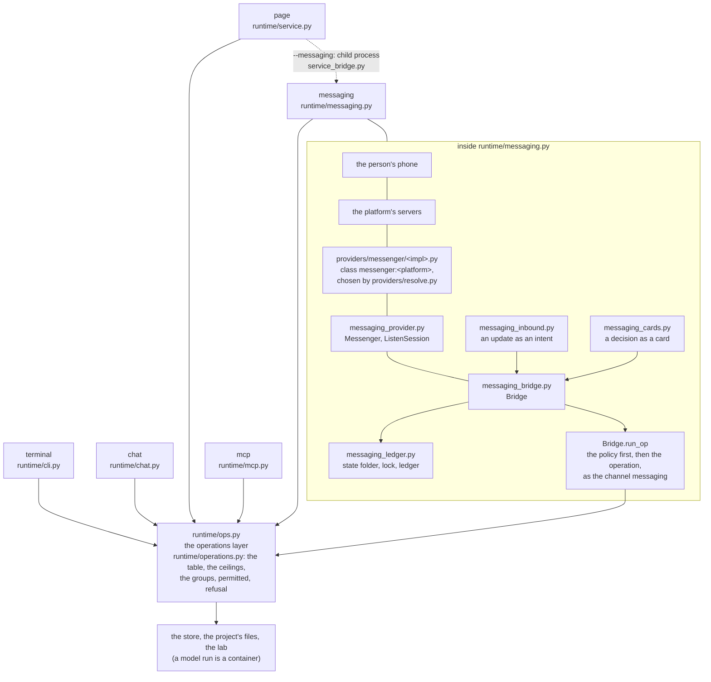
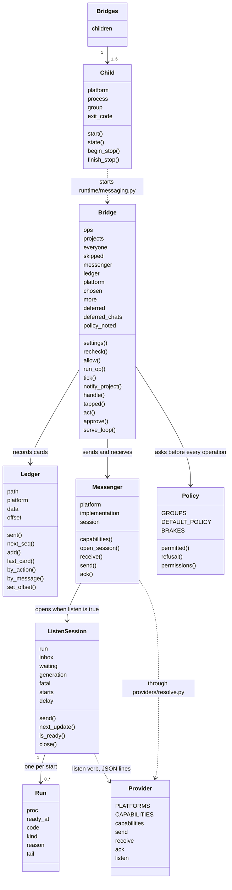
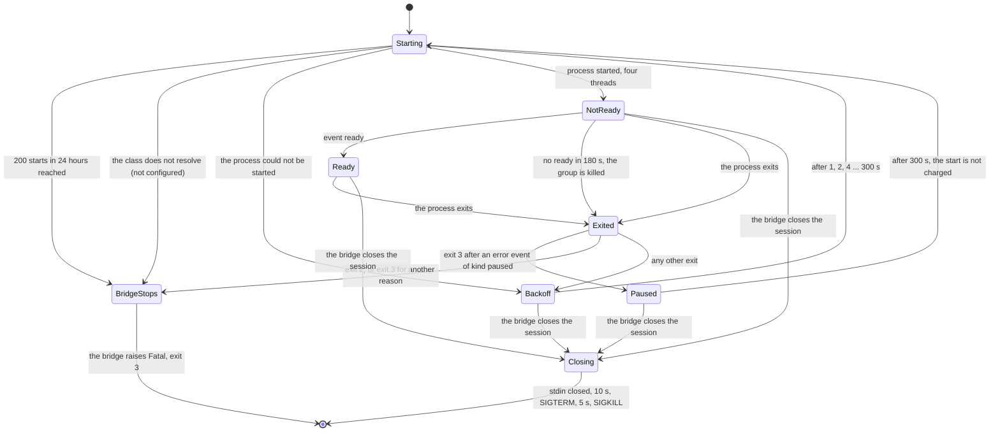
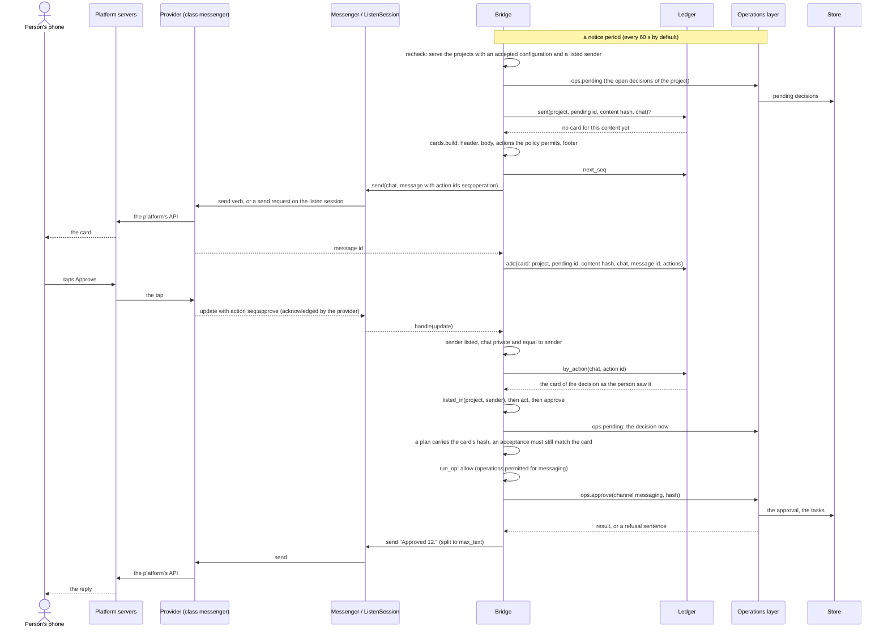

# The messaging channels

Part of [the platform map](README.md). This is not a layer page: it follows one feature, a person running projects from a messaging app they already use, across the layers that carry it. It has the same eight sections, in the same order, as a layer page, and each fact sits in the section where a reader of a layer page would look for it. It states what the code does, with file and line references, and points to the contracts for the rules; when this page and the file it points to disagree, the file wins and the page is corrected. Written on 2026-10-13 from the code of the integration branch after packages MSG-1 to MSG-11, brought to the code after MSG-13 and put in the shape of the platform map on 2026-10-14 (MSG-14).

The feature spans these layers, and each of their pages describes its own part:

| Layer | What messaging puts there | Page |
|---|---|---|
| 7 The shells | the fifth shell `runtime/messaging.py`, the child of the local service `runtime/service_bridge.py`, the option `--messaging` of `runtime/service.py`, the `messaging` and `permissions` fields of `GET /projects`, and the page's side of the policy, `interface/js/permissions.js` | [shells.md](shells.md) |
| 6 The runtime | the channel `messaging` of the table of operations, the channel policy (`runtime/operations.py`), the checks in `ops_say.py`, `ops_waits.py`, `ops_config.py` and `ops.py`, and the keys `messaging` and `channels` of the configuration (`runtime/project_config.py`) | [runtime.md](runtime.md) |
| 3 The providers | the class `messenger:<platform>` and its five implementations under `providers/messenger/`, the listen mode (`providers/resolve.py`, `start`), the messenger rows of the secrets registry | [providers.md](providers.md) |
| 8 The target project | the keys `messaging` and `channels` of `docs/workbench/runtime.json` | [project.md](project.md) |
| 2 Contracts and references | "The messaging bridge", "The channel policy" and "The listen mode" of [contracts/runtime.md](../../../contracts/runtime.md), [providers/CONTRACT.md](../../../providers/CONTRACT.md), [providers/messenger/README.md](../../../providers/messenger/README.md), [contracts/secrets.md](../../../contracts/secrets.md) | [contracts-and-references.md](contracts-and-references.md) |

## Purpose

A person who runs a project through openhora needs two things away from the keyboard: to hear that a decision waits, and to answer it. The page of [the local service](shells.md) does both, but it is a web page to learn and keep open. The messaging channels take the same operations to apps the person already has: Telegram, Discord and three kinds of WhatsApp. The person is told, in a chat with a bot or a number, that a plan, a question, a review or an acceptance waits; reads its text; taps a button or types a short command; and can write a free line to the planning agent as in the terminal conversation.

What reaches the phone:

- **Notices.** One card for each open pending decision, once per content, to every listed sender (`runtime/messaging_cards.py`, `runtime/messaging_bridge.py`).
- **Replies** to what the person writes: the answer of an operation, or the planning agent's reply to a free line.
- **The decisions the project's policy allows the phone to take**: by default only reading, talking to the planning agent and answering a question (`operations.DEFAULT_POLICY`); approving a plan or an acceptance, releasing a delivery, rejecting, cancelling and retrying are turned on one group at a time by the project's configuration (the channel policy, under Abstractions).

What never reaches the phone as an approval: **an effect** (a commit, a pull request, a post, a message sent in the project's name). Decision D8 holds on every channel: an effect is approved only in the terminal or on the local page, with its hash typed or clicked there (`operations.EFFECT_CHANNELS = ("terminal", "page")`). The card of an effect carries the exact command, with its hash, and no button.

What the channels are not: not a second runtime and not a place with a model of its own. No model sits between the app and the operations layer; free text goes to `say`, which is the same planning agent the terminal and the page reach. And the bridge is not an assistant platform: a gateway that is itself an MCP client can use the MCP mode instead, and the note for that is `adapters/openclaw/README.md`; it is outside the core and runs a model between the chat and the tools, which the bridge does not.

Scope of this page: the bridge and its modules, the channel policy for all three channels that take one, the messenger interface, the five platforms built today, the public address the official WhatsApp paths need, the security model, a runbook and the open items. The decisions that shaped it, each with its reason, are the table at the end of "Business rules".

## Artifacts it owns

Where: **repo** is this repository; **state** is the per-user state folder (`--state-dir`, else `$OPENHORA_STATE_DIR`, else `$XDG_STATE_HOME/openhora` when that variable is set and absolute, else `~/.local/state/openhora`; `runtime/messaging_ledger.py:47`), which is never in a repository and outside every project's data folder; **project** is the target project; **store** is the OS secret store (service `openhora`); **service** is an answer of the local service.

| Path | Where | Format | Written by | Read by | Lifecycle | Versioned | Generated |
|---|---|---|---|---|---|---|---|
| `runtime/messaging.py` | repo | Python 3.9, standard library only; the bridge's shell: its docstring is the `--help` text | maintainers | the person, the local service (`service_bridge.py` starts it) | changed by pull request | yes | no |
| `runtime/messaging_bridge.py`, `messaging_cards.py`, `messaging_inbound.py`, `messaging_ledger.py`, `messaging_provider.py` | repo | Python 3.9, standard library only; the logic, the card, the intent, the ledger and the provider access ("The bridge's modules" under Abstractions) | maintainers | `runtime/messaging.py`, and `messaging_*.py` among themselves | changed by pull request | yes | no |
| `runtime/service_bridge.py` | repo | Python 3.9, standard library only; the bridge as a child of the local service | maintainers | `runtime/service.py` | changed by pull request | yes | no |
| `runtime/tests/test_messaging*.py`, `runtime/tests/test_service_messaging.py` | repo | pytest, offline; each sets `OPENHORA_STATE_DIR` to a temporary folder | maintainers | CI, the commit hook | grows with each package | yes | no |
| `interface/js/permissions.js` | repo | an ES module: no network, no DOM; `OPS`, `EXEMPT`, `ASKED`, `can`, `withheld`, `lineText`, `reader`, `fingerprint` | maintainers | the controls of the page (`floor/cards.js`, `cards/plan.js`, `cards/plan-waits.js`, `floor/task-actions.js`, `floor/agent-tab.js`, `views/lobby-composer.js`, `views/lobby.js`, `views/lobby-request.js`) | changed by pull request; a test ties `OPS` and `EXEMPT` to the write functions of `interface/js/api.js` | yes | no |
| `providers/messenger/telegram.py`, `discord.py`, `whatsapp.py`, `whatsapp-cloud.py`, `whatsapp-twilio.py` | repo | one script per implementation of `messenger:<platform>`, PEP 723 header with exact pins; each declares `PLATFORMS` | maintainers | `providers/resolve.py` (by class), the bridge (through it) | changed by pull request, with offline tests | yes | no |
| `providers/messenger/whatsapp_meta.py` | repo | the code the two official WhatsApp providers share (server, window rules, state store, identity map, renderer); its underscore keeps the resolver from listing it | maintainers | `whatsapp-cloud.py`, `whatsapp-twilio.py` (loaded by path) | changed by pull request | yes | no |
| `providers/messenger/discord.py.lock` | repo | the lockfile of `uv lock --script` for Discord's `websockets` dependency, with hashes | maintainers | `providers/resolve.py` (`uv run --locked`) | rewritten when the pin changes; a test fails when it is missing or names another version | yes | yes |
| `providers/messenger/whatsapp/` | repo | the Go program: `main.go`, `listen.go`, `inbound.go`, `send.go`, `render.go`, `session.go`, `commands.go`, `protocol.go`, `logger.go`, `fd*.go`, their `*_test.go`, `go.mod`, `go.sum` | maintainers | `whatsapp.py build`, which builds it on the person's machine; CI runs `go mod verify`, `go vet` and `go test` | `go.sum` holds the hash of every module; the repository carries source only, never a built binary | yes | no |
| `providers/messenger/tests/` | repo | pytest, offline: a fake HTTP client and server on port 0, the shared kits `whatsapp_cloud_kit.py` and `whatsapp_twilio_kit.py`, the render corpus `whatsapp_render_corpus.json` shared with the Go renderer; `conftest.py` applies the loopback guard | maintainers | CI, the commit hook | grows with each verb | yes | no |
| `providers/messenger/README.md` | repo | setup of each platform, the neutral message, the listen protocol, who can read the traffic of each tunnel, live measurements | maintainers | people | updated with each provider | yes | no |
| `<state>/` | state | a folder, mode 0700; checked at every start | `messaging_ledger.prepare_state_dir` (the bridge), and each provider for its own subfolder | the bridge, the providers | kept; nothing prunes the folder itself | no | yes |
| `<state>/messaging-<platform>.lock` | state | an empty file, mode 0600, opened `O_NOFOLLOW`, held with `flock(LOCK_EX \| LOCK_NB)` | `messaging_ledger.take_lock` (the bridge only: a provider is a separate process and must not) | `whoami` of a WhatsApp provider (to refuse while a bridge holds it) | the lock lives as long as the process; a crash leaves none stale; the file stays | no | yes |
| `<state>/messaging-<platform>.json` | state | the ledger: JSON `{"version": 1, "offset", "seq", "cards": [...]}`, mode 0600, no project text; the card entry is under Abstractions | `runtime/messaging_ledger.py` (the bridge), through a temporary file (`O_EXCL`, random name, fsync), published with `os.link` the first time and `os.replace` after | the bridge | grows by one entry per card sent and is never pruned; migrated once from `<data_dir of the first project>/messaging-<platform>.json` when the new file does not exist; the old file is left | no | yes |
| `messenger-message-*.json` in the system's temporary folder | machine | the neutral message handed to a per-call `send` (Telegram only), mode 0600 | `Messenger.send` (`messaging_provider.py:121-137`) | the provider's `send` | removed in a `finally`, right after the call | no | yes |
| `<state>/whatsapp/` | state | a folder, mode 0700: `bin/whatsapp-bridge` (the program), `build.json` (mode 0600: the sha256 of the binary, of `go.sum` and of go.mod, go.sum and every non-test `.go` file), `session.db` (mode 0600, with the `-wal`, `-shm` and `-journal` files beside it: the keys of a linked device, so whoever holds it can read and send as that number) | `whatsapp.py build`, `pair` and `listen` (the program) | `whatsapp.py` (`listen` refuses to start when the program or its sources differ from `build.json`), the Go program | `build` writes it again; `pair` creates the session; a logged-out device is mended by deleting `session.db` and running `pair`; exclude the folder from backups | no | yes |
| `<state>/whatsapp-cloud/` | state | a folder, mode 0700, files 0600: `settings.json` (`phone_number_id`, `port`, `webhook_path`, `template`, `template_language`, optional `public_base`: no secret), `seen.json` (message ids), `window.json` (per chat: `last_inbound`, `template_sent_at`), `identities.json` (business-scoped id to phone digits; phone numbers) | `whatsapp-cloud.py setup` (`settings.json`), the provider's `listen` (the rest), through `whatsapp_meta.Store` | the same | `seen.json` ids are kept 8 days (`SEEN_KEEP`, at most 50000), `window.json` rows 30 days (`WINDOW_KEEP`, at most 1000), `identities.json` rows 30 days (`IDENTITY_KEEP`, at most 2000); pruned when the store opens and once a day while running (`PRUNE_EVERY`); exclude the folder from backups | no | yes |
| `<state>/whatsapp-twilio/` | state | the same folder shape: `settings.json` (`account_sid`, `sender`, `port`, `webhook_path`, `public_url`, `template_sid`, `template_button_id`, `buttons`: no secret), `seen.json`, `window.json`, `identities.json`, and `sent.json` (the MessageSids this process sent, with the chat and the time, so that an error 63016 reported later still matches) | `whatsapp-twilio.py setup` (`settings.json`), the provider's `listen` (the rest) | the same | as the Cloud folder; `sent.json` rows are kept 2 days (`SENT_KEEP`, at most 2000) | no | yes |
| `docs/workbench/runtime.json`, the keys `messaging` and `channels` | project | JSON, no secret: `messaging` is `{"senders": {"<platform>": ["<id>", ...]}, "notices": "text" \| "count", "page_url": <http(s) URL> \| null}`; `channels` is `{"page": [...], "mcp": [...], "messaging": [...]}` of group names | the person | `runtime/project_config.py` (`_messaging`, `_channels`), the bridge through `ops.config` at each call | a change takes effect only after `accept-config` is typed in the terminal | the project decides | no |
| The secret records of every messenger | store | one entry per store username of the table below (service `openhora`, read by the providers through `providers/secrets/resolver.py`); WhatsApp unofficial has none: its secret is the session file | `keyring set openhora <store username>` by a person, at a hidden prompt | the providers | replaced on a new value; the bridge never reads one | no | no |
| `messaging` of `GET /api/v1/projects` | service | `null` without `--messaging`; an object `{"platform", "state": "running" \| "stopped", "exit_code": <n> \| null}` for one platform; a list of those objects for several | `runtime/service.py` (`messaging_state`), from `service_bridge.Child.state` and `Bridges.state` | the page, a client | recomputed at each request | no | yes |
| `permissions` of each project in `GET /api/v1/projects` | service | `{"channel": "page", "allowed": [...]}`, or `null` when the configuration is not accepted | `runtime/service.py` (`_permissions`), from `operations.permissions` | `interface/js/permissions.js` | recomputed at each request | no | yes |

The messenger rows of the secrets registry (`REGISTRY` of `providers/secrets/resolver.py`, equal cell by cell to the table of [contracts/secrets.md](../../../contracts/secrets.md)): store usernames only, never a value.

<!-- generated: messenger-secrets -->
| Secret | Store username | Read by | Purpose |
|---|---|---|---|
| `MESSENGER_TELEGRAM_BOT_TOKEN` | `messenger-telegram` | `providers/messenger/telegram.py` | receive the person's messages and send the notices of the messaging bridge, as a Telegram bot |
| `MESSENGER_DISCORD_BOT_TOKEN` | `messenger-discord` | `providers/messenger/discord.py` | receive the person's messages and button taps and send the notices of the messaging bridge, as a Discord bot |
| `MESSENGER_WHATSAPP_CLOUD_TOKEN` | `messenger-whatsapp-cloud` | `providers/messenger/whatsapp-cloud.py` | send the notices of the messaging bridge through the official WhatsApp Cloud API, and check at start that the token works |
| `MESSENGER_WHATSAPP_CLOUD_APP_SECRET` | `messenger-whatsapp-cloud-app-secret` | `providers/messenger/whatsapp-cloud.py` | check the signature of every webhook call Meta makes to the bridge's local server |
| `MESSENGER_WHATSAPP_CLOUD_VERIFY_TOKEN` | `messenger-whatsapp-cloud-verify-token` | `providers/messenger/whatsapp-cloud.py` | answer Meta's webhook handshake (the verify token typed in the app's webhook settings) |
| `MESSENGER_WHATSAPP_TWILIO_API_KEY_SID` | `messenger-whatsapp-twilio-api-key-sid` | `providers/messenger/whatsapp-twilio.py` | name the Restricted API key that sends the notices of the messaging bridge through Twilio's WhatsApp sender |
| `MESSENGER_WHATSAPP_TWILIO_API_KEY_SECRET` | `messenger-whatsapp-twilio-api-key-secret` | `providers/messenger/whatsapp-twilio.py` | authenticate the sends of the messaging bridge through Twilio's Messages API, as the Restricted API key |
| `MESSENGER_WHATSAPP_TWILIO_AUTH_TOKEN` | `messenger-whatsapp-twilio-auth-token` | `providers/messenger/whatsapp-twilio.py` | check X-Twilio-Signature on every webhook call Twilio makes to the bridge's local server |
<!-- /generated -->

## Abstractions

### Where the bridge sits

The operations layer (`runtime/ops.py` and the table `runtime/operations.py`) is reached by five shells. Each parses what it was given, calls one operation and returns what came back; none decides a rule a second shell would have to decide again.



With `--messaging`, the local service also starts `runtime/messaging.py` as a child process (`service_bridge.py`); the two are separate processes that share the operations layer, not a call path.

The five channels are the values of the `channels` column of the table (`runtime/operations.py`): `terminal`, `chat`, `page`, `mcp` and `messaging`. The ceiling of `messaging` is the rows `status`, `task`, `progress`, `pending`, `answer`, `release`, `approve`, `reject`, `retry`, `cancel`, `say`, `agents`, `skills`, `costs`, `artifacts` and `artifact`, and no other (not `request`, `route`, `set-mode`, `accept-config`, `go-ahead`, `config`, `dispatch`, the standing approvals, nor anything terminal-only). `messaging` is not in `ops_say.QUEUING_CHANNELS` (`runtime/ops_say.py:62`: only the page queues a line while a run holds the project): a line that arrives meanwhile is answered with the sentence in `messaging_bridge.RUN_BUSY` (`runtime/messaging_bridge.py:66`). Of the rows that take a channel (`channel_arg`), `approve` and `say` are told `messaging` by the bridge (`Bridge.run_op`, `messaging_bridge.py:182-183`).

### The class diagram



### The channel `messaging` and the channel policy

The `channels` column of the table (`runtime/operations.py`) is the **ceiling** of a channel. A project's `docs/workbench/runtime.json` may narrow it with named groups, `"channels": {"page": [...], "mcp": [...], "messaging": [...]}`, and never widens it; like every key of the file, a change takes effect only after `accept-config` is typed in the terminal. `runtime/project_config.py` (`_channels`, `:182-219`) refuses an unknown group, a group none of whose operations the channel's ceiling lists, `approve-effects` anywhere but the page, a `page` or `mcp` list without `read`, and an entry for `chat` or `terminal` (neither is ever narrowed: the conversation's input is local access, equal to the terminal). A group is valid on a channel when one of its operations is in that channel's ceiling; it then covers the ceiling's share. Every row the page, the MCP mode or messaging may call is in exactly one group (a test walks the table).

The groups are a closed list in `operations.GROUPS` (`runtime/operations.py:259`), a pure literal, and the block below is generated from it:

<!-- generated: channel-groups -->
Channels with a policy (`POLICY_CHANNELS`): `page`, `mcp`, `messaging`. Never narrowed (`NEVER_NARROWED`): `terminal`. A policy for `page`, `mcp` must list `read` (`MUST_READ`). A channel with no entry in the project's `channels` takes its `DEFAULT_POLICY`: `messaging`: `read`, `talk`, `answer`; any other channel keeps its whole ceiling. Valid on the page only (`PAGE_ONLY_GROUPS`): `approve-effects`. An effect is approved only from (`EFFECT_CHANNELS`): `terminal`, `page`. Brakes (`BRAKES`), permitted on the page whatever its policy says: `cancel`, `set-mode`.

| Group | Operations | Decision kind | Valid on | In the default policy of |
|---|---|---|---|---|
| `read` | `status`, `progress`, `pending`, `task`, `agents`, `costs`, `skills`, `artifacts`, `artifact`, `flows`, `conversation`, `connections`, `version`, `config`, `commands`, `artifact-raw` | - | `page`, `mcp`, `messaging` | `messaging` |
| `talk` | `say` | - | `page`, `mcp`, `messaging` | `messaging` |
| `answer` | `answer` | - | `page`, `mcp`, `messaging` | `messaging` |
| `release` | `release` | - | `page`, `mcp`, `messaging` | - |
| `request` | `request`, `route` | - | `page`, `mcp` | - |
| `approve-plans` | `approve` | `plan` | `page`, `messaging` | - |
| `approve-acceptances` | `approve` | `acceptance` | `page`, `messaging` | - |
| `approve-effects` | `approve` | `effect` | `page` | - |
| `go-ahead` | `go-ahead` | - | `page` | - |
| `reject-cancel` | `reject`, `cancel` | - | `page`, `messaging` | - |
| `retry` | `retry` | - | `page`, `messaging` | - |
| `set-mode` | `set-mode`, `set-model` | - | `page` | - |
| `consent` | `give-consent` | - | `page` | - |
| `dispatch` | `dispatch` | - | `page` | - |
| `documents` | `sync`, `hand-over` | - | `page` | - |
| `verdict` | `verdict` | - | `page` | - |
| `sources` | `source-add`, `source-import`, `source-refresh`, `source-describe`, `sources` | - | `page`, `mcp`, `messaging` | - |
<!-- /generated -->

`messaging` is **closed** by default: with no entry in `channels` it takes `DEFAULT_POLICY`. The other channels:

| Channel | With no entry in `channels` | Narrowed by |
|---|---|---|
| `terminal` | the whole ceiling, always | never |
| `chat` | the whole ceiling, always | never (an error to name it) |
| `page` | the whole ceiling | `channels.page`, which must list `read` |
| `mcp` | the whole ceiling | `channels.mcp`, which must list `read` |
| `messaging` | **closed**: `read`, `talk`, `answer` (`operations.DEFAULT_POLICY`) | `channels.messaging`: approving, releasing, rejecting, cancelling and retrying are turned on one group at a time |

**One helper, and every place it runs.** `operations.permitted(op, channel, policy, kind=None)` (`runtime/operations.py:335`) is pure; `operations.refusal(op, channel, policy, kind=None, go_ahead=False)` (`:350`) returns the sentence "/<operation> is not enabled for this channel; the project's configuration (channels.<channel>) turns it on" (`not_enabled`, `:345`), or `None`; the caller raises `OpsError` with code 1. It runs in code, never in a prompt:

| Where | What it checks |
|---|---|
| `runtime/service.py` `_policy_refusal` (`:660`) | every route of the page, after the query is read and before the bytes of an upload are written and before a job starts: a refused route is `409` `refused`, takes no model slot, writes nothing. A read returns first; a configuration that is not accepted is left to the operation (`412`) |
| `runtime/mcp.py` `_refuse_by_policy` (`:287`) | each `tools/call`, per project, before a job starts. `tools/list` still shows the ceiling's tools |
| `runtime/ops_say.py` `_say_command` (`:508`) | a command typed into `say`, under the channel that carries the line (`page`, `mcp` or `messaging`, never `chat`) |
| `runtime/ops_waits.py` `only_on_plans` (`:281`, called from `ops.approve`) | approval of a plan, an acceptance (and an effect, for a channel that may approve one at all), and a non-empty `go_ahead` (which needs the group `go-ahead` too) |
| `runtime/ops_config.py` `set_mode` (`:114`) | the direction of a mode change from the page (below) |
| `runtime/ops_say.py` `_drain_refusal` (`:364`) | a queued entry, again when the page's queue is drained (below) |
| `runtime/messaging_bridge.py` `Bridge.allow` / `run_op` (`:167`, `:178`) | every operation the bridge calls, and the card it draws |

The policy is read from the project's accepted configuration at each call (`Bridge.settings` asks `ops.config` every time, `messaging_bridge.py:97-105`), so a change the person accepted takes effect without a restart, and a configuration that is not accepted refuses everything.

**The brakes.** `operations.BRAKES = ("cancel", "set-mode")` (`:287`): on the page, `cancel` and a move **down** of an agent's mode are permitted whatever the policy says (`permitted`, `:340`), `--lan` included, so a person who has lost trust can always stop work from the page; a page policy may omit them without error. A move **up** is refused unless the policy lists `set-mode`; the direction is known only after the mode is read, so `ops_config.set_mode` checks it before its lock and any write (`:143-147`). The brakes do not leak to other channels: `cancel` on `messaging` still needs `reject-cancel`.

**The queue's stored group.** Only the page queues a line or a route while a run holds the project. Each queue entry stores the group that created it (`talk` for a line and for a request a line made, `request` for a route the page asked for, `QUEUE_GROUPS`, `ops_say.py:63`); `route_queued` re-checks that group under `page`, with the policy as it is at drain time, before it answers the line or routes the request. A refused entry gets a stored reply with the sentence and leaves the queue; an entry queued before the group was stored is checked as `talk` (a line) or `request` (a route), under `page` (`_drain_refusal`, `:364-370`).

**The permissions pairs.** The service's own `GET /projects` adds, per project, `"permissions": {"channel": "page", "allowed": [...]}`, or `null` when the configuration is not accepted (`service._permissions`, `:685`, built from `operations.permissions`, `:363`, in the handler at `:821` and not in `shell_kit`). `allowed` is in the table's order and holds the plain name of every operation the page may call, except `approve` and `set-mode`, which are pairs: `approve:plan`, `approve:acceptance`, `approve:effect`, `approve:go-ahead` and `set-mode:down`, `set-mode:up`; `cancel` and `set-mode:down` are always there. The answer of `commands` leaves out the commands the page's policy refuses (`service._shown_commands`: `/new` follows `talk`, `/help` stays).

`interface/js/permissions.js` is the page's side: no network, no DOM; `can(project, op, kind)` (`:57`) looks a name up in that list. A project entry without the key, with `null`, or with a shape that is not a list allows everything, so the page never hides a control because of a shape it does not know. The controls draw only what the list allows and say on one line what is turned off; `cancel` and `setMode` are exempt from the check as brakes (`EXEMPT`, `:32`). A test ties the write functions of `interface/js/api.js` to the module's `OPS` (`:17`) and `EXEMPT` maps so a new one cannot be added without a decision. The page decides nothing: a write the page still sends against the policy is refused by the service with `409`, and the service's check is the authority. The policy governs a person's requests, not the dispatch loop the service runs on its own timer.

### The bridge

`Bridge` (`runtime/messaging_bridge.py:82`) subclasses `shell_kit.Jobs`. Its properties:

| Property | What it holds |
|---|---|
| `ops`, `log` | the operations module and the log function (from `Jobs`); the log carries no sender id, no text and no result |
| `projects` | the projects that are ready to serve now (a part of `everyone`) |
| `everyone` | every project the bridge was given |
| `skipped` | project id to the reason it is skipped now (absent: served) |
| `messenger`, `ledger`, `platform` | the `Messenger` of the platform, its `Ledger`, the platform's name |
| `chosen` | sender to the project id that sender chose with `/project` |
| `more` | `(project id, chat)` to the number last announced as waiting ("And n more waiting"), set once the line went out |
| `policy_noted` | the projects whose "notices are off" line was already logged |
| `deferred`, `deferred_chats` | `(project id, pending id, chat)` to the time it was last logged as deferred; the chats with a card kept for later |
| `clock` | the time source for `sent_at` |

Its relations: it asks the **ledger** whether a card was sent and records each one; it sends and receives through the **messenger**; it asks the **policy** (`operations.permitted`) before every operation, through `run_op`; it calls the **operations layer** only through `run_op` (the one call path) and `ops.pending`/`ops.config`; it takes the project's model slot through `shell_kit.Jobs.start_job` for `say` and `release`.

**Its loop.** `serve_loop` (`:489`) runs until `stop` is set. For a provider with a listen session it is `listen_loop` (`:464`), otherwise a poll loop: `tick` every notice period, then `poll_once` (a `receive` of at most `POLL_SECONDS` = 25 s, the ledger's offset sent and the next one stored). **`tick`** (`:257`) is `recheck` first, then, for each served project, `notify_project` and the "And n more waiting" line. **`notify_project`** (`:228`) sends the cards a project's open decisions lack, at most `CARDS_PER_TICK` = 10, and returns how many are left over. A provider that listens is looked at again at once when it becomes ready, and notices wait until it is (`listen_loop`).

**Skip and re-check.** A project whose configuration is not accepted, or whose accepted configuration lists no sender for the platform, is skipped, not a reason to stop. `Bridge.recheck` (`:107`) runs at the start of every notice period; it logs one line when a project's state changes (`skipping <name>: its configuration is not accepted (run accept-config in the terminal)`, `... runtime.json messaging.senders.<platform> lists no sender`, `... its configuration cannot be read`, `<name> is ready: now served`) and serves a project from its accepted file the moment it is ready. With every project skipped the bridge keeps running. Until a project is ready no update is served for it: a message from its sender in that window is dropped like one from an unlisted sender (the first row of "Common errors").

**Inbound** (`handle`, `:275`). An update from a sender who is not in `messaging.senders.<platform>` of at least one served project, or from a chat that is not private, or whose `chat` differs from `sender`, is dropped with no reply and one log line (`dropped an update from an unlisted sender`, no id, no text). A tapped button is looked up in the ledger by action id and chat (an unknown one gets "This button is no longer valid. Send /pending."), acknowledged where the platform needs it, and run with the recorded pending id. A typed command is read by `messaging_inbound.parse`; a reply to a question's card is `answer`; any other text is `say`, in a thread, one model call per project at a time ("Still working on the last message."), and its reply goes back as a neutral message split to the platform's limit (`cards.split`). A person listed in several projects chooses with `/project <name>`; the default is the first (`project_of`, `:147`).

**The modules**, each with one job (the layer map in `scripts/tests/test_layer_map.py` lets `messaging.py` import `ops.py`, `shell_kit.py` and these, `messaging_*.py` reach each other, `shell_kit.py`, `providers/resolve.py` and `scripts/redact.py`, and `service.py` import `service_bridge.py`, which names only `messaging.py`):

| Module | Job |
|---|---|
| `messaging.py` | The shell: parses the command line, makes and locks the state folder, installs the signal handlers, prints the start line, and runs `serve` |
| `messaging_bridge.py` | The logic. `Bridge.run_op` is the one call path: `operations.permitted` for the channel and the project's policy, then the operation, as the channel `messaging`. Notices (`tick`, `notify_project`), the intents (`handle`, `tapped`, `act`, `approve`), `say` and `release` in threads (`shell_kit.Jobs`, one model job per project), the poll loop and the listen loop |
| `messaging_cards.py` | A pending decision as a neutral card, fitted to the capabilities; pure. Also `content_sha256` and `split` |
| `messaging_inbound.py` | An update as an intent (`approve`, `reject`, `release`, `answer`, `pending`, `project`, `help`, `reply`, `action`, `text`, `usage`, `ignore`); pure |
| `messaging_ledger.py` | The state folder (made and checked), the lock, the ledger file; no network |
| `messaging_provider.py` | `Messenger` (the four verbs through `providers/resolve.py`) and `ListenSession` (the long-lived `listen` verb) |
| `service_bridge.py` | The bridge as a child of the local service (below); standard library only |

### The ledger and a card entry

Per user, never in a repository. The folder is the state folder (`messaging_ledger.state_dir`, `:47`). `prepare_state_dir` (`:59`) makes it mode 0700 and **checks** it with `lstat`: a real directory (not a link), owned by the user, no group or other bits; anything else is `StateError` and exit 2 naming the path. `take_lock` (`:78`) opens `<state>/messaging-<platform>.lock` with `O_CREAT | O_NOFOLLOW` at mode 0600, checks it is a regular file of the user, and takes `flock(LOCK_EX | LOCK_NB)` for the life of the process; a held lock is `LockHeld` and exit 4 ("another messaging bridge already serves <platform> on this machine (its lock: <path>); stop it first"). The system releases the lock when the process ends, so a crash leaves none stale. Only `messaging.py` takes it: a provider is a separate process and must not.

The ledger is `<state>/messaging-<platform>.json` (mode 0600), written through a temporary file (`O_EXCL`, random name, fsync) and published with `os.link` the first time and `os.replace` after (`_write`, `:149`). It holds no text of a project. Its keys: `version` (1), `offset` (the platform's next update offset, Telegram only; a listen provider never touches it), `seq` (the number action ids are made from, raised by `next_seq` and persisted by the next `add`) and `cards`. A **card entry** (`Bridge.send_card`, `messaging_bridge.py:209-211`) holds:

| Key | What it is |
|---|---|
| `platform` | the platform (added by `Ledger.add`; an entry without it is read as this platform's) |
| `project` | the project's id |
| `pending_id`, `kind` | the pending decision and its kind |
| `content_sha256` | what the card is bound to: a plan's hash, an effect's payload hash, else the sha256 of the decision's text (`messaging_cards.content_sha256`) |
| `chat` | the chat it was sent to |
| `message_id` | the platform's message id |
| `actions` | the action ids made for it, `{"<seq>:<operation>": "<operation>"}` |
| `sent_at` | the time it was sent |

A card is found by platform, project id and chat (`sent`, `:189`), so two sets of projects on one machine never suppress each other's cards, and a restart sends no card twice. A button is found by `by_action` (chat and action id, newest first), a reply by `by_message`, the newest card of a decision in a chat by `last_card`. An **action id** is `<seq>:<operation>` (`approve`, `release`, `reject`), made by the bridge, never by a provider; a card with several buttons gets several ids with one `seq`. A one-time migration copies, from `<data_dir of the first project>/messaging-<platform>.json` (where the first versions kept it), the cards of the projects this bridge serves, with the old `seq` and `offset`, so an action id on a card already sent still acts on that card; the old file is left and one line says it can be deleted (`_migrate`, `:114`). A ledger that cannot be read or is not of this version is `LedgerError` (exit 1).

### The card and the neutral message

The neutral message the bridge sends is `{"text", "actions": [{"id", "label"}], "link": {"label", "url"} | null, "document": {"name", "text"} | null}`, where the text is Markdown as the agents write it and the action ids are `<seq>:<operation>` made by the bridge. `messaging_cards.build` (`:89`) makes it from a pending decision and returns `{"message", "content_sha256", "kind", "pending_id"}` (each action of `message` is first `{"op", "label"}`, and the bridge turns it into `{"id", "label"}`):

- a header `<project name> · <kind> #<id>`, then the body, then a footer;
- **actions**: one for each resolution word of the decision whose operation the policy permits (approved and accepted are `approve`, rejected `reject`, released `release`), in the order approve, release, reject; an effect is never offered an approval; a question is answered by replying to its card, when the policy permits `answer` and the platform keeps reply context;
- **folding**: buttons are drawn only when the platform declares them, and only as many as `max_buttons`; the rest become typed lines in the footer, "Send /approve 12", which always work. What the **policy** refuses is neither drawn nor offered as a line: the card says "Act on it on the page or in the terminal.";
- **link**: a page link (when `messaging.page_url` is set and the card is an effect, has a refused action, or is in `count` mode) becomes a link button where the platform has `url_buttons`, else the URL in the footer;
- **text**: with `notices: "text"` the decision's text, cut to `max_text` with "(continues on the page)" or, where the platform takes documents, a short body plus the whole text as a document (`<kind>-<id>.txt`); with `"count"`, "A <kind> waits for you." and no project text;
- the card of an effect ends with "Approve it on the page or in the terminal:" and the exact command as a code span (`code_span`, `:78`: a command that holds a backtick is wrapped in a longer run);
- at most 10 cards per project per tick, then the line "And <n> more waiting. Send /pending to list them."

### An update and an intent

An **update** is one element of what a provider receives (a `receive` answer, or a listen `update` event): `{"update_id"?, "sender", "chat", "private", "text", "action", "action_ref", "reply_to"}`. For a listen provider the bridge validates it (`messaging_provider.valid_update`, `:164`): it must be a JSON object with `private` true, a non-empty string `sender` and `chat`, and `text`, `action` and `reply_to` each a string or null; `action_ref` is forced to null (the provider has already acknowledged). Anything else is dropped and logged by class. An **intent** is what `messaging_inbound.parse` (`:37`) makes of it, one dict with a `kind`:

| Kind | From | Fields |
|---|---|---|
| `action` | a tapped button | `action` (the id) |
| `approve`, `release` | `/approve <id>`, `/release <id>` | `id` |
| `reject` | `/reject <id> [note]` | `id`, `note` or null |
| `answer` | `/answer <id> <text>` | `id`, `text` |
| `pending`, `help` | `/pending`; `/help`, `/start` | none |
| `project` | `/project [name]` | `name` (empty: say which) |
| `reply` | a reply to a message, not a command | `reply_to`, `text` |
| `text` | anything else, a command the bridge does not handle itself (such as `/status`) included | `text` (a line for the planning agent) |
| `usage` | a command it handles with arguments it cannot read | `text` ("Usage: ...") |
| `ignore` | an empty update | none |

### Capabilities

`capabilities --platform <p>` prints a JSON object. `Messenger.capabilities` (`messaging_provider.py:89`) reads it once and checks every key's type (`CAPABILITY_KEYS`, `:35`): `max_text` (int), `buttons` (bool), `max_buttons` (int), `max_button_label` (int), `lists` (bool), `max_list_rows` (int), `url_buttons` (bool), `reply_context` (bool), `documents` (bool). The one optional key is `listen` (bool; absent is stored as false). A missing or mistyped key is `MessengerError("failed")`. The values of the five shipped providers, read from their text by the generator (no provider is run):

<!-- generated: messenger-capabilities -->
`yes` and `no` are booleans; a key a provider leaves out is `no` (`listen` is optional); `configured` is a value the provider computes from its saved settings, not a constant.

| Platform | Provider | `max_text` | `buttons` | `max_buttons` | `max_button_label` | `lists` | `max_list_rows` | `url_buttons` | `reply_context` | `documents` | `listen` |
|---|---|---|---|---|---|---|---|---|---|---|---|
| `discord` | `discord.py` | 1900 | yes | 5 | 80 | no | 0 | yes | yes | yes | yes |
| `telegram` | `telegram.py` | 4096 | yes | 6 | 40 | no | 0 | yes | yes | yes | no |
| `whatsapp` | `whatsapp.py` | 4096 | no | 0 | 0 | no | 0 | no | yes | yes | yes |
| `whatsapp-cloud` | `whatsapp-cloud.py` | 4096 | yes | 3 | 20 | no | 0 | no | yes | yes | yes |
| `whatsapp-twilio` | `whatsapp-twilio.py` | 1600 | configured | 3 if configured, else 0 | 20 if configured, else 0 | no | 0 | no | yes | no | yes |
<!-- /generated -->

### The messenger class and its two modes

A messenger is a provider of the class `messenger:<platform>`, in `providers/messenger/<impl>.py`. The class is one the runtime uses, not one a skill may require, so on purpose it is not in the class table of `contracts/environment.md` (which skills copy); it is documented in [providers/CONTRACT.md](../../../providers/CONTRACT.md). The part after the colon is handed to the script as `--platform`; each script declares the platforms it serves on one top-level line, `PLATFORMS = ("<platform>",)`, which `providers/resolve.py` reads as text. The variables `MESSENGER_<PLATFORM>_PROVIDER`, then `MESSENGER_PROVIDER`, choose among several; one candidate is chosen on its own. The bridge names no implementation.

`resolve.py` has two ways to run a provider: `call(cls, verb, args, ...)` (`:383`), one JSON object per process, and `start(cls, verb, args, ...)` (`:395`), which returns the running `Popen` of a long-lived verb (binary stdin, stdout and stderr pipes, its own session, no file descriptor of the caller). `interpreter_for(path)` (`:322`) picks the interpreter: the caller's own for a header with `# dependencies = []`, otherwise `uv run`, and `uv run --locked` when `<script>.lock` sits next to the script. The exit codes of a verb map to `ProviderCallError.kind` (`:370-373`): 2 `usage`, 3 `not-configured`, anything else `failed`, and a timeout `timeout`; `Messenger._call` (`messaging_provider.py:82`) turns it into a `MessengerError` with the same kind.

**Mode one: the per-call verbs** (Telegram). One process per call. `receive --platform <p> --offset <n> --timeout <s>` returns `{"updates": [{"update_id", "sender", "chat", "private", "text", "action", "action_ref", "reply_to"}], "next_offset"}` (long polling where the platform has it); `send --platform <p> --chat <id> --message-file <f>` reads the neutral message from a file of mode 0600 that the bridge removes afterwards and prints `{"message_id"}`; `ack --platform <p> --action-ref <ref>` acknowledges a tapped button. `send` has no `--confirmed` and no idempotency key (which CONTRACT.md asks of other verbs that send): the bridge is the only caller, sends only to a chat of the project's accepted `messaging.senders` list, and keeps the ledger. A provider refuses a message beyond its capabilities (exit 2); the bridge never sends one.

**Mode two: the listen session.** A platform that must stay connected (a gateway that delivers taps only on its open connection, a client with one live session, a webhook server) declares `"listen": true` and implements `listen --platform <p>`. The bridge starts it once, through `resolve.start`, and keeps it (`ListenSession`, `runtime/messaging_provider.py:202`).

- **Protocol.** JSON lines on binary standard input and output, UTF-8 written as ASCII (`ensure_ascii=True`, `line_of`, `:159`), one flush per line, at most 1 MiB per line (`MAX_LINE`, `:39`). The bridge writes `{"id", "op": "send", "chat", "message"}`; the provider writes `{"event": "ready"}`, `{"event": "update", "update": {...}}` (the shape of one element of `receive`), `{"event": "error", "kind", "reason"}` and the answers `{"id", "ok": true, "message_id"}` or `{"id", "ok": false, "kind", "reason"}`. Nothing else is ever written to stdout. There is no `ack`: the provider acknowledges its own taps at once and emits `action_ref: null` (the bridge forces it to null); no offset applies.
- **Validation** (`take`, `:515`). The reader drops, and logs by class, a line over the limit, one that is not JSON or not an object, an unknown event, an answer to an unknown id, and an update that is not private or lacks a non-empty string `sender` or `chat`. Updates feed a bounded queue (`UPDATE_QUEUE` = 1000; the newest are dropped when full, with one line).
- **Lifecycle** (`supervise`, `:350`). One supervisor starts the process, waits for `ready` (`READY_SECONDS` = 180; missing it counts as a crash and kills the group), and decides after an exit: **2 or 3 stops the bridge** (exit 3, with the reason of the last error event, else the redacted stderr tail, else `exit <n>`); anything else restarts it after a backoff of 1, 2, 4 ... up to 300 s (`BACKOFF`; the first wait again only after `RESET_AFTER` = 10 minutes ready), at most `MAX_STARTS` = 200 starts per rolling 24 hours for each bridge process, after which the bridge stops with a sentence (a platform may reset a credential that connects too often). Notices wait until `ready` and are looked at again at once when it comes back (`generation`). A watcher on `proc.wait()` detects an exit, kills the leader's group and fails every waiting request (`exit_loop`, `:452`). Stderr is drained, the last `STDERR_TAIL` = 300 characters kept and shown only after `scripts/redact.py`, and only when no error event gave a reason.
- **Stop** (`close`, `:288`). The bridge closes the session after its jobs have ended: stdin closed, then `STDIN_WAIT` = 10 s, SIGTERM to the provider's group, `TERM_WAIT` = 5 s, SIGKILL, by group id only. A provider must exit **within 5 s of the end of its standard input**: it runs in a session of its own, so killing the bridge never reaches it, and the end of its stdin is what stops it.
- **Rules for a provider.** Duplicate fd 1 for the protocol and point fd 1 at stderr; never `setsid`; interactive pairing is a separate verb run in a terminal, never inside `listen`.

`Run` (`:179`) is one start of the provider process: `proc`, `out` (the writer thread's queue), `ready_at`, `code`, `reason` (of the last error event, at most 300 characters), `kind` (a word of `ERROR_KINDS`, else `other`), `tail`, `threads`, `stale`; it is `ready` once `ready_at` is set and the process has not exited. `ListenSession` holds one `Run` at a time, the update `inbox`, the `waiting` requests (request id to an event and an answer), the `generation` (how many `ready` events), `fatal` (the sentence that stops the bridge), the `starts` of the rolling window and the current backoff `delay`; its threads are a supervisor, and for each start a writer, a reader, a stderr drain and a watcher on the exit.



### Answer kinds and error kinds

| Kind | Where it is said | Meaning | What the bridge does |
|---|---|---|---|
| `usage` | an exit 2 of a verb; an error event or an answer | the call or the message does not fit (a message beyond the capabilities, a flag) | the verb fails with `MessengerError("usage")`; as a listen exit it stops the bridge |
| `not-configured` | an exit 3 of a verb; an error event; an answer | the person has something to do (a missing secret, a refused token, a webhook set on the bot) | `Fatal` and exit 3; as a listen exit it stops the bridge |
| `failed` | any other exit; an answer; the resolver for a provider that printed no JSON object | the call did not work | logged by class; a card not sent is tried again at the next notice period |
| `timeout` | the resolver, when a verb runs over its time | the same, for a per-call verb | as `failed` |
| `paused` | an **error-event** kind only (`ERROR_KINDS`, `messaging_provider.py:48`) | the platform session is gone and only the person can mend it (a logged-out WhatsApp device). The provider writes the event and exits 3 | this is the one exit 3 that does not stop the bridge: it logs the redacted reason, waits `PAUSED_WAIT` = 5 minutes (a close interrupts the wait), and starts the provider again; that start is not charged to the 200-starts ceiling and the backoff is left alone; the line is written again every `PAUSED_REPEAT` = 24 hours while it stays paused and again after the provider has been connected in between. Cards wait as for any provider that is not ready |
| `deferred` | an **answer** kind only (`ANSWER_KINDS`, `:49`): `{"id", "ok": false, "kind": "deferred", "reason"}` | a platform that lets a business write first only inside a window (the official WhatsApp API: 24 hours after the person's last message) cannot take the card now. It is not an error and never a reason to stop or restart | the bridge records nothing in the ledger for that card, so it is offered again at the next notice period and at once when the person next writes from that chat (`Bridge.deferred_chats`), and it logs one line for a card and a chat at most every `DEFERRED_LOG_EVERY` = 24 hours (`defer`, `messaging_bridge.py:216`) |

**At-least-once delivery.** A send in flight when the provider dies fails, and its card is sent again after the next `ready`. The first copy, if it was delivered, has buttons the ledger has no record of, which answer the stale-button sentence. What the platform delivers to a linked device while the provider is paused or restarting is delivered when it reconnects, each approval still bound to the card the person saw. Duplicates are therefore possible; a wrong approval is not, because the binding is the hash or the card's content, not the delivery.

### The service's children

With `--messaging`, `service_bridge.Child` (`runtime/service_bridge.py:83`) holds the bridge process of one platform: `platform`, `argv` (built by `command`, `:62`), `environment` (a copy of the snapshot), `process`, `group` (the process group id its own session made), `exit_code`, `stopping`, `stop_wait` (150 s) and a watcher thread. `state()` is `{"platform", "state": "running" | "stopped", "exit_code": <n> | null}`. `Bridges` (`:170`) holds one `Child` per platform, in the order given. The service's `bridge` attribute is the `Child` for one platform and the `Bridges` for several (`service.py:1022-1029`). What a child is started with, and how it stops, is under "Business rules" (rules 41 to 44).

### The WhatsApp window and the template marks

The two official WhatsApp providers share one rule (`whatsapp_meta.py`): a business may write free text only within 24 hours of the person's last message (`WINDOW_SECONDS`), and the provider sends a card only while that last message is younger than 23 h 30 min (`WINDOW_GATE`). The provider records per chat, in `window.json`, `last_inbound` (the time of the last message: Meta's own timestamp for the Cloud API, the time of receipt for Twilio, which sends none) and `template_sent_at` (the time the fixed template was last sent). Outside the window a send is not made: with an approved template (optional), the provider sends it once per closed window and again at most every 7 days (`TEMPLATE_REPEAT`); without one it sends nothing and logs one line per chat per 24 hours (`NO_TEMPLATE_LOG`); either way the send answers `deferred`. The template is fixed text with no project text ("N decisions wait; reply to see them") and one "See decisions" quick reply, mapped to `/pending`. A late error closes the window of that chat and sends the template, still once: 131047 on the Cloud API (reported later as a `failed` status for a message the process sent), 63016 on Twilio (from the send or a per-message status callback for a SID in `sent.json`). The marks of the window and the template are exactly these two fields; a clock skew over `CLOCK_SKEW` = 300 s is read as now.

### The platforms

| | Telegram | Discord | WhatsApp, unofficial | WhatsApp Cloud API | WhatsApp through Twilio |
|---|---|---|---|---|---|
| Platform name | `telegram` | `discord` | `whatsapp` | `whatsapp-cloud` | `whatsapp-twilio` |
| Provider | `telegram.py` | `discord.py` (+ `discord.py.lock`) | `whatsapp.py` + Go program `whatsapp/` | `whatsapp-cloud.py` | `whatsapp-twilio.py` |
| Mode | one process per verb | listen | listen | listen | listen |
| How it receives | `getUpdates` long polling | Gateway (WebSocket), direct messages | linked-device session of a Go client | webhook (local server, public HTTPS) | webhook (local server, public HTTPS) |
| How it sends | Bot API `sendMessage` | REST `POST` on the DM channel | the Go client | Graph API | Messages API |
| Buttons | inline keyboard, up to 6, label 40, URL button | up to 5, label 80, link button | none (typed commands) | up to 3 reply buttons per message | typed commands until three quick-reply template ids are recorded, then up to 3 |
| Documents | `sendDocument` | `.txt` in the same message | text/plain or text/markdown after the text | media upload after the text | no (text cut at 1600) |
| `max_text` | 4096 | 1900 | 4096 | 4096 | 1600 |
| Sender id | numeric user id | user id | phone digits | phone digits (and, if used, a business-scoped id) | phone digits (and, if used, a business-scoped id) |
| Secrets (store usernames) | `messenger-telegram` | `messenger-discord` | none: the session file | `messenger-whatsapp-cloud`, `-app-secret`, `-verify-token` | `messenger-whatsapp-twilio-api-key-sid`, `-api-key-secret`, `-auth-token` |
| Public HTTPS address | no | no | no | yes | yes |
| Live test | run by the maintainer: cards and the conversation received (the Markdown rendering not explicitly confirmed) | run by the maintainer: a card received in a direct message (buttons not confirmed); findings below | **not tested live** (an attempt showed the number must be separate) | **not tested live** | **passed** (text and typed commands); buttons not tested |

**Rendering per platform.** The text is Markdown. Each provider renders the subset its platform can show, with everything escaped first so text from a project can never become markup, or sends it plain.

| Platform | Rendering |
|---|---|
| Telegram | `render_html` into Telegram's HTML parse mode: fenced blocks, table lines and quote runs found on the raw text, everything else escaped with `html.escape` before any mark; headings bold, bullets a dot, `**x**` bold, `~~x~~` strike, `` `x` `` code, fences and tables `<pre>`, quotes `<blockquote>`; no single-mark italics; a link shown as `text (url)`, never an anchor; previews off on every message; on a 400 "can't parse entities" one plain resend with the same keyboard |
| Discord | Discord renders Markdown itself; `render_discord` keeps the text and makes it safe outside code spans and fenced blocks: masked links to `text (url)`, mention openers escaped, `||` escaped, table runs fenced; `allowed_mentions` is empty and embeds are off |
| WhatsApp (unofficial) | In the Go program (`render.go`): `**x**` to `*x*`, `~~x~~` to `~x~`, headings to `*text*`, links to `text (url)`, tables fenced, code byte for byte; cut at 4096 with "(continues on the page)" |
| WhatsApp Cloud API, Twilio | The shared renderer of `whatsapp_meta.py` with the platform's limit, held to the Go renderer on a shared corpus (`providers/messenger/tests/whatsapp_render_corpus.json`) |

#### Telegram

`telegram.py` serves `telegram` over HTTPS with the standard library. It is the one provider that uses the per-call verbs: `getUpdates` long polling (the provider caps the wait at 50 s; the bridge asks 25 s; never a webhook), `sendMessage` with an inline keyboard (the action ids are the buttons' `callback_data`, at most 64 bytes), a URL button for the link, `sendDocument`, `answerCallbackQuery` for `ack`. The sender and chat are the numeric ids, and `private` is true when the chat type is `private`. A `409` of `getUpdates` is told in two: one whose description says another `getUpdates` request terminated this one gives "another program is reading this bot's updates (a second bridge, or another tool with the same token)"; any other gives the sentence that tells the person to remove the webhook; both exit 3, since a provider has no exit 4. The token is the secret `MESSENGER_TELEGRAM_BOT_TOKEN` (store username `messenger-telegram`); Telegram carries it in the request path, so every error is built from the class of the exception, the status and the service's own description, with anything shaped like a token removed. Rendering is above. A chat with a bot is not end-to-end encrypted.

#### Discord

`discord.py` serves `discord`, with buttons, through the Gateway, only in the listen mode (`receive`, `send` and `ack` exit 2). It uses the standard library for HTTP and `websockets` 16.1.1, pinned in the script's header, imported only where the Gateway opens, and **hash-locked** in `discord.py.lock`, which `resolve.py` honours by starting the script with `uv run --locked` (a stale lock is refused, not re-resolved). No port is opened. The Gateway is a pure state machine over a fake clock in the tests: Hello, Identify with the intent `DIRECT_MESSAGES` only, heartbeats with jitter, Resume after a drop, op 7 and a missing acknowledgement closing with 4000, one Identify per 5 s, `session_start_limit.remaining` read before each Identify (below 50 is an error and exit 3), close codes 4004 and 4014 exiting 3 and 4010 to 4013 exiting 2. **Direct messages only**: a message in a server channel, from a bot or a webhook is ignored; `chat` and `sender` are both the person's user id, never the DM channel id, and the provider opens the DM channel itself when it sends. A tap (an interaction of type 3 in a DM) is acknowledged at once with callback type 6 before the update is written. A bot can message a person only when they share a server with it (or the application is installed to the person) and the person allows direct messages from that server; Discord otherwise answers 403 (error 50007), the send fails with a sentence, and the bridge keeps running. The token is `MESSENGER_DISCORD_BOT_TOKEN` (`messenger-discord`), masked in every error path together with any Discord token shape. Discord messages are not end-to-end encrypted.

#### WhatsApp, unofficial client

`whatsapp.py` serves `whatsapp` through [whatsmeow](https://github.com/tulir/whatsmeow) (MPL-2.0), an unofficial WhatsApp Web client, in a small Go program in `providers/messenger/whatsapp/` that is **built from source on the machine that runs the bridge** and never downloaded. It works only in the listen mode and has **no buttons**: every action is a typed line.

- **Build and pin.** `whatsapp.py build` builds the program into `<state folder>/whatsapp/bin/` with `GOENV=off`, `GOFLAGS=-mod=readonly`, `GOWORK=off`, `CGO_ENABLED=0` and the settings that would weaken the checks cleared (`GO_ENV_REMOVED`, `GO_ENV_SET`, `whatsapp.py:73-74`), runs `go mod verify`, and records `build.json` (mode 0600) with the hashes of the binary, `go.sum` and the sources. `listen` refuses to start when the program or its sources differ from the record, and says to run `build` again. The pure-Go SQLite driver means no C compiler. `go.sum` holds the hash of every module; CI runs `go mod verify`, `go vet` and `go test`.
- **Pairing, `status`, `whoami`.** `pair --phone <digits>` prints a pairing code (no QR code) and the steps; it refuses an already paired session. `status` prints whether the session is paired and never connects. `whoami` prints the phone digits of each one-to-one sender that writes within a window (default 120 s), on a terminal only, never sends, and refuses while a bridge holds `messaging-whatsapp.lock`.
- **A separate number.** The bridge is a linked device of the number it pairs. The person writes to it from their personal WhatsApp as to any contact. Pairing the person's own number would make the bridge a linked device of the personal account, which cannot talk to itself: use a separate number you can afford to lose.
- **Identity.** An update is made only for a text message in a one-to-one chat from another person, not from the linked device itself, not a group, broadcast list, status or newsletter, not an edit, reaction or protocol message, not a medium. `sender` and `chat` are both the phone digits (a hidden LID address is resolved to the number, else the message is dropped with a line that carries no id). Senders in `runtime.json` are digits only, with the country code and no `+` (for example `5511900000000`); `whoami` prints the exact ones.
- **Session and `paused`.** `session.db` (0600, in `whatsapp/`, mode 0700) holds the keys of a linked device: whoever holds the file can read and send as that number. A logged-out device makes the provider write a `paused` event naming `pair` and exit 3; the bridge waits and asks again. A second program using the same session is not a pause: the provider says so and the bridge stops. A refused client version stops it the same way, with a sentence to update and build again.
- **Licences and risk.** The program links whatsmeow (MPL-2.0) and, through it, `go.mau.fi/libsignal` (GPL-3.0). The repository carries source only; do not hand a built binary to anyone without meeting the GPL-3.0. WhatsApp's terms bar automation and unofficial clients, so the number may be restricted or banned; the protocol is not published and may change under the client.
- **Privacy.** Messages are end-to-end encrypted between WhatsApp's clients; this program is one of them and decrypts them on the machine that runs the bridge. WhatsApp sees who writes to whom and when.
- **Tested.** Offline (Go and Python). **Not tested live**: an attempt showed that the number must be separate.

#### WhatsApp Cloud API (Meta direct)

`whatsapp-cloud.py` serves `whatsapp-cloud`, the official WhatsApp Business Cloud API, with buttons, only in the listen mode, with the standard library only. It shares its server, window rules, state store, identity map and renderer with the Twilio provider through `whatsapp_meta.py` (loaded by path; its underscore keeps the resolver from listing it).

- **Receives** through a small HTTP server on `127.0.0.1:<port>` only (default 8787): `GET` and `POST` on a random 32-hex path (any other path 404, other method 405), `Content-Length` required, 3 MiB cap, a total deadline of 10 s per request, at most 8 requests at once, no request in any log. The handshake needs `hub.mode=subscribe` and the verify token, compared as bytes in constant time. A `POST` is accepted only with `X-Hub-Signature-256: sha256=<HMAC-SHA256 of the raw body keyed with the app secret>` over the raw bytes (a re-serialised body fails); a valid call is processed (the update line is written and flushed, `seen.json` persisted) **before** the 200. A message id is remembered 8 days, so Meta's retries and duplicates are dropped, also after a restart. Until the listener is ready (the token checked) a `POST` is answered 503 and nothing is marked seen, so Meta's retry is handled later (`whatsapp-cloud.py:417`).
- **Sends** with `POST` on the Graph API (`graph.facebook.com/v25.0/<phone_number_id>/messages`, `Authorization: Bearer`), no link preview. A card whose rendered text is at most 1024 characters is one interactive message with up to 3 reply buttons (title cut to 20 characters, made distinct); a longer one is a text message followed by a message with the fixed line "Choose an action for the card above." and the buttons. The answered id is the text message's. A document is uploaded and sent after the text.
- **The window.** See "The WhatsApp window and the template marks" above.
- **Identity.** `sender` and `chat` are the phone digits in `from`; for a person who uses a WhatsApp username Meta may send only a business-scoped id, in which case the digits remembered for that id (30 days, `identities.json`) are used, else the id. List the digits and, if needed, the id in `messaging.senders.whatsapp-cloud`.
- **Secrets**: the system user's token, the app secret (signature only) and the verify token (handshake only). **State**: `<state folder>/whatsapp-cloud/` (0700; files 0600) holds `settings.json`, `seen.json`, `window.json`, `identities.json` with phone numbers: exclude it from backups.
- **Errors.** 190, 0 and HTTP 401: an error event `not-configured` and exit 3; rate limits are `failed` with a wait; nothing ever carries a response body.
- **Tested.** Offline (a local HTTP client against the server on port 0, the Graph API replaced by a fake opener, a shared render corpus). **Not tested live**: the Meta side needs a number off the WhatsApp app and a developer account the maintainer did not yet have.

#### WhatsApp through Twilio

`whatsapp-twilio.py` serves `whatsapp-twilio`: WhatsApp reached through a Twilio WhatsApp sender, only in the listen mode, standard library only, sharing `whatsapp_meta.py` with the Cloud provider.

- **Receives** on the same kind of server, `POST` only, a body cap of 256 KiB. `X-Twilio-Signature` is `base64(HMAC-SHA1(Auth Token, URL + the form parameters))` computed as Twilio's own validator does: the body is read as a UTF-8 form with blank values kept, names sorted, each name's values sorted with a repeated value counted once, over UTF-8 bytes; the URL is the stored `public_url` plus the query exactly as received, accepted with and without `:443`; the comparison is on bytes in constant time. A missing or wrong signature is a 403 and nothing is processed. The answer to a valid call is an empty TwiML `<Response/>`. Only calls whose `AccountSid` and `To` are the configured account and sender are read; a `MessageSid` is remembered 8 days. Until the listener is ready a `POST` is answered 503 and nothing is marked seen (`whatsapp-twilio.py:539`).
- **A tap.** When `ButtonPayload` is present the provider emits only the action, never `Body`: the template's `see-decisions` becomes `/pending`; `<seq>:<operation>` becomes the action of a card button; any other payload is ignored.
- **Sends** a form `POST` to `Messages.json` with HTTP Basic using a **restricted API key**; the Auth Token never sends. `max_text` is 1600 and `documents` false: the bridge cuts a card to 1600 and splits replies itself. Twilio has no reply-to parameter.
- **Buttons are off until configured.** `capabilities` reports `buttons: true` only after `setup` records the ids of three quick-reply Content templates the person created (one, two and three buttons); then a short card is one Content message and a longer one is text followed by a message with the fixed buttons line. If Twilio refuses the variables (error 21656) the provider logs it once and falls back to the text plus the fixed-body buttons message. This path has not been tested live.
- **The window** is the same rule as the Cloud provider's, with the time of receipt as the clock (Twilio sends no timestamp). Error 63016, from the send or a per-message status callback for a SID this process sent (`sent.json`, 2 days), closes the window and sends the template once. The person must leave the status callback URL of the sender empty: the provider passes it on every message and both together would deliver each report twice.
- **Costs.** Twilio charges per message, inbound or outbound, plus Meta's fees for a template outside the window and a small fee for a failed message; figures are in the provider's README, from Twilio's pricing page at the time of writing.
- **Messages lost while asleep.** Twilio retries a webhook once, and only on a connection failure. A message the person sends while the machine is asleep or offline is lost for good, unlike Meta's retries of up to 7 days. There is no catch-up; the person writes again.
- **Tested.** Offline, including Twilio's published signature vector. **Passed the maintainer's live test**: the webhook signature, `whoami`, cards with typed commands and the conversation. Not tested live: card buttons, the second published signature vector (its parameters are not in the sources), the template path after 24 hours.

### The end to end flow

From a decision to a card, and from a tap back to an operation:



## Dependencies

**What it reads.**

| What | How | Why |
|---|---|---|
| The operations layer | `runtime/ops.py` through the module the bridge is handed: `ops.config`, `ops.pending`, `ops.stop_runs`, `ops.OpsError`, and by name through `Bridge.run_op` the operations whose row lists `messaging` (`status`, `task`, `progress`, `pending`, `answer`, `release`, `approve`, `reject`, `retry`, `cancel`, `say`, `agents`, `skills`, `costs`, `artifacts`, `artifact`); `ops.operations` (`permitted`, `not_enabled`, `by_name`, `command_line`) | one call path; the bridge holds no rule about the work |
| The shell kit | `runtime/shell_kit.py`: `Jobs` (one model job per project, `Busy`, `Stopping`), `projects_of`, `default_log`, `now` | the job registry and the project list the service and the MCP mode share |
| The provider resolver | `providers/resolve.py`, loaded by path (`messaging_provider.resolver`): `call`, `start`, `ProviderCallError`, `interpreter_for` | the class `messenger:<platform>` chooses the implementation; the bridge names none |
| The credential redactor | `scripts/redact.py`, loaded by path (`messaging_provider.redact_module`) | the reason of a stopped listen provider and the paused line are shown masked |
| The secrets resolver | `providers/secrets/resolver.py` and the secret store (`keyring`), read **by each provider**, never by the bridge or the service | a credential is read where it is used |
| The store | indirectly: the pending decisions and the approvals are the operations layer's; the bridge opens no database | one persistence |
| The project | `docs/workbench/runtime.json` through `ops.config`: `messaging`, `channels`, the accepted hash | senders, notices, page URL and the policy |
| The state folder | `runtime/messaging_ledger.py`: the ledger and the lock | what was sent, one bridge per platform |
| The local service | `runtime/service.py` imports `service_bridge.py`, which starts `messaging.py` as a process | one start brings up the page and the bridge |

The bridge never imports the service, the MCP mode, the lab or a provider script: the layer map allows `runtime/messaging.py` to reach `ops.py`, `shell_kit.py` and `messaging_*.py`, the modules `messaging_*.py` to reach each other, the kit, `providers/resolve.py` and `scripts/redact.py`, and `service_bridge.py` to name only `messaging.py` (`scripts/tests/test_layer_map.py:223-234, 386-393`). A provider reads nothing under `runtime/`.

**Who depends on it.**

- **The local service** (`runtime/service.py`): the `--messaging` option, the child, the `messaging` field of `GET /projects` and the stop order; and the policy it applies to the page (`_policy_refusal`, `_permissions`).
- **The page** (`interface/js/permissions.js` and the controls): the `permissions` list.
- **The operations layer**: `ops_say.py`, `ops_waits.py`, `ops_config.py` and `ops.approve` check the policy for every channel, including `messaging`; `project_config.py` validates the keys.
- **The MCP mode** (`runtime/mcp.py`): the same policy.
- **The contracts**: [contracts/runtime.md](../../../contracts/runtime.md), [providers/CONTRACT.md](../../../providers/CONTRACT.md), [contracts/secrets.md](../../../contracts/secrets.md).
- **Outside the core**: `adapters/openclaw/README.md` documents the MCP route for a gateway that is an MCP client; nothing in the bridge reads it.
- **Nothing reads the `messaging` field** of `GET /projects` today (the page, the demo fixtures and the demo builder do not: MSG-13 checked them).

## Business rules

Each rule with the file and line that enforce it. Tests are in `runtime/tests/test_messaging*.py`, `runtime/tests/test_service_messaging.py` and `providers/messenger/tests/` unless a path is given. The decisions that produced the rules follow the table.

Principle 11 of [AGENTS.md](../../../AGENTS.md): what must never happen is prevented by code or structure, not by a prompt or a test.

**Approvals and effects (the hard limits that live in code).**

| # | Rule | Enforced at |
|---|---|---|
| 1 | An effect is never approved from a messaging app or from a line, whatever the policy. The card of an effect has no approve button and ends with the exact command, with its hash, to type in the terminal or click on the page | `runtime/operations.py:286,323` (`EFFECT_CHANNELS`), `runtime/ops.py:2064-2066`, `runtime/ops_waits.py:291-294`, `runtime/ops_say.py:537-539`, `runtime/messaging_cards.py:99,119-122`, `runtime/messaging_bridge.py:389-394` |
| 2 | A plan is approved only with its hash: the card is bound to `payload.plan_sha256`; the tap or `/approve <id>` sends the hash the ledger recorded; `ops.approve` refuses a plan whose tasks no longer have the hash it states or that differs from the one given; from `messaging` a plan cannot be approved without a hash | `runtime/messaging_cards.py:52-57`, `runtime/messaging_bridge.py:406-408`, `runtime/ops_waits.py:295-297`, `runtime/ops.py:2067-2073` |
| 3 | An acceptance is approved only if its card still matches: an acceptance has no hash, so the bridge compares the sha256 of the decision's text now with the hash recorded for the card; when they differ it approves nothing, replies "This decision changed since you saw it." and sends the new card | `runtime/messaging_bridge.py:402-405`, `runtime/messaging_cards.py:60` |
| 4 | A typed `/approve 12` acts on the newest card of decision 12 in that chat; with none, "Send /pending first, so you see what you approve." The bridge reads these commands itself and never passes `/approve` to `say`; one that does reach `say` from `messaging` is answered "use the card's button, or /approve <id> as the whole line" | `runtime/messaging_bridge.py:363,399-401`, `runtime/messaging_inbound.py:24,47-56`, `runtime/ops_say.py:530-531` |
| 5 | A tap of an old card: the ledger finds the card by action id and chat; if the sender is not listed for that card's project, nothing happens; a card it cannot find is "no longer valid" | `runtime/messaging_bridge.py:313-327`, `runtime/messaging_ledger.py:217-223` |

**Who may write.**

| # | Rule | Enforced at |
|---|---|---|
| 6 | Only listed senders, only private chats: an update from an unlisted sender, from a chat that is not private, or whose `chat` differs from `sender`, is dropped with no reply and no id logged; a listen provider's update must have `private` true and non-empty string `sender` and `chat` | `runtime/messaging_bridge.py:61,275-280`, `runtime/messaging_provider.py:164-176` |
| 7 | A card of one project is acted on only by that project's listed senders | `runtime/messaging_bridge.py:139-145,304-306,324-326` |
| 8 | A project whose configuration is not accepted is skipped and everything for it is refused ("This project's configuration is not accepted: run accept-config in the terminal.") | `runtime/messaging_bridge.py:107-126,170-172` |
| 9 | Free text goes to `say`, in a thread, one model call per project at a time; no model sits between the app and the operations layer | `runtime/messaging_bridge.py:310-311,423-441` |
| 10 | One update never ends the bridge: the class of the failure is logged, never the content | `runtime/messaging_bridge.py:445-451` |

**The channel policy.**

| # | Rule | Enforced at |
|---|---|---|
| 11 | `messaging` is closed by default (`read`, `talk`, `answer`); a project turns more on, one group at a time; the keys are checked | `runtime/operations.py:281`, `runtime/project_config.py:182-219,227-256` |
| 12 | The policy is checked in code, in seven places, and is read from the accepted configuration at each call | `runtime/operations.py:311-360`; the table under Abstractions |
| 13 | The bridge reads `pending` itself, outside the policy's `read` group, to build cards and to bind an approval; `read` decides what a person may ask for, and a policy without it switches the notices off (one log line) | `runtime/messaging_bridge.py:228-242` |
| 14 | A card draws no button the policy refuses and offers no typed line for it | `runtime/messaging_cards.py:97-108,123-124` |
| 15 | The page can always stop work: `cancel` and a move down of an agent's mode are permitted whatever the page's policy says, `--lan` included | `runtime/operations.py:287,340-341`, `runtime/ops_config.py:143-147` |
| 16 | A queued line or route is checked again, under the page, with the group it was created by | `runtime/ops_say.py:63,364-370` |
| 17 | The MCP mode keeps its ceiling unless narrowed, and checks each call | `runtime/mcp.py:287-300` |
| 18 | A refused route of the page is `409` `refused`, takes no model slot and writes nothing | `runtime/service.py:660-682` |

**Bridge limits.**

| # | Rule | Enforced at |
|---|---|---|
| 19 | One bridge per platform and user: the lock; a second one exits 4 | `runtime/messaging_ledger.py:78-100`, `runtime/messaging.py:194-201` |
| 20 | At most 10 cards per project per tick, then one line "And <n> more waiting" | `runtime/messaging_bridge.py:56,249-253,266-271`, `runtime/messaging_cards.py:38` |
| 21 | A reply is split to the platform's `max_text`; a card is cut or becomes a document | `runtime/messaging_bridge.py:153-165`, `runtime/messaging_cards.py:138-147,152-163` |
| 22 | `--notice-every` is a whole number of seconds, 5 or more; a platform is a lowercase word of letters, digits and hyphens | `runtime/messaging.py:73-75,107-115` |

**Files, locks and the state folder.**

| # | Rule | Enforced at |
|---|---|---|
| 23 | The state folder is mode 0700 and checked with `lstat`: a real directory, owned by the user, no group or other bits; else exit 2 naming the path | `runtime/messaging_ledger.py:59-75` |
| 24 | The lock is opened `O_NOFOLLOW` at mode 0600, must be a regular file of the user, and is held for the life of the process | `runtime/messaging_ledger.py:78-100` |
| 25 | The ledger is written through a temporary file of mode 0600 (`O_EXCL`, random name, fsync), published with `os.link` the first time (which refuses a path someone placed) and `os.replace` after; it holds no text of a project | `runtime/messaging_ledger.py:5-11,149-173` |
| 26 | The message file handed to a per-call `send` is mode 0600 and removed afterwards | `runtime/messaging_provider.py:121-137` |
| 27 | Every file a provider writes is 0600 in a folder of 0700 (umask 077) | `providers/messenger/whatsapp.py:426`, `providers/messenger/whatsapp_meta.py:189,214,1262`, `providers/messenger/whatsapp/session.go:37` |

**The providers' processes.**

| # | Rule | Enforced at |
|---|---|---|
| 28 | The bridge names no implementation: the class and the platform choose it; the bridge never passes or reads a credential | `runtime/messaging_provider.py:5-10,82-87` |
| 29 | A dependency that holds a credential is hash-locked: `discord.py.lock` is honoured by `uv run --locked`; the Go program by `go.sum` and `go mod verify` | `providers/resolve.py:322-334`, `providers/messenger/whatsapp.py:35-38` |
| 30 | Listen protocol limits: a line is at most 1 MiB, the update queue 1000, ready within 180 s, backoff 1 s to 300 s, at most 200 starts in 24 hours, stderr tail 300 characters, only known event and answer kinds | `runtime/messaging_provider.py:35-51,341-348,433-450,497-512,539-566` |
| 31 | `paused` waits 5 minutes and starts again without being charged; `deferred` keeps the card | `runtime/messaging_provider.py:394-405`, `runtime/messaging_bridge.py:201-203,216-224` |
| 32 | The provider is stopped by group id only: stdin closed, 10 s, SIGTERM, 5 s, SIGKILL; a provider exits within 5 s of the end of its stdin | `runtime/messaging_provider.py:288-305,309-313` |

**Webhooks (the two official WhatsApp providers).**

| # | Rule | Enforced at |
|---|---|---|
| 33 | Meta: HMAC-SHA256 of the raw body, constant-time compare, 401 otherwise; the verify token for the handshake. Twilio: HMAC-SHA1 over the stored URL and the sorted parameters, 403 otherwise | `providers/messenger/whatsapp-cloud.py:381-386,398-399,412`, `providers/messenger/whatsapp-twilio.py:500-524,542` |
| 34 | The webhook server binds `127.0.0.1` only; body cap 3 MiB (256 KiB for Twilio), a 10 s deadline per request, 8 requests at once (the next gets 503), `Content-Length` required (411), the path a random 32-hex string matched in constant time (404 otherwise, 405 for a method) | `providers/messenger/whatsapp_meta.py:49-51,646-672,692-713`, `providers/messenger/whatsapp-twilio.py:116,649` |
| 35 | A message id is remembered 8 days, so retries and duplicates are dropped, also after a restart; a valid call is processed before the 200 | `providers/messenger/whatsapp_meta.py:58,263` |
| 36 | A card is sent only within the 24-hour window (gate 23 h 30 min) | `providers/messenger/whatsapp_meta.py:54-55,356-369` |

**Secrets and redaction.**

| # | Rule | Enforced at |
|---|---|---|
| 37 | A provider builds errors from the class of an exception, the status and the service's description, never a body or a token; `scripts/redact.py` masks credential formats in the reason of a stopped listen provider and in the paused line; `whatsapp_meta.redact` masks secrets, long tokens and runs of eight digits; Discord masks the exact token and token shapes; Telegram removes anything shaped like a token | `runtime/messaging_provider.py:403,420`, `providers/messenger/whatsapp_meta.py:95-107`, `providers/messenger/discord.py:138`, `providers/messenger/telegram.py:105` |
| 38 | No credential in a run: the bridge never reads or passes a credential (`Messenger._call` passes none); a model run is the container's, which holds no credential | `runtime/messaging_provider.py:82-87` |
| 39 | The service's child gets the environment snapshot taken before any thread or run, so a floor-model key written into the service's own environment never reaches it | `runtime/service.py:1228,1241`, `runtime/service_bridge.py:86-101` (`Child.__init__`, `start`) |
| 40 | The bridge's log carries no sender id, no text and no result; the start line names the platform and the projects' ids and names, never a sender or a token | `runtime/messaging.py:147`, `runtime/messaging_bridge.py:61,279` |

**The service's child.**

| # | Rule | Enforced at |
|---|---|---|
| 41 | The child has its own session (so a signal to the service's group does not reach it and one signal to its group reaches the bridge and everything it started), a standard input that is a pipe the service holds open and never writes to (the bridge, started with `--stop-on-stdin-eof`, stops when it closes, however the service dies), standard output at `/dev/null`, standard error the service's, the service's own interpreter | `runtime/service_bridge.py:62-70,97-113`, `runtime/messaging.py:166-179,211-212` |
| 42 | When the child exits, at any time, the service writes one line with the code and its meaning and goes on serving the page; nothing restarts the bridge | `runtime/service_bridge.py:54-59,73-80,115-120` |
| 43 | On the service's stop, `begin_stop` runs first (close the child's stdin, SIGTERM to its group), then the service ends its own runs, then `finish_stop` waits up to `BRIDGE_STOP_WAIT` = 150 s (above the bridge's own 120 s wait for its jobs) and sends SIGKILL to the group if the child is still alive. Several children share one bound | `runtime/service_bridge.py:53,129-167,170-198` |
| 44 | At most 6 platforms, no name twice, each a lowercase word; `--notice-every` needs `--messaging` | `runtime/service.py:209-210,1188-1219` |

**Tests never reach the real secret store or state folder.**

| # | Rule | Enforced at |
|---|---|---|
| 45 | Every provider suite applies the loopback guard: no network but loopback, the null keyring backend, a fresh `OPENHORA_STATE_DIR` for each test | `providers/loopback_only.py`, `providers/messenger/tests/conftest.py:1-20` |
| 46 | `OPENHORA_STATE_DIR` is set in every runtime test that reaches the bridge, the ledger or the service's child | `runtime/tests/test_messaging.py`, `test_messaging_policy.py`, `test_messaging_state.py`, `test_messaging_shell.py`, `test_messaging_listen.py`, `test_service_messaging.py` |

### The decisions and why

Decisions are numbered M-n in the supervisor's record of the messaging work; the table gives each as the workbench's own decision. "The maintainer" is the person who owns the repository. Dates are those of the decision (2026-10-11 to 2026-10-14); a row that groups several says which.

| Decision | What | Why |
|---|---|---|
| M-1 (10-11) | An openhora bridge of its own: no model between the app and the operations layer; free text goes to `say`. Telegram first, over the Bot API with long polling and no open port. Each platform is a provider, so another one adds a file. | A model between a chat and the tools can be argued into acting by text it reads; code cannot. A generic bridge with one provider per platform keeps the cost of the next platform at one file. |
| M-2 (10-11) | The messaging channel may approve a plan, with the plan's hash carried by the button. | The tap names exactly the content the person saw; `ops.approve` refuses a plan whose hash moved. |
| M-3 (10-11) | Effects stay under D8: approved in the terminal or on the page; the notice carries the command. Standing approvals reduce how often that is needed. Approving effects from the messaging channel is a later opt-in and is not built. | An effect leaves the machine and cannot be undone; the person must see its content and hash on a surface that is local to them. |
| M-4 (10-11) | Notices carry the decision's text by default; a project may choose `count` (a line and a link, no project text). | The platform's servers see what is sent; the person chooses how much. |
| M-5 (10-11) | The route through a gateway that is an MCP client (the MCP mode) is documented outside the core (`adapters/openclaw/README.md`), for people who already run one. Running skills inside such a gateway would be a later project with its own battery. | It serves people who already have a gateway. It puts a model between the chat and the tools, which the bridge does not, and anything specific to one tool lives in `adapters/` (principle 2). |
| M-6 (10-11) | An acceptance may also be approved from the messaging channel; the bridge binds it to the content of the card the person saw. Reject, retry and cancel are allowed there too (when the policy turns them on). | An acceptance has no hash. A person who wants more safety uses the page, the fully safe channel. |
| M-7 (10-11) | Cards are platform-neutral (header, body, actions, link, document). Each provider declares capabilities; the bridge folds what does not fit into typed commands (`/approve 12`), which always work. One decision per message. | One bridge for every platform; a platform without buttons loses nothing but convenience. |
| M-8, M-12, M-13, M-14 (10-11 to 10-12) | A channel policy: the table's `channels` column is the ceiling; `runtime.json` `channels.<channel>` narrows it with named groups. Messaging is closed by default (`read`, `talk`, `answer`). The policy covers the page and the MCP mode too; the conversation (`chat`) and the terminal are never narrowed; the MCP mode keeps its ceiling unless narrowed; `cancel` and a move down of an agent's mode are never withheld from the page, `--lan` included. Two independent reviews of the plan and a third of the written specs shaped these (a group's validity, the queue's stored group, the ledger's migration keeping `seq`, the state folder checked, provider exit codes staying 0 to 3, test hooks as keyword parameters only). | One rule for every surface instead of one per shell. The person who has lost trust must always be able to stop work from the page. The chat's input is local access, equal to the terminal, so it is not narrowed. |
| M-9, M-13 (10-11, 10-12) | `service.py --messaging <platform>` starts the bridge as a child process of the service with the same projects; one start brings up the page and the bridge. | One command for a person who wants both; the child's stop is tied to the service's. |
| M-10 to M-19 (10-11 to 10-12) | Order of delivery: the policy for the page and the MCP mode and `--messaging` waited for the parallel runtime work that owned the same files (the table, `ops_say`, `service`, `mcp`), then were split: the bridge's state folder, lock and child process first (MSG-3a), the policy on the server rebased onto that work (MSG-3b), and the page hiding what the policy refuses in a package of its own after the interface work (MSG-3c). | Several packages owned the same files; the order avoided conflicts without changing any rule. |
| M-20, M-21 (10-12) | Telegram renders the Markdown of a message safely (HTML parse mode, everything escaped first); an effect command is a tap-to-copy code span; link previews are off for every message the Telegram provider sends. | Agents write Markdown; raw marks are hard to read. A command that is one tap to copy is harder to mistype than one typed from a screenshot. |
| M-22 (10-12) | Discord with buttons, through its Gateway, with `websockets` adopted rather than built. WhatsApp after it, through an unofficial web client first, as another gateway does. A long-lived `listen` mode for a messenger provider comes first, generic. | The Gateway delivers button taps only on its open connection. The maintainer decided on the unofficial WhatsApp client knowing that WhatsApp's consumer terms bar automation and the number may be restricted; the risk is written in the provider's README. |
| M-23, M-26 (10-12, 10-13) | An expired or logged-out WhatsApp session makes the bridge wait and ask again every few minutes, not stop. The `paused` line repeats every 24 hours. A `whoami` subcommand prints the sender digits, on a terminal only. The README documents excluding the session from backups. Messages sent while paused are processed on reconnect. | The same behaviour as a project that is not ready: only the person can mend it, and the bridge recovers by itself. |
| M-24 (10-12) | Discord's `websockets` dependency is hash-locked (`discord.py.lock`), honoured by the way `resolve.py` starts the provider (`uv run --locked`). | The dependency holds a credential on a long-lived connection; a version pin is not an integrity check. |
| M-25, M-27 (10-13) | WhatsApp unofficial through whatsmeow, a Go program built from source on the person's machine and pinned by `go.sum`, driven by a Python provider; a separate number of the person's own; typed commands only. The GPL-3.0 licence of a library it links is accepted on two conditions: openhora never distributes the built binary, and the note stays in the provider's README. | Research found the alternatives downloading a native library without a hash check, or with a published vulnerability and a lookalike package that stole sessions. A separate number keeps a restriction away from the personal account. |
| M-28, M-29, M-35 (10-13) | The official WhatsApp Cloud API as a second platform, `whatsapp-cloud`. Outside the 24-hour window the provider sends one fixed template with no project text ("N decisions wait; reply to see them") with a "See decisions" quick reply mapped to `/pending`, at most once per closed window and once every 7 days; the template is optional (without it a card waits until the person writes). The Meta-direct provider's state folder is documented as excluded from backups; it remembers message ids 8 days and identity pairs 30 days. | The official path has no restriction risk for the number. A fixed text is the only thing that can be sent where free-form text cannot. |
| M-30 to M-34 (10-13) | A third WhatsApp provider, `whatsapp-twilio`, for a number that is a Twilio WhatsApp sender. A restricted API key sends; the Auth Token only checks `X-Twilio-Signature`. No documents (text cut at 1600); no card buttons until the person records three quick-reply template ids; no catch-up of messages lost while the machine slept. Shared code with `whatsapp-cloud` lives in `providers/messenger/whatsapp_meta.py`. Leaving Twilio later is Meta's migration between WhatsApp Business Accounts, never deleting the sender. | The maintainer's test number is a Twilio sender. Twilio documents the Auth Token as the signing key and a restricted key for sending, so each secret does one job. |
| M-36 (10-13) | The official WhatsApp providers take any public HTTPS address (`--public-url`); Tailscale is an optional helper, not a requirement. A README table says who can read the traffic for each option. A missing `keyring` library is reported as such, not as "secret missing". | Forcing one tunnel vendor on every user is not the workbench's choice; the person decides who sits in the path. |
| M-37 (10-13) | This page and the entry in [decisions.md](../../decisions.md). | The integration is the workbench's own knowledge and must outlive the conversation that built it. |
| M-38 (10-13) | One service may start several bridges (`--messaging a,b`); cards go to every app; a decision resolved in one app is refused in the others. Built (MSG-13): at most 6 platforms, one child each, stopped together within one 150 s bound. | A person may use more than one app; the decision's state, not the app, says whether it is still open. |
| M-39 (10-14) | This page is written in the platform map's eight-section shape, with its objects, properties, relations and diagrams, and the tables that change with the code are generated (`channel-groups`, `messenger-capabilities`, `messenger-secrets`); the layer pages carry their part of messaging. | A newcomer reads the objects once, in the place every other feature is read; a table that changes with the code is a generated block, not a sentence that goes stale. |

## Entry points

### The bridge

`uv run --with keyring==25.7.0 python3 runtime/messaging.py --project <dir> [--project <dir>]... --platform <platform> [--notice-every 60] [--state-dir <dir>] [--stop-on-stdin-eof]` (`runtime/messaging.py:11-13`, `:86-116`); `python3 runtime/messaging.py --help` prints the docstring.

| Flag | Meaning | Default |
|---|---|---|
| `--project <dir>` | a project folder; repeat for several; its configuration must be accepted and name who may write to the bot | at least one |
| `--platform <platform>` | the messaging platform, such as `telegram`; the provider is chosen by the class `messenger:<platform>`; its credential is read by the provider from the secret store | required |
| `--notice-every <s>` | seconds between two looks at what waits for the person, and between two re-checks of the projects that are skipped | 60 (5 or more) |
| `--state-dir <dir>` | the per-user state folder | `$OPENHORA_STATE_DIR`, else `$XDG_STATE_HOME/openhora`, else `~/.local/state/openhora` |
| `--stop-on-stdin-eof` | stop, as SIGTERM does, when standard input ends; off by default because a bridge started by hand under `nohup`, `&`, launchd or systemd has its input at `/dev/null` | off |

It runs until SIGINT or SIGTERM, then stops polling, ends the runs it started (`ops.stop_runs`) and, last, closes the provider's session. It prints one JSON line at the start (the platform and the projects' ids and names, never a sender or a token) and logs to standard error with no sender id, no text and no result. Exit codes: 0 stopped; 1 a messenger or ledger failure that is not "not configured"; 2 usage (also a state folder that is not safe, and a `--platform` that is not a lowercase word of letters, digits and hyphens); 3 a folder that is not a configured project, or the messenger provider is not configured (also the provider's two Telegram 409 answers, and the end of a listen provider that said it could not go on); 4 another bridge already serves the platform for this user.

### The local service with the bridge

`uv run --with keyring==25.7.0 python3 runtime/service.py --project <dir> --messaging <platform>[,<platform>]... [--notice-every <s>]` (`runtime/service.py:24,60-85`). Off by default. Several platforms are a comma list or the option repeated: at most 6, no name twice, each a lowercase word of letters, digits and hyphens; a violation is exit 2 and nothing starts. After the sockets are bound and the JSON line is printed, which then ends with `"messaging": "<platform>"` (a list of platforms for several), `service_bridge.Child` starts `[sys.executable, runtime/messaging.py, --project <each project>..., --platform <platform>, --stop-on-stdin-eof]` (and `--notice-every <s>` when given); several platforms start one child each. When a child exits the service writes one line with the code and its meaning (`service_bridge.MEANINGS`; a negative code names the signal) and goes on serving the page; the other children keep running. `GET /api/v1/projects` answers `{"projects": [...], "messaging": <null | one object | a list of objects>}`, each object `{"platform", "state": "running" | "stopped", "exit_code": <n> | null}`; the field belongs to the service, beside the projects and not inside each (`shell_kit.projects_list`, which the MCP mode shares, is unchanged), and each project in `projects` also carries `permissions`. The service cannot know which model jobs a killed bridge was running (its output is not read), so the line says "unknown": the containers such a bridge started stay until removed by hand or by a later `stop-runs --all`; a `stop-runs` of another process does not reach them. The service and the bridge each hold their own model slot per project, in memory; only the project's file locks keep two router runs apart. An upgrade or restart of the service restarts the bridge, and a bridge started by hand cannot run beside the service's child for the same platform (the second exits 4). With several apps, each gets its own card and a decision resolved in one is refused in the others; the bridges share the project's file locks, so two apps written at once may answer "busy" in one; two official WhatsApp providers need different ports in `setup`.

### The providers' verbs

Every provider takes `--platform` on each verb. Exit codes of a verb: 0 done, 1 a service error, 2 usage, 3 not configured (the person has something to do). A provider with a hyphen in its file name serves a platform of the same name.

| Provider | Verbs and flags |
|---|---|
| `telegram.py` | `--check` (verify the token with `getMe`: 0 ready, 3 not configured); `capabilities`; `receive --offset <n> --timeout <s>`; `send --chat <id> --message-file <f>`; `ack --action-ref <ref>` |
| `discord.py` | `--check` (verify the token with `GET /users/@me`); `capabilities`; `listen`; `receive`, `send` and `ack` exit 2 |
| `whatsapp.py` | `capabilities`; `build`; `status`; `pair --phone <digits>`; `whoami [--seconds 120]`; `listen`; the three per-call verbs exit 2 |
| `whatsapp-cloud.py` | `capabilities`; `listen`; `setup [--phone-number-id <id>] [--public-url <url> \| --public-host <host>] [--port <n>] [--template <name> --template-language <code> \| --no-template] [--new-path]`; `whoami [--seconds 120]`; the three per-call verbs exit 2 |
| `whatsapp-twilio.py` | `capabilities`; `listen`; `setup [--account-sid <sid>] [--sender <number>] [--public-url <url> \| --public-host <host>] [--port <n>] [--template-sid <sid>] [--template-button-id <id>] [--button-sid-1 <sid> --button-sid-2 <sid> --button-sid-3 <sid>] [--clear-buttons] [--no-template] [--new-path]`; `whoami [--seconds 120]`; the three per-call verbs exit 2 |

Run a provider whose header has dependencies with `uv run providers/messenger/<impl>.py ...`, and any command that reads a secret with `uv run --with keyring==25.7.0 python3 ...`. The listen protocol is under Abstractions.

### Public HTTPS for webhooks

Only the two official WhatsApp paths need it. Telegram and Discord are reached by the bridge's own outbound connection; the unofficial client is one too. Meta and Twilio, instead, **call** the person's machine: the webhook must reach the provider's local server over HTTPS from the internet. The workbench does not choose how: any public HTTPS address that forwards `https://<host>[:<port>][/<prefix>]/<path>` to `http://127.0.0.1:<port>/<path>` works, with `<path>` the random 32-hex path `setup` makes, kept by the proxy (an address prefix is removed by it). A tunnel must forward to `127.0.0.1:<port>`, the port `setup` stored: a tunnel started for another port answers 502.

- **`--public-url`.** `setup --public-url https://<host>[:<port>][/<prefix>]` takes the base address (https only, a host of letters, digits, dots and hyphens, an optional port, an optional prefix; no query, fragment or credentials); `--public-host <host>` is shorthand. The order is the flag, then the address saved by an earlier `setup`, then a Tailscale hostname (only if the `tailscale` command is found); otherwise exit 2 with a sentence that says what to give. A saved tunnel address is never silently replaced. `setup` prints the callback URL for Meta or Twilio and the line `Expose: https://<host>/<path> must reach http://127.0.0.1:<port>/<path> (the path kept)`; the Funnel command is printed only when Tailscale was used. Twilio signs the exact URL, so `setup` stores it whole and the provider checks the signature against that text.
- **Who can read the traffic.**

| Option | Who can read the messages in transit | Address | Account |
|---|---|---|---|
| Tailscale Funnel | nobody in between: TLS ends on your machine, Tailscale's relays carry the encrypted traffic | stable | a Tailscale account and its macOS app |
| Cloudflare Tunnel | Cloudflare: TLS ends there | stable, a name on a domain you own | a Cloudflare account and a domain |
| ngrok | ngrok: TLS ends there | changes at each start on the free plan | an ngrok account |
| A reverse proxy on a server you run | nobody in between: TLS ends on your server | stable | the server |

- **The secret path as defence in depth.** The signature is the only authentication: Meta signs the raw body with the app secret and Twilio signs URL plus parameters with the Auth Token; no tunnel or identity header reaches the service. The random path keeps the endpoint out of a casual scan, and the provider's server binds `127.0.0.1` only so nothing else on the network can reach it. A Funnel hostname is published in Certificate Transparency logs; the path is not.
- **If the address changes**, run `setup` again with the new `--public-url` and update the webhook in Meta's app settings or the Twilio Console.

### Operating it

1. **Set the platform up** once, following its section in [providers/messenger/README.md](../../../providers/messenger/README.md) (the bot, the token or secrets, the pairing or webhook). Every command that reads a secret is run as `uv run --with keyring==25.7.0 python3 ...`: the `setup` and `whoami` verbs of the official WhatsApp providers read secrets, and a plain `python3` has no `keyring` library. Without it the provider says "the OS secret store is not available in this Python (the keyring library is missing)" instead of "missing or malformed".
2. **Configure the project** in `docs/workbench/runtime.json` (fictional values; nothing in it is a secret):

   ```json
   {
     "messaging": {"senders": {"telegram": ["123456789"], "whatsapp-twilio": ["5511900000000"]}, "notices": "text", "page_url": null},
     "channels": {"messaging": ["read", "talk", "answer", "approve-plans"]}
   }
   ```

   `senders` maps each platform to a list of ids with no space; `notices` is `text` or `count`; `page_url` is an `http(s)` URL or null; `channels.messaging` narrows the closed default, or turns on more of it, group by group.
3. **Accept it.** Any operation refuses a configuration whose hash is not the accepted one and prints the hash; then `python3 runtime/cli.py accept-config --project <dir> --sha256 <hash>`. A change of senders or channels takes effect only after this.
4. **Start it.** With the page: `uv run --with keyring==25.7.0 python3 runtime/service.py --project <dir> --messaging <platform>`. On its own: `uv run --with keyring==25.7.0 python3 runtime/messaging.py --project <dir> --platform <platform>`. One bridge per platform and user; set `OPENHORA_STATE_DIR` identically for the provider commands and the bridge where a provider keeps state (WhatsApp does).
5. **Check it.** `GET /api/v1/projects` (with the bearer token, from the page or a client) shows the service's `messaging` field; the bridge's first line on standard output names the projects it serves, and its log says when it skips a project.

Common errors, with their cause:

| What the person sees | Cause | What to do |
|---|---|---|
| The first messages after starting get no answer; the log says `dropped an update from an unlisted sender` | The bridge started while the project was not yet accepted (or listed no sender), so it was skipped; a message in that window is dropped like an unlisted sender's, until the next notice period serves the project | Run `accept-config`, wait up to one notice period (60 s by default), write again. Also check the sender id is the one the platform reports, not a display name |
| `skipping <name>: its configuration is not accepted ...` / `... lists no sender` | The skip rule | Accept the configuration; add `messaging.senders.<platform>` |
| `another messaging bridge already serves <platform> on this machine (its lock: <path>)` (exit 4) | A second bridge for the platform, often a hand-started one beside the service's child | Stop the other one |
| Telegram: another program is reading this bot's updates / remove the webhook | Two readers of one token, or a webhook set on the bot | Stop the other reader; delete the webhook |
| `... is not available in this Python (the keyring library is missing)` | The command was run with a plain `python3` | Re-run with `uv run --with keyring==25.7.0 python3 ...` |
| An ngrok or other tunnel answers 502 | The tunnel forwards to a port other than the provider's | Forward to `127.0.0.1:<port>` where `<port>` is the one `setup` printed in the `Expose:` line |
| A webhook call is refused with 403 (Twilio) or 401 (Meta) | The signature does not match: the stored public URL differs from the one Twilio calls, or a wrong secret | Run `setup` again with the exact address; check the secret |
| Discord: nothing arrives in a server channel | The bridge works only in direct messages | Write to the bot in a direct message |
| Discord: "Public Bot" cannot be turned off in the developer portal | The application's default install link is still set | Set the default install link to None first, then turn off "Public Bot", guild install only |
| Discord: the bot cannot open a direct message (403, error 50007) | The bot and the person share no server, or direct messages from that server's members are off | Share a private server with the bot; allow direct messages |
| WhatsApp unofficial: the bridge cannot talk to the person | The number paired is the person's own: the bridge became a linked device of their personal account | Use a separate number for the bridge |
| WhatsApp: `paused ... run pair` in the log | The device was logged out | Delete `whatsapp/session.db`, run `pair`; the bridge recovers within 5 minutes |
| `This button is no longer valid. Send /pending.` | The card is older than the ledger's record, or the bridge was restarted | Send `/pending` |
| `is not enabled for this channel; the project's configuration (channels.messaging) turns it on` | The policy lacks the group | Add the group, accept the configuration |
| "The planning agent is answering another request. Send it again in a moment." / "Still working on the last message." | A run holds the project, or the previous line is still being answered | Send again |

How to add a platform: add one file, `providers/messenger/<impl>.py`, that declares `PLATFORMS` and implements the four subcommands (or `listen` and `capabilities`), register its credential in `providers/secrets/resolver.py` and `contracts/secrets.md` (store usernames only; a provider may not import `runtime/`), and add offline tests in `providers/messenger/tests/` with the network patched out. Nothing in the bridge changes: the platform's name goes in `runtime.json` (`messaging.senders.<platform>`, a lowercase word with hyphens) and on the bridge's `--platform` flag. A dependency worth a hash check is locked with `uv lock --script`.

## Known limits and improvements

**Open items.**

- **The Meta live test.** `whatsapp-cloud` has not been run against Meta: the handshake, a signed message, a card with buttons, a tap, a document, the template after 24 hours of silence, whether `--set-path` of a tunnel reaches the service as `/<path>`, and whether Meta renders the marks the renderer writes. The setup steps are in the provider's README.
- **The second Twilio signature vector.** Twilio publishes two examples; the first is a test. The parameters of the second (a repeated `Digits` value) are not in the sources, so the rule for a repeated parameter is tested only against a reference implementation written in the test kit.
- **Buttons on Twilio** are built and tested offline and not live: the three templates, the 21656 fallback and the callback-driven resend.
- **The page state for a paused bridge.** A paused listen provider is a log line only; `GET /projects` has no state for it.
- **Live results still missing**: the Markdown rendering on Telegram after MSG-4 and Discord buttons were not explicitly confirmed; the unofficial WhatsApp client and the Meta Cloud API were not run live.
- **Several bridges in one service** (decision M-38) is built (MSG-13): `--messaging telegram,whatsapp-twilio` (or the option repeated) starts one child per platform. Each app gets its own card and a decision resolved in one is refused in the others; the bridges share the project's file locks, so two apps written at once may answer "busy" in one; two official WhatsApp providers need different ports in `setup`, which the service cannot know, so a clash is reported by the bridge's own exit.
- **Restarting a crashed bridge** and **queuing a line while a run holds the project** are not built; so is **editing a sent card** when a decision is resolved elsewhere, and **approving effects from the messaging channel** (decision M-3, an opt-in for later).
- **A Go job in CI** uses the runner's own Go instead of a pinned setup action; moving it to a pinned action is open.
- **The ledger is never pruned**: one entry stays for each card ever sent (`messaging_ledger.py:205-208`).

**Residual risks, stated plainly.**

- **Platform servers see the text.** What the person writes, and every notice in `text` mode, passes the platform's servers: a Telegram bot chat and a Discord direct message are not end-to-end encrypted; Meta processes the messages of the Cloud API, and Twilio and Meta both those of the Twilio path. `count` mode keeps notices free of the project's text, but replies to what the person writes still carry text. A person who wants more safety leaves the policy closed and uses the page. In `count` mode an effect's card still carries the approve command, which holds the project's folder path and the effect's hash.
- **The unofficial client's terms.** WhatsApp bars automation and unofficial clients; the number may be restricted or banned, and the protocol may change under the client. The session file is the account.
- **A tunnel can read the traffic** when its TLS ends at the vendor (Cloudflare Tunnel, ngrok). A Funnel hostname is public (Certificate Transparency); the signature, not secrecy of the hostname, is the defence.
- **At-least-once duplicates.** A card or a reply may arrive twice; the second copy's buttons answer the stale-button sentence. This is safe because every approval is bound to a hash or to the card's content.
- **Messages lost while the machine sleeps** on the Twilio path (a single retry on connection failure only).
- **Delivery gaps by design.** A resolved decision's card is not edited; acting on it later gets the operation's refusal as the reply. A line that arrives while a run holds the project is answered busy, not queued.
- **The page does not show a paused bridge.** `GET /projects` reports `running` or `stopped`; the paused state of a listen provider is a log line only.

## Changes

- 2026-10-11: the bridge, the channel `messaging` and Telegram (MSG-1, #328); the MCP route for a gateway documented outside the core (MSG-2, #326).
- 2026-10-12: `service.py --messaging`, the state folder, the lock, the ledger in the state folder and a bridge that skips a project until it is ready (MSG-3a, #340); the channel policy on the server for the page and the MCP mode (MSG-3b, #346); the page draws only what its policy allows (MSG-3c, #351); Telegram renders a message's Markdown, escaped first (MSG-4, #354).
- 2026-10-13: the listen mode, a messenger that stays connected (MSG-5, #359); Discord with buttons (MSG-6, #360); WhatsApp through a Go program built from source (MSG-7, #364); the official WhatsApp Cloud API (MSG-8, #365); WhatsApp through Twilio (MSG-9, #367); the WhatsApp reminder template is optional (MSG-10, #371); any HTTPS tunnel for the official providers (MSG-11, #372).
- 2026-10-14: first version of this page, written from the code at the head of the integration branch after MSG-1 to MSG-11 and the supervisor's record of decisions M-1 to M-37 (MSG-12, #373); several bridges from one service, `--messaging a,b` (MSG-13, #374; decision M-38).
- 2026-10-14: the page in the eight-section shape of the platform map, with the objects, their properties and relations, a sequence, a state machine and a class diagram, numbered rules with file and line, the generated tables `channel-groups`, `messenger-capabilities` and `messenger-secrets`, and the layer pages brought up to date (MSG-14, #390; decision M-39).
- 2026-10-14: the messenger verbs moved from the table "From a class to a folder" into "Verbs per class" of `providers/CONTRACT.md`, in the form of the other classes (MSG-15): the generated `provider-classes` block shows the five `messenger:<platform>` rows, with the verbs the generator now also reads from `add_parser(...)` calls, and the known limit that the block had no messenger row is removed.

Dates are the UTC merge date of each pull request (`gh pr view <n> --json mergedAt`); MSG-14 is dated the day it was written.
