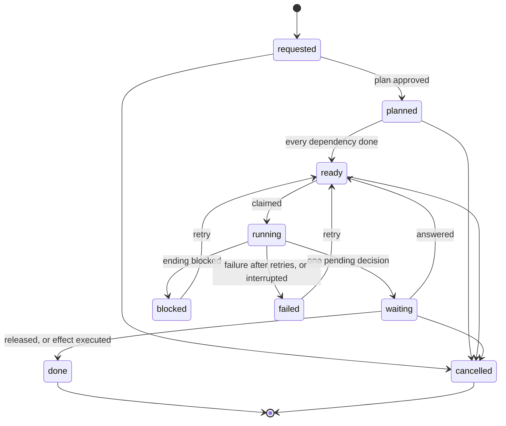

# Layer 6: the runtime

Part of [the platform map](README.md). Every layer page has the same eight sections, in this order.

## Purpose

The task runtime (`runtime/`) turns a person's request into tasks and runs each task as one proven skill, once, in the container the skill was proven in, on a fresh copy of the project that holds only what may enter it. What a run leaves comes back by one rule of paths, and the task then waits for the person on one pending decision; every effect outside the project is executed by code under an approval bound by its hash. Five channels reach these operations (`terminal`, `chat`, `page`, `mcp`, `messaging`), and the runtime holds the one rule that says which channel may call which operation, narrowed per project by a channel policy; the messaging channel, a bridge to Telegram, Discord and WhatsApp, is followed across the layers on [messaging.md](messaging.md).

The contract is [contracts/runtime.md](../../../contracts/runtime.md); the module list is [runtime/README.md](../../../runtime/README.md); the design and its stages are the platform plan (removed on 2026-10-15; `git show bc830832:docs/architecture/platform-plan-2026-10-05.md`). This page maps them and does not repeat them.

## Artifacts it owns

Where: **repo** is this repository, **project** is the target project, **data** is the project's data folder (`data_dir` of the configuration, outside every repository).

| Path | Where | Format | Written by | Read by | Lifecycle | Versioned | Generated |
|---|---|---|---|---|---|---|---|
| `runtime/*.py`, `runtime/handlers/*.py`, `runtime/README.md` | repo | Python 3.9, standard library only; the modules are the block below this table | maintainers | the shells, the scheduler's entry | changed by pull request | yes | no |
| `runtime/secrets.json` | repo | JSON registry of one secret, `WB_RUNTIME_FLOOR_KEY` (store username `runtime-floor`) | maintainers | `ops_core.py` (`_own_key`), `ops_reads.py` (`_secret_rows`), through `providers/secrets/resolver.py` | changed by pull request | yes | no |
| `runtime/roles.json` | repo | JSON with closed keys: the skills the runtime is wired to, the code areas and the packs in use (the values are the `roles` block of [skills-and-flows.md](skills-and-flows.md)) | maintainers | `runtime/roles.py`, through which `router.py`, `plan.py`, `workcopy.py` and `manifest.py` read their constants | changed by pull request | yes | no |
| `runtime/tests/`, `runtime/tests/corpus/endings.jsonl` | repo | pytest; JSON lines of archived lab runs with labels | maintainers; the corpus by `corpus/build_corpus.py` | CI, the hook, `endings.py --corpus` | grows with each stage | yes | the corpus is |
| `flows/<name>.json` | repo | flow file: `flow`, `title`, `tasks[]` (`key`, `skill`, `title`, `text`, `depends_on`, `milestone`); the flows are the `flow-files` block of [skills-and-flows.md](skills-and-flows.md) | maintainers | `runtime/flow_files.py`, `scripts/validate.py` (dependencies, inventory) | changed by pull request | yes | no |
| `skills/<name>/evals/runtime-manifest.json` | repo | runtime manifest: `skill`, `documents[]` (`path`, `checks`, `platform`, `bound_to_approval`), `machine_files`, `mandatory_milestone`, `asking_openings`, `gate`, and the optional `reply_phrases` (`missing_input`, `question_intros`, `gate_questions`: phrases of the skill's replies the classifier reads, each in the skill's text); a whole manifest for each skill of the packs in use (`test_every_skill_of_a_pack_in_use_has_a_runtime_manifest_that_is_well_formed`); a skill outside those packs may also have a whole one, which a contained run needs, or a partial one (`skill` and any subset of the keys); a skill without a whole manifest does not run, as a task or as a contained run (`manifest.load` in `ops._run` and `ops._contained_scope`) | maintainers | `runtime/manifest.py` | outside the skill's content hash: no bump, no lab test | yes | no |
| `packs/<name>.txt` | repo | pack patterns | maintainers | `runtime/plan.py` (an area agent's scope: the `pack` of its entry in `area_agents`), `runtime/manifest.py` (`PACKS_IN_USE`, the `packs_in_use` of `runtime/roles.json`; a pack that file does not name, such as `marketing`, only scopes an area agent) | changed by pull request | yes | no |
| The store's task tables (`providers/store/sqlite.py`, migrations 2 and later: below) | data (`store_db`) | SQLite, WAL, mode 0600; one function call is one transaction | the operations layer only (`ops.py` and its siblings), through the store's functions | the operations layer only | grows; `approvals` never loses a row | no | no |
| `docs/workbench/runtime.json` | project | JSON, no secret (keys below) | the person | `runtime/project_config.py`; the scheduler's entry checks its hash against the pin | accepted by its hash; every change accepted again | the project decides | no |
| `docs/workbench/instructions.md` | project | plain Markdown, no header, at most 4,000 characters; the person's standing instructions for the project | the person only (by hand, `instructions-set` and `instructions-add` from the terminal or the page; limit L40) | `runtime/instructions.py` (`state`, `block`): the prompt of every model run of the project | changed by the person; a routine's approval covers its sha256 | the project decides | no |
| `<state>/messaging-<platform>.json`, `<state>/messaging-<platform>.lock` | the per-user state folder (`--state-dir`, else `$OPENHORA_STATE_DIR`, else `$XDG_STATE_HOME/openhora`, else `~/.local/state/openhora`; mode 0700, checked; outside every repository and every data folder) | the messaging bridge's ledger (JSON, mode 0600, no project text: the cards it sent, their action ids and the platform's offset) and its lock (an empty file under an exclusive lock, mode 0600) | `runtime/messaging_ledger.py`, for the bridge | the bridge | the ledger grows by one entry per card and is never pruned; the lock lives as long as the process; a ledger an earlier version kept in the first project's data folder is migrated once and the old file left | no | yes |
| `docs/workbench/state.md` | project | the state contract ([contracts/state.md](../../../contracts/state.md)) | `core-project-init` owns it; the runtime writes into it through `runtime/state_merge.py` only | runs (it enters every copy), the engagement gate script | updated after each run, answer, approval and mode change | the project's `Docs in git` decision | its `Checkpoints` line and the runtime's approval rows are |
| `docs/workbench/policies/<policy>.json` | project | bounds of a standing approval: `policy`, `agent`, `effects`, `targets`, `files`, `max_per_day`, `max_items_per_run` | the person | `runtime/autonomy.py` (`bounds_of`, `covers`) | bound by its hash; an edit covers nothing until approved again | the project decides | no |
| `.workbench-local/drop/<task id>/` | project | the files the person handed to one task | `runtime/drop.py` (`hand-over`) | `runtime/workcopy.py` (enters that task's runs only) | never comes back changed | no (the folder must be ignored by git) | no |
| `.workbench-local/evidence/` | project | field evidence: one use per run, one verdict per run | `scripts/evidence.py`, called by `ops.py` | `evidence.py export` | grows | no | no |
| `<data_dir>/task-runs/<run id>/` | data | `prompt.md`, `cwd/` (the copy as the run left it), `outputs/` (`response.md`, `timing.json`, `raw.json`, `stderr.log`, `stream.jsonl`), attempts set aside; for a code task `changeset/` (`changeset.json`, `files/`); for a gate run its temporary folder, `payload.md` and `effect.json` | `runtime/lab.py`, `changeset.py`, `effects.py` | `pending --id`, `approve` of an effect | kept; never committed | no | yes |
| `<data_dir>/contained-runs/<n>/` | data | the run folder of one contained run (the same layout as a task run's: `prompt.md`, `cwd/`, `outputs/`); `<n>` is claimed by creating the folder | `runtime/lab.py`, called by `ops.contained_run` | the person; no file of it ever comes back to the project | kept | no | yes |
| `<data_dir>/prepared/<run id>/`, `<data_dir>/prepared/contained-<n>/` | data | files written for one run before they enter its copy | `runtime/workcopy.py` | `runtime/lab.py` | removed after the run | no | yes |
| `<data_dir>/locks/task-<id>.lock` | data | a file under an exclusive lock, mode 0600, in a folder of mode 0700; it holds, as text, `<pid> <pgid> <start time>` of its holder, which a cancel or a stop signals only when the process still has that start time (R18) | `ops_core.py` (`_task_lock`, `_try_lock`, `_lock_pgid`); `ops_runs.py` (`_drop_task_locks`) | `ops_runs.py` | held by the `run-task` process (or, for a step task, the `run-step` process) of that task from before its claim to after its finish: the proof that the task is alive; recovery and `stop-runs --all` probe it without writing; the file of a task that ended `done` or `cancelled` is deleted by the next recovery, under its own lock | no | yes |
| `<data_dir>/locks/effect-<request id>.lock` | data | an empty file under an exclusive lock; taking it retries for about a second | `ops_core.py` (`_effect_lock`, `_effects_running`) | `ops.py` (`_approve_effect`), `ops_runs.py` | held while an approved effect of the request executes: a code task of that request is not claimed meanwhile (`parallel.admit`), and two effects of a request do not execute together | no | yes |
| `<data_dir>/locks/route.lock` | data | an empty file under an exclusive lock; taking it retries for about a second | `ops_core.py` (`_route_lock`) | `ops.py`, `ops_runs.py`, `ops_say.py` | held for a whole run of the router, and for the release of a brief (which routes a delivery again); `say` probes it to refuse a turn that would route while the router answers another request | no | yes |
| `<data_dir>/locks/claim.lock` | data | an empty file under an exclusive lock; waits up to `CLAIM_LOCK_WAIT` (30 s) | `ops_core.py` (`_claim_lock`) | `ops_runs.py`, `ops.py` | held around the admission, the claim and the run row of a task run, and the budget and the run row of the router's run | no | yes |
| `<data_dir>/locks/write.lock` | data | an empty file under an exclusive lock, re-entrant per thread; waits up to `WRITE_LOCK_WAIT` (60 s), a run's return without a limit | `ops_core.py` (`_write_lock`) | `ops.py`, `ops_waits.py`, `ops_config.py`, `ops_runs.py` | held around every write into the project's files or its state file and every external effect (a sync, a hand-over, an answer's state line, the approval and standing rows, the go-ahead's line, the Checkpoints line, an effect approved or executed under a standing approval, the return of a run) | no | yes |
| `<data_dir>/locks/dispatch.lock` | data | an empty file under an exclusive lock, taken without waiting | `ops_core.py` (`_dispatch_lock`) | `ops_runs.py` | held for a whole dispatch round of the project (a waiting round holds it until its children end) | no | yes |
| `<data_dir>/task-runs/children/` | data | the output files of the children a dispatch round starts (`<task id>-<time>.out` and `.err`), mode 0700, kept 14 days | `ops_runs.py` (`spawn`) | the person, to read a child's output | the dispatcher starts a child with its output in files, no pipe | no | yes |
| `<data_dir>/config.lock` | data | an empty file under an exclusive lock, mode 0600; a change waits up to `CONFIG_LOCK_WAIT` (10 s), then is refused | `ops_core.py` (`_config_lock`) | `ops.py` | held while `accept-config` or `set-mode` accepts or changes the configuration | no | yes |
| `<data_dir>/proof.json` | data | the proof file (version 2): each skill's band, score and `web_measured` per model, and the hash of its inputs | `runtime/proof.py` | `runtime/proof.py` | rebuilt when the gate file, a version file, an evidence file or the skill's content changes | no | yes, a cache |
| `<data_dir>/deps/<key>/` | data | an installed dependency folder, keyed by recipe, files and image digest | `runtime/deps.py` | `runtime/deps.py` (copied into a code run) | installed once per content and image | no | yes |
| `<data_dir>/effects/<pending id>/` | data | the files code hands the code provider for one effect (the commit message, the title and the body) | `runtime/effect_pull_request.py` (`execute`), called by `ops._approve_effect` | the code provider | kept | no | yes |
| `<data_dir>/documents/not-taken/`, `imported.json`, `notices.json`, `own-writes.json` | data | page texts not taken; the last import of each document; the read-only pages that carry the notice; the runtime's last write of each document (the file's hash and the hash the page reads as after it) | `runtime/documents.py` | `runtime/documents.py`, `ops.task_prompt` (the imported line) | grows | no | yes |
| `<data_dir>/dispatch-pin.json` | data | the path and sha256 of the accepted `runtime.json`, mode 0600 | `cli.py pin` | `runtime/dispatcher.py` (the scheduler's entry) | written again after each accepted change | no | yes |
| `<data_dir>/service.token` | data | the local service's token, mode 0600, new at every start (`--token-file` names another place) | `runtime/service.py` | the person, who pastes it once per browser session | removed when the service stops | no | yes |
| `<data_dir>/uploads/<random>/<name>` | data | a file a page hands to a task, mode 0600 | `runtime/service.py` | `ops.hand_over`, which copies it into the task's drop | removed right after the hand-over | no | yes |

The modules of the runtime, one row each, from the first sentence of their docstrings:

<!-- generated: runtime-modules -->
| Module | What it is (first sentence of its docstring) |
|---|---|
| `runtime/ask_reply.py` | The reply to a question, checked by code (package AQ-1, the ask operation). |
| `runtime/ask_select.py` | Which sources a question reads (package AQ-1, the ask operation): selection by code, never by a model. |
| `runtime/attachments.py` | Files a listed sender sends through a messaging app (package ATT-1): the limits, the sentences, the checks that need no store, and the folders where such a file waits. |
| `runtime/autonomy.py` | The five autonomy modes of an area agent, from the three facts under them, and the daily caps: the one module that compares a mode word (decision D14 of the platform plan). |
| `runtime/billing.py` | The billing of the credential a run uses, read from the adapters' manifests: whether a run is covered by a subscription, paid by use (an API key) or free. |
| `runtime/board.py` | The mirror of tasks to and from the project's task board (class integration:issue-tracker). |
| `runtime/changeset.py` | The change set: how code a run changed comes back (limit L9), and why a working document never enters a commit (limit L11). |
| `runtime/chat.py` | The conversation with the planning agent, in the terminal: one more shell of the operations layer (runtime/ops.py, say). |
| `runtime/cli.py` | The terminal shell of the task runtime: one command per operation of runtime/ops.py, nothing else. |
| `runtime/costs.py` | The cost of the runs, recomputed from the token counts the adapter left in a run folder and the prices of the one price table of the workbench (runtime/prices.json, read by runtime/prices.py; the project's `model_prices` is retired). |
| `runtime/deps.py` | A project's dependencies, installed by code: in the eval image, in a step with no model that sees only the dependency files, and copied into each run that needs them. |
| `runtime/dispatcher.py` | The dispatcher of the task runtime: what may start now, and what an autonomy mode releases, decided by one pure function from a snapshot of the store. |
| `runtime/documents.py` | The mirror of documents to and from the project's documents platform (class integration:documents). |
| `runtime/drop.py` | The file drop: how a person hands a file to one task (a logo made elsewhere, a spreadsheet), since the runtime has no image provider. |
| `runtime/effect_commit.py` | The effect kind of a commit of files to a branch, made by the code provider under a standing approval. |
| `runtime/effect_publish.py` | The effect kind registered under the side-effect word `publish` (runtime/effects.py KINDS): a facade over the two things the word does (package PUBLISH-EFFECT). |
| `runtime/effect_pull_request.py` | The effect kind of the pull-request skill: one commit made by the code provider, then the pull request opened. |
| `runtime/effect_reply.py` | The effect kind of a reply to a comment on one of the project's own posts, made by a publisher under a standing approval. |
| `runtime/effect_send.py` | The effect kind of sending an e-mail from the project's outbox (package EMAIL-SEND): the text a step task prepared is sent, to exactly the recipients the person approved, once. |
| `runtime/effect_write.py` | The effect kind of writing a document back to the platform that holds the project's documents (package P8, decision D17, direction 2): the text a step task prepared replaces, whole, a document that lives on the platform (a Notion page today), after the person approved the exact content. |
| `runtime/effects.py` | The external effects of the task runtime: what a skill with a confirmation gate showed at its gate, recovered from what the run left, and (stage 4, WP-4.8) its execution by code once the person approved its hash. |
| `runtime/endings.py` | How a run ended, for a run that did not fail: the classifier of endings. |
| `runtime/flow_check.py` | The flow check: what a flow may not hold, decided by code when it is created or changed (decisions D27 and D31, P6a). |
| `runtime/flow_files.py` | Flow files: one data file per flow, with its tasks and their dependencies written out. |
| `runtime/instructions.py` | The person's standing instructions for a project: one Markdown file the person writes, read into the prompt of every model run of the project (limit L40). |
| `runtime/intake.py` | The generic streaming intake: how a body of a declared length gets from a stream onto disk, safely. |
| `runtime/isolated.py` | Skill code the runtime runs on the host, as an isolated subprocess with a scrubbed environment. |
| `runtime/lab.py` | The lab facade: the one file of runtime/ that talks to the lab (evals/execution.py, the execution kit). |
| `runtime/language.py` | The language artifacts are written in: the tag rule, the order that decides it, and the words a run, a plan card and a refusal use. |
| `runtime/lease.py` | Two hosts do not write the sources folder within one lease window, and no database or lock lives in a synced folder (package P-OPS, finding I4). |
| `runtime/mail_address.py` | What the runtime needs to know of an e-mail address, and nothing else (package EMAIL-SEND): the same rule as providers/_email.py `normalize_address`, written again because the runtime does not import a provider; a test holds the two equal on a table of addresses. |
| `runtime/manifest.py` | The runtime manifest of a skill: skills/&lt;name&gt;/evals/runtime-manifest.json, read and checked. |
| `runtime/mcp.py` | The MCP mode: the operations layer of runtime/ops.py served as tools of a Model Context Protocol server over standard input and output. |
| `runtime/messaging.py` | The messaging bridge: the operations layer of runtime/ops.py reached from a messaging app the person already uses, with no model between the app and the operations. |
| `runtime/messaging_attach.py` | The messaging bridge's part of the files a listed sender sends (package ATT-1b): from the update to the fetch, the hold, the card or the reply, and from the card's answer to the add or the discard. |
| `runtime/messaging_bridge.py` | The messaging bridge's logic (runtime/messaging.py is its shell): notices out, intents in, every operation through one call path. |
| `runtime/messaging_cards.py` | A notice as a platform-neutral card (runtime/messaging.py): a pending decision becomes {"text", "actions", "link", "document"}, the message every messenger provider takes (providers/messenger/README.md), plus what the bridge needs to bind a tap to it. |
| `runtime/messaging_inbound.py` | What a person sent to the messaging bridge, as an intent (runtime/messaging.py). |
| `runtime/messaging_ledger.py` | The messaging bridge's ledger: what it sent, so that a restart sends nothing twice and a tapped button or a reply is bound to the card the person saw (runtime/messaging.py). |
| `runtime/messaging_provider.py` | The messaging bridge's access to a messenger provider (class messenger:&lt;platform&gt;, providers/messenger/README.md): the four verbs as methods, started through providers/resolve.py, the one function that resolves a class and runs a provider's verb. |
| `runtime/messaging_remind.py` | The messaging bridge's part of reminders (package RM-1): `/remind`, `/reminders` and `/forget` from a listed sender, and the delivery of the reminders that are due. |
| `runtime/operations.py` | The table of operations: the one place that says what the operations layer (runtime/ops.py) offers to a shell. |
| `runtime/ops.py` | The operations layer of the task runtime: every operation a person or a scheduler can perform, once. |
| `runtime/ops_actor.py` | Who acted (package POL-2), in the operations layer: the sender of a messaging app, the profile the accepted configuration gives that sender, and the record of both with a decision. |
| `runtime/ops_ask.py` | The answer from sources (package AQ-1): `ask`, one question answered from the converted text of the sources that code selected. |
| `runtime/ops_attachments.py` | The operations over the files a listed sender sent through a messaging app (package ATT-1): list what is held, hold a file the bridge fetched, add a held file as a version of a source, discard it. |
| `runtime/ops_cancel.py` | Cancel a request, or stop a task, at any moment (R18, limit L41): the two operations `cancel` and `stop-task`, and what the runs and the shells ask of them. |
| `runtime/ops_config.py` | The configuration's acceptance in the operations layer: who may accept a change of docs/workbench/runtime.json, and the three operations that change or accept it. |
| `runtime/ops_contained.py` | The contained run (stage 7): one run of one skill of an area agent's pack, in the eval container, for a caller that is not a task (a handler's agent run). |
| `runtime/ops_core.py` | The names every module of the operations layer shares, once: the checkout (ROOT), the refusal (OpsError), the project's context and the store call, the locks, the runtime's own key and the data-folder names. |
| `runtime/ops_flows.py` | The operations over flows (flow files, P6a): list them, check one, save a plan as one, hand a file over for a request, and the pieces the rest of the layer asks of them (binding a flow's parameters and dates, and moving a handed-over file into the task that reads it). |
| `runtime/ops_grants.py` | The effect, as the channel policy sees it (package POL-1): which word an `effect` decision carries, whether the whole of it can be on a messaging card, and whether a channel outside the terminal and the page may approve it. |
| `runtime/ops_instructions.py` | The person's standing instructions in the operations layer: the three operations over the file, the block a run's prompt receives, the check a routine's task makes, and the proposal that follows an answer (runtime/instructions.py holds the file and its checks). |
| `runtime/ops_language.py` | The language of a deliverable in the operations layer: the check of the person's choice on a request, and the line a run gets (runtime/language.py holds the rule, the order and the words). |
| `runtime/ops_models.py` | Which model a run goes to, in the operations layer: the person's choice (a request, a task, an agent, the project's default), the proof of the skill on each model (runtime/proof.py) and the person's consent for an agent's own model (decision D38). |
| `runtime/ops_reads.py` | The reads of the local interface and the signals of the local service: the change signal of the store (`version`), the stop of the runs a process started, the conversation's commands as rows (`commands`), the agents with their day, the conversation's messages, the skills with their proof, the costs, the connections, the service's start check and the project's artifacts. |
| `runtime/ops_reminders.py` | The operations over reminders (package RM-1): make one, list them, forget one, and what the messaging bridge asks of the store to send them. |
| `runtime/ops_routines.py` | The operations over routines (package P6b; decisions D23, D24, D31 to D35, findings S3, S10, I5, F4, F12) and the tick that fires them. |
| `runtime/ops_runs.py` | The runs of tasks: one task run (`run_task`), the person's verb that picks one (`run_next`), the dispatcher's round (`dispatch`), and the processes the round starts. |
| `runtime/ops_say.py` | The conversation with the planning agent: one turn of it (`say`) and the memory a plain line carries to the router. |
| `runtime/ops_sources.py` | The operations over a project's sources (P4): register a source, import a version, refresh it, list the catalog, and set a description; and the three small pieces the rest of the operations layer asks of them: the catalog block the planner reads, the sources a request's @mentions force, and the copies a task receives when it starts. |
| `runtime/ops_step_effects.py` | The approval of an effect that a step task opened (package P8): the third path an external effect takes, beside a skill's gate and a standing approval (runtime/effects.py, "for the step path"). |
| `runtime/ops_step_seams.py` | What a step kind is handed to reach anything outside the project's files (package P8, limit L30): the services of the engine's Context. |
| `runtime/ops_steps.py` | The run of a step task (package P5): the one operation `run_step`, and what a process that runs a step task does around the engine of runtime/steps.py. |
| `runtime/ops_waits.py` | The derived waits in the operations layer: which task waits for which, worked out from the artifact contract. |
| `runtime/orphans.py` | Orphan containers of the eval harness, removed on recovery (package P-OPS, finding I6). |
| `runtime/output_document.py` | The document of an output to the documents platform, and nothing that writes (package NOTION-OUT): what the step kinds `output-page` and `output-table` build and the effect kind `write` approves, for the three operations that make something new on the platform. |
| `runtime/parallel.py` | The rules of tasks that run at once, decided by pure functions: whether a ready task may start beside the ones that run (a slot of its agent, a slot of the project, no code task of its request, no artifact in use), and what a skill's footprint is. |
| `runtime/path_rule.py` | The path rule: how one path of what a run left goes back to the project. |
| `runtime/phrases.py` | The phrase table (package LR-1): the sentences the runtime says to a person in the project's language, and the one function that picks them. |
| `runtime/phrases_pt_br.py` | The Brazilian Portuguese column of the phrase table (package LR-1, runtime/phrases.py): data only, a pure literal, no code and no import. |
| `runtime/plan.py` | The plan of a request: the tasks code builds from a route, which the person approves before any task exists. |
| `runtime/policy_grants.py` | What `config` shows of the channel policy (packages POL-1 and POL-2), pure: the grants a file lists, what a configuration widens and the hash a person types to accept it, and the warnings that are never a refusal. |
| `runtime/policy_widening.py` | What a configuration WIDENS, and the hash a person types to accept it (packages POL-1 and POL-2), pure. |
| `runtime/prices.py` | The one price table: runtime/prices.json, read once, here. |
| `runtime/progress.py` | Progress and the summary of a period, computed from the store's records: no model writes them. |
| `runtime/project_config.py` | The project's configuration of the runtime: &lt;project&gt;/docs/workbench/runtime.json, and its hash. |
| `runtime/proof.py` | The proof of a skill, and the choice of the model a run of it goes to. |
| `runtime/publish_document.py` | The document of a post to publish, and nothing that publishes (package PUBLISH-EFFECT): what the step kind `publish-post` builds and the effect kind `publish` approves on the step path. |
| `runtime/publish_payload.py` | The post as the publishing skill's own script builds it (package PUBLISH-EFFECT): runs skills/mkt-publish/scripts/payload.py, unedited, on one content file, in a private folder, and reads what it wrote. |
| `runtime/reminders.py` | Reminders, the pure part (package RM-1): what a person types, as a moment and a text, and the rules that decide whether a reminder is still to be sent. |
| `runtime/roles.py` | The skills the runtime names, as data: runtime/roles.json, read and checked. |
| `runtime/router.py` | The router step of the task runtime: what code reads of one run of the router skill asked only for the route. |
| `runtime/routines.py` | Routines, the pure part (package P6b; decisions D23, D24, D31 to D35): the schedule, the slots that are due, the catch-up rule and the content a routine's approval covers. |
| `runtime/run_stop.py` | Ending a run that is in progress (R18, limit L41): the process mechanics of a cancel or a stop, with no knowledge of what a request or a task is. |
| `runtime/secret_state.py` | Whether the OS secret store or the password manager is locked or unavailable, for the messages of the runtime (package P-OPS, finding I3; the password manager, package S16). |
| `runtime/send_document.py` | The document of an e-mail to send, and nothing that sends (package EMAIL-SEND): what the step kind `send-email` builds and the effect kind `send` approves. |
| `runtime/service.py` | The local service: the operations layer of runtime/ops.py served on this machine through an API, with a token and an origin check, and the static files of the interface/ folder of the checkout. |
| `runtime/service_bridge.py` | The messaging bridge as a child of the local service (runtime/service.py --messaging &lt;platform&gt;): one start brings up the page and the bridge. |
| `runtime/shell_kit.py` | What the two network-free shells of the operations layer share: the local service (runtime/service.py) and the MCP mode (runtime/mcp.py). |
| `runtime/skill_meta.py` | What a skill declares in its frontmatter, read for the runtime: the artifact lists, the requirement classes, the side effects and the version. |
| `runtime/snapshot_text.py` | The text of a mail snapshot and of a calendar snapshot (package RT-1, SPEC-SECRETARY-INTEGRATIONS sections 2.1 to 2.3). |
| `runtime/sources.py` | The sources of a project: a registry of what the person gave the project to read, immutable versions of each in the project's sources folder, a catalog built by code, and the copies a task receives. |
| `runtime/sources_mail.py` | Mail and calendar as sources of a project (package RT-1, SPEC-SECRETARY-INTEGRATIONS sections 1 to 3 and 6): the origin check, the window, the calls to the providers, the per-message credential scan, the import and the refresh. |
| `runtime/sources_onedrive.py` | OneDrive files as sources of a project (package O2): the origin check, the calls to the provider, the import, the version-first refresh and the listings for the person's terminal. |
| `runtime/state_merge.py` | The one module that decides what a run may change in the project's state file (docs/workbench/state.md), limit L10 of the platform plan. |
| `runtime/step_export.py` | The step kinds that make a file: `export-csv`, `export-xlsx`, `export-docx` and `export-pdf` (package P8, decision D17 direction 1). |
| `runtime/step_ingest.py` | The step kind `ingest`: bring one version of a source into the project, as a task (package P5, the engine's second consumer). |
| `runtime/step_output.py` | The step kinds `output-page` and `output-table`: a task's result becomes a new page, a new table, or rows added to a table on the platform that holds the project's documents, as an external effect the person approves (package NOTION-OUT, an extension of P8's write-back). |
| `runtime/step_project_script.py` | The step kind `project-script`: run one of the project's own scripts as a step, under limits that live in code (package P9, decision D25). |
| `runtime/step_publish_post.py` | The step kind `publish-post`: publish one drafted post now, as an external effect the person approves (package PUBLISH-EFFECT). |
| `runtime/step_send_email.py` | The step kind `send-email`: send an e-mail from the project's outbox, as an external effect the person approves (package EMAIL-SEND). |
| `runtime/step_write_back.py` | The step kind `write-back`: write a project document over a document on the platform, as an external effect the person approves (package P8, decision D17 direction 2). |
| `runtime/steps.py` | The step engine: how a step task runs, one step after another, resumably, with stops for the person (package P5). |
| `runtime/table_data.py` | The table a task made, read and checked as code (package NOTION-OUT): a CSV file or the first sheet of a workbook becomes the table an output step approves and a platform receives, `{"columns": [{"name", "type"}], "rows": [[value, ...]]}`, with the type of each column given or inferred by a rule, and every cap enforced. |
| `runtime/upkeep.py` | Upkeep of a runtime meant to run for weeks: retention of what it leaves on disk, and the orphans a crash leaves in docker (package P-OPS, finding I6). |
| `runtime/workcopy.py` | What enters a run copy, and what comes back from it: the limits of the task runtime that decide which files of a project a run sees (L1 to L6) and which files a run leaves come back (L7, L8, L12, L14). |
| `runtime/write_document.py` | The document of a write-back, and nothing that writes (package P8): what the step kind `write-back` builds and the effect kind `write` approves (its operation `update_page`; the operations that make a new page or table are runtime/output_document.py, and the hash covers the operation in both). |
| `runtime/handlers/published_posts.py` | The weekly routine that lists the published posts (backlog item PB16): the first handler of the task runtime. |
| `runtime/handlers/social.py` | Agent runtime: find new work, run an agent on it read-only, gate its proposal, execute or queue it. |
| `runtime/handlers/social_vote.py` | The runtime's weekly vote step (docs/architecture/weekly-vote.md), imported by runtime/handlers/social.py (ported from scripts/runtime_vote.py, which scripts/runtime.py still imports). |
| `runtime/handlers/social_vote_job.py` | Publish the weekly vote post at its slot time, then record it in the profile repository's vote files. |
<!-- /generated -->

**The store, as built.** Migration 1 holds the first runtime's tables (`cursors`, `events`, `runs`, `inbox`, `actions`); the task runtime uses `cursors` and `actions` too. The migrations, generated from `MIGRATIONS` of `providers/store/sqlite.py`:

<!-- generated: store-migrations -->
Schema version 21: the highest migration of `MIGRATIONS`.

| Migration | Description | Tables created | Columns added | Triggers |
|---|---|---|---|---|
| 1 | cursors, events, runs, inbox and actions | `cursors`, `events`, `runs`, `inbox`, `actions` | - | - |
| 2 | tasks, task_runs and pending_decisions of the task runtime | `tasks`, `task_runs`, `pending_decisions` | - | - |
| 3 | the number of values the lab replaced in what a task run left | - | `task_runs.redactions` | - |
| 4 | a task's item on the task board, the records of mirrored documents and saved platform comments | `document_records`, `platform_comments` | `tasks.remote_id`, `tasks.remote_version`, `tasks.remote_written_sha256` | - |
| 5 | the approvals table: what the person approved, a record that only grows | `approvals` | - | `approvals_never_deleted`, `approvals_only_status_moves` |
| 6 | the messages of the conversation with the planning agent | `conversation_messages` | - | - |
| 7 | tasks, task runs and pending decisions are never deleted | - | - | `tasks_never_deleted`, `task_runs_never_deleted`, `pending_decisions_never_deleted` |
| 8 | derived waits between requests: a request's after_request and the task_waits table | `task_waits` | `tasks.after_request` | `task_waits_never_deleted` |
| 9 | the billing of the credential a task run used | - | `task_runs.billing` | - |
| 10 | the model of a request or a task, and the autonomy of a task run | - | `tasks.model`, `task_runs.autonomy` | - |
| 11 | the registry of sources, their versions, and the versions a task run received | `sources`, `source_versions`, `task_sources` | `tasks.sources` | `sources_never_deleted`, `sources_only_description_moves`, `source_versions_never_deleted`, `source_versions_never_changed`, `task_sources_never_deleted`, `task_sources_never_changed` |
| 12 | the step task: its kind, arguments, footprint and state | - | `tasks.step_kind`, `tasks.step_args`, `tasks.step_footprint`, `tasks.step_state` | - |
| 13 | a task that runs its skill without the web | - | `tasks.web_off` | - |
| 14 | routines, their fires, and the Drive source type | `sources`, `routines`, `routine_fires` | - | `sources_never_deleted`, `sources_only_description_moves`, `routines_never_deleted`, `routine_fires_never_deleted`, `routine_fires_never_changed` |
| 15 | a stop request on a request or a task, and the run status `cancelled` | `task_runs` | `tasks.stop_requested_at`, `tasks.stop_requested_by` | `task_runs_never_deleted` |
| 16 | the language a request or a task asks its deliverable in | - | `tasks.language` | - |
| 17 | the actor of a resolution and of an approval | - | `pending_decisions.actor`, `approvals.actor` | `approvals_only_status_moves` |
| 18 | held attachments, and the provenance of a source version | `attachments` | `source_versions.provenance` | `attachments_never_deleted`, `attachments_decided_once` |
| 19 | the OneDrive source type | `sources` | - | `sources_never_deleted`, `sources_only_description_moves` |
| 20 | reminders, the one-shot notices the messaging bridge sends | `reminders` | - | `reminders_never_deleted`, `reminders_fixed`, `reminders_move` |
| 21 | the mail and calendar source types | `sources` | - | `sources_never_deleted`, `sources_only_description_moves` |
<!-- /generated -->

The task runtime's tables, those that migration 2 and later create, with their columns (generated from the same source):

<!-- generated: task-runtime-tables -->
| Table | Created by migration | Columns |
|---|---|---|
| `tasks` | 2 | id, parent_id, flow, key, skill, agent, title, text, state, depends_on, milestone, note, created_at, updated_at, remote_id (migration 4), remote_version (migration 4), remote_written_sha256 (migration 4), after_request (migration 8), model (migration 10), sources (migration 11), step_kind (migration 12), step_args (migration 12), step_footprint (migration 12), step_state (migration 12), web_off (migration 13), stop_requested_at (migration 15), stop_requested_by (migration 15), language (migration 16) |
| `task_runs` | 15 | id, task_id, skill, skill_version, skill_sha256, model, adapter, web, status, failure, ending, attempts, started_at, ended_at, cost_usd, tokens, duration_ms, skill_loaded, image_digest, run_dir, error, redactions, billing, autonomy |
| `pending_decisions` | 2 | id, task_id, run_id, kind, title, body, payload, payload_sha256, status, resolution, answer, created_at, resolved_at, resolved_by, actor (migration 17) |
| `document_records` | 4 | id, path, provider, remote_id, written_sha256, remote_version, read_sha256, status, note, updated_at |
| `platform_comments` | 4 | id, provider, remote_id, subject, task_id, document_path, author, text, created_at, saved_at, status, used_by_pending |
| `approvals` | 5 | id, scope, what, payload_sha256, policy_sha256, bounds, task_id, pending_id, approved_at, approved_by, expires_at, status, executed_at, actor (migration 17) |
| `conversation_messages` | 6 | id, conversation, role, text, task_id, run_id, created_at |
| `task_waits` | 8 | id, task_id, awaited_id, kind, path, reason, status, created_at, ended_at, ended_by |
| `sources` | 21 | id, type, origin, description, created_at, updated_at |
| `source_versions` | 11 | source_id, version, label, by, kind, original_name, original_sha256, original_bytes, converted_name, converted_sha256, converted_bytes, converter, converter_version, hidden_text, warnings, catalog, origin_version, imported_at, provenance (migration 18) |
| `task_sources` | 11 | run_id, task_id, source_id, version, sha256, copied_at |
| `sources` | 21 | id, type, origin, description, created_at, updated_at |
| `routines` | 14 | id, name, flow, params, schedule, model, consent, providers, window_seconds, state, approved_sha256, approved_content, approved_at, approved_by, resumed_at, created_at, updated_at |
| `routine_fires` | 14 | id, routine_id, slot, status, reason, request_id, fired_at |
| `task_runs` | 15 | id, task_id, skill, skill_version, skill_sha256, model, adapter, web, status, failure, ending, attempts, started_at, ended_at, cost_usd, tokens, duration_ms, skill_loaded, image_digest, run_dir, error, redactions, billing, autonomy |
| `attachments` | 18 | id, platform, ref_sha256, sender, profile, name, declared_type, declared_bytes, kind, sha256, bytes, target, label, direct, status, code, source_id, version, created_at, decided_at |
| `sources` | 21 | id, type, origin, description, created_at, updated_at |
| `reminders` | 20 | id, text, due_local, due_utc, zone, platform, chat, created_by, status, why, created_at, claimed_at, ended_at, attempts, retry_after |
| `sources` | 21 | id, type, origin, description, created_at, updated_at |
<!-- /generated -->

The cursors the runtime writes: `config:accepted-sha256` (the accepted configuration, written only by `ops_config._record_acceptance`, which `accept_config` calls for the person and `set_mode` calls for a move down the order of the modes, or for a move up the person accepts in the same command with `set-mode --accept` from the terminal), `config:accepted-by` (`person` or `code:narrowing`), `dispatch:held` (the ready tasks the last dispatcher round did not start, JSON: `at`, `held` with each task's reason, at most `HELD_KEPT` (20) of them, `more` for the rest and `missing`, the names of the credential's variables that were not found; a round that holds the same tasks for the same reasons writes nothing, since a write moves the change counter), `board:configured` (when the board was first written), `use:<run id>` (the recorded use of a run), `verdict:<run id>` (the person's one verdict on it), and each handler's own (`routine:published-posts`; `mailbox:<agent>` and `vote:<round>` of the social handlers).

**The project configuration's keys** are the generated `config-keys` block of [project.md](project.md); this page lists none. They are closed (`runtime/project_config.py`): an unknown key is refused (exit 3) with the nearest known name, and the first runtime's keys (`FIRST_RUNTIME_KEYS`, a second closed tuple that leaves with stage 7) stay valid in the same file. `handlers` has one entry per handler, which names an `agent` of `area_agents` and a boolean `dispatch` (default false): the dispatcher ticks a handler only when `dispatch` is true, its agent is enabled and its mode is not `stopped` (`ops._ticks`). The social handler still reads the first runtime's keys (`runtime/handlers/social.py`; `harness` and `model` are ignored: the model and its adapter come from the skill's proof), and `path`, the folders put first on `PATH` for what the operations start, is one of them, read by `dispatcher.bootstrap`. `max_cost_usd_per_run` is what a floor run of unknown cost counts at; `model_prices` is typed by the person from the provider's price page, and `runtime/costs.py` recomputes a run's cost from its token counts with it.

## Abstractions

**Task and its nine states** (the store's CHECK): `requested`, `planned`, `ready`, `running`, `waiting`, `blocked`, `done`, `failed`, `cancelled`. A `waiting` task has exactly one open pending decision; several tasks of a database may be `running` at once, and the runtime decides which under its claim lock (`runtime/parallel.py`).

**Cancel and stop at any moment (R18, limit L41).** `cancel` ends a request and everything under it, `stop-task` one running task, at any moment, whether the router or a task's run is in progress. The stop request is written first (`tasks.stop_requested_at` and `_by`, migration 15), under the project's write lock and inside the request's effect lock, and every task not running is cancelled at once; the running runs are ended by their lock holder's process (TERM, 30 s, KILL; the lab's containers the process tree named are removed through the container tool) or, for the router, by a watcher beside its lab call. A run that ends after the stop request is recorded `cancelled` (the fourth `task_runs.status`: failure and ending null, `error` "cancelled by <who>", the usage it reported), opens nothing and returns nothing into the project; a stopped task is `blocked` with a note (a stop) and `retry` resumes it, or `cancelled` (a cancel). A `cancelled` run keeps its reservation in the caps. The whole contract is "Cancel and stop at any moment" of [contracts/runtime.md](../../../contracts/runtime.md); the modules are `runtime/ops_cancel.py` and `runtime/run_stop.py`.



**Step task and the step engine (P5).** A task of a request that runs no skill: code runs it, in a process of its own (`run-step`), with no model. Its kind (`tasks.step_kind`, a word of the registry in `runtime/steps.py`), its arguments (`step_args`, canonical JSON, which the plan hash covers), its footprint (`step_footprint`, the project paths the kind declares it writes, derived from the kind and never from text) and the engine's progress (`step_state`, one record per step) are columns of the task (migration 12); `is_step_task` is the one test of what a step task is, and "code task" keeps its one meaning, the code-area task of `runtime/parallel.py`. It moves through the same nine states: `planned` and then `ready` under `depends_on` (the same `_refresh`), `running` while a process holds its lock, `waiting` at a stop with one pending decision of kind `question` (the answer makes it `ready`; the next run goes on only if the answer is the verdict `continue`, ends the step on `stop`, and asks again on any other text; a decision is bound to its stop and its cycle), `failed` at the step that failed (a retry resumes there, with the earlier results kept) and `done`. The engine (`runtime/steps.py`) knows no feature: a **kind** (`Kind`) declares the steps in their order, the stops (words of `STOPS`), one executor per step, the footprint, how the arguments are checked, what a step leaves to clean, and its side steps; a kind is a file, `runtime/step_<kind>.py`, that registers itself and says whether it is `unattended` (the dispatcher starts only those on its own) (`ingest`, which wraps `sources.import_version`, and the file-output kinds and `write-back` of P8, none of them unattended; the project script of P9 will register the same way). Every result and every failure is closed words and numbers, never a tool's text. A **step kind** is not an **effect kind** (a key of `effects.KINDS`) and not a pending-decision kind.

**The owner of a step task.** Its agent is `runtime`, the runtime's own pseudo-agent: not an entry of `area_agents` (the name is reserved), with a running cap of its own (`parallel.RUNTIME_PARALLEL`, 2) that `parallel.admit` applies as it applies an area agent's `max_parallel`. The dispatcher holds a task it owns only by that cap, the project's `max_running` and the files in use: never for lack of an agent, and it asks no area agent's mode, daily cap or credential, because it calls no model. `plan.agent_for` gives a plan task its owner. A waiting step task holds no slot. The pseudo-agent has two modes and no configuration: `set-mode --agent runtime --mode stopped|autonomous` (terminal and page) is the brake of step tasks, kept in the store's cursor `steps:mode`; while it is stopped, or when a kind is not unattended (`start it by hand`), the dispatcher starts no step task, and the person's `run-next` and `run-step` still do. The dispatcher starts the process as `run-step --unattended`, which asks the brake and the kind's flag again under the claim lock. The `agents` read carries the brake as `steps`, and the Building's panel shows it with the control the page's policy allows. The decision and its reasons are in `docs/decisions.md`, 2026-10-15 (P5).

**A step task's process and its liveness.** `ops_runs.dispatch` starts `cli.py run-step --project <dir> --task <id>` for a ready step task (`run_task` and `run_next` hand a step task over to it too); the process (`runtime/ops_steps.py`) takes `task-<id>.lock` before it claims the task, holds it until the task has left `running`, and ends the task `failed` itself when the engine meets a bug, an unknown kind or a TERM. A process killed outright leaves a task `running` whose lock nobody holds: the next round, `run-next` or `run-step` ends it `failed` (`_recover`). `stop-runs --all` signals the group the lock names, as for a task run.

**Effect kind.** What differs between two external effects (the form of the payload a skill shows at its gate, the effect document, what the person reads, the checks that nothing moved, the provider verbs) is one module of `runtime/` with a fixed set of names; `runtime/effects.py` keeps the rest (the recovery of the payload, the effect file and its hash, the provider call, and the one registry `KINDS`). The registry's keys are the words of the side-effect vocabulary (`SIDE_EFFECTS` of `scripts/validate.py`), and it holds three kinds: `create` maps to `runtime/effect_pull_request.py` (commit, then open a pull request), `push` to `runtime/effect_commit.py` (commit files to a branch) and `publish` to `runtime/effect_reply.py` (a reply to a comment on one of the project's own posts). Two paths read it. The gate path takes the word the skill's manifest names in its gate (`gate.effect`) and records it in the effect document as `effect`; a gate word with no row opens a review, never an effect (`_effect_or_review`), and an effect document already open whose `effect` has no row is refused when the person approves it (`ops.py`, `_approve_effect`) and opens no review, since a review opens only when a run reaches its gate. The policy path takes the `kind` of the document a handler hands to `ops.execute_under_policy` and loads the same module, which answers what the generic operation asks of it: `POLICY` (true when the kind may run under a standing approval; `create` is false and is refused with "cannot run under a policy"), `PROVIDER_CLASS`, `policy_platform(doc)` (the platform the provider is resolved with: for a class written `publisher:<platform>` the placeholder is filled with it, and none for the code provider), `policy_effect(doc)` (the `{kind, target, files, items}` that `autonomy.covers` checks) and `policy_argv(doc)` (the verb and the document's args, without the reserved flags), besides `describe(doc)` for the state file's row. Two names are optional, for a kind whose bounds name a class of targets and whose content needs a judgement: `resolve_targets(cfg, doc, resolve_call)` (the set of targets a class holds now, read from a recorded fact through a provider's read-only verb, before the write lock) and `policy_judgement(root, project, doc, run_script, policy_file, private, log=None, data_dir=None, now=None)` (the checks beyond the bounds, on the exact content, after `covers` and before any provider call; it returns the private file it wrote the judged bytes to, which the operation gives the provider in place of the document's file); `publish` implements both, `push` neither. `EFFECT_KEYS` (the keys a handler's document has and no others) and `RESERVED_FLAGS` (`--confirmed`, `--dry-run`, `--allow`, `--idempotency-key`, which only the operation adds) are in `effects.py` too. Extension rule: a new kind is a module plus a row of `effects.KINDS`; neither path of `runtime/ops.py` changes.

**Request.** A task with no parent and no skill, in the person's words. With a flow named it is planned at once; without, it stays `requested` until its route becomes an approved plan. A request written on the task board waits in an `acceptance` first. The limits of a plan are constants of `runtime/plan.py`: a request lists at most `MAX_DELIVERIES` (8) deliveries, each costing one run of the router; a plan allows `SUBTASKS_PER_PLAN` (20) sub-tasks from the product backlog, whose task reads run `BACKLOG_JOBS` (8) at a time; and a request's title is at most `TITLE_CHARS` (120) characters.

**The conversation.** One per project (`ops.CONVERSATION`, "project"), kept in `conversation_messages`. A plain line or `/new` is routed with a bounded memory in front of it: the newest `MEMORY_TURNS` (6) plain lines and router replies after the last request that reached `planned`, `done` or `cancelled`, each cut to `MEMORY_CUT` (600) characters and the whole cut to `MEMORY_CHARS` (4,000) by dropping the oldest (`ops.chat_memory`, a workaround marked `T23` that leaves with the next change of the lab models). A line typed on the page while the router answers another request (it holds the route lock) is queued, not refused (the terminal and the MCP mode drain nothing and are refused as before): it is stored with its reply pending, held in one cursor of the store (`conversation:queue`) and answered by `route_queued`, which the service calls every five seconds; a request to route made then is queued the same way, and `route` with a flow takes no lock. A short plain line that is one of a closed list of forms ("status", "como estamos", "o que falta") is answered by code from `status` and `progress`, never by the router; a router reply of the shape `direct` is answered the same way and cancels the request it came from; a reply that names no route opens a question with one sentence and the reply whole in its payload (`contracts/runtime.md`, "The conversation").

**Run and attempt.** A run is one row of `task_runs`: one skill, once, in a new copy (a step task has no run row). Inside it, the lab's one function (`evals/run_attempts.py`) makes attempts: it pauses on the account limit without counting a failure, retries a timeout, an adapter failure, a refusal or an early end, and never retries a refused credential. The early-end rule is the lab's (`evals/measure.py`, through `lab.early_end`), so a rule change there reaches the runtime's runs too: since measurement version 10 a reply that is a loop of raw tool-call syntax printed as text (`early_end.collapse`) is an early end even when the run wrote a file, and such a run is made again, a paid retry, instead of being returned. A failed run has a failure kind from a closed list: `timeout`, `refused`, `auth`, `adapter`, `early_end`, `settings`, `stopped`, `internal`.

**The six endings** of a run that did not fail (`runtime/endings.py`): `done` (a declared output written, nothing asked; or nothing changed and the declared output already there), `question` (nothing written, or only the state file, and it asks), `draft_with_questions` (a declared output written and it still asks), `gate` (the file of its confirmation gate written and it asks), `blocked` (it stopped on a missing input another skill writes), `unclassified` (no rule holds; the person reads the whole reply).

**The pending-decision kinds and their resolutions.**

| Kind | Opened when | Resolutions |
|---|---|---|
| `plan` | code built a plan from a route or a named flow | `approved`: the tasks are created; `rejected`: the request is cancelled |
| `question` | ending `question`; a stop of a step task (its payload names the kind and the step) | `answered`: the task is `ready`; the answer is written into the state file by code (a step task's answer is recorded on the decision only: the next run goes on after the stop) |
| `review` | ending `done`, `draft_with_questions`, `unclassified`, or a `gate` whose effect could not be opened | `released`: the task is `done`, still a draft; `answered`: the task runs again with the text |
| `effect` | ending `gate`, with the payload recovered, parsed, agreeing with the configuration and an unblocked change set | `approved` (only with its hash, then executed by code); `answered`: sent back; `rejected`: the task is cancelled, nothing sent |
| `acceptance` | a request written on the board; sub-tasks beyond the plan's limits (`subtasks`); a request a mode completed (`deliveries`) | `accepted`, `rejected` |
| `your_document` | reserved: a task in which the person writes the document; the store accepts the kind and no operation opens it | none: `ops._actions` offers no word for it |

A pending decision is `open`, `resolved` or `cancelled`. A release by an autonomy mode is recorded with `resolved_by` `mode:<mode>`.

**Approvals and their scopes** (table `approvals`, the three scopes of [contracts/environment.md](../../../contracts/environment.md)): `action` (one exact payload by its hash: today an effect), `standing` (a policy file by its hash, with bounds and an expiry of at most 365 days), `plan` (reserved). Statuses move only forward: `pending-execution` to `executed` or `revoked`; `active` to `expired` or `revoked`. The rows in the state file's `## Approvals` are copies code generates.

**The channel rule.** An effect is approved with its hash, in the terminal or on the page, or on a messaging app the project's accepted configuration grants that effect's word. `approve` in `runtime/ops.py` takes the channel the table of operations passes it (`channel_arg`) and refuses an effect for any channel outside `EFFECT_CHANNELS = ("terminal", "page")`, or for none, before it executes or sends anything, unless that channel holds the grant of the effect's word (`operations.GRANTS`, `ops_grants.effect_refusal`) and the whole effect fits on a card: the rule fails closed. The conversation and the MCP mode are never a way to approve an effect, and a line typed into any channel never is (`say` is told its channel and does a typed command only when that command's row lists it). From a messaging app the operation is also told the sender (`sender`, `<platform>:<id>`, set by the bridge from the update the provider authenticated): the policy is asked for that sender's profile, read from the configuration of the call, and the store records the actor with the decision (`ops_actor`, column `actor` of `pending_decisions` and `approvals`, migration 17; the id is in the store alone and a shell reads `acted_by`, "owner on telegram"). The guards are under Business rules; the grants are on [messaging.md](messaging.md).

**The channel policy.** The `channels` column of the table of operations is the ceiling of a channel (`terminal`, `chat`, `page`, `mcp`, `messaging`). A project's `channels` key narrows the ceiling of `page`, `mcp` and `messaging` with named groups (`operations.GROUPS`, a pure literal: `read`, `talk`, `answer`, `release`, `request`, `approve-plans`, `approve-acceptances`, `approve-effects` (page only), `go-ahead`, `reject-cancel`, `retry`, `set-mode`, `consent`, `dispatch`, `documents`, `verdict`) and widens it only by a grant (`operations.GRANTS`: an effect word and networked plans for messaging; plans, acceptances, reject-cancel and retry for the MCP mode; accepted only with the hash of the widening list); `messaging` with no entry is closed to `read`, `talk`, `answer` and the routine brakes (`operations.DEFAULT_POLICY`), and no default holds a grant; `terminal` and `chat` are never narrowed. One pure function, `operations.permitted`, and one sentence-maker, `operations.refusal`, are called by every shell and by the operations (`runtime/service.py`, `runtime/mcp.py`, `ops_say.py`, `ops_waits.py`, `ops_config.py`, the messaging bridge); the brakes `cancel` and a move down of an agent's mode are never withheld from the page. The groups table is generated on [messaging.md](messaging.md), and the keys are checked by `runtime/project_config.py` (`_policies`, `_channels`, `_messaging`). A policy is a named set of groups (`policies`), a channel has a default profile, and on a messaging app each listed sender may have their own (`operations.effective_groups(channel, cfg, sender)`); any group a channel or a sender gets that the accepted file did not effectively give them is a widening, accepted only with the hash of its list (`runtime/policy_widening.py`).

**The messaging bridge, as the runtime sees it.** Six modules of `runtime/` (`messaging.py`, `messaging_bridge.py`, `messaging_cards.py`, `messaging_inbound.py`, `messaging_ledger.py`, `messaging_provider.py`; the first sentence of each is in the generated modules block above) and `service_bridge.py` carry the bridge. It calls an operation only through `Bridge.run_op` (the policy first, then the operation as the channel `messaging`), reads a messenger provider by class through `providers/resolve.py` (`call` for a per-call verb, `start` for the long-lived `listen`), and holds two kinds of answer that no operation has: `deferred` (a platform that lets a business write first only inside a window cannot take a card now: the bridge keeps the card and offers it again, and it is not an error) and `paused` (a provider's session is gone and only the person can mend it: the bridge waits five minutes and asks again instead of stopping). Both live in `messaging_provider.py` and `messaging_bridge.py`, not in the operations layer; their rules are on [messaging.md](messaging.md), "The messenger class and its two modes".

**The effect and its hash.** The pull-request skill runs up to its confirmation gate and writes its payload to a temporary file whose path and sha256 its reply states; code recovers that file only when the hash matches, parses it, and writes `effect.json`, which binds the configuration's repository and base, the head the runtime names (`<branch_prefix>request-<id>`), the title and body the skill showed, and every file of the change set by its hash. The effect's hash is the sha256 of that document.

**The change set.** What a code task (a skill of the engineering or delivery area) did to versioned files: the difference between the copy's base commit and its working tree, taken by git in the run's container, then classified, checked and hashed by the host. A refused path (a link, a path the code provider does not take, over its size, a credential format, a tool's settings, a protected path) blocks the whole set. The next code task of the request starts from the newest unblocked set.

**The proof and the choice of the model (P3, decisions D1, D3, D4, D34, D36, D38).** There are no tiers: a skill has a band for each pair of model and adapter, and a run goes to the model the choice names. A model named on a request, a task, `run-next --model` or an agent (`area_agents.<agent>.model`) runs there whatever its band, and a run on a pair that is not proven waits for the person's review (`autonomy: "supervised"`) unless the agent holds the person's consent. `auto` (the default when nothing is named and the project's `default_model` is absent or `auto`) is the one choice the proof makes: among the pairs whose band is `reliable`, whose proof checks pass here (the measurement files are the recorded ones, the eval image is the evidence's), with a key found, a price known and a measured usage, inside the approved providers, it takes the lowest expected cost (the mean usage by kind times the price per million tokens, from `runtime/prices.json`); a tie goes to the higher pessimistic score; none qualifies, and the run takes the project's default model supervised, with the reason shown. A pair that is reliable only through community evidence (the status script's `community` section, read through `lab.standing`, `community_only`) is ranked and chosen, and its output is held for review: community evidence never releases unattended work. The consent of D38 is stored with the agent (`consent: {model, mode}`), is given with `--consent` in the terminal or on the page by `give-consent` with the hash of the exact warning it showed (never from messaging or the MCP mode), and is asked again when the model or the mode changes (a move down is never withheld). The runs recorded `autonomy: "proven"`, `"consent"` or `"supervised"` (`task_runs.autonomy`, migration 10). A skill that requires the web runs with it only on a model whose current set holds a with-skill lab line of a web case of the skill, counting the lines that weigh in its score, current and inherited (a web case is one the gate file lists in `web_cases` and that sets `allow_web` in `evals/evals.json`): the proof file stores `web_measured` on each model's pair, `lab.standing` computes it from the status script's `lab_view`, and a listed case with no line on a model turns nothing on there (`runtime/tests/test_proof_web_measured.py`).

**The autonomy modes, from three facts.** Each area agent (an entry of `area_agents`) has one of five modes: `stopped`, `supervised`, `milestones` (default), `autonomous`, `autonomous-with-policy`. They rest on three facts: whether the agent is enabled, the checkpoints of its mode (`every-phase`, `milestones`, `end`) and whether a standing approval is in force; `mode_of` maps the facts back, so a policy mode whose approval expired acts as `autonomous`. **Daily caps** (ADJ-R3, A-38): they follow the billing of the credential a run uses, not the model's tier. The adapters' manifests state it for each credential (`subscription`, `metered` or `free`; `runtime/billing.py` reads them), the run row records it when the run starts (migration 9), and `may_start` takes the billing of the run about to start: a subscription or free run counts against `max_runs_per_day`, a metered run against `max_usd_per_day`, and a billing nobody knows starts nothing (a start by hand records `unknown`, counted as metered). A metered task is held when less than 0.05 of the dollar cap is left, and a metered run carries a spend limit, the per-run limit or what is left of the day (`autonomy.run_budget`). An absent cap is 0, and a metered run of unknown cost counts at `max_cost_usd_per_run` (default 0.5); the cost of a metered run is kept whatever its model. A run row older than the column has no billing and counts by the tier rule it had (`autonomy.history_billing`), for history only. `MODES` of `runtime/autonomy.py` is also the order of autonomy, the least first, and `narrows(old, new)` says whether a move is down it. `set_mode` accepts a move down by code at once (recorded `code:narrowing`), since it widens nothing, and never a move up: the hash stays unaccepted and `next` is the `accept-config` command. It runs under `<data_dir>/config.lock` and reads the file and the accepted hash again under it, so a stale copy of the file can never bring a widening that code then accepts; a dispatcher round likewise ends when the file or the accepted hash moved (`_configuration_moved`). The day's metered spend is split by `autonomy.spend_split` into `usd_recorded` (recorded costs) and `usd_reserved` (`max_cost_usd_per_run` for each metered run without a cost); their sum is `usd_metered`, which the dollar cap compares, `runs_counted` is what the runs cap compares, and `runs_total` counts every run of the agent. A run of the router belongs to a request, which has no agent, so the day's count gives it the agent `planning` (`plan.PLANNING`): the planning agent's caps count the router's runs, and a line that would route when it may not start is answered with the reason and runs nothing (`ops._planning_may_start`).

**Derived waits.** The order between requests is derived, not typed: `runtime/plan.py` (`derive`, pure) makes a task that is not started wait for the oldest open task of another request whose skill owns an input the project does not have yet, and `runtime/ops_waits.py` reads the store and the files and applies it (`rederive`, at planning, when a task ends, at every poll and round of dispatch, and before a claim). The wait is a row of `task_waits` (migration 8) with its reason, the task stays `planned`, and the store's `task_claim` refuses a task with an open wait, so the order does not rest on the dispatcher; `decide` holds one as `waiting` as the second lock. `request --after` and an `after #n` on the board are the person's override, `approve --go-ahead <key>` drops the derived waits of a plan's tasks, and `go-ahead --task <id>` those of a task already created, each recorded as the person's decision in the state file, and the plan says before approval which required input nothing writes (`contracts/runtime.md`, "Derived waits"). A circle between requests is never waited on, it is reported.

**Held reasons.** A ready task a round did not start is held with one word of `REASONS` in `runtime/dispatcher.py`, listed in the `held-reasons` block of [shells.md](shells.md): the agent's mode or caps (`autonomy.may_start`), a check the round makes before it starts a run (`credential`, `secret store`, `image`: the task is held, not failed), the one-at-a-time rule (`job running`), a task no enabled agent owns, a service that dispatches nothing (`dispatch off`), and `other` for any text a rule function gives that is not on the list, since free text never reaches a page. `held_of` builds the list; `ops.py` keeps the last round's in the cursor `dispatch:held`, and `status` and `agents` read it.

**The handler.** A routine under `runtime/handlers/` (the block below lists the files and the verbs each declares), configured under `handlers` of the configuration, started by `ops.handler_call` as a separate process with one JSON object out; a verb may take `HANDLER_TIMEOUT` (1,800 s). A handler prepares an effect (a JSON document: policy, kind, target, files, items, idempotency key, payload hash, and the provider verb's own flags) and hands it to `ops.execute_under_policy` through `cli.py execute-under-policy`. That one operation holds limit L15 for policy effects: it checks the standing approval and every bound with `autonomy.covers`, holding the write lock and counting the day's actions again; it adds `--allow` for exactly the approval's file globs and the idempotency key, makes the provider's dry run and then its confirmed call (`effects.provider_call`, which starts the verb through `resolve.invoke` of `providers/resolve.py`, the one function that calls a provider), and records the action. `published_posts.py` never passes the confirming flag, never re-reads the bounds and never records an action, and `social.py`'s auto reply follows the same rule since CONS-2a: it writes the reply and what the judgement reads into the run's folder, hands one effect document (kind `publish`, policy `engagement-policy`) to the operation, appends the engagement log entry when the operation executed and writes an inbox item with the operation's reason when it did not. The bound is the standing approval of the engagement policy, whose bounds `approve-policy` derives from the file's ```engagement-policy block (effect `publish`, the target class `comment-on-published-post`, the block's `max_replies_per_day` as the daily cap, one item a run), and the class is a fact: before the write lock the operation asks the kind to resolve it, which reads the publisher's ledger through its read-only verb `posts`, and `autonomy.covers` accepts the document's post only when it is in that set (a ledger that cannot be read, or lists no such post, covers nothing). The judgement is the skill's: after `covers` and before any provider call the kind checks the parent comment is a comment on the post and the run folder is `runs/<n>` of the data folder, reads the text once, checks it is the one the document hashed, scans it for a credential, writes those bytes to a private file (0700 folder, 0600 file, removed afterwards) that the gate reads and the publisher is given, and runs `mkt-engage`'s `policy_gate.py decide` through `runtime/isolated.py` at the operation's clock, which must answer `auto` with the document's key; the gate's `auto` is never the approval. `test_no_handler_executes_an_effect_itself` keeps the confirming flag and the record of an action out of every function of `runtime/handlers/` except the exact-content paths that `EXACT_CONTENT_PORTS` in `runtime/tests/test_runtime_rules.py` lists by function: `cmd_approve` of `social.py` (and `main`, which only declares the flag), the vote post's approval and record in `social_vote.py`, and `social_vote_job.py`, where the person approved one exact content by its hash and code checks it. CONS-2b, after the launch, hands those to the operation too and empties the table. The social files still differ from `published_posts.py` in two ways: they run skill scripts (the notification parser, the vote step's) as subprocesses on the host, the tolerated edges of `scripts/tests/test_layer_map.py` (review finding 9), where `runtime/isolated.py` is the runner the rest of the runtime uses; and `social.py` has its own loaders, `load_resolution` and `load_redact`, which look next to the script, in the checkout and under the configured `workbench`, where `published_posts.py` loads this checkout's `providers/resolve.py` and calls `resolve.call`. The `replay` verb of `social.py` judges the stored run folders again through the same operation with `--replay-log` (every check, nothing executed or recorded) for the cut-over.

The handlers under `runtime/handlers/`, with the verbs each declares in `VERBS` (a dash: the file declares none):

<!-- generated: handlers -->
| Handler | File | Verbs |
|---|---|---|
| `published-posts` | `runtime/handlers/published_posts.py` | `tick`, `preview` |
| `social` | `runtime/handlers/social.py` | `tick`, `pin`, `add-comment`, `status`, `inbox`, `approve`, `reject`, `replay` |
| `social-vote` | `runtime/handlers/social_vote.py` | - |
| `social-vote-job` | `runtime/handlers/social_vote_job.py` | - |
<!-- /generated -->

**The contained run.** `ops.contained_run` (verb `contained-run`) runs one skill once in the eval container for a caller that is not a task, such as the social handler's agent run; the contract's section "The contained run" has the full text and the table of its four restrictions. Before anything is copied it checks that the configuration is the accepted one and that the skill is a folder of `skills/` with a whole runtime manifest and is in the pack of an enabled area agent (`_contained_scope`: a check of scope, not of mode): `test_a_skill_outside_every_pack_of_the_configuration_is_refused_and_nothing_runs`, `test_a_skill_with_no_whole_runtime_manifest_is_refused`. The model and the adapter come from the choice (the project's `default_model`, else `auto`; a skill not proven on it runs supervised), never from the configuration; the copy holds only the artifacts the skill declares (the form of limit L3); the run is one attempt, never on the open network, in a new folder `contained-runs/<n>/`; and nothing comes back but the reply, past the credential scan, written to `<out>/response.md` beside `<out>/timing.json`. Restrictions R1 to R4 of the contract each have a test in `runtime/tests/test_contained_run.py`: `test_a_contained_social_run_sees_only_the_artifacts_its_skill_declares`, `test_no_credential_but_the_model_s_own_enters_a_contained_social_run`, `test_a_contained_social_run_is_one_attempt_within_its_time_limit_and_never_on_the_open_network` and `test_nothing_but_the_reply_leaves_a_contained_social_run`. The skill's proof stands for the run only while the task text is the measured one, which `test_the_engage_task_text_is_the_prompt_of_the_measured_runtime_cases` and `test_the_vote_task_text_is_the_prompt_of_the_measured_runtime_cases` of `runtime/tests/test_social_task_text.py` compare byte for byte.

**The mirror and its records.** The board mirror keeps a task's item (`remote_id`, `remote_version`, the hash last written); the person owns the title, the text, the state and the comments, the rest is shown. The documents mirror keeps one `document_records` row per document, with the status `mirrored`, `read_only` or `rejected` and a note. A saved comment is `open`, `used` (by one pending decision) or `dismissed`.

**The roles file and the isolated runner.** `runtime/roles.json` (read by `runtime/roles.py`, closed keys, each skill a folder of `skills/`, each pack a file of `packs/`) names the skills the runtime is wired to (`router`, `brief`, `subtask`), the code areas and the packs in use; `router.py`, `plan.py`, `workcopy.py` and `manifest.py` read their constants from it, and `runtime/tests/test_roles.py` binds it to the repository. A skill's script (a document's checker, the backlog's task reader) runs through `runtime/isolated.py`: `python -I -E -s <script>` in a folder the caller names, with an environment of exactly `PATH`, a fresh `HOME` (removed after), `TMPDIR`, `LANG` and `LC_ALL`; no module of the runtime loads a file of `skills/` in its own process. The container is the stronger boundary and stays open (review finding 9).

**The drop.** The file drop: one folder per task in the project's `.workbench-local/drop/`, entering that task's runs only, listed in their prompt, never brought back.

**What the reads carry.** The reads the interface shows are the operations of the table that list the `page` channel, and their fields are the ones a page cannot compute, so the operations layer returns them (the contract's section "The local service" has each field in full). In `status`: a request's and a task's `title` (a request's is `plan.request_title`) and `agent` (null in a project with no area agents), and `held`, the ready tasks the last round held, each with `reason`, `at` and `next`, the command that gets past the reason or null. In `agents`, per agent: `held` (how many), `wider` (for every mode above the configured one, the absolute `set-mode` command, so a page shows it and builds none), and the day's spend as `usd_recorded`, `usd_reserved`, `usd_today` (their sum), `runs_today` (the runs on a subscription or free credential), `runs_total_today` (every run of the agent), `billing` and `caps_in_use` (which of the two caps has something to count, so that a page draws only that meter). In `connections`: `platform.here` and `platform.same` (whether this machine runs the eval image as the platform the lab evidence was made on; null when unknown) and `service`, what the local service found at its start through `service-check` (null in any other process). In a refusal, `OpsError.next` is the command that gets past it. `version` is the change signal: a number the store keeps in its file's header (`change_counter` of `providers/store/sqlite.py`), raised by one in the same transaction as every write that changed a row and started again at 1 after 2,147,483,647, so two numbers are compared for difference only; the operation takes no write lock (`test_it_takes_no_write_lock_and_runs_four_statements_from_connecting_to_the_answer`). The limits of the reads are constants of `ops.py`: `COST_DAYS` (30, the default window of `costs`), `MESSAGES_PAGE` (500, the most messages one `conversation` call returns), `ARTIFACT_LIMIT` (2,000, the most files `artifacts` lists) and `ARTIFACT_MAX_BYTES` (1 MiB, the largest file `artifact` returns).

## Dependencies

**What it reads.**

| What | How | Why |
|---|---|---|
| The lab (`evals/execution.py`, `evals/run_attempts.py`, the status script, the gate file) and, through it, the adapters and the container | `runtime/lab.py` only, which loads the execution kit (`evals/execution.py`) and reads the names its `__all__` lists, and of the status script the names of its `STATUS_NAMES`; the event runner, the grading and the evidence are not in the kit; the kit is loaded once, under `_LOAD_LOCK`, because the local service answers on threads (`test_the_kit_is_loaded_once_when_several_threads_ask_for_it_at_the_same_time`) | a run is the lab's run without the grading |
| The providers | by class through `providers/resolve.py`: `store:runtime`, `integration:issue-tracker`, `integration:documents`, `integration:vcs`, `publisher:<platform>` (the handler's read-only `posts`, and the social handler's publisher), `reader:email` and `scheduler:job` (the social handler's mailbox, and the job of its vote step), and `messenger:<platform>` (the messaging bridge: `call` for the per-call verbs, `start` for `listen`; `messaging_provider.py` loads the resolver by path) | never a provider path built by hand |
| The skills | their frontmatter (`runtime/skill_meta.py`), their runtime manifests (the reply phrases of a skill included), and a few sentences of the templates and of `AGENTS.md` that the classifier and the merge read, each bound by a test (`runtime/tests/test_skill_text_binding.py`) | what the frontmatter declares is never repeated |
| The packs and flow files | `scripts/select_skills.py`, `runtime/flow_files.py` | the scope of an area agent; the tasks of a flow |
| The contracts | the state file's form, the approval scopes, the secrets lookup | the runtime writes into artifacts others own |
| The secret store | `providers/secrets/resolver.py`, with `runtime/secrets.json` | the runtime's own floor key, by name only |

**Who reads it.** The shells (`runtime/cli.py`, `runtime/chat.py`, `runtime/service.py`, `runtime/mcp.py`, `runtime/messaging.py`) through `runtime/ops.py` only (the bridge's own modules also reach the shell kit, `providers/resolve.py` and `scripts/redact.py`: `scripts/tests/test_layer_map.py`, `ALLOWED`); `service.py` and `mcp.py` also import `runtime/shell_kit.py`, which they share and which imports nothing of the runtime (`scripts/tests/test_layer_map.py`; `test_a_shell_imports_the_kit_and_defines_none_of_what_it_owns`), and [shells.md](shells.md) describes them. The scheduler's two jobs go through `runtime/dispatcher.py`. The handlers read the store only through its provider's verbs and hand an effect to `cli.py execute-under-policy` (the exact-content paths that `EXACT_CONTENT_PORTS` lists do their own: see The handler), and import no module of `runtime/` outside `runtime/handlers/`; `social.py` imports its sibling `social_vote`, which the layer map allows.

**The rules.**

- No module under `runtime/` names an AI tool or a model: the model and its adapter come from the gate file (test `test_no_module_of_the_runtime_and_no_flow_file_names_an_ai_tool`).
- `runtime/` is outside the core directories of the validator on purpose: it reads adapters through the lab, as `evals/` does, which the core may never do.
- The facade is the only door to the lab: no other module imports anything under `evals/` (`test_no_other_module_of_the_runtime_reads_the_lab`), and the runtime has no attempt loop of its own (`test_the_runtime_has_no_loop_of_its_own`).
- The store's functions are the runtime's own persistence, not a substitutable class (decision D2, `providers/CONTRACT.md`): one function, one transaction; the task tables have no command-line verb, and `export` prints them.

## Business rules

Each invariant with its guard. A test is in `runtime/tests/` unless its path is given.

**The limits that live in code** ([contracts/runtime.md](../../../contracts/runtime.md), "The limits").

<!-- generated: limits -->
| # | Limit | Built by | Test named after it |
|---|---|---|---|
| L1 | Every run starts from a new copy, with the skills installed again from the fixed checkout | stage 2 | `runtime/tests/test_run_limits.py`, `test_limit_01_every_run_starts_from_a_new_copy_with_the_skill_staged_again` |
| L2 | What enters: versioned files, the project's documents, the machine files the skills use, and what the person handed over through the file drop, which is opened from the project's root one component at a time with `O_NOFOLLOW` (a link at `.workbench-local`, at `drop`, at `<task id>` or at the file refuses the drop: the hand-over is refused, the listing is empty, the run copy and the ingest step see nothing, `stage-file` is refused and the approval's placement is reported failed; `runtime/drop.py`). No other file outside git. The store and the runtime's configuration never | stage 2 (the file drop: stage 3) | `runtime/tests/test_run_limits.py`, `test_limit_02_only_versioned_files_documents_and_declared_machine_files_enter_and_never_the_store_or_the_configuration` |
| L3 | A task with the web receives only the artifacts its skill declares, and the files the person handed it (the file drop: the file is the person's own choice, and the answer to the hand-over says it will be visible to a run with the open network) | stage 2 (strict form: no allowance for web and code together) | `runtime/tests/test_run_limits.py`, `test_limit_03_a_run_with_the_web_receives_only_the_artifacts_its_skill_declares` |
| L4 | A tool's configuration files are removed at any depth | stage 2 | `runtime/tests/test_run_limits.py`, `test_limit_04_a_tools_configuration_files_are_removed_at_any_depth` |
| L5 | The project's `AGENTS.md` enters when the skill declares it | stage 2 | `runtime/tests/test_run_limits.py`, `test_limit_05_agents_md_enters_only_when_the_skill_declares_it_and_without_the_two_lines_the_container_cannot_serve` |
| L6 | No credential enters the container | stage 2 (first form in stage 1) | `runtime/tests/test_run_limits.py`, `test_limit_06_no_credential_enters_the_container` |
| L7 | The destination of each returned file comes from the path rule | stage 2 (first form in stage 1) | `runtime/tests/test_run_limits.py`, `test_limit_07_the_destination_of_each_returned_file_comes_from_the_path_rule` |
| L8 | Only a regular file, with its real path inside the copy, comes back | stage 2 (first form in stage 1) | `runtime/tests/test_run_limits.py`, `test_limit_08_only_a_regular_file_with_its_real_path_inside_the_copy_comes_back` |
| L9 | Code comes back as a change set; the commit is one, made by the code provider with the person's own git and signature | stage 4 | `runtime/tests/test_changeset.py`, `test_limit_09_code_comes_back_as_a_change_set_with_created_changed_and_removed_paths_and_the_executable_bit` |
| L10 | The state file comes back through a merge made by one module | stage 2 | `runtime/tests/test_run_limits.py`, `test_limit_10_the_state_file_comes_back_through_the_merge_and_only_code_writes_what_is_the_persons` |
| L11 | A working document never enters a commit | stage 4 | `runtime/tests/test_changeset.py`, `test_limit_11_a_working_document_never_enters_a_commit` |
| L12 | What comes back never overwrites what changed at the origin | stage 2 (first form in stage 1) | `runtime/tests/test_run_limits.py`, `test_limit_12_what_comes_back_never_overwrites_what_changed_at_the_origin` |
| L13 | A record only grows | stage 4 (approvals); tasks, runs and pending decisions: migration 7 of the store | `providers/store/tests/test_sqlite_approvals.py`, `test_limit_13_an_approval_is_never_deleted_and_its_status_only_moves_forward` |
| L14 | Everything passes the credential scan before it leaves | stage 2 | `runtime/tests/test_run_limits.py`, `test_limit_14_everything_passes_the_credential_scan_before_it_leaves` |
| L15 | An external effect is executed by code, with the exact content approved or inside an approved policy; inside a policy, by one operation (`ops.execute_under_policy`) that checks every bound and records the action | stage 4 (the exact content; a policy: stage 6; the one operation: WP-R.1; the social agent's auto reply and a class of targets resolved from a recorded fact: CONS-2a) | `runtime/tests/test_autonomy.py`, `test_limit_15_a_class_bound_covers_only_a_target_the_operation_resolved_from_a_recorded_fact`; `runtime/tests/test_effects.py`, `test_limit_15_the_effect_is_executed_by_code_with_exactly_the_approved_content` |
| L16 | A skill with a confirmation gate runs up to the gate; what it shows there is what the person approves | stage 4 | `runtime/tests/test_effects.py`, `test_limit_16_a_skill_with_a_gate_runs_up_to_the_gate_and_what_it_showed_is_what_the_person_approves` |
| L17 | The approval lives in the approvals table; the rows in the state file are generated copies | stage 4 | `runtime/tests/test_effects.py`, `test_limit_17_the_approval_lives_in_the_table_and_the_state_file_row_is_a_generated_copy` |
| L18 | A document bound to an approval by hash is a machine file | stage 6 | `runtime/tests/test_run_limits.py`, `test_limit_18_a_document_bound_to_an_approval_by_hash_is_a_machine_file` |
| L19 | The planning agent creates no task: it returns the route, and code builds the plan | stage 3 | `runtime/tests/test_run_limits.py`, `test_limit_19_the_planning_agent_creates_no_task_it_returns_the_route_and_code_builds_the_plan` |
| L20 | The measurement files are not changed | stage 4 (for the change set: the project lists them in its protected_paths) | no test named |
| L21 | The sources folder (`sources_dir`, mandatory, no default) is dedicated and private: empty, or marked as the runtime's (`.openhora-sources`, naming the project it serves) at the acceptance of the configuration, with mode 0700; the runtime checks it again before every use | P4 (`runtime/sources.py` `accept_folder`, `check_folder`; the acceptance in `ops_config._record_acceptance`) | `runtime/tests/test_sources_limits.py`, `test_limit_21_the_sources_folder_is_dedicated_and_private_empty_or_marked_as_the_runtimes_with_mode_0700` |
| L22 | The sources folder is disjoint from `data_dir`, from `store_db`, from the workbench checkout and from the local evidence folder, compared by device and inode (`os.path.samestat`), not by strings | P4 (`runtime/sources.py` `path_problems`; `runtime/project_config.py` reads it; the evidence folder is asked of the lab at acceptance and at every use) | `runtime/tests/test_sources_limits.py`, `test_limit_22_the_sources_folder_is_disjoint_from_the_data_folder_the_store_the_checkout_and_the_local_evidence` |
| L23 | The runtime writes only inside the sources folder and never follows a symbolic link out of it (every step is opened from the descriptor of the folder with `O_NOFOLLOW`); the home folder, the filesystem root, a folder that contains the project, a folder that is itself a link (also written with a closing slash or `/.`), and a folder at or under the project's `docs/` or `.workbench-local/` are refused; the staging folder of an import, `<data_dir>/sources-staging`, is made through the descriptor of its parent with `O_NOFOLLOW` (this user's, 0700), so a link at its name takes nothing out; a pipe where a file is expected is refused before it is opened; a numbered folder with no record is moved aside, never replaced in place | P4 (`runtime/sources.py` `Folder`, `path_problems`, `_make_staging`, `_place`; `runtime/project_config.py`) | `runtime/tests/test_sources_limits.py`, `test_limit_23_the_runtime_writes_only_inside_the_sources_folder_and_never_follows_a_symbolic_link_out`; `runtime/tests/test_sources_limits.py`, `test_limit_23_a_sources_folder_inside_the_project_s_local_work_folder_is_refused`; `runtime/tests/test_sources_limits.py`, `test_limit_23_a_sources_folder_inside_the_project_s_docs_folder_is_refused` |
| L24 | What a container writes comes back only as regular files, checked with `lstat` and opened with `O_NOFOLLOW`, under a byte cap and with names from a closed list; a link, a folder, a pipe or a file with a second link is refused. The converter's own result leaves the container as a stream of frames on its standard output (never a folder), capped by the host, and is written by the host into a folder of its own | P4 (`runtime/sources.py` `collect_outputs`; `providers/converter/container.py` `parse_frames`; `providers/_container.py` `run(stdout_cap=)`) | `runtime/tests/test_sources_limits.py`, `test_limit_24_what_a_container_writes_comes_back_only_as_regular_files_under_a_byte_cap_and_with_names_from_a_closed_list` |
| L25 | A file of the sources folder changed outside the runtime is detected by its hash, sniffed, converted and scanned again, labelled as the person's (`changed-by-person`), and never used unattended: a task that starts on its own never receives it, and no task receives it as the recorded one | P4 (`runtime/sources.py` `verify_version`, `recheck`, `task_copies`) | `runtime/tests/test_sources_limits.py`, `test_limit_25_a_file_changed_outside_the_runtime_is_detected_by_its_hash_sniffed_converted_and_scanned_again_labelled_as_the_persons_and_never_used_unattended` |
| L26 | The work copy excludes the sources folder, even when it sits inside a tracked tree; the only thing of the sources a run sees is the copy of the converted text of each source its plan chose, made when the task starts (or, for an answer run, the selection of an answer: limit L49); and nothing a run leaves is written into the folder when it sits inside the project: a returned path inside it is kept with a reason (the check runs before the path rule, and `cfg` is a required argument of `workcopy.returning`), and a change set that touches it is refused (it is a protected path, whatever the case of its letters) | P4 (`runtime/workcopy.py` `entering`, `_never`, `returning`; `runtime/sources.py` `inside`, `task_copies`, `protected_paths`) | `runtime/tests/test_sources_limits.py`, `test_limit_26_the_work_copy_excludes_the_sources_folder_even_when_it_sits_inside_a_tracked_tree`; `runtime/tests/test_sources_limits.py`, `test_limit_26_nothing_a_run_leaves_is_written_into_the_sources_folder_even_when_it_sits_inside_the_project`; `runtime/tests/test_sources_limits.py`, `test_limit_26_returning_cannot_be_called_without_the_sources_configuration` |
| L27 | The catalog is built only from the converted output, by code, never by parsing a raw file on the host: the host module imports no archive, markup, workbook or document reader | P4 (`runtime/sources.py` `catalog_entry`, `list_catalog`) | `runtime/tests/test_sources_limits.py`, `test_limit_27_the_catalog_is_built_only_from_converted_output_and_no_raw_file_is_parsed_on_the_host` |
| L28 | Two hosts do not write the sources folder within one lease window: a writer takes the folder's lease (`.openhora-lease`: host id, host name, pid, time taken, expiry; this host's id is kept in `<data_dir>/host-id`, never in the folder) right before it writes, and a live lease of another host (5 minutes after that host's last write) refuses the write and names that host; an expired lease is taken over and the takeover is told (the answer of the operation, `<data_dir>/lease-takeover.json` for the doctor), this host's own is renewed, a damaged one is taken as expired. A read, an import that finds the bytes already held and an upkeep pass with nothing to remove take no lease. The lease is taken always, not only in a folder known to be synced. `data_dir` and `store_db` are refused in a synced folder (a sync client's folder name, matched whole, in the real path, or its marker file in a parent; macOS's iCloud "Desktop & Documents" cannot be told and is not refused), because a database and a lock do not survive a sync client | P-OPS (`runtime/lease.py`; `runtime/sources.py` `take_lease`, called by `import_version` and by the removal of old versions; `runtime/project_config.py` reads `synced_reason`) | `runtime/tests/test_lease.py`, `test_limit_28_a_writer_of_the_sources_folder_takes_its_lease_and_a_live_lease_of_another_host_refuses_the_write_naming_it` |
| L29 | Upkeep deletes only inside `data_dir` (run folders) and the sources folder (old versions), never follows a symbolic link (each folder is opened from its parent's descriptor with `O_NOFOLLOW` and compared with `os.path.samestat`), and never removes a run that is live or still needed (a running run, a task lock held by a live process, a task or request that is not finished, an open pending decision that names it), a version a task that is not finished received, or a container that is not a run's own (the shared proxies and key holders of the harness are never selected, by label or by name), and never removes a running run container by a pass | P-OPS (`runtime/upkeep.py` `remove_in`, `sweep_runs`, `sweep_versions`; `runtime/orphans.py` `sweep`, `is_shared`) | `runtime/tests/test_upkeep.py`, `test_limit_29_upkeep_removes_only_inside_the_data_and_sources_folders_never_follows_a_link_and_never_removes_what_is_live` |
| L30 | A review is harmless to pass: no step of a step task performs an external effect itself, and every external effect goes through the gate, which asks for the hash of the exact content. **In code:** a kind that declares an `effectful` step is refused when it is registered, whatever the step and whether or not the kind starts on its own; a step kind is handed only the services of `ctx.services` (`runtime/ops_step_seams.py`), where the documents service has `read` and `stat` and no way to write, the effect files are written and read and never executed, and the one function that writes to a platform, `effect_write.execute`, is reached only from the operation `approve`. **In a test, not in code:** Python cannot stop a module from importing another, so a static test holds `runtime/step_*.py` to a row of modules each may import (none that calls a provider), to no `--confirmed`, no `execute`, no network module; it is a tripwire and a new kind's review is the wall | P8 (`runtime/steps.py` `Kind.effectful`, `Gate`, `_check_effects`, `_gate_at`; `runtime/ops_step_seams.py`) | `runtime/tests/test_steps_gate.py`, `test_limit_30_a_kind_that_declares_a_step_performing_an_external_effect_itself_is_refused_when_it_is_registered`; `runtime/tests/test_steps_gate.py`, `test_limit_30_a_step_module_imports_only_the_modules_on_its_row_and_none_that_calls_a_provider`; `runtime/tests/test_steps_gate.py`, `test_limit_30_no_step_kind_module_writes_to_a_platform_runs_an_effect_or_reaches_the_network_itself`; `runtime/tests/test_steps_gate.py`, `test_limit_30_the_documents_service_a_step_kind_is_given_can_only_read_and_stat` |
| L31 | A write to the platform that holds the project's documents runs only with the approval of the hash of its exact content, given in the terminal, on the page, or, for a page (never a table, whose card is a preview of its rows), on a messaging app the project's accepted configuration grants `approve-effect-write` (limit L44), with the target's identifier inside that hash; just before it, the target is read again and a text other than the one the task read stops the write and asks again; it runs once and is recorded. The row holds for the four operations of the word `write` (NOTION-OUT): `update_page`, `create_page`, `create_table` and `append_rows`; the hash covers the operation, the parent or table, the title and every column, type and cell, and for rows added the table is read again (its columns, row count and newest edit) and a different one stops the write | P8 and NOTION-OUT (`runtime/effect_write.py` `execute`, `verify`, `_execute_output`; `runtime/ops_step_effects.py` `approve`; `runtime/ops.py` `_approve_step_effect`; `runtime/step_write_back.py`, `runtime/step_output.py`, `runtime/output_document.py`) | `runtime/tests/test_outputs.py`, `test_limit_31_an_output_is_not_approved_from_messaging_the_tool_server_or_a_conversation`; `runtime/tests/test_outputs.py`, `test_limit_31_an_output_without_the_approval_of_its_exact_content_is_refused_by_structure`; `runtime/tests/test_write_back.py`, `test_limit_31_a_write_without_the_approval_of_its_exact_content_is_refused_by_structure` |
| L32 | In a CSV file or a workbook a task's result makes, a cell whose text starts with `=`, `+`, `-`, `@`, a tab, a carriage return or a line feed (after any leading spaces and invisible characters), or the fullwidth forms of the first four, is written as text, never as a formula, in every segment of the cell that a locale separating cells with `;` would split; the file is made by adopted tools in a container with no network and written only inside the step's footprint, never in the sources folder | P8 (`providers/exporter/_render.py` `guarded`; `providers/exporter/container.py`; `runtime/step_export.py`) | `runtime/tests/test_step_export.py`, `test_limit_32_a_cell_that_starts_with_a_formula_character_is_written_as_text`; `runtime/tests/test_step_export.py`, `test_limit_32_a_cell_is_guarded_in_every_segment_a_locale_that_separates_cells_with_a_semicolon_would_split` |
| L33 | A routine whose flow holds a networked script, or that a standing effect policy covers, is created and changed only from the terminal or the page (`operations.ROUTINE_LOCAL_CHANNELS`), whatever `channels.messaging` grants; the brakes (pause, cancel) are the only routine verbs that reach messaging by default, creating and changing are a grant, approving and resuming are the terminal's and the page's, and the MCP mode only lists | P6b (`runtime/ops_routines.py` `local_reason`, `_require_local`; `runtime/operations.py`) | `runtime/tests/test_routines_limit.py`, `test_limit_33_a_routine_with_a_networked_script_or_under_a_standing_policy_is_made_and_changed_only_in_the_terminal_or_on_the_page` |
| L34 | No credential reaches a project script: its container's environment is the pairs of `ENV_ALLOWED` (proxy variables and build switches; no name that looks like a key), written as `-e NAME=VALUE` from the arguments of the call, never from this process's environment and never as a bare `-e NAME`; the provider's own process has the resolver's minimum environment; no host path but the script is mounted; and a script or lock file that looks like it holds a credential is refused when a plan is built and before it is approved (`prepare` and `Kind.vet`, naming the line and never the value) and again before it runs (`verify`) | P9 (`providers/script/container.py` `env_args`, `run_command`; `runtime/step_project_script.py` `credential_line`, `prepare`, `load_files`) | `runtime/tests/test_script_limits.py`, `test_limit_34_no_credential_reaches_a_project_script_its_environment_is_a_list_and_a_file_that_holds_one_is_refused_before_approval_and_again_before_it_runs` |
| L35 | A project script writes only through the import of a source: its container has a read-only root, one read-only mount and a size-capped memory-backed `/scratch`; its result leaves as frames on standard output (never a folder it left), parsed by the host with closed names and caps, written into an empty private folder, read back with the rules of L24 and imported with `sources.import_version`; the step's footprint is empty and no function of the kind writes in the project | P9 (`providers/script/container.py` `parse_frames`, `write_outputs`; `runtime/step_project_script.py` `_run`, `_import`; `runtime/sources.py` `collect_outputs`) | `runtime/tests/test_script_limits.py`, `test_limit_35_a_project_script_writes_only_through_the_import_of_a_source_its_footprint_is_empty_its_root_is_read_only_and_its_result_comes_back_as_frames` |
| L36 | A project script reaches no network except the destinations declared in its approved arguments: `--network none` by default; with destinations, only the internal network of its step, created with the gateway mode `isolated` so that the host has no address on it, and checked before anything starts (a daemon older than 28.0 is refused; the network must be internal, without IPv6, with no `Gateway` in any entry of its address plan and the isolated mode in its options), whose other member is the per-step proxy that resolves the declared names once, refuses an address that is not public, serves `CONNECT` to a declared name and port or a frozen address and refuses every other name by name and every other literal by address; and a plan that holds a step of a `networked` kind (or of a kind this checkout does not have) is approved, by default, only from the terminal or the page (`operations.NETWORKED_PLAN_CHANNELS`, one named literal), and from a messaging app only when the project grants `approve-networked-plans` on top of `approve-plans` (never from the conversation or the MCP mode), because a script can send a write to a destination it declared, which the effect gate cannot see | P9 (`providers/script/container.py` `Egress`, `run_command`; `providers/script/egress_proxy.py` `freeze`, `decide`) | `runtime/tests/test_script_limits.py`, `test_limit_36_a_project_script_reaches_no_network_except_the_destinations_declared_and_approved_none_by_default_an_internal_network_and_a_proxy_that_refuses_by_name_and_by_address`; `runtime/tests/test_script_plan_vet.py`, `test_limit_36_a_plan_that_holds_a_networked_step_is_approved_only_from_the_terminal_or_the_page` |
| L37 | A changed project script never runs: the sha256 of the script and of its lock file are in the plan's arguments, so in the plan's hash; the step reads them from the project and compares before anything is staged, and mounts a copy written from the bytes it hashed; the kind is not unattended, so the dispatcher never starts it | P9 (`runtime/step_project_script.py` `load_files`, `stage`, `KIND`) | `runtime/tests/test_script_limits.py`, `test_limit_37_a_changed_script_never_runs_and_the_kind_is_never_started_by_the_dispatcher` |
| L38 | A dependency build has no mount and installs only what a hashed lock file names: the build container's command carries no mount or volume, the lock arrives on standard input, pip runs with `--require-hashes --only-binary=:all: --no-deps`, the network is the package index through a per-step proxy, and only the resulting image layer, built by this provider and labelled with the lock's sha256, reaches a run, read-only | P9 (`providers/script/container.py` `build_command`, `build_deps`, `deps_image`; `providers/script/_inner.py` `check_lock`, `cmd_build`) | `runtime/tests/test_script_limits.py`, `test_limit_38_a_dependency_build_has_no_mount_installs_only_what_a_hashed_lock_names_and_only_its_image_layer_reaches_a_run` |
| L39 | A password manager's command-line tool is called only by the secret resolver, on the host, as a list of arguments with no shell, with stdin on `/dev/null` and a deadline, never to sign in, add an account or unlock (the person signs in: the desktop app's unlock, or a service account's token the resolver found in the environment, the credentials directory or the OS secret store, never through the manager), and never inside a run container: the lookup answers "unavailable" without calling anything when `WB_EVAL_CONTAINER` is set (what the eval image sets), the backend refuses to start the tool in that case too, and no `OP_*` variable is in `evals/executor.py`'s `FORWARD`, in a gate model's `pass_env` or in an adapter's eval block (a test reads them; nothing in the repository passes one). The runner refuses the whole `OP_` family in `--pass-env` (`token_var` of `evals/execution.py`: `OP_SERVICE_ACCOUNT_TOKEN`, `OP_SESSION_*`, `OP_CONNECT_TOKEN`, `OP_CONNECT_HOST`), and `contained_env` drops one even when it is named (`evals/execution.py` is outside the measurement fingerprint; backlog T39). Its environment is the minimum (`PATH`, `HOME`, `USER`, `LANG`, `TMPDIR`, `XDG_CONFIG_HOME`, `XDG_RUNTIME_DIR` when set), plus the manager's own token only when the resolver found it. Contract: `contracts/secrets.md`, "The password manager" | S16 (`providers/secrets/password_managers.py` `_run`, `in_container`; `providers/secrets/resolver.py` `_from_manager`) | `runtime/tests/test_password_manager_limit.py`, `test_limit_39_password_manager_never_in_a_run` |
| L40 | The person's standing instructions are written only by the person: the path rule calls `docs/workbench/instructions.md` `other` under every spelling a disk opens as that file (letter case, Unicode folds such as `inſtructions.md`; `path_rule.fold`, and an inode check in `returning`), so no run returns it, the documents mirror never sends it and no change set carries it (`verify_for_commit` refuses it); it never enters a run's copy as a file (the instructions reach a run in its prompt); the only writer in code is `ops_instructions`, reachable from `operations.INSTRUCTIONS_CHANNELS` (the terminal and the page) by default (no channel policy widens it yet; the group that covers the two writes is `instructions-write` and grants nothing off those channels; a later package will turn the default into a grant the person may widen), and it writes only with a compare-and-set on the file's sha256 | INSTRUCTIONS (`runtime/path_rule.py` `INSTRUCTIONS`, `classify`; `runtime/workcopy.py` `_never`, `entering`; `runtime/ops_instructions.py` `_write`; `runtime/operations.py` `INSTRUCTIONS_CHANNELS`) | `runtime/tests/test_instructions.py`, `test_limit_40_the_standing_instructions_are_written_only_by_the_person` |
| L41 | A cancel or a stop never signals a process while an effect of its request executes, and a stopped run returns nothing. **In code:** `cancel` and `stop-task` hold the request's effect lock (`effect-<request>.lock`, which an executing effect holds) for their whole call, so that one that meets an executing effect is refused with "an effect of request N is executing; nothing was stopped; cancel again when it ends", writes nothing and signals nothing (the one exception: a `cancel` whose request runs nothing, while the lock is held only by the write of an output, a send or a publication, goes on without signalling anything, cancels the rest of the request and keeps that decision, and its task, open, so that the write records itself; the answer says so in `writing` and `said`); the stop request is written under the project's write lock, and a run asks the store for it under the same lock, just before it returns anything into the project and until it has finished (`ops._run_body`), so a stopped run returns no file (what "returns nothing" covers is the return of a skill run's files and of the state file into the project, and the pending decision it would open; the files of a step task are checked by `ctx.alive()` before each write, an atomic write that began is not undone, and a step task has no review; what the model's tokens already spent is not returned), and the store records every run that finishes after the stop request as `cancelled`, opening no pending decision (`task_run_finish`, `route_run_finish`). A finish that committed before the stop request keeps its result, and the cancel then cancels its pending decisions: a review is never applied | CANCEL-BOARD (`runtime/ops_cancel.py` `cancel`, `stop_task`; `runtime/run_stop.py`; `runtime/ops.py` `_run_body`; `providers/store/sqlite.py` `request_stop`, `task_stop`, `task_run_finish`, `route_run_finish`) | `runtime/tests/test_cancel_running.py`, `test_limit_41_a_cancel_while_an_effect_of_the_request_executes_signals_nothing_and_writes_nothing`; `runtime/tests/test_cancel_running.py`, `test_limit_41_a_stopped_run_returns_nothing_it_made_and_opens_nothing` |
| L42 | An e-mail is sent by the runtime only to the recipients of the effect document the person approved by its hash, all or none, with its attachments taken from private copies of the files that hash covers, and at most once per key. **In code:** the sender, every recipient (the Bcc too), the subject, the text, each attachment by name and hash and the key are inside the hash (`runtime/send_document.py`); the execution refuses unless the approval is of that document's hash, copies each attachment from the project to a private folder (0700, files `O_EXCL` 0600) and compares its sha256 with the one the task read (another file is `stale`: nothing is sent and the task starts over), asks the provider for a dry run that must hash to the document's `dry_run_sha256`, then calls `send --confirmed`; the provider's envelope is exactly To + Cc + Bcc of the flags (no address of the text is ever one), every header is built from checked parts (a display name, a comment, a line break, a second `@`, a repeated address or more than 20 recipients is refused), one refused recipient means `RSET`, nothing sent and the key released (exit 1 guarantees nothing was sent), and an answer lost after the message was handed over leaves the key pending (exit 4, `unknown`) until the Sent folder or the person settles it, so one e-mail is sent once per key however many decisions reach it; no password goes over a connection that is not TLS. An e-mail is approved in the terminal or on the page (`operations.EFFECT_CHANNELS`), or on a messaging app when the project grants `approve-effect-send` (limit L44); one with an attachment is never whole on a messaging card (`effect_send.on_cards`), so a messaging app never approves it, the group granted or not. **Where code cannot enforce it:** what an SMTP server does with a message once it said 250, and whether it files a copy in the Sent folder, are the host's | EMAIL-SEND (`runtime/send_document.py`, `runtime/effect_send.py` `execute`, `runtime/ops_step_effects.py` `approve`, `runtime/step_send_email.py`, `providers/mailer/smtp.py` `cmd_send`, `providers/_email.py`) | `runtime/tests/test_send_email.py`, `test_limit_42_a_send_without_the_approval_of_its_exact_content_is_refused_by_structure`; `runtime/tests/test_send_email.py`, `test_limit_42_with_the_approval_of_its_hash_from_the_terminal_or_the_page_it_is_sent_once_to_exactly_the_recipients_and_recorded`; `runtime/tests/test_send_email.py`, `test_limit_42_an_attachment_changed_after_the_preview_stops_the_send_and_asks_again_about_the_file_as_it_is`; `runtime/tests/test_send_email.py`, `test_limit_42_a_lost_answer_is_unknown_the_effect_stays_open_and_approving_again_looks_in_the_sent_folder_first`; `runtime/tests/test_send_email.py`, `test_limit_42_a_recipient_the_server_refuses_sends_nothing_names_the_address_and_leaves_the_effect_open` |
| L43 | A post is published by the runtime only with the approval of the hash of its exact text, immediately, and at most once under the key the publishing skill uses, by whichever of the two paths runs first. **In code:** the platform, the text, the first comment, the image by name, size and hash, the slot it is not published at, the ledger's path, the key and the provider's dry run (without the ledger's lines) are inside the hash (`runtime/publish_document.py`); the post is built by the publishing skill's own script, `skills/mkt-publish/scripts/payload.py`, unedited and run isolated (`runtime/publish_payload.py`), so the text, the comment and the image are the bytes its own scheduled job would give the publisher and the key is the content file's name; the execution (`runtime/effect_publish.py` `execute`, reached from `runtime/ops_step_effects.py` `approve` only) refuses unless the approval is of that document's hash, builds the post again in a private folder (0700) and compares it with the document (another text, comment, image, slot or key is `stale`: nothing is published and the task starts over), makes the provider's dry run again (it must equal the document's, except where it names the post a published key holds; the ledger it prints must be the document's, and neither the person's ledger variable nor a scheduled job pinned to this key may name another ledger; else `deviation`), and calls `publish --confirmed` with that key and no `--at`; the provider's ledger holds a key for one content and publishes it once, so a post the skill's job already published is refused at the preview (`already_published`) and replayed at the approval if it went out in between, a job that is scheduled and has not run has written nothing to the ledger, so a post published here first is replayed when the job runs, and a post published here is replayed by the skill's job; a key left pending by an unknown outcome blocks both paths until the person settles it with the provider's `resolve`; a failure after which the ledger holds the key is `unknown` and never reads as a clean refusal. A post with an image is not whole on a messaging card (`effect_publish.on_cards`), so a messaging app never approves it, the group granted or not; a post without an image is approved in the terminal or on the page (`operations.EFFECT_CHANNELS`), or on a messaging app when the project grants `approve-effect-publish` (limit L44). The word keeps its reply to a comment under a standing approval (`runtime/effect_reply.py`, re-exported by the facade), and no bound names a post. **Where code cannot enforce it:** that both paths see one ledger (the provider's own data folder: the runtime passes `XDG_DATA_HOME` through, but a scheduler that runs the skill's job with another one has another ledger), what the platform does with a post once it answered, and scheduling, which stays the publishing skill's | PUBLISH-EFFECT (`runtime/publish_document.py`, `runtime/publish_payload.py`, `runtime/effect_publish.py` `execute`, `runtime/step_publish_post.py`, `runtime/ops_step_seams.py` `PublisherReader`) | `runtime/tests/test_publish_post.py`, `test_limit_43_a_post_without_the_approval_of_its_exact_text_is_refused_by_structure`; `runtime/tests/test_publish_post.py`, `test_limit_43_with_the_approval_of_its_hash_from_the_terminal_or_the_page_it_is_published_once_now_and_recorded`; `runtime/tests/test_publish_post.py`, `test_limit_43_a_post_the_publishing_skills_job_published_is_not_published_again_and_nothing_is_asked`; `runtime/tests/test_publish_post.py`, `test_limit_43_a_post_published_by_this_path_is_replayed_by_the_skills_job_and_not_published_again`; `runtime/tests/test_publish_post.py`, `test_limit_43_a_post_the_skills_job_published_between_the_preview_and_the_approval_is_replayed_and_published_once`; `runtime/tests/test_publish_post.py`, `test_limit_43_an_image_changed_after_the_preview_stops_the_publication_and_asks_again_about_the_file_as_it_is`; `runtime/tests/test_publish_post.py`, `test_limit_43_a_refusal_publishes_nothing_leaves_the_effect_open_and_releases_the_key`; `runtime/tests/test_publish_post.py`, `test_limit_43_a_lost_answer_is_unknown_the_effect_stays_open_and_the_key_stays_blocked_until_the_person_settles_it` |
| L44 | An effect is approved from a channel other than the terminal and the page only when the project's accepted configuration grants that channel the effect's word (`approve-effect-<word>`), only from a card that carried the whole text it approves, and only with that card's hash, which must be the effect's own; never from the MCP mode, the conversation or a typed line. A pull request is approved from a card by no one yet: its card is not the whole text, so the grant `approve-effect-create` waits for a card that shows the change. **In code:** `operations.policy_allows` asks an effect by its word and a channel outside `EFFECT_CHANNELS` is covered only by a grant of `operations.GRANTS` that the project's own entry lists (the umbrella `approve-effects` never counts there, `effect` with no word is false); `ops_grants.effect_refusal` (called by `ops.approve` before anything executes) refuses a channel that is not granted and an effect whose own kind says it cannot be on a card (`effect_send.on_cards`: an attachment; `effect_publish.on_cards`: an image; `effect_write.on_cards`: a table, whose card shows the first 20 rows, the last 3 and cells cut at 60 characters while the hash covers every row; `effect_pull_request.on_cards`: always false, because the card shows paths and hashes and not the code), read from the effect document by the decision's own hash; `ops._approve_effect` compares the typed hash with the decision's and the effect document is read only if its bytes have that hash; the card is drawn with the button only when the notices carry text and the card carried the whole text (`messaging_cards.build` `whole`, recorded in the ledger; an entry without it is not whole): when the body does not fit, the whole text goes FIRST as a message of its own (`messaging_bridge.send_document`), the provider must confirm that the file arrived (`messaging_provider.Sent.document_failed`, answered by Telegram, WhatsApp Cloud and the unofficial WhatsApp client; Discord sends text and file as one request, so it has no half-delivered card), and only then is the card with the buttons sent; a file that failed or could not be confirmed makes a card with no approval that says to approve on the page, recorded `blocked` and not sent again by a tick until the content changes (the person's own `/pending` tries it again, once for each request, file first, with the same confirmation rules); the ledger's `whole` is true only when no file travelled in the card's message or the provider confirmed it, and a typed line approves an effect or a networked plan only if the card's entry says it offered the approval (`approvable`; a plain plan or an acceptance keeps the old rule, the policy read when the person acts); a plan that holds a networked step needs the same whole card and the card's hash, typed or tapped (a hash typed with `/approve` is the card's for every kind), and `messaging_bridge.approve_effect` approves with the CARD's hash after checking that it is the decision's own `payload_sha256` (a stale card gets `CHANGED` and a new card), in a job thread; `ops_say` never approves an effect from a line; the grants themselves are accepted only in the terminal, with `accept-config --widen <sha256 of the widening list>`. **Where code cannot enforce it:** what the person reads on a phone, and who holds the phone; the documents say to grant a word to an account on a phone with a lock, and to take the entry out the day the person leaves | POL-1 (`runtime/operations.py` `GRANTS`, `policy_allows`, `granted`; `runtime/ops_grants.py` `effect_facts`, `effect_refusal`; `runtime/policy_grants.py`; `runtime/ops_config.py` `accept_config`; `runtime/messaging_cards.py` `build`; `runtime/messaging_bridge.py` `approve_effect`) | `runtime/tests/test_channel_grants.py`, `test_limit_44_an_effect_is_approved_off_the_terminal_and_the_page_only_for_a_granted_word_from_a_whole_card_and_with_its_own_hash_never_from_the_mcp_mode_the_conversation_or_a_typed_line` |
| L45 | An e-mail update is served only when the receiving server's own authentication result passes for its From domain, the message is private and not automatic, and a typed approve, reject, release or answer acts only in reply to the card of that decision. E-mail cannot confirm delivery (an accepted message is not a delivered one), so its cards carry the whole text in the body and nothing else (no attachment, `documents` false), a card that does not fit is cut and, for a decision whose approval needs its whole text (an effect, a plan that reaches the network), never approvable there (a plain plan or an acceptance keeps its old rule), and the approval is taken only from a reply that names the card's random Message-ID, which also proves that the card reached the person's mailbox. **In code:** `providers/messenger/email-imap.py` `inspect_message` emits an update only for a message of at most 1 MiB, with no header over 16 KiB, no address header over 2,000 characters and a header block under 64 KiB, the body parsed only in a child process with a time and CPU budget, with one plain From address (no group, no encoded word, never the mailbox's own), a `Sender` equal to it and no `Resent-*`, the mailbox as the only recipient of To and Cc, no `Auto-Submitted` other than `no`, no `Precedence` bulk, list or junk, no `List-Id` or `List-Unsubscribe`, no delivery report, and only when `authenticated` admits the From domain from `topmost_results` (a second header of the id is refused), the topmost Authentication-Results header whose authserv-id is the configured one (exactly one DMARC result, `pass`, with a `header.from` equal to the domain; DKIM alone never, SPF never; no header, no admission; a double quote inside a comment makes the header unreadable); a dropped message gets one log line by class and no reply; `message_text` keeps the sender's own words only (the text part, else the HTML text without hidden text and quoted blocks; history cut at the first `>` line, signature delimiter, attribution or forward marker; a command line alone; 8,000 characters); the mailbox is opened with EXAMINE and fetched with `BODY.PEEK`, and no command that changes it is ever sent (`ALLOWED_IMAP`); `reply_to` is the In-Reply-To only if it is a Message-ID this provider sent to that chat (`SentLedger`); the capability `actions_need_reply` (`runtime/messaging_provider.py` `OPTIONAL_KEYS`) makes `messaging_bridge.Bridge.replied_card` the only way a typed approve, reject, release or answer reaches `act` (`/answer` too), bound to the card replied to, so `approve_effect` compares THAT card's hash with the decision's. **Where code cannot enforce it:** a mail server that writes the header for some messages only cannot be told from a forger who copies it (`--check` looks at the newest messages and exits 3 when none carries one); the mailbox account itself; a domain without DKIM; a signed message that someone captured and sends again can at most repeat what its sender approved, for a decision that is still open and unchanged | EMAIL-CHANNEL (`providers/messenger/email-imap.py`; `runtime/messaging_bridge.py` `replied_card`, `handle`; `runtime/messaging_provider.py` `OPTIONAL_KEYS`) | `runtime/tests/test_channel_email_reply.py`, `test_limit_45_an_e_mail_update_is_served_only_when_the_receiving_servers_authentication_passes_for_its_from_domain_and_a_typed_action_only_in_reply_to_its_card` |
| L46 | An act from a messaging app is checked against the profile of the sender who acted, read from the project's accepted configuration at the moment of acting, and, for a tap and for `/approve`, `/reject`, `/release` and `/answer` typed by id, only in the chat its card was sent to (`cancel`, `stop-task` and `retry` are by id and need the group); a profile is changed only by `accept-config` in the terminal, and nothing a sender sends names one. Any group a channel or a sender gets that the accepted file did not effectively give them is accepted only with the hash of the widening list; the sender who acted is recorded in the store and never in a file of the project. **In code:** `operations.effective_groups(channel, cfg, sender)` resolves the sender's profile, else the channel's entry; the bridge asks `permitted(..., sender)` for the sender of the update at every tap and line (`messaging_bridge.allow`, `run_op`, `approve_effect`, `wants`; the settings are read from `ops.config` at each call, so a sender removed or narrowed since loses the act), draws each card for its sender (`messaging_cards.build`), refuses a card whose ledger `chat` is not the acting sender's (`tapped`, `act`), and passes the sender key to the operation, which asks the policy again for that sender (`ops_actor.guard`, `ops_waits.only_on_plans`, `ops_grants.effect_refusal`, `ops_say._say_command`); the profile comes from the loaded configuration by the id the provider authenticated, and no operation has a profile or policy argument; the actor is written by the store with the decision (`providers/store/sqlite.py`, migration 17) and the state file's row and the cancel label carry the platform and the profile name only (`effects.approval_row`, `ops_cancel._who`); `policy_widening.widening` lists every group a place did not effectively have, a group inside a channel's ceiling included, and `ops_config.accept_config` refuses a file that widens without the hash of that list. **Where code cannot enforce it:** who holds the account behind an id (a shared or unlocked phone, a stolen session file, a SIM swap, a recycled number inherit the profile); the documents say to give a profile with effect grants only to an account on a phone with a lock and to remove a person's entry the day they leave | POL-2 (`runtime/operations.py` `effective_groups`, `group_refusal`; `runtime/project_config.py` `_policies`, `_messaging`, `_channels`; `runtime/policy_widening.py`; `runtime/ops_actor.py`; `runtime/messaging_bridge.py`; `runtime/messaging_cards.py`; `runtime/ops_config.py` `accept_config`; `providers/store/sqlite.py` migration 17) | `runtime/tests/test_sender_profiles_bridge.py`, `test_limit_46_an_act_from_a_messaging_app_is_checked_against_the_profile_of_the_sender_who_acted_when_they_act_and_only_in_the_chat_of_its_card` |
| L47 | A file a messaging app brought is fetched only after the policy of the sender who sent it took files and what the platform declared passed the checks, only by the reference the provider handed over (never an address), into a folder the bridge made, one at a time per project, at most the day's bytes left; and the bridge does not take the provider's word for the result. **In code:** `messaging_attach.Attachments.arrived` asks `operations.permitted("attachment-hold", ...)` for the sender before anything else and `attachments.precheck` before a fetch; `Messenger.fetch` takes a reference, a folder and a positive byte cap and builds no address; `fetch_one` takes the upload lock, makes the incoming folder, and `left_as_told` refuses a provider that left anything but one regular file named `content` with no other name, of the size and the sha256 it answered and no larger than the budget (a refused or failed fetch is still reported to the hold and counts against the day); the folder is removed in a `finally`; `ops_attachments.attachment_hold` bounds the file with the intake again. **Where code cannot enforce it:** what a provider fetches and from which host is the provider's (each provider's README names its hosts, and its tests the host allow-list, the redirects and the credential that never goes to a content host: packages ATT-2 to ATT-4); the live checks are the maintainer's | ATT-1b (`runtime/messaging_attach.py`; `runtime/messaging_provider.py` `Messenger.fetch`, `ListenSession.fetch`; `runtime/attachments.py`) | `runtime/tests/test_messaging_attach.py`, `test_limit_47_a_file_is_fetched_only_by_the_reference_the_provider_gave_into_a_folder_the_bridge_made_and_never_taken_on_the_providers_word` |
| L48 | A file a messaging app brought is held in `<data_dir>/attachments/` and nowhere else until a person adds it, and the account of the person who sent it is in the store alone. It never enters a run copy, the sources folder, a prompt or a catalog before `attachment-add` makes it a version; it is deleted when it is added, refused, discarded or after 7 days; the folders it waits in are private to this user and made and opened without following a link; the day's files and bytes, the held ceiling and the per-message count are limits of code; a source version, its `manifest.json` and its catalog line name the platform and the profile and never the sender. **In code:** `attachments.make_incoming`, `keep_held`, `read_held` and `delete_held` open every level from the data folder's descriptor with `O_NOFOLLOW` (`sources._private_dir`); `ops_attachments.attachment_hold` refuses any channel but messaging, checks the sender's profile (`ops_actor.guard`) and the grant for a direct add (`operations.granted`), bounds the file with the intake and removes the incoming folder in a `finally`; `ops_attachments._add` is the only road from a held file to a version and passes `sources.clean_provenance`, which admits words and a number and no sender; `upkeep.sweep_attachments` deletes only inside `attachments/`. **Where code cannot enforce it:** the platform sees the file (and the bridge's fetch, ATT-1b, is a limit of its own), the data folder's disk is the person's, and a held file is readable by whoever can read this user's files | ATT-1 (`runtime/attachments.py`; `runtime/ops_attachments.py`; `runtime/upkeep.py` `sweep_attachments`; `runtime/sources.py` `clean_provenance`; `providers/store/sqlite.py` migration 18) | `runtime/tests/test_attachments.py`, `test_limit_48_a_file_waits_in_private_folders_made_without_following_a_link` |
| L49 | An answer run receives only the converted copies of the sources that code selected for that question (`ask_select`: the `@` mentions, else all the documents that fit, else a ranking by plain word rules, never a model's choice; a mail or calendar snapshot only when named with `@<id>` and only for a question asked in the terminal or on the page), made as a task's are (the newest version checked against its record; a version the person changed by hand only for an ask typed where the person is), plus the artifacts its skill declares; it is one attempt, with the web off and nothing brought back, and it writes into none of the project, a source or the documents platform: in the store only its run, its request, its `task_sources` rows, its actor cursor and the reply as a message of the conversation. The selection of an answer is the other way a source reaches a run, beside the plan of a task (limit L26) | AQ-1 (`runtime/ask_select.py`; `runtime/ops_ask.py` `ask`; `runtime/ops_contained.py` `execute`; `providers/store/sqlite.py` `answer_run_start`, `answer_run_finish`) | `runtime/tests/test_ask.py`, `test_limit_49_an_answer_run_receives_only_the_converted_copies_of_the_sources_code_selected_and_writes_into_nothing` |
| L50 | An answer leaves only as the reply to the shell or chat that asked, and is readable only by the channel that asked: `ask` returns text and takes no recipient, address or chat; the bridge sends it only to the chat of the update (a private chat whose id is the listed sender's); no effect document, approval or recorded action is made; and the reply stored in the conversation (so that the page, which redraws from it, keeps it) is shown by `conversation` only to the channel that asked (the terminal, the page, the sender on a messaging app), every other reader, the MCP mode always, getting "(answered from the sources: request <n>)" | AQ-1 (`runtime/ops_ask.py` `asked_by`; `runtime/ops_reads.py` `conversation`; `runtime/messaging_bridge.py` `say`, `reply`) | `runtime/tests/test_ask.py`, `test_limit_50_the_conversation_shows_an_answer_only_to_the_channel_that_asked`; `runtime/tests/test_messaging_ask.py`, `test_limit_50_an_answer_leaves_only_as_the_reply_to_the_chat_that_asked_and_opens_no_effect` |
| L51 | A reminder is a notice and never an effect: it is sent only to the private chat of a sender the project lists, the one who set it (or, from the terminal or the page, the listed sender they named, who holds the group `reminders`), with that sender's own words or, when the project's notices are `count`, none; it reaches nobody the project does not list and does nothing in the world. The group is in no default policy and never on the MCP mode; the words are in the store alone (never in a log, an export, a card, a catalog, a prompt or a file of the project); when the reminder fires the accepted configuration and the sender's profile are read again, so a sender removed or narrowed gets nothing and the reminder ends `dropped`; a reminder more than 6 hours past its time ends `missed`; 100 wait in a project, 30 for one chat, and 30 are made for one chat in a day. **In code:** `ops_reminders.remind` takes the chat from the authenticated sender (a messaging call that names another chat is refused) or from a `--to` that the configuration lists and whose profile holds the group; `reminders_due`, `reminders_sent` and `reminders_retry` are not rows of the table (no sender can type them or reach them from the MCP mode), read `messaging.senders` and `operations.permitted("remind", ...)` when they claim, and return the text only when `notices` is `text`; the bridge sends the line to the row's own chat through `Bridge.reply`; migration 20's triggers keep the words, the moment and the chat from changing and an ended row ended, and `reminder_add` counts the caps in the transaction that writes; no module of it imports an effect, a provider, a model or the network. **Where code cannot enforce it:** in `text` mode the messaging platform's servers see the words (as they see the person's own message); a bridge that stops between the send and the mark, or a mark that fails after a send that went out, may send a line twice, never zero times; the clock and the zone are the machine's | RM-1 (`runtime/reminders.py`; `runtime/ops_reminders.py`; `runtime/messaging_remind.py`; `providers/store/sqlite.py` migration 20) | `runtime/tests/test_messaging_reminders.py`, `test_limit_51_a_reminder_is_a_notice_to_the_sender_who_set_it_and_never_an_effect` |
| L52 | A mail or calendar source is read only by its snapshot: the providers of `reader:email` and `integration:calendar` are called only by the runtime's source operations on the host (`source-mail`, `source-calendar`, a refresh from the terminal or the page, the `ingest` step of a routine), with the arguments the person's origin fixes (a fixed box and a number of days, or one calendar and a window), never from a run and never by a step with a query a model wrote; a run receives only the converted text of the versions its plan chose. **In code:** `runtime/sources_mail.py` `provider_call` is the one caller of those classes (a test reads every module of `runtime/` for the two class names: the other modules that name `reader:email` are the two older ticks that poll a platform's notification e-mails with the project's own fixed query, `runtime/handlers/social.py` and `scripts/runtime.py`), it sends only the verbs `search` and `events` to the four implementations of `SECRETS` and refuses every other verb and implementation (so `get`, `read-eml`, `calendars`, `send` and `"auto"` are never sent), its process has the minimum environment and its own secret, and the `ingest` step's arguments (`source`, `file`, `url`, `sha256`) have no place for a query, a box, a window or a calendar. | RT-1 | `runtime/tests/test_sources_mail.py`, `test_limit_52_an_ingest_step_takes_a_source_id_and_no_query_box_window_or_calendar`; `runtime/tests/test_sources_mail.py`, `test_limit_52_the_providers_of_mail_and_calendar_are_named_only_by_the_one_module_that_calls_them`; `runtime/tests/test_sources_mail.py`, `test_limit_52_the_one_caller_sends_only_the_verbs_that_read_a_window_and_only_to_the_four_implementations`; `runtime/tests/test_sources_mail.py`, `test_limit_52_no_run_calls_a_provider_of_mail_or_calendar_and_a_run_gets_only_the_text_of_the_version_its_plan_chose` |
| L53 | A mail or calendar snapshot older than `SNAPSHOT_MAX_AGE` (26 hours, so that a daily refresh always qualifies) is never handed to a task that starts on its own: `task_copies` refuses with "the snapshot of <id> is from <time>; refresh it (source-refresh) or start the task yourself" (code `stale`). A task the person starts (`run-next`) receives it, and every copy of a snapshot, attended or not, begins with one line that says when it was read and how old it was when the task started (the record in `task_sources` still names the version and the hash of its text: the line is not part of the version). The age is that of the version (`source_versions.imported_at`, the clock of the reading); a refresh that finds the same list on the same local day makes no version, so the age counts from the first reading of that day, and a refresh on another day always makes one. A version dated more than five minutes ahead of the clock has an unknown age (a clock that is wrong) and is refused to a task that starts on its own like an old one. | RT-1 | `runtime/tests/test_sources_mail.py`, `test_limit_53_a_snapshot_older_than_26_hours_is_never_given_to_a_task_that_starts_on_its_own`; `runtime/tests/test_sources_mail.py`, `test_limit_53_a_task_the_person_starts_receives_an_old_snapshot_with_its_age_in_the_first_line`; `runtime/tests/test_sources_mail.py`, `test_limit_53_a_fresh_snapshot_carries_its_age_too_in_minutes_or_hours`; `runtime/tests/test_sources_mail.py`, `test_limit_53_a_snapshot_dated_more_than_five_minutes_ahead_of_the_clock_has_an_unknown_age_and_is_refused_to_an_unattended_task`; `runtime/tests/test_sources_mail.py`, `test_limit_53_a_file_source_is_not_aged_and_a_refreshed_snapshot_qualifies_again`; `runtime/tests/test_sources_mail.py`, `test_limit_53_a_run_next_receives_an_old_snapshot_and_the_dispatcher_does_not` |
| L59 | The account token of the person's own Google or Microsoft account is read only by a provider process the runtime or the person's terminal starts, with that one secret in its environment; it never enters a run, a prompt, a manifest, a card, a log or the store; it carries exactly the platform's scope set, and a token that lacks one or carries another is refused with the authorize command. The token reaches everything its scopes allow and that is accepted (decision of 2026-10-18); what restricts it is the platform: policies, an effect card of the exact content, the verbs each provider script exposes (the readers send GET only, and a test fails on any other method), and no token in a run. **In code:** `providers/_google.py` `check_platform_scope` (every authorization and every refresh; a refresh that omits `scope` passes only when the record's stored scope is the set) and its scrub of every credential the process held; `runtime/sources.py` `_provider_env` hands a provider the minimum environment plus the account token of its service and its legacy record (`sources_mail.SECRETS`, `sources.DRIVE_SECRETS`, `sources_onedrive.ONEDRIVE_SECRETS`), never the other service's; the registry lists only provider scripts as readers. **Where code cannot enforce it:** what the service lets a token with these scopes do when a provider script is replaced by another; the account token is as private as the machine's secret store, and revoking the app's access in the Google or Microsoft account stops everything at once. The provider-side tests (the scope refusals, the legacy fallback, the output never holding a credential, the readers' verbs) are `providers/accounts/tests/test_account_google_readers.py`. | ACCT-G, ACCT-M | `runtime/tests/test_account_token_limit.py`, `test_limit_59_a_provider_is_handed_its_services_account_token_and_its_legacy_record_and_no_other_secret`; `runtime/tests/test_account_token_limit.py`, `test_limit_59_the_converter_and_the_other_providers_are_given_no_account_token`; `runtime/tests/test_account_token_limit.py`, `test_limit_59_the_environment_of_a_run_holds_no_account_token_whatever_the_model_passes`; `runtime/tests/test_account_token_limit.py`, `test_limit_59_the_account_token_is_registered_for_providers_only_and_under_its_own_store_name` |
<!-- /generated -->

The limit's text and the stage that built it come from the contract's table; the last column is every test named `test_limit_<nn>_...` under `runtime/tests/` and `providers/store/tests/`. The other guards of each limit are named in the contract's table. The limit with no test named after it, L20, is guarded for a change set by the project's `protected_paths` (`test_a_change_to_a_protected_path_blocks_the_change_set_and_names_the_path`) and, in this repository, by the fingerprint check of `scripts/validate.py`. L18 and L19 keep, beside the test named after them, `test_the_facts_of_later_stages_move_a_path_to_machine_or_versioned` and `test_a_valid_route_opens_a_plan_and_approving_it_creates_the_tasks`.

`test_every_limit_built_so_far_has_a_test_named_after_it` checks the limits listed in `BUILT` of `runtime/tests/test_run_limits.py` (L1 to L8, L10, L12, L14, L18 and L19) and that every test the contract's table names exists.

**Configuration and checkout.**

- Every operation refuses a configuration whose hash is not the accepted one, and a configuration that names another checkout than the one running. Some operations run on a configuration that was not accepted, since they are how it is read, accepted or checked: `config`, `accept_config` and `service_check` call `context(check_config=False)`. `version` does not use `context` and checks the hash itself (`_accepted`): `test_config_hash.py`; `test_a_project_that_is_not_configured_or_names_another_checkout_is_refused`; `test_it_refuses_a_configuration_nobody_accepted_yet_as_every_operation_does` (`test_live_version.py`).
- A board or documents provider other than `local` is written to only until its `expires`: `test_no_write_is_made_after_the_date_the_configuration_gives_or_under_an_unaccepted_hash`.

**Runs and the copy.**

- Several tasks of a database may run at once, and a task whose lock is held is alive while one whose lock is free is ended as interrupted: `providers/store/tests/test_sqlite_tasks.py`, `test_two_tasks_of_one_database_may_run_at_once`; `runtime/tests/test_task_ops.py`, `test_a_task_whose_lock_is_held_is_alive_and_one_whose_lock_is_free_is_ended_at_the_next_run`; `runtime/tests/test_parallel_runs.py` for the slots, the files in use, the locks, the report and the stop.
- The clean-tree rule holds for a code task only: a code run is refused while tracked files other than the state file have uncommitted changes; a document task is not held to it and makes no change set: `test_a_code_run_is_refused_while_tracked_files_of_the_project_have_uncommitted_changes`, `test_a_code_task_runs_when_the_only_uncommitted_tracked_change_is_the_state_file`, `test_a_document_task_runs_while_tracked_files_of_the_project_have_uncommitted_changes`, `test_a_document_task_never_makes_a_change_set_and_lists_a_tracked_file_it_changed_in_kept`.
- A skill without a well-formed runtime manifest does not run: `test_a_skill_without_a_manifest_does_not_run`; `test_every_skill_of_a_pack_in_use_has_a_runtime_manifest_that_is_well_formed`.
- The prompt names no skill: `test_the_prompt_of_a_run_names_no_skill_and_keeps_its_form`.
- The facade never builds the eval image: `test_the_runtime_never_builds_the_eval_image_a_missing_one_is_an_error`.
- Dependencies are installed by code, in a step that sees only the dependency files, and a failed install fails the run before any model call: `test_the_install_step_sees_only_the_dependency_files`; `test_a_failed_install_fails_the_run_before_any_model_call`.
- A use is recorded for every run and never stops it; a verdict is the person's, one per run: `test_a_use_that_cannot_be_recorded_does_not_stop_the_run`; `test_a_verdict_is_one_of_three_words_and_no_code_path_gives_one`.

**The model and the key.**

- A model named runs there and only auto is chosen by the proof; the order of the choice is the person's `--model`, the task's, the request's, the agent's, the project's `default_model`, then auto: `test_model_choice.py` (`test_the_model_of_a_run_by_hand_wins_and_the_project_default_comes_after_the_agent`, `test_a_model_named_on_one_request_without_evidence_runs_supervised_and_is_marked_unproven`), `test_proof_routing.py` (`test_a_named_model_runs_there_and_its_band_informs_the_person_without_gating_the_choice`, `test_a_model_the_gate_file_does_not_list_is_refused`).
- Auto: the cheaper of the reliable pairs, a tie to the higher score, a fallback to the project default supervised with its reason, community evidence chosen and held: `test_auto_picks_the_cheaper_of_the_reliable_pairs`, `test_a_tie_goes_to_the_higher_pessimistic_score`, `test_when_none_qualifies_auto_falls_back_to_the_project_default_supervised_with_the_reason`, `test_a_pair_reliable_only_through_community_evidence_is_chosen_and_held_for_review`.
- The consent per agent: `test_fixing_a_model_on_an_autonomous_agent_asks_for_the_consent_and_writes_nothing_without_it`, `test_the_consent_is_a_flag_of_its_own_given_in_the_terminal_and_accept_alone_gives_none`, `test_messaging_can_give_no_consent_because_it_has_no_operation_for_it`, `test_consent.py` (the page's `give-consent`: the exact warning hash, the model and mode, a stale or unaccepted configuration, the page alone, the policy, the route, and a move down that is never withheld), `test_with_the_consent_the_agents_reviews_on_an_unproven_model_are_released_and_the_runs_are_recorded_as_consent`, `test_changing_the_model_or_the_mode_asks_again_and_a_consent_that_no_longer_fits_is_not_in_force`.
- The key of a model: the runtime's own key for that model wins when stored (`WB_RUNTIME_KEY_<VARIABLE>` of `runtime/secrets.json`); else the lab's key for it; else the model has no key and auto leaves it out with the reason, and a model the person names does not start. The routing names the key by its source, never its value: `test_a_run_carries_the_runtimes_own_key_for_its_model_and_the_environment_is_restored`, `test_without_a_key_of_its_own_a_run_uses_the_labs_key_for_its_model_and_the_runtime_sets_nothing`, `test_without_any_key_auto_leaves_the_model_out_and_says_why`, `test_a_model_the_person_names_that_has_no_key_does_not_start`, `test_the_key_value_never_appears_in_what_the_operation_prints_or_logs`.
- One price table: the auto estimate, a run's cost and the proof page read `runtime/prices.json`, and a stale price is shown as stale: `test_a_pair_is_shown_with_the_price_its_date_and_the_expected_cost`.

**Endings and pending decisions.**

- The classifier never guesses, and the count of unclassified corpus runs does not grow: `test_endings_corpus.py`, `test_the_number_of_unclassified_runs_does_not_grow`; `test_no_run_that_changed_no_file_is_called_done_or_a_draft`.
- A `waiting` task has exactly one open pending decision: `test_a_waiting_task_always_points_to_an_open_pending_decision`; `test_a_waiting_task_has_exactly_one_open_pending_decision_on_every_path_of_an_effect`.
- A question is answered, never released: `test_a_question_is_answered_never_released_and_an_answer_needs_its_text`.
- A mandatory milestone is one whatever the flow file says: `test_a_manifest_makes_a_task_a_milestone_whatever_the_flow_file_says`.

**The state file.**

- A run may add a `draft` row of the skill that ran, a decision attributed to it, and a new open question in any list form (written as `- [ ] <text>`); it never sets `approved` or `skipped`, never closes, rewords or removes a question, and never writes a line attributed to the person or another skill: `test_state_merge.py`.
- What changed at the origin during the run wins line by line; a state file a run emptied is a conflict: `test_what_changed_at_the_origin_since_the_copy_wins_line_by_line`; `test_a_state_file_a_run_emptied_is_a_conflict_and_nothing_is_written`.
- Only code writes the person's answer, the `Checkpoints` line and the approval rows: `test_the_persons_answer_is_written_by_code_as_a_decision_of_the_user`; `test_the_state_file_s_checkpoints_line_is_the_most_careful_of_the_enabled_agents`.

**Plans and the router.**

- The router's reply is a route only when it holds exactly one route line; a reply that asks is a question; `Route: none`, a name in prose or two route lines are unclassified: `test_router_step.py`.
- A route is refused when its flow has no flow file or its skill is outside the packs of the enabled agents: `test_a_flow_route_is_valid_only_when_its_flow_file_exists`; `test_a_skill_route_is_valid_only_when_the_skill_is_in_the_pack`.
- A flow whose skills no enabled area agent's pack holds is refused with a sentence that names the narrowest pack that holds them, never `default` or `all`: `test_a_flow_outside_the_scope_names_the_pack_the_skills_and_what_to_add`; `test_the_pack_named_is_the_narrowest_one_and_never_a_catch_all_pack`.
- A request's title is the one given, else its first sentence when it is at most 120 characters, else its first line cut at a word: `test_without_a_title_the_first_sentence_is_the_title`; `test_a_sentence_over_the_limit_is_cut_at_a_word_with_an_ellipsis`.
- A router run is refused while a task runs or the request has an open pending decision: `providers/store/tests/test_sqlite_platform.py`, `test_a_route_run_is_refused_while_a_task_runs_or_a_plan_is_open`.
- A plan is approved only by its hash: `test_the_plan_hash_changes_with_any_task_and_approve_refuses_another_hash`.
- At most 8 deliveries per request; a second route to the brief skill is not followed; sub-tasks beyond the approved plan's limits wait for an acceptance: `test_more_deliveries_than_the_limit_are_refused_before_any_run`; `test_a_second_route_to_clarify_is_not_followed`; `test_sub_tasks_beyond_the_limits_wait_for_the_person_s_acceptance`.

**Autonomy, approvals and effects.**

- A mode never releases a question, an unclassified reply, a draft with open questions, a gate, a `done` with no change, a blocked change set, an unproven skill or a mandatory milestone: `test_a_question_and_an_unclassified_reply_are_never_released_by_a_mode`; `test_a_mandatory_milestone_is_held_in_every_mode`; `test_a_skill_that_is_not_proven_is_held_in_every_mode`.
- A release by a mode stays a draft and is recorded as the mode's; a set a mode completed ends in one acceptance: `test_a_release_by_a_mode_is_recorded_as_the_mode_s_and_the_delivery_stays_a_draft`; `test_a_set_released_by_a_mode_ends_with_one_acceptance_for_the_person`.
- Only `autonomous-with-policy` makes a standing approval cover an effect, inside every bound, and an edited bounds file covers nothing: `test_only_the_policy_mode_makes_an_approval_cover`; `test_an_edited_bounds_file_covers_nothing_until_it_is_approved_again`.
- A standing approval needs the hash shown and a future expiry; a new one revokes the earlier: `test_an_approval_needs_the_hash_shown_and_a_future_expiry`; `test_a_new_approval_of_a_policy_revokes_the_earlier_one`.
- An effect is executed only with its exact hash, only when nothing moved since the gate, and an approval word typed as an answer is refused: `test_a_file_changed_after_the_gate_is_a_deviation_and_nothing_is_sent`; `test_a_base_that_moved_or_a_branch_that_already_exists_is_a_deviation_and_nothing_is_sent`; `test_answering_an_effect_with_only_an_approval_word_is_refused`.
- The pull request is opened only after the commit succeeded, and a provider failure leaves the effect open with the same idempotency keys: `test_the_pull_request_is_opened_only_after_the_commit_succeeded`; `test_a_provider_failure_leaves_the_pending_decision_open_and_approving_again_uses_the_same_keys`.
- Protected paths are checked again, with the accepted configuration, before the commit: `test_protected_paths_are_checked_again_with_the_accepted_configuration_before_the_commit`.
- An effect is approved with its hash from the terminal or the page, or from a messaging app granted its word; any other channel, or none, is refused before anything is executed or sent (`test_channel_grants*.py`, limit L44): `test_an_effect_is_approved_in_the_terminal_and_never_from_the_conversation`; `test_an_effect_approved_with_no_channel_is_refused_and_nothing_is_executed`; `test_task_ops.py`, `test_an_effect_is_approved_from_the_terminal_and_the_page_and_from_no_other_channel`.
- A move down the order of the modes is accepted by code and a move up never is; the accepted hash has one writer, and two changes of the configuration never overlap: `test_a_move_down_the_order_is_accepted_by_code_and_a_move_up_never_is`; `test_no_other_operation_writes_the_cursor_of_the_accepted_hash`; `test_two_set_modes_at_once_never_make_code_accept_a_widening`; `test_changes_of_the_configuration_take_a_lock_and_give_up_when_another_holds_it`.

**The channel policy and the messaging channel** (the numbered rules of the bridge are on [messaging.md](messaging.md), "Business rules").

- A channel may call an operation only when its row lists the channel and the project's policy covers it; the helper is pure and runs in code, never in a prompt: `runtime/operations.py:311-360` (`policy_allows`, `permitted`, `refusal`), checked by the page's routes (`runtime/service.py:660`), the MCP mode (`runtime/mcp.py:287`), a typed line (`runtime/ops_say.py:508-545`), `approve` (`runtime/ops_waits.py:281-297`), `set-mode` (`runtime/ops_config.py:143-147`) and a drained queue entry (`runtime/ops_say.py:364-370`): `test_messaging_policy.py`, `test_permitted_follows_the_groups_the_ceiling_and_the_closed_default`.
- `messaging` is closed by default to `read`, `talk` and `answer`, and the keys that narrow or open it are checked when the configuration is loaded (`runtime/project_config.py:182-256`): `test_messaging_policy.py`, `test_channels_are_checked_against_the_groups_and_the_ceiling`, `test_the_messaging_section_is_read_and_each_wrong_value_is_a_sentence`.
- A plan is approved from a messaging app only with its hash, an acceptance only if its card still matches, and an effect never (`runtime/ops_waits.py:295-297`, `runtime/ops.py:2064-2073`, `runtime/messaging_bridge.py:388-410`): `test_a_plan_with_its_hash_and_an_acceptance_are_approved_and_the_rest_is_refused`, `test_a_typed_approve_is_refused_outright_from_messaging_even_with_the_policy_on`.
- The brakes: `cancel`, `stop-task` and a move down of an agent's mode are permitted on the page whatever its policy says (`runtime/operations.py:287,340`).
- `messaging` is not a queuing channel: only the page queues a line while a run holds the project (`runtime/ops_say.py:62`), and a messaging app is answered busy.

**The person's standing instructions** ([contracts/runtime.md](../../../contracts/runtime.md), "Standing instructions"; limit L40).

- Every model run of the project (a task run, the router's run, a contained run) receives the block, once, at its place; with no file or a blank one the prompt is what it was; a step task, the first runtime and the lab get none: `test_instructions_runs.py` (`test_a_task_run_receives_the_block_once_right_after_the_task_paragraph_and_without_a_file_the_prompt_is_what_it_was`, `test_the_router_run_receives_the_block_once_after_its_task_text_and_without_a_file_its_prompt_is_unchanged`, `test_a_contained_run_receives_the_block_after_the_callers_prompt_and_without_a_file_the_prompt_is_unchanged`); `test_instructions.py` (`test_the_lab_and_the_evals_never_name_the_instructions_and_the_steps_never_read_them`).
- A file that fails a check (too long, a credential, an invisible character, a line of the form `--- ... ---`, not UTF-8, a link) is never cut or skipped: no run starts, with one sentence: `test_a_task_does_not_start_on_a_file_that_fails_a_check_and_starts_when_it_is_fixed` and its two siblings for the router and the contained run; `test_the_cap_counts_characters_and_a_crlf_as_one_and_a_text_over_it_is_never_cut`.
- An instruction cannot lift a gate: `test_an_instruction_to_skip_the_gate_changes_nothing_about_the_effect_gate`.
- Only the person writes the file (L40): the path rule calls it `other` under every spelling a disk opens as the file (`path_rule.fold`; an inode check in `returning`), so it is never returned, mirrored or put in a change set, and it never enters a copy as a file; the two writers are, by default, the terminal's and the page's alone (no policy of today widens them; a later package of policies will make it a grant), with a compare-and-set on the file's sha256: `test_instructions.py`, `test_limit_40_the_standing_instructions_are_written_only_by_the_person`.
- The assist proposes and never writes: the proposal is the person's own line, once per request, never from a model's reply: `test_an_answer_to_the_routers_question_may_end_with_one_proposal_of_the_persons_own_line_once_per_request`, `test_the_conditions_of_a_proposal`.
- A routine's approval covers the file; a routine of a project without it keeps its hash; a task whose instructions changed after the fire does not start: `test_a_routine_of_a_project_without_the_file_keeps_its_content_and_its_hash`, `test_adding_changing_or_removing_the_file_stops_the_next_fire_and_names_the_instructions_and_approving_again_fires`, `test_a_task_of_a_routine_does_not_start_when_the_instructions_changed_after_the_fire_and_an_ordinary_task_does`.

**The language of a deliverable** ([contracts/runtime.md](../../../contracts/runtime.md), "The language of a deliverable"; `runtime/language.py`, `runtime/ops_language.py`).

- The order is one and code computes it: the request's recorded language, else the key `language`, else `en`; the language a message is written in and an answer decide nothing: `test_the_order_is_the_requests_choice_then_the_key_then_english`, `test_an_answer_that_asks_for_another_language_changes_neither_the_task_nor_the_next_prompt` (`runtime/tests/test_project_language.py`).
- Every task run and the router's run get a language paragraph (the router's is its own variant, which tells it when to propose a `Language:` line), right after the "For this task:" paragraph and before the standing instructions, whether or not the project sets the key; a contained run, a step task, the first runtime and the lab never do, and `evals/` and `runtime/lab.py` never name the modules: `test_the_requested_language_goes_from_the_request_to_the_plan_the_hash_the_task_row_and_the_runs_prompt_once`, `test_a_contained_run_never_gets_the_language_line`, `test_nothing_of_the_lab_the_steps_or_the_first_runtime_names_the_language_modules`.
- The person's choice is checked before anything is recorded (code 2, the refusal names the rule and the right form), kept on the request row and copied to each task of the plan as the field `language`, so the plan hash covers it; a plan that asks for none hashes as it did: `test_a_bad_language_is_refused_before_anything_is_recorded`, `test_the_requested_language_is_a_field_of_each_task_that_runs_a_skill_and_the_plan_hash_covers_it`; the column and its check: `providers/store/tests/test_sqlite_language.py`.
- The router may propose one `Language:` line (the request's words name a language, never the language they are written in); two lines or a bad tag leave the reply unclassified, an explicit choice ignores it (the line is not even read), and the person sees the language on the plan before approving it: `test_the_router_reads_one_language_line_and_a_bad_tag_or_two_lines_leave_the_reply_unclassified`, `test_a_proposal_from_the_router_is_on_the_card_in_the_task_rows_after_approval_and_in_the_run`, `test_an_explicit_choice_ignores_the_routers_line`.
- Every plan shows one line, `Language: pt-BR` or `Language: en (requested)`, in the plan's text, the conversation's plan reply and the page's plan card: `test_the_form_the_words_and_the_card_line` (`runtime/tests/test_interface_language.py`).

**Mirrors and the drop.**

- Only tasks still open when the board is configured are mirrored: `test_a_task_already_final_when_the_board_is_configured_is_never_mirrored_and_the_count_is_said`.
- The board takes three state moves and writes back any other; an item a person wrote waits for acceptance: `test_a_state_change_the_table_does_not_list_is_refused_and_written_back`; `test_an_item_a_person_wrote_on_the_board_waits_for_acceptance_and_cannot_be_routed_before_it`.
- A page that changed since the runtime last wrote it is never written over: `test_a_document_both_sides_changed_is_overwritten_on_neither_side_until_the_person_takes_one`; `test_a_read_only_page_edited_after_the_last_write_is_not_overwritten_and_is_rejected`.
- A read-only type's edit is never imported, and its page carries the notice: `test_a_read_only_page_carries_the_notice_once_and_an_editable_page_never`; `test_take_page_keeps_a_read_only_page_and_the_file_is_not_mirrored_until_it_changes_again`.
- A person's edit is taken only when the checker passes on a scratch copy, and a task that reads a rejected document does not start: `test_the_checker_runs_on_a_scratch_copy_and_never_on_the_project`; `test_a_task_that_reads_a_rejected_document_does_not_start`.
- The imported edit is named once to the next run of a task that reads it: `test_an_imported_edit_is_named_once_to_the_next_run_of_a_task_that_reads_it`.
- A comment enters an answer only on the person's command: `test_a_comment_is_saved_once_and_enters_an_answer_only_on_the_persons_command`.
- The drop refuses a link, a folder, a file over 25 MB, a bad or repeated name, a credential, a git project that does not ignore it, and a web task: `test_file_drop.py`.

**The dispatcher and the caps.**

- Nothing starts while a task of the project runs; the oldest ready task whose agent may start is the one started: `test_dispatcher.py`.
- An absent cap is 0; a stopped agent or one at its cap may not start: `test_an_absent_cap_is_zero_and_never_unlimited`; `test_a_stopped_agent_and_an_agent_at_its_cap_may_not_start`.
- A round stops at its budget (2,700 s), after a failure the next run would repeat, when the configuration changed during it, when the eval image is not on the machine, and, before a start of a task whose model has no key, without that model's credential (only that model's tasks are held); a stop for the credential, the image or a moved configuration fails no task: `test_a_round_stops_at_its_budget_and_starts_no_new_run`; `test_a_round_stops_after_a_failure_the_next_run_would_repeat`; `test_a_round_without_the_credential_of_the_tasks_model_starts_nothing_and_says_why`; `test_a_missing_image_holds_the_task_and_fails_nothing`; `test_a_narrowing_accepted_in_the_middle_of_a_round_stops_the_next_start`.
- A ready task a round did not start has a reason, one word of the closed list `REASONS` (`other` stands for any reason outside it), and a missing credential and an unreadable secret store are told apart: `test_the_vocabulary_of_the_held_reasons_is_closed`; `test_every_ready_task_a_decision_held_gets_its_reason_and_its_agent`; `test_a_missing_credential_and_an_unreadable_secret_store_are_told_apart`.
- The local service dispatches every 30 s unless it is started with `--no-dispatch`, and `status` then says `dispatch off` for every ready task: `test_the_service_dispatches_every_thirty_seconds_unless_told_not_to`; `test_a_service_that_dispatches_nothing_says_dispatch_off_for_every_ready_task`.
- The poller calls no model and starts no task: `test_the_poll_calls_no_model_and_starts_no_task`.
- The scheduler's entry refuses a configuration that is not the pinned one before it loads any code of the checkout, starts with the system interpreter, and its check names what it could not import: `test_dispatcher_entry.py`.
- Every module runs on Python 3.9: `test_every_module_of_the_runtime_is_on_the_list_the_python_39_job_checks`; the CI job `python39`.

## Entry points

**The terminal shell**, `python3 runtime/cli.py <verb> --project <dir> ...`: one verb for each operation whose row lists the terminal channel (`version` lists `page` and `mcp` only and has none), one JSON object printed, exit 0 ok, 1 failed or refused, 2 usage, 3 not configured. `python3 runtime/cli.py --help` gives every flag.

<!-- generated: cli-verbs -->
| Verb | Flags it reads | Operation |
|---|---|---|
| `request` | `--text \| --text-file` `[--flow]` `[--title]` `[--after]` `[--model]` `[--language]` | `request` |
| `route` | `--request` `[--flow]` `[--param]` | `route` |
| `route-queued` | - | `route_queued` |
| `status` | - | `status` |
| `task` | `--task` | `task` |
| `flows` | - | `flows` |
| `flow-check` | `--flow` | `check_flow` |
| `flow-save` | `--name` `[--id]` `[--flow]` `[--title]` `[--split]` `[--replace]` | `flow_save` |
| `stage-file` | `--request` `--file` | `stage_file` |
| `config` | - | `config` |
| `progress` | `[--since]` | `progress` |
| `pending` | `[--id]` | `pending` |
| `answer` | `--id` `--text \| --text-file` `[--with-comments]` | `answer_proposing` |
| `release` | `--id` | `release` |
| `approve` | `--id` `[--sha256]` `[--go-ahead]` | `approve` |
| `reject` | `--id` `[--note]` | `reject` |
| `retry` | `--task` | `retry` |
| `go-ahead` | `--task` `[--drop-after]` | `go_ahead` |
| `cancel` | `--request` | `cancel` |
| `stop-task` | `--task` | `stop_task` |
| `deps` | - | `deps` |
| `run-next` | `[--model]` | `run_next` |
| `run-task` | `--task` `[--model]` | `run_task` |
| `run-step` | `--task` `[--unattended]` | `run_step` |
| `accept-config` | `--sha256` `[--adopt-sources]` `[--widen]` | `accept_config` |
| `proof` | `[--skill]` | `proof` |
| `verdict` | `--run` `--word` | `verdict` |
| `sync` | `[--dry-run]` `[--take]` `[--path]` | `sync` |
| `hand-over` | `--task` `--file` | `hand_over` |
| `set-mode` | `--agent` `--mode` `[--accept]` `[--consent]` | `set_mode` |
| `set-model` | `--agent` `--model` `[--accept]` `[--consent]` | `set_model` |
| `approve-policy` | `--file` `--agent` `[--sha256]` `[--expires]` `[--what]` | `approve_policy` |
| `revoke-policy` | `--id` | `revoke_policy` |
| `standing` | `--policy` | `standing` |
| `execute-under-policy` | `--policy` `--effect-file` `[--replay-log]` | `execute_under_policy` |
| `contained-run` | `--skill` `--prompt-file` `--out` `[--platform]` `[--timeout-seconds]` | `contained_run` |
| `dispatch` | - | `dispatch` |
| `poll` | - | `poll` |
| `handler` | `--name` `--verb` `[--arg]` | `handler_call` |
| `pin` | - | `pin` |
| `say` | `--text \| --text-file` | `say` |
| `ask` | `--text \| --text-file` | `ask` |
| `agents` | - | `agents` |
| `conversation` | `[--conversation]` `[--after]` | `conversation` |
| `skills` | - | `skills` |
| `costs` | `[--since]` | `costs` |
| `connections` | - | `connections` |
| `artifacts` | - | `artifacts` |
| `artifact` | `--path` | `artifact` |
| `stop-runs` | `[--all]` | `stop_runs` |
| `service-check` | `[--dispatch-every]` | `service_check` |
| `source-add` | `--source` `--type` `--origin` `[--description]` | `source_add` |
| `source-import` | `--source` `[--file]` `[--url]` `[--origin]` `[--description]` | `source_import` |
| `source-refresh` | `--source` `[--file]` | `source_refresh` |
| `source-drive` | `[--file-id]` `[--source]` `[--description]` | `source_drive` |
| `source-onedrive` | `[--search]` `[--folder]` `[--item]` `[--source]` `[--description]` | `source_onedrive` |
| `source-mail` | `--source` `[--origin]` `[--description]` | `source_mail` |
| `source-calendar` | `--source` `[--origin]` `[--description]` | `source_calendar` |
| `source-describe` | `--source` `[--description]` | `source_describe` |
| `sources` | - | `sources_catalog` |
| `attachments` | - | `attachments` |
| `attachment-add` | `--id` | `attachment_add` |
| `attachment-discard` | `--id` | `attachment_discard` |
| `remind` | `--when` `--text \| --text-file` `[--to]` | `remind` |
| `reminders` | - | `reminders_read` |
| `reminder-forget` | `--id` | `reminder_forget` |
| `instructions` | - | `instructions_read` |
| `instructions-set` | `--text \| --text-file` `--base-sha256` | `instructions_set` |
| `instructions-add` | `--line` `--base-sha256` | `instructions_add` |
| `routines` | `[--id]` | `routines_read` |
| `routine-create` | `--name` `--flow` `[--param]` `[--every]` `[--at]` `[--weekday]` `[--minutes]` `[--model]` `[--provider]` `[--window-seconds]` `[--consent]` `[--warning-sha256]` | `routine_create` |
| `routine-change` | `--id` `[--flow]` `[--param]` `[--every]` `[--at]` `[--weekday]` `[--minutes]` `[--model]` `[--provider]` `[--window-seconds]` `[--consent]` `[--warning-sha256]` | `routine_change` |
| `routine-approve` | `--id` `[--sha256]` | `routine_approve` |
| `routine-pause` | `--id` | `routine_pause` |
| `routine-resume` | `--id` | `routine_resume` |
| `routine-cancel` | `--id` | `routine_cancel` |
<!-- /generated -->

The verbs that call a model: `route` (without `--flow`), `run-next`, `contained-run`, `dispatch`, and `say` for a new request. The row of `release` says no model and carries `job`, yet releasing a brief routes its delivery again, which runs the router (`ops._after_release`).

**The conversation**, `python3 runtime/chat.py --project <dir>`: each line is a turn of `ops.say`; a line starting with `/` is one of the commands below (the rows of the table of operations that list the chat channel, and `/help` and `/new`); any other line answers the router's question or is a new request.

<!-- generated: say-commands -->
| Command | What it does (its `help` in the table) |
|---|---|
| `/help` | list the commands |
| `/status` | requests, tasks and what waits for you |
| `/progress [since]` | where the work stands and what happened (since: 7d, <n>d or YYYY-MM-DD) |
| `/pending [id]` | what waits for you; with an id, that decision whole |
| `/answer <id> <text>` | answer a pending decision; the answer to a question may come back with a proposal (instruction_proposal) to add your own line to the project's instructions, which is added only by instructions-add, from the terminal or the page |
| `/release <id>` | release a delivery (it stays a draft) |
| `/approve <id> [sha256]` | approve a plan or an acceptance (a plan: --go-ahead <task key>, repeated, drops that task's derived waits); an effect is approved with its hash, in the terminal, on the page, or on a messaging app the project grants that effect's word (from a card that carried the whole text) |
| `/reject <id> [note]` | reject a plan, an acceptance or an effect |
| `/retry <task id>` | make a failed or blocked task ready again |
| `/cancel <request id>` | cancel a request at any moment, even while a task of it runs: the run is ended and returns nothing, what it used so far is spent |
| `/stop-task <task id>` | stop one running task: its run is ended and returns nothing, the task is blocked, and retry resumes it |
| `/ask <text>` | answer a question from the text of the project's sources, with the quotes it rests on and the sources and versions read: one run of the answer skill, no plan to approve; the sources are chosen by code (@<id> to name them), the answer goes only to the shell or chat that asked; never the MCP mode, and on a messaging app only for a sender whose profile lists the group ask |
| `/attachments` | the files people sent through a messaging app (from a messaging app, only the ones you sent): those held for your answer (name, kind, size, the source each would become, when it expires), the latest decisions, the day's count and the limits; a held file is in the data folder, never in a run, a prompt or the sources folder |
| `/new <text>` | start a new request, whatever is open (--after <id> before the text: run it after that request) |
<!-- /generated -->

**The operations layer is `ops.py` and its siblings, the `ops_*.py` files** (the first seven are described here; `ops_models.py`, `ops_sources.py`, `ops_flows.py`, `ops_steps.py`, `ops_step_effects.py`, `ops_step_seams.py` and `ops_routines.py` came with later packages, and `runtime/README.md` lists every module once) (CONS-1B, ADJ-R1 for `ops_waits.py`, R4-C3 for `ops_config.py`, PAR-4 for `ops_runs.py`). `runtime/ops.py` holds the operations and is the facade every shell imports; `runtime/ops_say.py` holds the conversation (`say`, `chat_memory`), `runtime/ops_reads.py` the reads of the local interface (`version`, `agents`, `skills`, `costs`, `connections`, `artifacts`, ...), `runtime/ops_config.py` the configuration's acceptance (`accept_config`, `set_mode`, the one writer of the accepted hash), and `runtime/ops_runs.py` the runs of tasks and the dispatcher's round (`run_task`, `run_next`, `dispatch`, `reap`), and `runtime/ops_core.py` the names they all share (`ROOT`, `OpsError`, `context`, `_stored`, the locks, the runtime's own key, the data-folder names). The rule is one home for the shared names and attribute access: every module reads a shared name as `core.<name>` at call time and never from a `from`-import of `ops_core`, so a test that patches `ops_core.ROOT` reaches every reader (a name bound at import would keep the real checkout, and the test would pass for the wrong reason); `ops_core.py` imports no other file of the layer, and a sibling reaches an operation that stays in `ops.py` at call time, so no two files import each other. `ops.py` exposes the siblings' operations under their names at its end, so the table of operations and the shells did not change. `test_runtime_rules.py` checks the three rules and keeps a size budget for `ops.py` and each sibling; the next change of the layer lowers the budget as it moves the domain out of `ops.py`.

**The operations**, the table `runtime/operations.py` (`OPERATIONS`, a pure literal): one row per operation of `runtime/ops.py`, with its function, its verb, the channels that may call it, whether it calls a model and what it does. It is the port of the shells: the terminal's parser, the conversation's commands and help, and the texts that name a command derive from it, so adding an operation adds a row and a function, and adding a shell adds a file. A public function of the layer's files that is not a row (`store_module`, `context`, `task_prompt`, `code_task`, `chat_memory`) is used by other modules and tests: `test_operations_table.py` keeps the two lists equal, counting a function in the file that defines it. Each operation takes the project folder first and returns a JSON-serialisable object or raises `OpsError` with code 1, 2 or 3. A row has `name`, `call`, `args`, `channels`, `model` and `help`, and where it applies `channel_arg` (the function is told which channel called), `chat_reply` (the key of the result the conversation shows), `job` (the service and the MCP mode start it as a job) and `exit_unless` (the terminal prints the result and exits 1 unless that key has that value, as `contained-run` does for `status`); the docstring of `runtime/operations.py` defines each. Every sentence that names a terminal command (a refusal's `next`, the `wider` commands, the held reasons' commands) is built by `operations.command_line`, and the service's start command by `operations.service_line`: both are absolute from the running checkout, and both carry the `uv run --with` prefix when `started_with_uv()` says the process started through uv, which the variable `WORKBENCH_STARTED_WITH_UV` (`1` or `0`) overrides ([contracts/runtime.md](../../../contracts/runtime.md), "The commands the runtime names"): `test_a_process_started_through_uv_gets_the_prefix_and_one_started_without_it_does_not`; `test_no_sentence_of_the_operations_layer_builds_a_command_but_through_the_one_helper`. An `OpsError` carries its `code` and, for a refusal that has a command to get past it, `next`.

<!-- generated: operations -->
| Operation | Verb of `cli.py` | Channels | Calls a model | What it does |
|---|---|---|---|---|
| `request` | `request` | terminal, page, mcp | no | record what you want; with a flow, plan it from the flow file, else it waits for its route; with after, run it after that request; with model, run its tasks on that model (an id of the gate file, or auto); with language, write its deliverables in that language (a tag such as en or pt-BR; else the project's language setting) |
| `route` | `route` | terminal, page, mcp | yes, without --flow | plan a request that waits for its route: one run of the router skill, or the plan of a flow file of the workbench or of the project (with --param name=value, repeated, for the flow's parameters; a file parameter names a file stage-file handed over); on the page, while a run is in progress, the request is queued |
| `route_queued` | `route-queued` | terminal | yes | route the oldest queued line or request, when no run is in progress (the local service calls it every few seconds) |
| `status` | `status` | terminal, chat, page, mcp, messaging | no | requests, tasks and what waits for you |
| `task` | `task` | terminal, page, mcp, messaging | no | one task or request with its runs and its pending decisions |
| `flows` | `flows` | terminal, page, mcp | no | the flows: the files of this checkout and of the project (docs/workbench/flows/), with their titles, how many tasks each holds, their parameters, step kinds and the result of the flow check |
| `check_flow` | `flow-check` | terminal, page, mcp | no | the flow check of one flow: a task that requires the web must not receive sources; for a skill that reads a research brief the check offers the split the code makes. It writes nothing |
| `flow_save` | `flow-save` | terminal, page | no | save an approved plan (--id) or a flow already there (--flow) as the flow --name of this project (docs/workbench/flows/); the flow check runs first and a finding refuses it, unless --split makes the code-made split; an existing file is replaced only with --replace |
| `stage_file` | `stage-file` | terminal, page | no | copy one file of yours for a request that waits for its plan, so that a flow with a file parameter can name it and its plan carry the file's hash (the plan's approval moves it into the task that reads it) |
| `config` | `config` | terminal, page | no | the configuration's path and hash, whether you accepted it, the data folder, the profiles of the channels and senders, and what the file widens (the list whose hash accept-config --widen takes); it never refuses |
| `progress` | `progress` | terminal, chat, page, mcp, messaging | no | where the work stands and what happened (since: 7d, <n>d or YYYY-MM-DD) |
| `pending` | `pending` | terminal, chat, page, mcp, messaging | no | what waits for you; with an id, that decision whole |
| `answer_proposing` | `answer` | terminal, chat, page, mcp, messaging | no | answer a pending decision; the answer to a question may come back with a proposal (instruction_proposal) to add your own line to the project's instructions, which is added only by instructions-add, from the terminal or the page |
| `release` | `release` | terminal, chat, page, mcp, messaging | no | release a delivery (it stays a draft) |
| `approve` | `approve` | terminal, chat, page, messaging | no | approve a plan or an acceptance (a plan: --go-ahead <task key>, repeated, drops that task's derived waits); an effect is approved with its hash, in the terminal, on the page, or on a messaging app the project grants that effect's word (from a card that carried the whole text) |
| `reject` | `reject` | terminal, chat, page, messaging | no | reject a plan, an acceptance or an effect |
| `retry` | `retry` | terminal, chat, page, messaging | no | make a failed or blocked task ready again |
| `go_ahead` | `go-ahead` | terminal, page | no | go ahead on a task that waits for another request's task: its derived waits end (with drop-after, its after wait) |
| `cancel` | `cancel` | terminal, chat, page, messaging | no | cancel a request at any moment, even while a task of it runs: the run is ended and returns nothing, what it used so far is spent |
| `stop_task` | `stop-task` | terminal, chat, page, messaging | no | stop one running task: its run is ended and returns nothing, the task is blocked, and retry resumes it |
| `deps` | `deps` | terminal | no | install the dependency sets of runtime.json, by code |
| `run_next` | `run-next` | terminal | yes | run the next ready task: one skill, once, on the model chosen for it (or the one you name with --model) |
| `run_task` | `run-task` | terminal | yes | run one named task in this process; the dispatcher starts it, a person uses run-next |
| `run_step` | `run-step` | terminal | no | run one named step task in this process, no model: what the dispatcher starts (with --unattended, which asks again for the brake and the kind's flag) for a step task of a kind it may start on its own (ingest, and the kinds that follow); a flow can hold a step task since P6a |
| `accept_config` | `accept-config` | terminal | no | record the hash of runtime.json you accept; --adopt-sources also lets this project take over a sources folder marked for another; a file that gives a channel or a listed sender a group the accepted file did not effectively give it (a grant, a group such as release or retry, a sender moved to a wider profile) is accepted only with --widen <the sha256 of the widening list that config shows> |
| `proof` | `proof` | terminal | no | the model each skill in use would run on when nothing chooses one, with its band, price and expected cost on every model, and the two checks |
| `verdict` | `verdict` | terminal, page | no | record your verdict on what one run delivered (worked, corrected or failed) |
| `sync` | `sync` | terminal, page | no | mirror the tasks with the task board and the documents with the documents platform |
| `hand_over` | `hand-over` | terminal, page | no | copy one file of yours into a task's file drop |
| `set_mode` | `set-mode` | terminal, page | no | set one area agent's autonomy mode in runtime.json (for the agent `runtime`, the owner of step tasks, only stopped or autonomous: the brake of step tasks, kept in the store); --accept (terminal only) also accepts the hash it makes, when the file was the accepted one before; --consent (terminal only) is the consent an autonomous agent with a model fixed needs, and is distinct from --accept |
| `set_model` | `set-model` | terminal, page | no | fix one area agent to a model (an id of the gate file, auto, or default) in runtime.json; --accept (terminal only) accepts the hash; --consent (terminal only, distinct from --accept) is, for an agent in an autonomous mode, your consent after the warning: its reviews on that model are released by the mode and recorded as autonomy by consent |
| `give_consent` | `give-consent` | page | no | the page gives your consent for one area agent in an autonomous mode: it sends the model, the mode, the hash of the configuration it read and the hash of the warning it showed; only that consent is recorded and accepted. In the terminal the consent is set-model --consent |
| `approve_policy` | `approve-policy` | terminal | no | approve a policy file for one area agent (a standing approval) |
| `revoke_policy` | `revoke-policy` | terminal | no | end a standing approval |
| `standing` | `standing` | terminal | no | whether an active standing approval covers a policy now; it executes nothing |
| `execute_under_policy` | `execute-under-policy` | terminal | no | execute an effect a handler wrote, inside the bounds of a standing approval; with --replay-log, only check it |
| `contained_run` | `contained-run` | terminal | yes | run one skill of an area agent's pack in the container on the artifacts it declares; only its reply comes out |
| `dispatch` | `dispatch` | terminal, page | yes | one round of the dispatcher: the handlers' ticks, the releases by a mode, the ready tasks the rules allow, each a process of its own; the terminal waits for them, the page returns at once |
| `poll` | `poll` | terminal | no | the short job: mirrors, expired approvals, the state file's generated lines, the releases |
| `handler_call` | `handler` | terminal | no | start one verb of a handler that runtime.json names |
| `pin` | `pin` | terminal | no | write the pin of the dispatcher's two jobs |
| `say` | `say` | terminal, page, mcp, messaging | yes, for a new request | one turn of the conversation with the planning agent; on the page, while a run is in progress, a line that needs the planner is queued (elsewhere refused); a question about the state is answered at once |
| `ask` | `ask` | terminal, chat, page, messaging | yes | answer a question from the text of the project's sources, with the quotes it rests on and the sources and versions read: one run of the answer skill, no plan to approve; the sources are chosen by code (@<id> to name them), the answer goes only to the shell or chat that asked; never the MCP mode, and on a messaging app only for a sender whose profile lists the group ask |
| `agents` | `agents` | terminal, page, mcp, messaging | no | each area agent: its mode, its caps, what it used today and how many tasks wait for it |
| `conversation` | `conversation` | terminal, page, mcp | no | the messages of the project's conversation above a message id, oldest first; the answer to a /ask is shown only to the channel that asked |
| `skills` | `skills` | terminal, page, mcp, messaging | no | the skills in scope with their proof on each model, their runs here and the two checks of the proof |
| `costs` | `costs` | terminal, page, mcp, messaging | no | the runs by day, agent, model and adapter, with the recorded cost and the cost recomputed from the prices |
| `connections` | `connections` | terminal, page, mcp | no | which provider each requirement class resolves to, which secrets are found (never a value), the image |
| `artifacts` | `artifacts` | terminal, page, mcp, messaging | no | the project's files under docs/ with their owner skill, size and time |
| `artifact` | `artifact` | terminal, page, mcp, messaging | no | the text of one file under docs/ of the project, read-only |
| `artifact_raw` | `artifact-raw` | page | no | the bytes of one image under docs/ of the project (png, jpeg, webp or svg, by its magic number), read-only; the service answers them with their media type |
| `version` | `version` | page, mcp | no | the change signal of the project's store: a number that grows on every write, and when the file was last written |
| `commands` | `commands` | page | no | the commands of the conversation as rows, command, arguments and help line, in the order /help prints them (the page lists them when the person types /) |
| `stop_runs` | `stop-runs` | terminal | no | end the runs this process started (the local service calls it before it exits); with --all, every task run of the project that a live process holds |
| `service_check` | `service-check` | terminal | no | what the local service checks at its start: the secret store, the credential, docker, the eval image and whether it dispatches (the service calls it for each project) |
| `source_add` | `source-add` | terminal, page | no | register a source of this project: its id, its type (file, notion, drive, onedrive, mail or calendar) and its origin (a file's name, a Notion page's address or id, a Drive file's id, a OneDrive file's <drive id>/<item id>, or the closed line of a mail or calendar window; a OneDrive, mail or calendar source is registered only from the terminal); nothing is imported and no credential is kept |
| `source_import` | `source-import` | terminal, page | no | import a version of a source from a file of yours (--file) or from a Notion page (--url, its address or id): read, converted to text in a container with no network, scanned, and kept as an immutable version in the sources folder |
| `source_refresh` | `source-refresh` | terminal, page | no | a new version of a source: from a new file, from its Notion page again, or, with neither, from the file you changed in the sources folder (it becomes a version labelled as yours, which a task that starts on its own never receives) |
| `source_drive` | `source-drive` | terminal | no | make Google Drive files sources: the Picker opens on a one-shot page on 127.0.0.1 and you choose one or more files (never a folder); each becomes a source and its first version is imported; with --file-id and --source, one file already picked is imported or refreshed |
| `source_onedrive` | `source-onedrive` | terminal | no | make OneDrive files sources: --search <text> or --folder <path> lists up to 25 candidates (name, folder, size, date and the <drive id>/<item id>) and registers nothing; --item <drive id>/<item id>, repeated for several files, makes each chosen file a source and imports its first version (never a folder) |
| `source_mail` | `source-mail` | terminal | no | a window of your mailbox as a source (terminal only): --origin gmail:box=<inbox\|important\|starred\|unread>;days=<1-31>;max=<1-100> (or outlook:box=<inbox\|unread>;...) registers the source and reads its first snapshot; with no origin, a source already registered is read again; each snapshot is a dated version with the links replaced and every message scanned for credentials, never read by a run |
| `source_calendar` | `source-calendar` | terminal | no | one calendar's window as a source (terminal only): --origin google:calendar=<id>;past=<0-7>;ahead=<0-31> (or outlook:calendar=<default\|id>;...) registers the source and reads its first snapshot; with no origin, a source already registered is read again; each snapshot is a dated version of the events (no description, no attendee), never read by a run |
| `source_describe` | `source-describe` | terminal, page | no | set your description of a source (what it is, what it is for); the planner reads it with the catalog; an empty one clears it |
| `sources_catalog` | `sources` | terminal, page, mcp, messaging | no | the catalog of the project's sources: each source, its newest version (name, type, size, date, sheets and columns with sample values, first headings), your description and whether its files changed outside the runtime |
| `attachments` | `attachments` | terminal, chat, page, messaging | no | the files people sent through a messaging app (from a messaging app, only the ones you sent): those held for your answer (name, kind, size, the source each would become, when it expires), the latest decisions, the day's count and the limits; a held file is in the data folder, never in a run, a prompt or the sources folder |
| `attachment_hold` | `attachment-hold` | messaging | no | the messaging bridge's call after it fetched a file into an incoming folder it made: the intake bounds it, reads its type from its bytes and hashes it, and it is kept for your answer; with the grant add-sources-direct a file for a new source is added at once; with failed, a fetch that ended with no file is recorded so that it counts against the day |
| `attachment_add` | `attachment-add` | terminal, page, messaging | no | add a held file as a source of the project, or as the next version of the source it names: converted in a container with no network, scanned for credentials, kept as an immutable version with where it came from (never who sent it); the held file is deleted whatever the result |
| `attachment_discard` | `attachment-discard` | terminal, page, messaging | no | delete a held file without adding it (from a messaging app, only a file you sent, and only by the answer to its card: /add and /discard) |
| `remind` | `remind` | terminal, page, messaging | no | make a reminder: a line of your own words that the messaging bridge sends once, at that time, to the chat of a listed sender, with no model in between (--when HH:MM is today or, when past, tomorrow; YYYY-MM-DD HH:MM; in <n>m\|h\|d; the machine's local time; 1 minute to 366 days ahead; --text up to 300 characters, refused if it looks like a credential); --to names the listed sender it goes to (from a messaging app it is always the sender who asks); never an effect (limit L51), off for a messaging app until the project's configuration lists the group reminders; at most 100 wait in a project, 30 for one chat, and 30 are made for one chat in a day |
| `reminders_read` | `reminders` | terminal, page, messaging | no | the reminders that wait and the ones that did not go out in the last 7 days (missed: the bridge was down more than 6 hours past the time; dropped: the sender was removed or lost the group before it fired); from a messaging app only the ones made for you, and no text when the project's notices are `count` |
| `reminder_forget` | `reminder-forget` | terminal, page, messaging | no | cancel a reminder that waits (from a messaging app, only one made for you: /forget); one that is being sent or has ended is not changed |
| `instructions_read` | `instructions` | terminal, page, mcp, messaging | no | the project's standing instructions (docs/workbench/instructions.md, written only by you): whether the file is there, its sha256, its characters against the cap, the problem that would stop a run, and the text; every model run of the project receives it in its prompt, and it never replaces a skill's stop rule, a confirmation gate or an approval |
| `instructions_set` | `instructions-set` | terminal, page | no | replace the whole text of the project's standing instructions (--text or --text-file; an empty text clears them); --base-sha256 is the sha256 you read (none for a file that is not there), and a file that changed since is never overwritten; by default only the terminal and the page write it (limit L40; `INSTRUCTIONS_CHANNELS`; no policy of today widens it) |
| `instructions_add` | `instructions-add` | terminal, page | no | append one line `- <text>` to the project's standing instructions; --base-sha256 is the sha256 you read (none for a file that is not there); by default only the terminal and the page write it (limit L40; `INSTRUCTIONS_CHANNELS`; no policy of today widens it) |
| `routines_read` | `routines` | terminal, page, mcp, messaging | no | the routines (a flow started by a schedule): state, schedule, the hash of the content now against the approved one, the last fire; with an id, its fires and what approving it needs |
| `routine_create` | `routine-create` | terminal, page, messaging | no | create a routine as a draft: --flow a flow, --param name=value its fixed arguments, --every day\|week\|minutes with --at HH:MM, --weekday, --minutes, --model (an id, auto, or the project's default), --provider (the approved set for auto), --window-seconds (the catch-up window, default its period), --consent (terminal; the page sends the hash of the warning) for a fixed model with no evidence; nothing fires until routine-approve; from messaging only when the project's `channels.messaging` lists routine-edit, and never for a flow with a networked script or one a standing policy covers |
| `routine_change` | `routine-change` | terminal, page, messaging | no | change a routine: what is given replaces what is there; its approval is cleared and it is a draft until routine-approve; a change of the model clears the consent |
| `routine_approve` | `routine-approve` | terminal, page | no | approve a routine by the sha256 of its exact content (schedule, flow template and fixed arguments, skill versions X.Y, eval image, model and consent, providers, and the sha256 of the project's instructions when the file is there): without --sha256 the preview and the hash; a stopped routine is approved again the same way |
| `routine_pause` | `routine-pause` | terminal, page, messaging | no | pause an active routine: nothing fires while it is paused, and the slots it passes are not made up |
| `routine_resume` | `routine-resume` | terminal, page | no | resume a paused routine; its approval stands and every fire still compares the hash |
| `routine_cancel` | `routine-cancel` | terminal, page, messaging | no | cancel a routine for good (it is never deleted; its fires stay on record) |
<!-- /generated -->

**The dispatcher's jobs**, `/usr/bin/python3 runtime/dispatcher.py <verb> --project <dir> [--pin <file>]`, run by the scheduler from a copy kept in the job folder:

<!-- generated: dispatcher-jobs -->
| Verb | Flags | What it does (the module's docstring) | Time limit (`JOBS`) |
|---|---|---|---|
| `poll` | `--project <dir> [--pin <file>]` | ops.poll: the short job | 5 minutes |
| `work` | `--project <dir> [--pin <file>]` | ops.dispatch(wait=True): the worker, which | 240 minutes |
| `check` | `--project <dir>` | can this interpreter run them? | - |
| `command-file` | `--job poll\|work --project <dir> --pin <file>` | - | - |
<!-- /generated -->

`poll` mirrors, expires approvals, rewrites the state file's generated lines and makes the releases a mode makes, with no model and no task (it leaves the release of a brief, which routes its delivery again, to `dispatch`); `work` runs the handlers' ticks, the releases, then every run the modes, the caps, the slots and the files in use allow, each as a process of its own, waits for them (a scheduler's job kills what it leaves), and starts no new run after 2,700 s; `check` looks for every module, the lab, the secret store, the credential, docker, uv and git; `command-file` prints a job's command file for the scheduler.

**The handlers**: `python3 runtime/cli.py handler --project <dir> --name <handler> --verb <verb> [--arg k=v]` starts one verb of a handler that `runtime.json` names (the verb must be one the file declares, the table above lists them), or the file is started by hand: `python3 runtime/handlers/published_posts.py tick|preview --project <dir>` and `python3 runtime/handlers/social.py tick|pin|add-comment|status|inbox|approve|reject --project <dir>` (the usage of each is the file's docstring). `runtime/handlers/social_vote_job.py` is started by the scheduler at the vote post's slot time and never by hand.

**The local service, the MCP mode and the messaging bridge** are shells too: `python3 runtime/service.py --project <dir> [--messaging <platform>[,<platform>]...]`, `python3 runtime/mcp.py --project <dir>` and `uv run --with keyring==25.7.0 python3 runtime/messaging.py --project <dir> --platform <platform>`. Their flags, routes, tools and rules are on [shells.md](shells.md), and the bridge's providers, verbs and runbook on [messaging.md](messaging.md). The service calls the operation `service-check` for each project at its start and keeps what it found in `ops.SERVICE`, which `connections` shows as `service`.

**Inspection, no model**: `python3 runtime/manifest.py --check`, `python3 runtime/flow_files.py --check`, `python3 runtime/roles.py --check`, `python3 runtime/endings.py --corpus runtime/tests/corpus/endings.jsonl`, `python3 runtime/path_rule.py <path>...`, `python3 runtime/project_config.py --project <dir>`, `python3 runtime/dispatcher.py check --project <dir>`, `python3 runtime/lab.py reference`.

## Known limits and improvements

| Limit or improvement | Where it is recorded |
|---|---|
| Closing an open question when the person's answer settles it | stage 3 findings (removed on 2026-10-14; `git show d3e60770:docs/architecture/stage-3-findings-2026-10-06.md`), finding 10 |
| A bulleted request becomes one router run per bullet; the count could be shown first, or deliveries that route to one skill offered as one | stage 3 findings (removed on 2026-10-14; `git show d3e60770:docs/architecture/stage-3-findings-2026-10-06.md`), finding 12 |
| The imported-edit line is built and tested, not yet seen in a live run | stage 3 findings (removed on 2026-10-14; `git show d3e60770:docs/architecture/stage-3-findings-2026-10-06.md`), findings 8 and 15 |
| A sync lists comments for every mirrored item and page at every pull, so its cost grows with the store | stage 3 findings (removed on 2026-10-14; `git show d3e60770:docs/architecture/stage-3-findings-2026-10-06.md`), finding 7 |
| `skill_loaded` (true when the skill is in the adapter's `skills_loaded` or `skills_used`) is stored as reported and read by no rule; no recorded follow-up run shows it yet | [backlog](../../backlog.md), R12 |
| The board's own status property is not written | [backlog](../../backlog.md), R13 |
| The checkout's revision is not in the dispatcher's pin (open point O11), and a scheduled job's interpreter may not read the secret store (open point O1) | [contracts/runtime.md](../../../contracts/runtime.md), "The dispatcher's two jobs" |
| The workarounds listed under T23 leave with the next change of the lab default list or of the grader, each marked `T23:` in the code | [backlog](../../backlog.md), T23 |
| An effect document written before the registry of kinds names its kind `pull-request`; it is read as an unknown kind, so approving it is refused with the reason (`_approve_effect` in `ops.py`) and it opens no review | `runtime/effects.py` (`KINDS`), #225 |
| Two glob rules: a `protected_paths` entry's `*` crosses `/` (`changeset.matches`), a policy's `files` glob's `*` does not (`autonomy.covers`) | the module docstrings of `runtime/project_config.py` and `runtime/autonomy.py` |
| The social handlers keep two exemptions that CONS-2b, after the launch, removes: the paths that confirm and record an exact content the person approved by its hash (`EXACT_CONTENT_PORTS`: `cmd_approve`, the vote post's approval and record, the vote job) and the skill scripts they run as host subprocesses (the tolerated edges of the layer map, review finding 9: the notification parser and the vote step's scripts); a third difference, `social.py`'s own loaders, has no listed removal. The auto reply is no longer one of them (CONS-2a) | `runtime/tests/test_runtime_rules.py` (`EXACT_CONTENT_PORTS`); `scripts/tests/test_layer_map.py` (`TOLERATED`); [runtime/README.md](../../../runtime/README.md), `handlers/social.py` |
| `runtime/ops.py` still holds the domain (the run pipeline, the approvals, the policy, the configuration, the dispatcher's operations), and `runtime/dispatcher.py` is both the decision and the scheduler's entry; the split waits for the next change of that layer, and `ops.py`'s size budget (`test_runtime_rules.py`) is lowered as code leaves it | the review (removed on 2026-10-14; `git show d3e60770:docs/architecture/platform/review-2026-10-06.md`), finding 10 |
| The messaging bridge's ledger is never pruned, the bridge is not restarted when it exits, and a line that arrives while a run holds the project is answered busy and not queued | [messaging.md](messaging.md), "Known limits and improvements" |
| The person's standing instructions are not read by the first runtime (`scripts/runtime.py`, `adapters/<harness>/run-agent.sh`), and the field evidence of a use does not record whether instructions were present, so a use with instructions cannot be told from one without | [backlog](../../backlog.md), INSTRUCTIONS; [contracts/runtime.md](../../../contracts/runtime.md), "Standing instructions" |
| `_effect_words` reads the side-effect vocabulary from the source text of `scripts/validate.py` with a regular expression | `scripts/tests/test_layer_map.py` (`TOLERATED`), the review (removed on 2026-10-14; `git show d3e60770:docs/architecture/platform/review-2026-10-06.md`), finding 11 |

## Changes

- 2026-10-06: first version, written from the code at the central branch's head of that day.
- 2026-10-06: the volatile tables are generated from the code by `scripts/architecture_tables.py` (the migrations, the task-runtime tables, the limits, the verbs, the conversation's commands, the operations, the dispatcher's jobs).
- 2026-10-07: the store's functions are the runtime's own persistence (decision D2); the known-limits rows the fixes closed are removed; the row on effect documents written before the registry of kinds is added (close-out).
- 2026-10-08: the operations table gained the `mcp` channel on its reads and the `version` and `service-check` rows, and the cursors `config:accepted-by` and `dispatch:held` were added to the page (WP-9.7, WP-9.13 and WP-9.14, recorded late).
- 2026-10-09: the page follows the code at the head of the central branch after WP-D.1.
- 2026-10-09: the two generated blocks WP-D.1 placed on this page (`runtime-modules`, `handlers`) are pointed to, no number they state is repeated, and the counts left the prose (flow files, manifests, packs).
- 2026-10-09: new Artifacts rows for `roles.json`, the contained runs, `config.lock`, `service.token` and `uploads`; the run lock's holders; the cursors `verdict:<run id>`, `mailbox:<agent>` and `vote:<round>`; the configuration keys point to the `config-keys` block of the project page.
- 2026-10-09: new Abstractions paragraphs for the channel rule, held reasons, the contained run, the conversation and what the reads carry; the policy path's vocabulary, the narrowing under the config lock and the spend split are stated, and the planning agent's runs are counted against `planning`.
- 2026-10-09: the handler paragraph is narrowed to `published_posts.py`, with the differences of the social handlers.
- 2026-10-09: the dependencies, business rules and entry points gain what the code has since.
- 2026-10-09: the unknown-effect-kind limit is corrected to a refusal at approval, the "contract lags" row is deleted because the lines of `contracts/runtime.md` it named were fixed in the same change, and rows are added for the social handlers' exemptions and review findings 10 and 11. The two known-limits rows for stage 3 findings 13 and 14 went because the findings are closed (#204, #205).
- 2026-10-09: the effect kind paragraph follows the one registry (CONS-3): `effects.KINDS` holds `create` and `push`, keyed by the side-effect words, the policy path is generic over the kind module (`POLICY`, `policy_platform`, `policy_effect`, `policy_argv`) and `POLICY_CALLS` is gone; `EFFECT_KEYS` and `RESERVED_FLAGS` moved to `effects.py`.
- 2026-10-09: the social agent's auto reply goes through `execute-under-policy` (CONS-2a): the effect kind `publish` (`runtime/effect_reply.py`) with two optional kind names, `resolve_targets` and `policy_judgement`; the bounds of a Markdown engagement policy are derived from its block at approval; `autonomy.covers` takes a class of targets that is covered only by what the operation resolved from the publisher's ledger (an X change of limit L15, with its own test); the gate runs through `runtime/isolated.py`; the exemption of the social handlers shrinks from three files to the exact-content functions (`EXACT_CONTENT_PORTS`); the `replay` verb of `social.py` and the argument `--replay-log` of the operation serve the cut-over.
- 2026-10-09: the operations layer is four files (CONS-1B): the shared names are `runtime/ops_core.py`, read as attributes; the conversation is `runtime/ops_say.py` and the reads of the interface `runtime/ops_reads.py`; `ops.py` is the facade, under a size budget. The lock, key and conversation rows and the known-limit row on the size of `ops.py` follow.
- 2026-10-09: the conversation queues a line or a request typed during a run and the service routes it when the run ends; a question about the state and a direct turn are answered by code; an unrecognised route is one sentence with two actions; the held rows carry their commands as fields; a web task takes a handed-over file; the Desk list carries each file's kind and the raw route answers an image's bytes (ADJ-R2).
- 2026-10-09: the known limit "a file cannot be handed to a task with the web" is removed (the maintainer decided it; `WEB_TASK_TAKES_DROP` is true); the page's policy gains `img-src 'self' blob:`; only the page queues a line or a request during a run, the terminal and the MCP mode are refused as before (ADJ-R2).
- 2026-10-09: the derived waits between requests (ADJ-R1, A-29): migration 8 (`tasks.after_request`, `task_waits`), `plan.derive`, the fifth part of the operations layer `ops_waits.py`, the held reason `waiting`, `request --after` and `approve --go-ahead`, the wait in a mirrored item's note; the brand flow's voice task says the profile is written by hand for a product brand. The `store-migrations`, `task-runtime-tables`, `runtime-modules`, `operations`, `cli-verbs`, `say-commands` and `held-reasons` blocks are regenerated.
- 2026-10-09: `go-ahead --task <id>` (ADJ-R1): the go-ahead on a task already created, from the terminal and the page; the `operations` and `cli-verbs` blocks are regenerated.
- 2026-10-09: the review of ADJ-R1: a skill that reads its own output waits for no task of its own skill; the Required column is `flow_files.required_inputs`, the validator's reader; a go-ahead is about the waits shown (the dropped wait, not a marker for ever), and a key with no wait is refused; `go-ahead --task <id> --drop-after`; `task_retry`, `tasks_add` and the accepted sub-tasks take their waits in the same transaction; the board reads `after #n` only as an instruction and names the awaited tasks in the note; the brand flow's title is short.
- 2026-10-10: the daily caps follow the billing of the credential, not the model's tier (ADJ-R3, A-38): `billing` on every credential of an adapter's manifest and `login_billing` (the validator requires them), `runtime/billing.py`, migration 9 (`task_runs.billing`), `autonomy.spend_split(runs, agent, per_run_usd)` and `may_start(..., billing)`, `billing` in the dispatcher's snapshot, the cost of a metered run kept on any tier, `billing` and `caps_in_use` in `agents`, and the page's meters named "Runs today" and "Spend today", drawn only for a cap in use.
- 2026-10-10: the conversation's commands are data (R4-C1, R-45): the operation `commands` (a row of the table with the channel `page`, in `runtime/ops_reads.py`) and the route `GET /projects/{p}/commands` answer `{"commands": [{"command", "arguments", "help"}]}`, the rows `/help` prints in its order (`operations.chat_command_rows`, built from `chat_commands`, the one source of the help); `/help`'s own help line reads `list the commands`; the `say-commands`, `operations` and `service-routes` blocks are regenerated.
- 2026-10-12: several tasks of a project run at once (PAR-4, decision of 2026-10-12): `runtime/parallel.py` (the slots of a floor and of the project, one code task per request, no file in use), `runtime/ops_runs.py` (one OS process per task run, `run-task`; the dispatcher starts a list of children and, with `wait`, keeps reaping until none is alive), the locks under `<data_dir>/locks/` replace the project's single lock, the recovery decides by the task locks, and the store's one-at-a-time claim, peek and fail-running functions are gone.
- 2026-10-14: the page follows the messaging channel (MSG-14): the purpose names the five channels, the per-user state folder's ledger and lock are artifacts, the channel policy and the messaging bridge (with the `deferred` and `paused` answers) are abstractions, `messenger:<platform>` is a provider the runtime reads, the policy and messaging rules are business rules with their file and line, and two known limits are added.
- 2026-10-15: the sources of a project (P4): `runtime/sources.py` and `runtime/ops_sources.py`, migration 11 (the registry, the versions, what a task received, `tasks.sources`), limits L21 to L27, `sources_dir` as a required key, the Sources line of the router and the sources in the plan's tasks, the copies a task receives when it starts ([sources.md](sources.md)).
- 2026-10-15: routines (P6b): migration 14 (`routines`, `routine_fires`, and the `drive` source type), `runtime/routines.py` and `runtime/ops_routines.py`, the seven routine verbs, the tick in each dispatcher round, the approved hash of D35, the fire key and the catch-up rule, the routine's own consent (D34), limit L33; the contract's "Routines" section is the map.
- 2026-10-15: workflows with steps, parameters and dates (P6a): the flow schema (`step`, `args`, `params`, `sources`, `web: false`), project flows in `docs/workbench/flows/` (a path-rule class `other`), `runtime/flow_check.py` and `runtime/ops_flows.py` (`flows`, `flow-check`, `flow-save`, `stage-file`), parameters and dates bound when a plan is built, a file handed over for a request that reaches its ingest step with the hash the plan carries, `tasks.web_off` (migration 13) and the run routed without the web; the contract's "Workflows" section is the map.
- 2026-10-15: running unattended (P-OPS): `runtime/upkeep.py`, `runtime/orphans.py`, `runtime/lease.py` and `runtime/secret_state.py`, limits L28 and L29, the dispatcher's round calls the upkeep first; see [unattended.md](unattended.md).
- 2026-10-15: the step task and the step engine (P5): migration 12 (`tasks.step_kind`, `step_args`, `step_footprint`, `step_state`), the store's `step_task_add`, `is_step_task`, `step_task_move` and `step_state_save`, `runtime/steps.py` (the engine and the registry of kinds), `runtime/step_ingest.py` (the kind `ingest`), `runtime/ops_steps.py` (the operation `run-step`), the runtime pseudo-agent `runtime` with a cap of its own in `parallel.admit` and `dispatcher.py`, `plan.agent_for`; the Abstractions gain three paragraphs and the generated blocks are regenerated.
- 2026-10-16: the person's standing instructions (INSTRUCTIONS): `docs/workbench/instructions.md`, `runtime/instructions.py` and `runtime/ops_instructions.py`, the operations `instructions`, `instructions-set` and `instructions-add` (the group `instructions`, the terminal and the page alone), limit L40, the block in the prompt of every model run, the proposal after an answer, and the sha256 of the file in a routine's approved content.
- 2026-10-16: the review of INSTRUCTIONS: the protected paths are compared with `path_rule.fold` (Unicode case folding and compatibility forms) and `returning` checks the inode; the separator check reads a line as a person does; the block carries a code made for each run; the contained run moved to `runtime/ops_contained.py`.
- 2026-10-16: second review of INSTRUCTIONS: `returning` resolves the real path it will write (a link on the way to a protected path is caught, the file there or not), a name inside `instructions.md` or `runtime.json` is class `other`, and a return validates every path before writing any.
- 2026-10-16: cancel and stop at any moment (R18, package CANCEL-BOARD): migration 15 (`tasks.stop_requested_at`, `stop_requested_by`; `task_runs` rebuilt to admit the status `cancelled`), the operations `cancel` (now working while a run is in progress) and `stop-task`, `runtime/ops_cancel.py` and `runtime/run_stop.py`, the group `brakes` (a grant of `channels.messaging`, in no default), limit L41, `Stop task` on the page and `POST /projects/{p}/tasks/{id}/stop`.
- 2026-10-16: the language of a deliverable (LANGUAGE, runtime part): migration 16 (`tasks.language`), `runtime/language.py` and `runtime/ops_language.py`, the option `request --language`, the line every task run and the router's run get, the field `language` of a plan's tasks (the hash covers it), the router's optional `Language:` line, and the plan's language line on every surface.- 2026-10-16: follow-ups of the cancel and the stop (R18): `ps` is asked in the C locale so a holder is verified in every language; the L41 row names the exception of a cancel during an output, a send or a publication write; tests of a cancel during a send and a publication.
- 2026-10-17: files sent through a messaging app are held and added by a person (ATT-1, runtime part): migration 18 (the table `attachments`, `source_versions.provenance`), `runtime/attachments.py` and `runtime/ops_attachments.py`, the operations `attachments`, `attachment-hold`, `attachment-add` and `attachment-discard`, the group `add-sources` and the grant `add-sources-direct`, the held pass of `upkeep`, the Building's section, limit L48 ([sources.md](sources.md), `contracts/runtime.md` "The sources").
- 2026-10-18: the runtime's replies in the project's language (LR-1): `runtime/phrases.py` (a table of `en` and `pt-BR` and `text(key, cfg, **fields)`), the bridge, the cards, the conversation and the answer from sources say their sentences in the project's `language`, English for a project with none and for a tag with no table; `config` carries `language`; `contracts/runtime.md`, "The language of a deliverable".
- 2026-10-18: mail and calendar as sources (RT-1): migration 21 (the types `mail` and `calendar` in the sources table, after RM-1's 20), `runtime/sources_mail.py` and `runtime/snapshot_text.py`, the operations `source-mail` and `source-calendar` (the terminal alone, in no group), `/ask` reading a snapshot only when it is named and only from the terminal and the page, the refresh through `source-refresh` and the `ingest` step, limits L52 (the providers are called by the source operations alone) and L53 (a snapshot over 26 hours old is never given to a task that starts on its own) ([sources.md](sources.md), rule 18; `contracts/runtime.md`, "The sources").
- 2026-10-18: OneDrive files as sources (O2): migration 19 (the type `onedrive` in the sources table), `runtime/sources_onedrive.py`, the operation `source-onedrive` (terminal only), the refresh by cTag ([sources.md](sources.md), rule 17; `contracts/runtime.md`, "The sources").
- 2026-10-18: reminders (RM-1): migration 20 (the table `reminders`), `runtime/reminders.py`, `runtime/ops_reminders.py` and `runtime/messaging_remind.py`, the operations `remind`, `reminders` and `reminder-forget` (the group `reminders`, in no default policy, never on the MCP mode), the page's routes, the terminal verbs and limit L51. See [messaging.md](messaging.md), rules R1 to R7.
